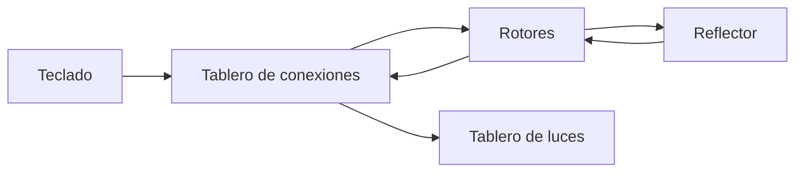
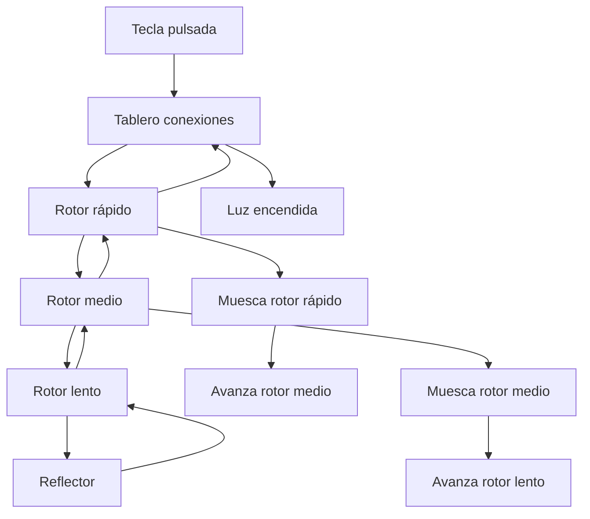
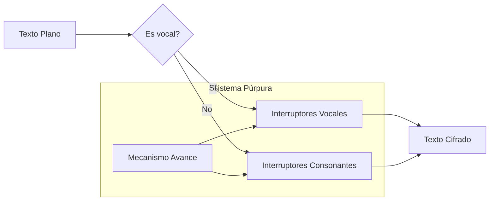

# Criptografía y Seguridad - Sistemas de cifrado clásicos, seguridad perfecta

## 2.6 Cifrados de rotor: Enigma y Púrpura.

---

Los cifrados de rotor representan la cúspide de la criptografía mecánica, siendo sistemas electromecánicos que proporcionaron seguridad avanzada durante la Segunda Guerra Mundial. Esta guía explora los principios matemáticos y operativos de las máquinas Enigma y Púrpura.

### Fundamentos de los Cifrados de Rotor

#### Concepto Básico

Un cifrado de rotor es un sistema de sustitución polialfabética donde la relación entre texto plano y cifrado cambia con cada carácter, implementado mediante rotores físicos que giran de manera similar a un odómetro.

**Principio matemático:** Cada rotor implementa una permutación fija $\pi_i$, y la rotación produce una transformación variable en el tiempo:

$$C_t = \rho_t(P_t)$$

Donde $\rho_t$ es la transformación compuesta en el tiempo $t$.

### Máquina Enigma

#### Historia y Contexto

Desarrollada por Arthur Scherbius en 1918, fue ampliamente utilizada por la Alemania Nazi. Su ruptura por los Aliados fue crucial para el desarrollo de la criptografía moderna.

#### Componentes Principales



#### Estructura Matemática

**Transformación de un carácter:**
$$E(x) = S^{-1} \left( R_3^{-1} \left( R_2^{-1} \left( R_1^{-1} \left( \Gamma \left( R_1 \left( R_2 \left( R_3 \left( S(x) \right) \right) \right) \right) \right) \right) \right) \right)$$

Donde:

- $S$: Sustitución del tablero de conexiones (Steckerbrett)
- $R_1, R_2, R_3$: Transformaciones de los rotores
- $\Gamma$: Transformación del reflector

#### Implementación de Enigma en Python

```python
class Rotor:
    def __init__(self, cableado, muesca=None):
        """
        Inicializa un rotor

        Args:
            cableado: String de 26 caracteres definiendo la permutación
            muesca: Posición donde causa rotación del siguiente rotor
        """
        self.cableado = cableado.upper()
        self.posicion = 0
        self.muesca = muesca
        # Crear mapeo inverso
        self.cableado_inverso = [''] * 26
        for i, char in enumerate(self.cableado):
            idx = ord(char) - ord('A')
            self.cableado_inverso[idx] = chr(ord('A') + i)

    def avanzar(self):
        """Avanza el rotor y retorna si debe avanzar el siguiente"""
        self.posicion = (self.posicion + 1) % 26
        return self.posicion == self.muesca

    def cifrar_adelante(self, char):
        """Cifra en dirección hacia el reflector"""
        idx = (ord(char) - ord('A') + self.posicion) % 26
        cifrado = self.cableado[idx]
        return chr((ord(cifrado) - ord('A') - self.posicion) % 26 + ord('A'))

    def cifrar_atras(self, char):
        """Cifra en dirección desde el reflector"""
        idx = (ord(char) - ord('A') + self.posicion) % 26
        cifrado = self.cableado_inverso[idx]
        return chr((ord(cifrado) - ord('A') - self.posicion) % 26 + ord('A'))

class Reflector:
    def __init__(self, cableado):
        self.cableado = cableado.upper()

    def reflejar(self, char):
        idx = ord(char) - ord('A')
        return self.cableado[idx]

class TableroConexiones:
    def __init__(self, conexiones=None):
        """
        Inicializa el tablero de conexiones

        Args:
            conexiones: Lista de pares de letras conectadas
        """
        self.mapeo = {}
        if conexiones:
            for a, b in conexiones:
                self.mapeo[a] = b
                self.mapeo[b] = a

    def conectar(self, char):
        """Aplica la conexión del tablero"""
        return self.mapeo.get(char, char)

class MaquinaEnigma:
    def __init__(self, rotores, reflector, tablero):
        self.rotores = rotores
        self.reflector = reflector
        self.tablero = tablero

    def avanzar_rotores(self):
        """Avanza los rotores en secuencia tipo odómetro"""
        # El rotor rápido siempre avanza
        avanza_siguiente = self.rotores[0].avanzar()

        # Rotor medio avanza si el rápido llega a su muesca
        if avanza_siguiente:
            avanza_tercero = self.rotores[1].avanzar()
            # Rotor lento avanza si el medio llega a su muesca (doble paso)
            if avanza_tercero:
                self.rotores[2].avanzar()

    def cifrar_caracter(self, char):
        """Cifra un solo carácter"""
        # Avanzar rotores antes de cifrar
        self.avanzar_rotores()

        # Aplicar tablero de conexiones
        char = self.tablero.conectar(char)

        # Camino de ida a través de los rotores
        for rotor in self.rotores:
            char = rotor.cifrar_adelante(char)

        # Reflexión
        char = self.reflector.reflejar(char)

        # Camino de vuelta a través de los rotores (en orden inverso)
        for rotor in reversed(self.rotores):
            char = rotor.cifrar_atras(char)

        # Aplicar tablero de conexiones nuevamente
        char = self.tablero.conectar(char)

        return char

    def cifrar_texto(self, texto):
        """Cifra texto completo"""
        resultado = []
        for char in texto.upper():
            if char.isalpha():
                resultado.append(self.cifrar_caracter(char))
            else:
                resultado.append(char)
        return ''.join(resultado)

# Configuración de Enigma histórica
# Rotor I: EKMFLGDQVZNTOWYHXUSPAIBRCJ, muesca en Q
# Rotor II: AJDKSIRUXBLHWTMCQGZNPYFVOE, muesca en E
# Rotor III: BDFHJLCPRTXVZNYEIWGAKMUSQO, muesca en V
# Reflector: YRUHQSLDPXNGOKMIEBFZCWVJAT

rotor_I = Rotor("EKMFLGDQVZNTOWYHXUSPAIBRCJ", ord('Q') - ord('A'))
rotor_II = Rotor("AJDKSIRUXBLHWTMCQGZNPYFVOE", ord('E') - ord('A'))
rotor_III = Rotor("BDFHJLCPRTXVZNYEIWGAKMUSQO", ord('V') - ord('A'))
reflector_B = Reflector("YRUHQSLDPXNGOKMIEBFZCWVJAT")
tablero = TableroConexiones([('A', 'B'), ('C', 'D')])  # Ejemplo de conexiones

# Crear máquina Enigma
enigma = MaquinaEnigma([rotor_I, rotor_II, rotor_III], reflector_B, tablero)

# Ejemplo de uso
print("=== MÁQUINA ENIGMA ===")
texto_plano = "HELLO WORLD"
print(f"Texto plano: {texto_plano}")

# Configurar posiciones iniciales
enigma.rotores[0].posicion = 0  # Rotor rápido
enigma.rotores[1].posicion = 0  # Rotor medio
enigma.rotores[2].posicion = 0  # Rotor lento

texto_cifrado = enigma.cifrar_texto(texto_plano)
print(f"Texto cifrado: {texto_cifrado}")

# Reconfigurar para descifrar (mismas posiciones iniciales)
enigma.rotores[0].posicion = 0
enigma.rotores[1].posicion = 0
enigma.rotores[2].posicion = 0

texto_descifrado = enigma.cifrar_texto(texto_cifrado)
print(f"Texto descifrado: {texto_descifrado}")
```

### Máquina Púrpura (Japanese PURPLE)

#### Contexto Histórico

Desarrollada por la Armada Imperial Japonesa, fue rota por el equipo de William Friedman en los Estados Unidos. Utilizaba interruptores telefónicos en lugar de rotores.

#### Diseño Técnico

**Características únicas:**

- Separaba vocales (A, E, I, O, U) y consonantes
- Usaba interruptores de pasos (stepping switches)
- Implementaba una máquina de estados más compleja

#### Implementación de Púrpura

```python
class InterruptorPasos:
    def __init__(self, cableado_vocal, cableado_consonante):
        """
        Simula un interruptor de pasos de Púrpura

        Args:
            cableado_vocal: Permutación para vocales (A,E,I,O,U)
            cableado_consonante: Permutación para consonantes
        """
        self.cableado_vocal = cableado_vocal
        self.cableado_consonante = cableado_consonante
        self.paso_actual = 0

    def avanzar(self):
        """Avanza el interruptor"""
        self.paso_actual = (self.paso_actual + 1) % 25

    def cifrar(self, char, es_vocal):
        """Cifra un carácter según el tipo"""
        if es_vocal:
            idx = "AEIOU".index(char)
            cifrado = self.cableado_vocal[self.paso_actual][idx]
            return cifrado
        else:
            idx = "BCDFGHJKLMNPQRSTVWXYZ".index(char)
            cifrado = self.cableado_consonante[self.paso_actual][idx]
            return cifrado

class MaquinaPurpura:
    def __init__(self):
        # Configuración simplificada de Púrpura
        # En la realidad usaba 4 interruptores para vocales y 6 para consonantes

        # Generar cableados pseudoaleatorios para ejemplo
        self.interruptor_vocal = InterruptorPasos(
            self.generar_permutaciones(5, 25),
            self.generar_permutaciones(5, 25)
        )

        self.interruptor_consonante = InterruptorPasos(
            self.generar_permutaciones(21, 25),
            self.generar_permutaciones(21, 25)
        )

    def generar_permutaciones(self, tam_alfabeto, num_permutaciones):
        """Genera permutaciones para los interruptores"""
        permutaciones = []
        for _ in range(num_permutaciones):
            alfabeto = list(range(tam_alfabeto))
            # Mezclar para crear permutación
            import random
            random.shuffle(alfabeto)
            permutaciones.append(alfabeto)
        return permutaciones

    def es_vocal(self, char):
        """Determina si un carácter es vocal"""
        return char in 'AEIOU'

    def cifrar_caracter(self, char):
        """Cifra un carácter con Púrpura"""
        if self.es_vocal(char):
            cifrado_idx = self.interruptor_vocal.cifrar(char, True)
            return 'AEIOU'[cifrado_idx]
        else:
            cifrado_idx = self.interruptor_consonante.cifrar(char, False)
            return 'BCDFGHJKLMNPQRSTVWXYZ'[cifrado_idx]

    def avanzar_maquina(self):
        """Avanza los interruptores según el algoritmo de Púrpura"""
        self.interruptor_vocal.avanzar()
        self.interruptor_consonante.avanzar()

    def cifrar_texto(self, texto):
        """Cifra texto completo"""
        resultado = []
        for char in texto.upper():
            if char.isalpha():
                resultado.append(self.cifrar_caracter(char))
                self.avanzar_maquina()
            else:
                resultado.append(char)
        return ''.join(resultado)

# Ejemplo de Púrpura
print("\n=== MÁQUINA PÚRPURA (SIMPLIFICADA) ===")
purpura = MaquinaPurpura()
texto_plano_purpura = "SECRET MESSAGE"
texto_cifrado_purpura = purpura.cifrar_texto(texto_plano_purpura)

print(f"Texto plano: {texto_plano_purpura}")
print(f"Texto cifrado: {texto_cifrado_purpura}")
```

### Análisis Criptográfico

#### Fortalezas de los Cifrados de Rotor

**Para Enigma:**

- Período largo: $26^3 = 17,576$ posiciones de rotores
- Gran espacio de claves: $\approx 10^{16}$ combinaciones posibles
- Propiedad de involución: $E(E(x)) = x$

**Para Púrpura:**

- Separación vocal/consonante complicaba el análisis
- Mecanismo de avance complejo
- Diseño único con interruptores

#### Debilidades y Ataques

```python
class AtaqueEnigma:
    def __init__(self):
        self.connones = self.cargar_connones()

    def cargar_connones(self):
        """Carga frases comunes (connones) para ataques"""
        return [
            "HEILHITLER",
            "OBERKOMMANDODERWEHRMACHT",
            "EINS",
            "ZWEI",
            "DREI",
            "WETTERBERICHT"
        ]

    def ataque_connon(self, texto_cifrado, connon):
        """
        Ataque usando texto plano conocido
        Basado en el método usado por los criptoanalistas aliados
        """
        posibles_configuraciones = []

        # Probar diferentes posiciones iniciales
        for pos_rapido in range(26):
            for pos_medio in range(26):
                for pos_lento in range(26):
                    # Crear Enigma con configuración de prueba
                    rotor_I = Rotor("EKMFLGDQVZNTOWYHXUSPAIBRCJ", ord('Q') - ord('A'))
                    rotor_II = Rotor("AJDKSIRUXBLHWTMCQGZNPYFVOE", ord('E') - ord('A'))
                    rotor_III = Rotor("BDFHJLCPRTXVZNYEIWGAKMUSQO", ord('V') - ord('A'))
                    reflector_B = Reflector("YRUHQSLDPXNGOKMIEBFZCWVJAT")
                    tablero = TableroConexiones()

                    enigma = MaquinaEnigma([rotor_I, rotor_II, rotor_III], reflector_B, tablero)
                    enigma.rotores[0].posicion = pos_rapido
                    enigma.rotores[1].posicion = pos_medio
                    enigma.rotores[2].posicion = pos_lento

                    # Intentar descifrar el connon
                    try:
                        descifrado = enigma.cifrar_texto(texto_cifrado[:len(connon)])
                        if descifrado == connon:
                            posibles_configuraciones.append((pos_rapido, pos_medio, pos_lento))
                    except:
                        continue

        return posibles_configuraciones

    def analizar_frecuencias(self, texto_cifrado):
        """Análisis de frecuencias para detectar patrones"""
        from collections import Counter
        frecuencias = Counter(texto_cifrado)
        return frecuencias.most_common(10)

# Ejemplo de ataque
print("\n=== ANÁLISIS CRIPTOGRÁFICO ===")
ataque = AtaqueEnigma()

# Simular cifrado de un mensaje
rotor_I = Rotor("EKMFLGDQVZNTOWYHXUSPAIBRCJ", ord('Q') - ord('A'))
rotor_II = Rotor("AJDKSIRUXBLHWTMCQGZNPYFVOE", ord('E') - ord('A'))
rotor_III = Rotor("BDFHJLCPRTXVZNYEIWGAKMUSQO", ord('V') - ord('A'))
reflector_B = Reflector("YRUHQSLDPXNGOKMIEBFZCWVJAT")
tablero = TableroConexiones()

enigma_ejemplo = MaquinaEnigma([rotor_I, rotor_II, rotor_III], reflector_B, tablero)
enigma_ejemplo.rotores[0].posicion = 5
enigma_ejemplo.rotores[1].posicion = 10
enigma_ejemplo.rotores[2].posicion = 15

mensaje_secreto = "HEILHITLER WAFFENSTILLSTAND"
cifrado_ejemplo = enigma_ejemplo.cifrar_texto(mensaje_secreto)

print(f"Mensaje original: {mensaje_secreto}")
print(f"Texto cifrado: {cifrado_ejemplo}")

# Análisis de frecuencias
frecuencias = ataque.analizar_frecuencias(cifrado_ejemplo)
print(f"Frecuencias más comunes: {frecuencias}")
```

### Comparativa Enigma vs Púrpura

```python
class AnalisisComparativo:
    def __init__(self):
        self.resultados = {}

    def analizar_complejidad(self):
        """Analiza la complejidad criptográfica de ambos sistemas"""

        # Espacio de claves teórico
        complejidad_enigma = {
            'disposicion_rotores': 60,  # 5 choose 3 × 3!
            'posiciones_rotores': 26 ** 3,
            'posiciones_anillo': 26 ** 3,
            'conexiones_tablero': 150e9,  # 10 conexiones de 26 letras
            'total_teorico': '~ 10^16'
        }

        complejidad_purpura = {
            'interruptores_vocales': 25 ** 4,  # 4 interruptores, 25 posiciones
            'interruptores_consonantes': 25 ** 6,
            'cableados': 'Variable',
            'total_teorico': '~ 10^20'
        }

        return {
            'Enigma': complejidad_enigma,
            'Purpura': complejidad_purpura
        }

    def comparar_vulnerabilidades(self):
        """Compara vulnerabilidades conocidas"""
        vulnerabilidades = {
            'Enigma': [
                'Propiedad de involución (A → B implica B → A)',
                'Ninguna letra se cifra a sí misma',
                'Mensajes con patrones conocidos (connones)',
                'Error humano en procedimientos'
            ],
            'Purpura': [
                'Separación vocal/consonante predecible',
                'Patrones en avance de interruptores',
                'Análisis de tráfico',
                'Mensajes diplomáticos con estructura conocida'
            ]
        }
        return vulnerabilidades

# Análisis comparativo
print("\n=== ANÁLISIS COMPARATIVO ===")
comparador = AnalisisComparativo()

complejidad = comparador.analizar_complejidad()
vulnerabilidades = comparador.comparar_vulnerabilidades()

print("COMPLEJIDAD DE CLAVES:")
for maquina, datos in complejidad.items():
    print(f"\n{maquina}:")
    for key, value in datos.items():
        print(f"  {key}: {value}")

print("\nVULNERABILIDADES PRINCIPALES:")
for maquina, vulns in vulnerabilidades.items():
    print(f"\n{maquina}:")
    for vuln in vulns:
        print(f"  • {vuln}")
```

### Ejercicios Propuestos

#### Ejercicio 1: Implementación Enigma

Complete la implementación de Enigma para incluir:
a) Anillos de posición (Ringstellung)
b) Selección de rotores (Walzenlage)
c) Múltiples reflectores

#### Ejercicio 2: Análisis Matemático

Para una máquina Enigma de 3 rotores:
a) Calcule el período exacto considerando muescas
b) Demuestre la propiedad $E(E(x)) = x$
c) Analice el espacio de claves completo

#### Ejercicio 3: Ataque de Texto Plano Conocido

Implemente un ataque que, dado un texto cifrado y un connon conocido:
a) Encuentre las posiciones iniciales de los rotores
b) Verifique las conexiones del tablero
c) Recupere el mensaje completo

#### Ejercicio 4: Simulación Púrpura

Extienda la implementación de Púrpura para:
a) Usar 4 interruptores para vocales y 6 para consonantes
b) Implementar el algoritmo real de avance
c) Simular el proceso de descifrado

#### Ejercicio 5: Análisis Histórico

Investigue y analice:
a) El papel de Alan Turing en la ruptura de Enigma
b) El equipo de William Friedman y Púrpura
c) El impacto en el curso de la Segunda Guerra Mundial

### Diagramas de Funcionamiento





### Referencias Bibliográficas

#### Bibliografía Básica

1. **Stallings, William** (2010). _Cryptography and Network Security: Principles and Practice_, 5a Ed., Prentice Hall.
   - Capítulo 2: Cifrados clásicos
   - Sección 2.5: Máquinas de cifrado

2. **Forouzan, Behrouz A.** (2008). _Cryptography and Network Security_, McGraw Hill.
   - Capítulo 3: Cifrados clásicos
   - Sección 3.5: Sistemas de rotor

3. **Pfleeger, Charles P. y Shari L. Pfleeger** (2006). _Security in Computing_, 4a Ed., Prentice Hall.
   - Capítulo 2: Técnicas criptográficas históricas

#### Bibliografía Complementaria

1. **Stallings, William** (2010). _Network Security Essentials: Applications and Standards_, 4a Ed., Prentice Hall.

2. **Ferguson, Niels, Bruce Schneier y Tadayoshi Kohno** (2010). _Cryptography Engineering: Design Principles and Practical Applications_, Wiley.
   - Capítulo 5: Criptoanálisis histórico

3. **Singh, Simon** (1999). _The Code Book_ - Explicación accesible de Enigma
4. **Kahn, David** (1967). _The Codebreakers_ - Historia completa de la criptografía
5. **Hodges, Andrew** (1983). _Alan Turing: The Enigma_ - Biografía detallada

### Impacto Histórico y Legado

#### Contribuciones a la Criptografía Moderna

1. **Concepto de seguridad por diseño**: Enigma demostró la importancia del diseño seguro
2. **Importancia de los procedimientos**: Los errores humanos fueron explotados
3. **Desarrollo de computación**: La ruptura impulsó el desarrollo de computadoras
4. **Criptoanálisis sistemático**: Estableció metodologías para análisis de sistemas

#### Lecciones Aprendidas

- **Ningún sistema es invulnerable**: Ambos sistemas fueron rotos
- **La seguridad es un proceso**: Requiere actualización constante
- **Importancia del factor humano**: Los procedimientos son cruciales
- **Valor del análisis matemático**: Fundamentó la criptografía moderna

Los cifrados de rotor representan el puente entre la criptografía mecánica y la digital moderna, y su estudio proporciona insights fundamentales sobre el diseño y análisis de sistemas criptográficos.
