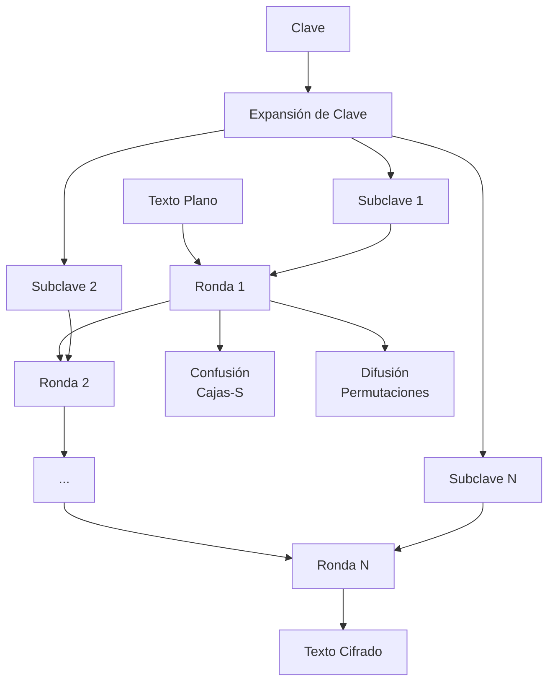
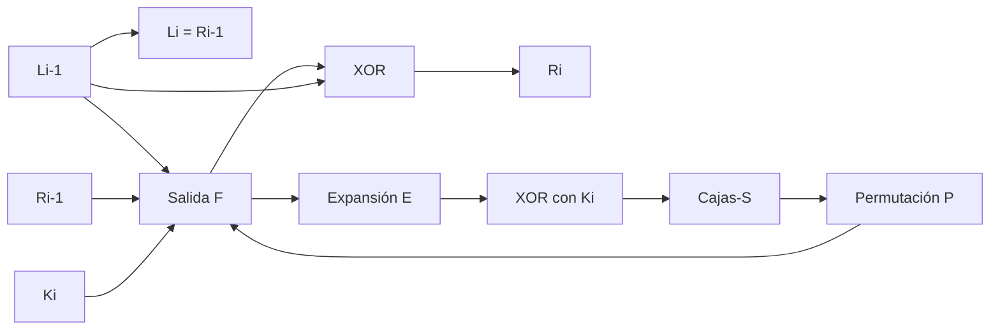

# Criptografía y Seguridad - Redes de Feistel, cifrado de bloques, DES y AES

## 3.1 Cifrado y teoría de la información: confusión y difusión.

---

Este tema se centra en dos principios fundamentales en el diseño de cifrados de bloque modernos, introducidos por Claude Shannon en su trabajo seminal "Communication Theory of Secrecy Systems" (1949). Estos principios son la **confusión** y la **difusión**, que buscan frustrar los intentos de criptoanálisis basados en análisis estadístico.

### Definición de Conceptos Fundamentales

#### Confusión

**Definición:** Operación que busca ocultar la relación entre la clave y el texto cifrado. Hace que la dependencia del cifrado respecto a la clave sea lo más compleja y no lineal posible.

**Objetivo:**

- Hacer imposible deducir la clave a partir del texto cifrado, incluso cuando se conoce una cantidad significativa de pares texto plano-texto cifrado.
- Implementada típicamente mediante **sustituciones no lineales** (cajas-S).

#### Difusión

**Definición:** Operación que busca dispersar la influencia de cada bit del texto plano sobre muchos bits del texto cifrado, y de cada bit de la clave sobre muchos bits del texto cifrado.

**Objetivo:**

- Diluir la estructura estadística del texto plano en el texto cifrado.
- Implementada típicamente mediante **permutaciones y transposiciones**.

### Representación Matemática

#### Teoría de la Información y Entropía

La seguridad de un cifrado puede analizarse mediante conceptos de teoría de la información:

**Entropía de Shannon:**

$$ H(X) = -\sum_{i=1}^{n} P(x_i) \log_2 P(x_i) $$

Donde:

- $H(X)$ es la entropía de la variable aleatoria $X$
- $P(x_i)$ es la probabilidad del símbolo $x_i$

**Entropía condicional** (equivocación):

$$ H(K|C) = -\sum_{c \in C} P(c) \sum_{k \in K} P(k|c) \log_2 P(k|c) $$

Donde:

- $H(K|C)$ es la cantidad de incertidumbre sobre la clave $K$ dado el texto cifrado $C$

#### Medida de Difusión y Confusión

**Difusión:** Para un cifrado ideal, cambiar un bit del texto plano debería afectar aproximadamente la mitad de los bits del texto cifrado:

$$ E \left[ \frac{ \# bits\ cambiados\ en\ C}{n} \right] \approx 0.5 $$

donde $n$ es el tamaño del bloque.

**Confusión:** La dependencia entre clave y texto cifrado debería ser compleja:

$$ I(K;C) = H(K) - H(K|C) \approx 0 $$

donde $I(K;C)$ es la información mutua entre la clave y el texto cifrado.

### Implementación en Algoritmos de Cifrado

#### Diagrama de Proceso General



#### En Redes de Feistel

La estructura de Feistel implementa ambos principios:

**Fórmula general de una ronda de Feistel:**

$$ L_i = R_{i-1} $$

$$ R_i = L_{i-1} \oplus F(R_{i-1}, K_i) $$

Donde:

- $L_i, R_i$: mitades izquierda y derecha en la ronda $i$
- $K_i$: subclave para la ronda $i$
- $F$: función de ronda que incorpora confusión y difusión

**Ejemplo de función F con confusión y difusión:**

```python
def funcion_F(derecha, subclave):
    # Expansión (difusión)
    expandido = expansion(derecha)

    # XOR con subclave
    mezclado = expandido ^ subclave

    # Sustitución (confusión)
    sustituido = s_box(mezclado)

    # Permutación (difusión)
    permutado = permutacion(sustituido)

    return permutado
```

#### En DES (Data Encryption Standard)

DES implementa confusión y difusión mediante:

**Confusión:** 8 cajas-S no lineales de 6 bits a 4 bits

**Ejemplo de caja-S del DES (S1):**

```
14, 4, 13, 1, 2, 15, 11, 8, 3, 10, 6, 12, 5, 9, 0, 7,
0, 15, 7, 4, 14, 2, 13, 1, 10, 6, 12, 11, 9, 5, 3, 8,
4, 1, 14, 8, 13, 6, 2, 11, 15, 12, 9, 7, 3, 10, 5, 0,
15, 12, 8, 2, 4, 9, 1, 7, 5, 11, 3, 14, 10, 0, 6, 13
```

**Difusión:** Permutación P después de las cajas-S

**Diagrama de una ronda DES:**



#### En AES (Advanced Encryption Standard)

AES implementa confusión y difusión de manera más eficiente:

**Estructura de una ronda AES (excepto la última):**

1. **SubBytes** - Confusión (sustitución no lineal)
2. **ShiftRows** - Difusión (permutación)
3. **MixColumns** - Difusión (transformación lineal)
4. **AddRoundKey** - Mezcla con clave

**Transformación SubBytes (Confusión):**
Cada byte $a$ es transformado mediante:

$$ b = S(a) = M \cdot a^{-1} + c $$

Donde $a^{-1}$ es el inverso en $GF(2^8)$, $M$ es una matriz de transformación afín, y $c$ es una constante.

**Transformación MixColumns (Difusión):**
Cada columna es tratada como polinomio en $GF(2^8)$ y multiplicada por:

$$ c(x) = 03x^3 + 01x^2 + 01x + 02 $$

**Implementación en Python de una ronda AES:**

```python
def aes_round(state, round_key):
    # Confusión
    state = sub_bytes(state)

    # Difusión - Paso 1
    state = shift_rows(state)

    # Difusión - Paso 2
    state = mix_columns(state)

    # Mezcla con clave
    state = add_round_key(state, round_key)

    return state

def sub_bytes(state):
    """Aplica S-box a cada byte del estado (confusión)"""
    for i in range(4):
        for j in range(4):
            state[i][j] = s_box[state[i][j]]
    return state

def shift_rows(state):
    """Desplaza filas del estado (difusión)"""
    for i in range(1, 4):
        state[i] = state[i][i:] + state[i][:i]
    return state
```

### Análisis Comparativo

| Característica    | DES                            | AES                                               |
| ----------------- | ------------------------------ | ------------------------------------------------- |
| **Confusión**     | Cajas-S (6→4 bits)             | S-box (8→8 bits) basada en inverso en GF(2⁸)      |
| **Difusión**      | Permutación P después de S-box | ShiftRows + MixColumns                            |
| **Efectividad**   | Limitada (bloque 64 bits)      | Alta (bloque 128 bits)                            |
| **No linealidad** | Mediante S-box                 | Transformación afín sobre inverso en campo finito |

### Ejercicios Propuestos

#### Ejercicio 1: Análisis de Difusión

Dado un cifrado de bloque de 8 bits, si cambiamos 1 bit en el texto plano:

- a) ¿Cuántos bits cambiarían en promedio en el texto cifrado si el cifrado tiene buena difusión?
- b) Si solo cambian 2 bits, ¿qué implica sobre la difusión?

**Solución esperada:**
a) En un cifrado con buena difusión, aproximadamente 4 bits (la mitad).
b) Implica que la difusión es pobre y el cifrado puede ser vulnerable a análisis diferencial.

#### Ejercicio 2: Implementación de Principios

Diseñe una función F para una ronda de Feistel de 32 bits que implemente:

1. Una etapa de confusión usando una S-box de 4 bits
2. Una etapa de difusión mediante una permutación

#### Ejercicio 3: Cálculo de Entropía

Dado un texto plano con distribución: P(A)=0.5, P(B)=0.25, P(C)=0.25

- Calcule la entropía H(P) del texto plano
- Si el cifrado es ideal, ¿cuál debería ser la entropía H(C) del texto cifrado?

**Solución:**

$$ H(P) = -(0.5\log_2 0.5 + 0.25\log_2 0.25 + 0.25\log_2 0.25) = 1.5\ bits $$

Para un cifrado ideal, $H(C)$ debería ser máxima (todos los símbolos equiprobables).

### Casos de Estudio

#### 1. Ataque por Análisis Diferencial

Un cifrado con pobre difusión es vulnerable al análisis diferencial. Si cambiar ΔP bits en el plano produce ΔC bits en el cifrado con probabilidad alta, se puede explotar esta característica.

#### 2. Ataque por Análisis Lineal

Un cifrado con pobre confusión puede ser vulnerable al análisis lineal, que busca aproximaciones lineales entre texto plano, texto cifrado y clave.

### Referencias y Bibliografía

#### Según Bibliografía Básica:

**Stallings (2010):**

- Capítulo 3: "Block Ciphers and the Data Encryption Standard"
- Sección 3.2: "The Data Encryption Standard" (págs. 71-85)
- Sección 4.1: "Finite Field Arithmetic" (para AES)

**Forouzan (2008):**

- Capítulo 6: "Block Ciphers"
- Sección 6.1: "Modern Block Ciphers" (principios de confusión y difusión)

#### Bibliografía Complementaria:

**Ferguson, Schneier y Kohno (2010):**

- Capítulo 4: "Block Ciphers"
- Análisis detallado de implementación de principios de Shannon

**Menezes et al. (1996):**

- Capítulo 7: "Block Ciphers"
- Tratamiento matemático formal de confusión y difusión

### Recursos Adicionales

#### Simuladores Recomendados:

1. **Cryptool**: Herramienta educativa para visualizar confusión y difusión
2. **DES Visualizer**: Simulador web de las rondas DES
3. **AES Animation**: Animación del proceso AES

#### Lecturas Recomendadas:

1. Shannon, C. E. (1949). "Communication Theory of Secrecy Systems"
2. National Institute of Standards and Technology. (2001). "Advanced Encryption Standard (AES)" (FIPS PUB 197)

### Evaluación de Comprensión

#### Preguntas Conceptuales:

1. ¿Por qué la confusión por sí sola no es suficiente para un cifrado seguro?
2. ¿Cómo contribuye MixColumns en AES a la difusión?
3. ¿Por qué las S-box deben ser no lineales?

#### Problemas Avanzados:

1. Demuestre que cambiar 1 bit en una columna del estado AES afecta todas las columnas después de 2 rondas.
2. Analice cómo el número de rondas afecta la confusión y difusión en DES vs AES.
