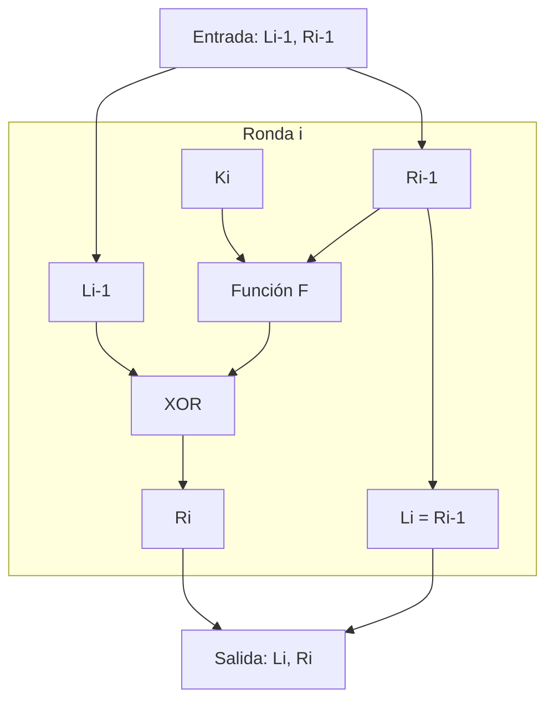
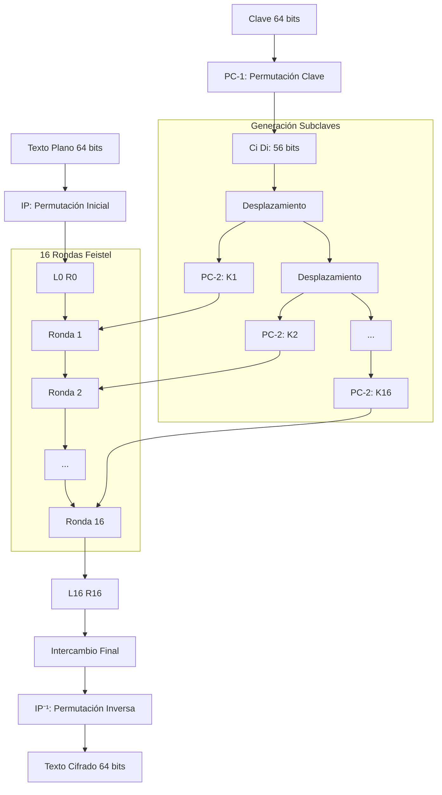

# Criptografía y Seguridad - Redes de Feistel, cifrado de bloques, DES y AES

## 3.2 Redes de Feistel. Lucifer y DES.

---

### Introducción Histórica

Las redes de Feistel representan una estructura fundamental en el diseño de cifrados de bloque. Esta guía explora el desarrollo desde Lucifer, el primer cifrado de bloque comercial, hasta DES (Data Encryption Standard), el estándar que dominó la criptografía durante décadas.

### Conceptos Fundamentales

#### Red de Feistel

**Definición:** Estructura de cifrado simétrico que divide el bloque de datos en dos mitades y procesa múltiples rondas de transformaciones. Debe su nombre a Horst Feistel, quien trabajó en el proyecto Lucifer en IBM.

**Propiedad clave:** La estructura es invertible independientemente de la función F utilizada en cada ronda.

### Estructura Matemática de una Red de Feistel

#### Fórmulas Generales

Para una red de Feistel con $n$ rondas:

**Proceso de cifrado ( ronda $i$ ):**

$$
L_i = R_{i-1}
$$

$$
R_i = L_{i-1} \oplus F(R_{i-1}, K_i)
$$

**Proceso de descifrado ( ronda $i$ ):**

$$
R_{i-1} = L_i
$$

$$
L_{i-1} = R_i \oplus F(R_{i-1}, K_i) = R_i \oplus F(L_i, K_i)
$$

Donde:

- $L_i, R_i$: mitades izquierda y derecha (típicamente 32 bits cada una para bloque de 64 bits)
- $K_i$: subclave para la ronda $i$
- $F$: función de ronda
- $\oplus$: operación XOR

#### Diagrama de una Ronda de Feistel



### Lucifer: El Precursor

#### Contexto Histórico

Desarrollado por IBM a finales de los 60s bajo la dirección de Horst Feistel. Lucifer fue el primer cifrado de bloque comercial y sentó las bases para DES.

#### Características Técnicas de Lucifer

**Parámetros clave:**

- Tamaño de bloque: 128 bits (versión original)
- Tamaño de clave: 128 bits
- Número de rondas: 16
- Estructura: Red de Feistel

**Función F de Lucifer:**

1. **Expansión:** Los 64 bits de entrada se expandían
2. **XOR con subclave:** Mezcla con 64 bits de clave
3. **Sustitución:** Dos cajas-S no lineales de 4×4 bits
4. **Permutación:** Reorganización de bits

**Código conceptual de la función F de Lucifer:**

```python
def funcion_f_lucifer(derecha, subclave):
    # Entrada: 64 bits, Salida: 64 bits

    # 1. Expansión (simplificada)
    expandido = expansion_permutacion(derecha)

    # 2. XOR con subclave
    mezclado = expandido ^ subclave

    # 3. Sustitución con S-boxes
    # Lucifer usaba S-boxes de 4 bits
    sustituido = 0
    for i in range(0, 64, 4):
        nibble = (mezclado >> i) & 0xF
        nibble_sust = s_box_lucifer(nibble)
        sustituido |= (nibble_sust << i)

    # 4. Permutación de bits
    permutado = permutacion_lucifer(sustituido)

    return permutado

def s_box_lucifer(nibble):
    # S-box no lineal de 4 bits
    sbox = [8, 4, 13, 1, 2, 14, 15, 11, 3, 5, 0, 9, 10, 12, 6, 7]
    return sbox[nibble]
```

### Transición a DES

#### Contexto del Desarrollo

En 1973, el NBS (ahora NIST) solicitó propuestas para un estándar de cifrado. IBM adaptó Lucifer para crear lo que se convertiría en DES.

#### Cambios Principales de Lucifer a DES

| Característica     | Lucifer       | DES                          |
| ------------------ | ------------- | ---------------------------- |
| **Tamaño bloque**  | 128 bits      | 64 bits                      |
| **Tamaño clave**   | 128 bits      | 56 bits (+8 paridad)         |
| **Rondas**         | 16            | 16                           |
| **S-boxes**        | 2 de 4×4 bits | 8 de 6×4 bits                |
| **Diseño público** | No            | Sí (excepto criterios S-box) |

### DES (Data Encryption Standard)

#### Estructura General

DES opera sobre bloques de 64 bits usando una clave de 56 bits efectivos.

**Algoritmo completo:**

1. **Permutación Inicial (IP):** Reordena los 64 bits de entrada
2. **16 Rondas Feistel:** Procesamiento principal
3. **Permutación Final (IP⁻¹):** Inversa de IP

#### Esquema Detallado de DES



#### Función F de DES

La función F es el corazón de cada ronda:

```python
def funcion_f_des(derecha, subclave):
    """
    Implementación de la función F de DES
    Entrada: 32 bits (derecha), 48 bits (subclave)
    Salida: 32 bits
    """
    # 1. Expansión E: 32 bits → 48 bits
    expandido = expansion_e(derecha)

    # 2. XOR con subclave
    xor_result = expandido ^ subclave

    # 3. Sustitución S-box: 48 bits → 32 bits
    sbox_output = 0
    for i in range(8):
        # Extraer 6 bits para cada S-box
        bits6 = (xor_result >> (42 - i*6)) & 0x3F

        # Calcular fila y columna
        fila = ((bits6 & 0x20) >> 4) | (bits6 & 0x01)
        columna = (bits6 >> 1) & 0x0F

        # Aplicar S-box i
        valor_sbox = S_BOXES[i][fila][columna]

        # Agregar al resultado (4 bits)
        sbox_output |= (valor_sbox << (28 - i*4))

    # 4. Permutación P: 32 bits → 32 bits
    permutado = permutacion_p(sbox_output)

    return permutado

# Tabla de expansión E (simplificada)
E_TABLE = [
    31, 0, 1, 2, 3, 4,
    3, 4, 5, 6, 7, 8,
    # ... continuación de la tabla real
]

def expansion_e(derecha):
    resultado = 0
    for i in range(48):
        bit_pos = E_TABLE[i]
        bit = (derecha >> (31 - bit_pos)) & 0x1
        resultado |= (bit << (47 - i))
    return resultado
```

#### Generación de Subclaves en DES

**Proceso matemático:**

1. **Permutación PC-1:** Elimina bits de paridad

   $$K_{56} = PC1(K_{64})$$

2. **Dividir en mitades:**

   $$C_0 = K_{56}[0:27], D_0 = K_{56}[28:55]$$

3. **Desplazamientos cíclicos:** Dependiendo de la ronda

   $$C_i = C_{i-1} \lll s_i, \quad D_i = D_{i-1} \lll s_i$$

   donde $s_i = 1$ para rondas 1, 2, 9, 16; $s_i = 2$ para otras

4. **Permutación PC-2:** Selecciona 48 bits

   $$K_i = PC2(C_i || D_i)$$

**Tabla de desplazamientos:**

```python
DES_SHIFTS = [1, 1, 2, 2, 2, 2, 2, 2, 1, 2, 2, 2, 2, 2, 2, 1]
```

### Comparación Detallada: Lucifer vs DES

#### Análisis de Seguridad

**Fortalezas de DES sobre Lucifer:**

1. **S-boxes más complejas:** 8 S-boxes de 6×4 bits vs 2 de 4×4 bits
2. **Mayor no linealidad:** Diseño cuidadoso para resistir análisis diferencial y lineal
3. **Mejor difusión:** Permutación P optimizada

**Debilidades introducidas en DES:**

1. **Clave más corta:** 56 bits vs 128 bits (vulnerable a búsqueda exhaustiva)
2. **Tamaño de bloque reducido:** 64 bits vs 128 bits (riesgo de colisiones)

#### Ejemplo: Una Ronda Completa

**Cifrado DES - Ronda 1:**

```
Texto plano: 0123456789ABCDEF (hex)
Clave: 133457799BBCDFF1 (hex)

Paso 1: Permutación inicial (IP)
Entrada: 0000 0001 0010 0011 ... 1110 1111
IP: 1100 1100 0000 0000 ... 1111 0000 1010 1010

Paso 2: Dividir en L0 y R0
L0 = 1100 1100 0000 0000 1100 1100 1111 1111
R0 = 1111 0000 1010 1010 1111 0000 1010 1010

Paso 3: Generar K1 (subclave ronda 1)
K1 = 000110 110000 001011 101111 111111 000111 000001 110010

Paso 4: Aplicar función F
E(R0) = 011110 100001 010101 010101 011110 100001 010101 010101
E(R0) XOR K1 = 011000 010001 011110 111010 100001 100110 010100 100111
S-box output = 0101 1100 1000 0010 1011 0101 1001 0111
P(SA) = 0010 0011 0100 1010 1010 1001 1011 1011

Paso 5: Calcular R1
R1 = L0 XOR f(R0, K1) = 1110 1111 0100 1010 0110 0101 0100 0100
L1 = R0 = 1111 0000 1010 1010 1111 0000 1010 1010
```

### Ejercicios Propuestos

#### Ejercicio 1: Implementación de Ronda Feistel

Implemente una ronda de Feistel simplificada con:

- Bloque: 8 bits (4+4)
- Función F: XOR con clave de 4 bits
- Clave: 1010 (binario)

**Datos de prueba:**

```
Texto: 0110 1101 (L=0110, R=1101)
Clave: 1010
```

**Solución esperada:**

```
L1 = R0 = 1101
R1 = L0 XOR (R0 XOR K) = 0110 XOR (1101 XOR 1010) = 0110 XOR 0111 = 0001
```

#### Ejercicio 2: Análisis de Debilidades

Analice por qué la reducción de 128 a 56 bits en la clave de DES representó un riesgo. Calcule:

- Número de claves posibles en Lucifer vs DES
- Tiempo de búsqueda exhaustiva asumiendo 1 millón de pruebas/segundo

**Solución:**

```
Lucifer: 2^128 ≈ 3.4 × 10^38 claves
DES: 2^56 ≈ 7.2 × 10^16 claves

Tiempo búsqueda exhaustiva DES:
(7.2 × 10^16) / (1 × 10^6) = 7.2 × 10^10 segundos
≈ 2,285 años
```

#### Ejercicio 3: S-box de DES

Dada la S-box S1 de DES:

```
14, 4, 13, 1, 2, 15, 11, 8, 3, 10, 6, 12, 5, 9, 0, 7,
0, 15, 7, 4, 14, 2, 13, 1, 10, 6, 12, 11, 9, 5, 3, 8,
4, 1, 14, 8, 13, 6, 2, 11, 15, 12, 9, 7, 3, 10, 5, 0,
15, 12, 8, 2, 4, 9, 1, 7, 5, 11, 3, 14, 10, 0, 6, 13
```

Calcule la salida para entrada:

- Bits: 101010 (binario) = 42 (decimal)
  ¿Cuál es el valor de salida en binario?

#### Ejercicio 4: Generación de Subclaves

Dada la clave hexadecimal: `0x133457799BBCDFF1`

- Aplique PC-1 para obtener C0 y D0
- Calcule C1 y D1 después del desplazamiento
- Aplique PC-2 para obtener K1

### Aspectos de Seguridad y Vulnerabilidades

#### Debilidades Conocidas de DES

1. **Clave corta (56 bits):** Vulnerable a ataque por fuerza bruta
2. **Complemetariedad:** Si $DES_K(P) = C$, entonces $DES_{\overline{K}}(\overline{P}) = \overline{C}$
3. **Claves débiles:** 4 claves donde todas las subclaves son iguales
4. **Claves semi-débiles:** 12 pares de claves donde $DES_{K1}(DES_{K2}(P)) = P$

#### Ataques Desarrollados

**Evolución temporal:**

- 1977: Diffie y Hellman estiman máquina para romper DES por $20M
- 1993: Primer ataque teórico con criptoanálisis diferencial
- 1998: EFF construye Deep Crack ($250,000, 56 horas)
- 2006: COPACOBANA ($10,000, 9 días)

### Implementación Práctica

#### Código Completo Simplificado de DES

```python
class DESSimplificado:
    def __init__(self, clave):
        self.clave = clave
        self.subclaves = self.generar_subclaves()

    def generar_subclaves(self):
        # PC-1 (permutación de clave inicial)
        pc1 = [
            56, 48, 40, 32, 24, 16, 8,
            0, 57, 49, 41, 33, 25, 17,
            # ... tabla completa PC-1
        ]

        # Aplicar PC-1
        clave_56 = self.aplicar_permutacion(self.clave, pc1, 64)

        # Dividir en C0 y D0 (28 bits cada uno)
        C = clave_56 >> 28
        D = clave_56 & 0xFFFFFFF

        subclaves = []
        for ronda in range(16):
            # Desplazar según tabla
            shift = 1 if ronda in [0, 1, 8, 15] else 2

            C = ((C << shift) | (C >> (28 - shift))) & 0xFFFFFFF
            D = ((D << shift) | (D >> (28 - shift))) & 0xFFFFFFF

            # Combinar y aplicar PC-2
            CD = (C << 28) | D
            subclave = self.aplicar_permutacion(CD, PC2_TABLE, 56)
            subclaves.append(subclave)

        return subclaves

    def cifrar_ronda(self, bloque, ronda):
        L = bloque >> 32
        R = bloque & 0xFFFFFFFF

        # Función F
        f_result = self.funcion_f(R, self.subclaves[ronda])

        # Nueva mitad derecha
        R_nuevo = L ^ f_result

        # Nueva mitad izquierda (antigua derecha)
        L_nuevo = R

        return (L_nuevo << 32) | R_nuevo

    def funcion_f(self, derecha, subclave):
        # Expansión E
        expandido = self.expansion_e(derecha)

        # XOR con subclave
        xor_result = expandido ^ subclave

        # S-boxes
        sbox_out = self.aplicar_sboxes(xor_result)

        # Permutación P
        return self.permutacion_p(sbox_out)
```

### Impacto Histórico y Legado

#### Contribuciones Fundamentales

1. **Estándarización:** Primer estándar de cifrado público y ampliamente adoptado
2. **Investigación:** Estimuló decades de investigación en criptoanálisis
3. **Educación:** Modelo pedagógico para entender cifrados de bloque
4. **Evolución:** Punto de partida para 3DES y AES

#### Lecciones Aprendidas

1. **Importancia del tamaño de clave:** La seguridad no puede depender de secretos del algoritmo
2. **Valor del escrutinio público:** Los algoritmos cerrados generan desconfianza
3. **Necesidad de actualización:** Los avances tecnológicos requieren actualizaciones periódicas

### Referencias según Bibliografía

#### Stallings (2010) - Cryptography and Network Security

- **Capítulo 3:** "Block Ciphers and the Data Encryption Standard"
- **Sección 3.2:** "The Data Encryption Standard" (págs. 71-85)
- **Sección 3.3:** "The Strength of DES" (págs. 86-89)

#### Forouzan (2008) - Cryptography and Network Security

- **Capítulo 6:** "Block Ciphers"
- **Sección 6.1:** "Modern Block Ciphers" (estructura Feistel)
- **Sección 6.2:** "Data Encryption Standard (DES)"

#### Pfleeger y Pfleeger (2006) - Security in Computing

- **Capítulo 2:** "Basic Cryptography"
- Discusión sobre la evolución histórica y debilidades de DES

#### Bibliografía Complementaria

**Menezes et al. (1996) - Handbook of Applied Cryptography:**

- **Capítulo 7:** "Block Ciphers"
- Análisis matemático detallado de estructuras Feistel

**Schneier (1996) - Applied Cryptography:**

- **Capítulo 12:** "Data Encryption Standard"
- Descripción técnica completa y ejemplos de implementación

**Ferguson et al. (2010) - Cryptography Engineering:**

- **Capítulo 4:** "Block Ciphers"
- Análisis de principios de diseño y lecciones de DES

### Ejercicios de Integración

#### Ejercicio Final: Análisis Comparativo

Compare la estructura de Feistel en Lucifer y DES respondiendo:

1. ¿Qué elementos se mantuvieron iguales?
2. ¿Qué cambios mejoraron la seguridad?
3. ¿Qué cambios la comprometieron?
4. ¿Cómo influyó el contexto histórico en las decisiones de diseño?

#### Proyecto: Simulador Educativo

Desarrolle un simulador que muestre:

- Estructura completa de DES con visualización de cada paso
- Comparación lado a lado con Lucifer
- Análisis de propagación de bits (difusión)
- Ejemplos de ataques básicos
