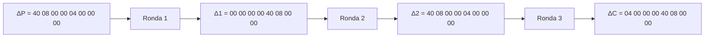
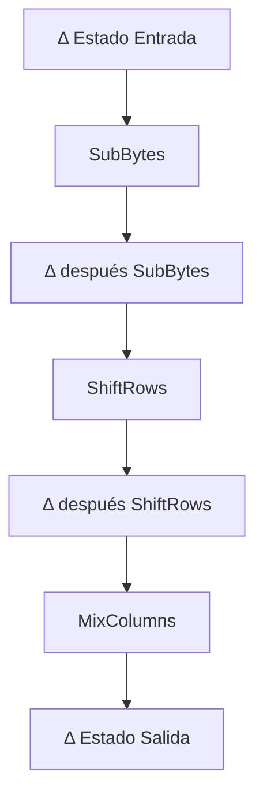
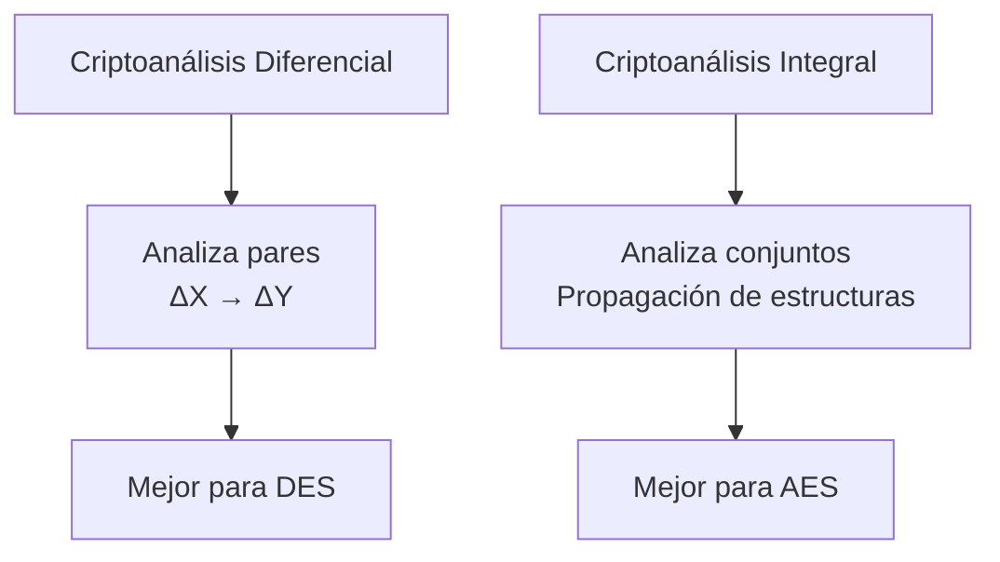

# Criptografía y Seguridad - Redes de Feistel, cifrado de bloques, DES y AES

## 3.3 Criptoanálisis diferencial.

---

El criptoanálisis diferencial es un ataque por texto claro elegido desarrollado por Eli Biham y Adi Shamir a finales de los 80, originalmente aplicado a cifrados tipo DES. Es uno de los ataques más poderosos contra cifrados de bloque y motivó el diseño cuidadoso de AES.

### Definición Fundamental

**Criptoanálisis Diferencial:** Ataque que analiza cómo las diferencias en los textos planos afectan las diferencias en los textos cifrados, explotando características probabilísticas del cifrado.

**Diferencia:** Operación XOR (⊕) entre dos valores:

$$\Delta X = X \oplus X'$$

### Conceptos Básicos y Terminología

#### Par Diferencial

Un par diferencial $(\Delta P, \Delta C)$ consiste en:

- **Diferencia de entrada:** $\Delta P = P \oplus P'$
- **Diferencia de salida:** $\Delta C = C \oplus C'$

#### Característica Diferencial

Secuencia de diferencias a través de las rondas del cifrado:

$$(\Delta P = \Delta X_0) \rightarrow \Delta X_1 \rightarrow \Delta X_2 \rightarrow \cdots \rightarrow (\Delta C = \Delta X_r)$$

#### Probabilidad Diferencial

La probabilidad de que una diferencia de entrada $\Delta X$ produzca una diferencia de salida $\Delta Y$ después de una ronda:

$$DP(\Delta X \rightarrow \Delta Y) = Pr[F(X) \oplus F(X \oplus \Delta X) = \Delta Y]$$

### Fundamentos Matemáticos

#### Probabilidad de Característica

Para una característica de $r$ rondas:

$$p = \prod_{i=1}^{r} p_i$$

donde $p_i$ es la probabilidad de la transición diferencial en la ronda $i$.

#### Relación de Pares Requeridos

El número esperado de pares de texto plano necesarios para un ataque exitoso es aproximadamente:

$$N \approx \frac{c}{p}$$

donde $c$ es una constante pequeña (típicamente 2-4).

### Criptoanálisis Diferencial contra DES

#### Historia y Desarrollo

- **1990:** Biham y Shamir publican el ataque diferencial a DES
- **1993:** Se demuestra que DES resiste mejor de lo esperado
- **Revelación posterior:** Los diseñadores de DES ya conocían el ataque

#### Características Diferenciales de DES

**Característica de 3 rondas:**



**Probabilidades por ronda:**

- Ronda 1: $p_1 = 1$
- Ronda 2: $p_2 = 14/64 \approx 0.219$
- Ronda 3: $p_3 = 1$

**Probabilidad total:** $p \approx 0.219$

#### S-boxes y Tablas Diferenciales

Cada S-box $S_i$ tiene una tabla de diferencias $DT_i$ donde:

$$DT_i(\Delta X, \Delta Y) = \#\{X | S_i(X) \oplus S_i(X \oplus \Delta X) = \Delta Y\}$$

**Ejemplo para S1 de DES:**

```python
def calcular_tabla_diferencias_s1():
    """Calcula tabla de diferencias para S-box S1 de DES"""
    tabla = [[0]*16 for _ in range(64)]  # ΔX: 0-63, ΔY: 0-15

    for delta_x in range(64):
        for x in range(64):
            y1 = s1(x)
            y2 = s1(x ^ delta_x)
            delta_y = y1 ^ y2
            tabla[delta_x][delta_y] += 1

    return tabla

# Valores más probables para S1
DT_S1 = {
    (0x20, 0xF): 16,    # Máxima probabilidad: 16/64 = 0.25
    (0x04, 0x4): 12,    # Probabilidad: 12/64 = 0.1875
    # ... otras entradas
}
```

### Ataque a DES de 4 Rondas (Ejemplo Didáctico)

#### Configuración del Ataque

```python
class AtaqueDiferencialDES4Rondas:
    def __init__(self):
        self.pares = []
        self.caracteristica_prob = 0.25 * 0.25  # 0.0625

    def generar_pares(self, num_pares):
        """Genera pares de texto plano con diferencia específica"""
        delta_p = 0x40080000  # Diferencia conocida

        for _ in range(num_pares):
            p1 = random.randint(0, 2**64-1)
            p2 = p1 ^ delta_p

            c1 = self.cifrar_4rondas(p1)
            c2 = self.cifrar_4rondas(p2)

            self.pares.append((p1, p2, c1, c2))

    def analizar_sboxes(self):
        """Analiza diferencias en S-boxes para extraer bits de clave"""
        contadores = {i: [0]*64 for i in range(8)}  # 8 S-boxes, 64 posibles claves

        for p1, p2, c1, c2 in self.pares:
            # Calcular diferencias esperadas en penúltima ronda
            delta_c = c1 ^ c2
            # ... lógica de análisis diferencial

            # Para cada S-box, probar posibles subclaves
            for sbox_num in range(8):
                for posible_clave in range(64):
                    if self.verificar_clave_sbox(sbox_num, posible_clave, p1, p2, c1, c2):
                        contadores[sbox_num][posible_clave] += 1

        # La clave correcta tendrá el mayor conteo
        clave_recuperada = []
        for sbox_num in range(8):
            clave_sbox = contadores[sbox_num].index(max(contadores[sbox_num]))
            clave_recuperada.append(clave_sbox)

        return clave_recuperada
```

### Criptoanálisis Diferencial contra AES

#### Diferencias Fundamentales

AES fue diseñado específicamente para resistir criptoanálisis diferencial, con:

- S-box altamente no lineal
- Estructura Wide Trail
- Mezcla de bytes entre columnas

#### Características Diferenciales en AES

**Propagación de diferencias en una ronda AES:**



#### Teoría de Wide Trail

El diseño de AES asegura que cualquier característica diferencial activa:

- Al menos 25 S-boxes en 4 rondas
- Probabilidad máxima muy baja

**Cálculo de límite superior para probabilidad diferencial:**

$$DP_{max}(4\ rondas) \leq \left(\frac{2^{-6}}{4}\right)^5 \approx 2^{-30}$$

### Implementación Práctica de Ataque Diferencial

#### Algoritmo General

```python
class AtaqueDiferencial:
    def __init__(self, cifrador, num_rondas):
        self.cifrador = cifrador
        self.num_rondas = num_rondas
        self.caracteristicas = []

    def encontrar_caracteristicas(self):
        """Encuentra características diferenciales de alta probabilidad"""
        # Búsqueda de características óptimas
        mejor_prob = 0
        mejor_caracteristica = None

        for delta_inicial in self.generar_diferencias():
            caracteristica = self.propagar_diferencia(delta_inicial)
            prob = self.calcular_probabilidad(caracteristica)

            if prob > mejor_prob:
                mejor_prob = prob
                mejor_caracteristica = caracteristica

        return mejor_caracteristica, mejor_prob

    def ejecutar_ataque(self, num_pares):
        """Ejecuta el ataque diferencial completo"""
        # Paso 1: Encontrar característica de alta probabilidad
        caracteristica, prob = self.encontrar_caracteristicas()

        # Paso 2: Calcular número de pares necesarios
        pares_necesarios = int(2 / prob)  # Regla práctica

        # Paso 3: Recolectar pares de texto plano
        pares = self.recolectar_pares(caracteristica.delta_inicial,
                                     min(num_pares, pares_necesarios))

        # Paso 4: Analizar y extraer subclaves
        subclaves = self.analizar_pares(pares, caracteristica)

        # Paso 5: Recuperar clave completa
        clave_completa = self.reconstruir_clave(subclaves)

        return clave_completa
```

### Ejemplo Detallado: Ataque a Cifrado Simplificado

#### Cifrado Toy de 4 Rondas

```python
class ToyCipher4Rounds:
    """Cifrado didáctico para demostrar ataque diferencial"""

    def __init__(self, clave):
        self.clave = clave
        self.sbox = [4, 10, 9, 2, 13, 8, 0, 14, 6, 11, 1, 12, 7, 15, 5, 3]

    def ronda(self, estado, subclave):
        """Una ronda del cifrado toy"""
        # XOR con subclave
        estado ^= subclave

        # Sustitución S-box (4 bits)
        nuevo_estado = 0
        for i in range(0, 16, 4):
            nibble = (estado >> i) & 0xF
            sustituido = self.sbox[nibble]
            nuevo_estado |= (sustituido << i)

        # Permutación simple
        estado = self.permutar(nuevo_estado)

        return estado

    def tabla_diferencias_sbox(self):
        """Calcula tabla de diferencias de la S-box"""
        tabla = {}
        for delta_x in range(16):
            for x in range(16):
                y1 = self.sbox[x]
                y2 = self.sbox[x ^ delta_x]
                delta_y = y1 ^ y2

                if delta_x not in tabla:
                    tabla[delta_x] = {}
                if delta_y not in tabla[delta_x]:
                    tabla[delta_x][delta_y] = 0

                tabla[delta_x][delta_y] += 1

        # Encontrar entrada más probable
        max_prob = 0
        mejor_par = None

        for delta_x in tabla:
            for delta_y in tabla[delta_x]:
                prob = tabla[delta_x][delta_y] / 16
                if prob > max_prob:
                    max_prob = prob
                    mejor_par = (delta_x, delta_y, prob)

        return mejor_par
```

### Ejercicios Propuestos

#### Ejercicio 1: Análisis de S-box

Dada la S-box de DES S1:

```
14, 4, 13, 1, 2, 15, 11, 8, 3, 10, 6, 12, 5, 9, 0, 7,
0, 15, 7, 4, 14, 2, 13, 1, 10, 6, 12, 11, 9, 5, 3, 8,
4, 1, 14, 8, 13, 6, 2, 11, 15, 12, 9, 7, 3, 10, 5, 0,
15, 12, 8, 2, 4, 9, 1, 7, 5, 11, 3, 14, 10, 0, 6, 13
```

1. Calcule la tabla de diferencias completa para ΔX = 0x20 (100000 en binario)
2. Encuentre ΔY con mayor probabilidad y su valor
3. ¿Cuál es la probabilidad máxima encontrada?

**Solución esperada:**

```
ΔX = 0x20 (100000):
- ΔY = 0xF (1111) ocurre 16 veces → probabilidad 16/64 = 0.25
- Esta es la característica diferencial más probable para S1
```

#### Ejercicio 2: Característica Diferencial de 2 Rondas

Para un cifrado Feistel simplificado con:

- Bloque: 8 bits (4+4)
- Función F: XOR con subclave de 4 bits
- S-box: {0:4, 1:10, 2:9, 3:2, 4:13, 5:8, 6:0, 7:14, 8:6, 9:11, 10:1, 11:12, 12:7, 13:15, 14:5, 15:3}

Encuentre una característica diferencial de 2 rondas con probabilidad > 0.25.

**Datos iniciales:**

```
ΔP = (ΔL0, ΔR0) = (0000, 0100)
```

#### Ejercicio 3: Cálculo de Pares Necesarios

Suponga que encuentra una característica diferencial para un cifrado de 8 rondas con:

- Probabilidad por ronda: p1 = 0.8, p2 = 0.3, p3 = 0.7, p4 = 0.4, p5 = 0.6, p6 = 0.5, p7 = 0.9, p8 = 1.0

1. Calcule la probabilidad total
2. Estime el número de pares de texto plano necesarios
3. Si puede generar 1000 pares/segundo, ¿cuánto tiempo tomaría el ataque?

**Solución:**

```
1. p_total = 0.8 × 0.3 × 0.7 × 0.4 × 0.6 × 0.5 × 0.9 × 1.0
          = 0.018144

2. N ≈ 2 / p_total ≈ 110 pares
3. Tiempo = 110 / 1000 = 0.11 segundos
```

#### Ejercicio 4: Implementación de Tabla de Diferencias

Complete el código para calcular la tabla de diferencias:

```python
def tabla_diferencias_completa(sbox):
    """
    Calcula tabla completa de diferencias para una S-box
    sbox: lista de 16 valores (4-bit S-box)
    Retorna: matriz 16x16 con conteos
    """
    tabla = [[0]*16 for _ in range(16)]

    # SU CÓDIGO AQUÍ

    return tabla
```

### Ataques Avanzados y Variantes

#### Criptoanálisis Diferencial Truncado

Analiza diferencias parciales donde solo se consideran algunos bits.

**Definición:** Para una diferencia truncada $T$, la probabilidad es:

$$Pr[T(\Delta X) \rightarrow T(\Delta Y)]$$

#### Criptoanálisis Diferencial Imposible

Busca diferencias que nunca pueden ocurrir (probabilidad 0).

**Aplicación:** Usado exitosamente contra AES reducido a 5-7 rondas.

#### Integral vs Diferencial



### Defensas y Contramedidas

#### Principios de Diseño Resistente

1. **S-boxes altamente no lineales:** Minimizar probabilidades diferenciales
2. **Mezcla completa:** Asegurar rápida propagación de diferencias
3. **Número suficiente de rondas:** Hacer probabilidades despreciables
4. **Key scheduling no lineal:** Prevenir ataques relacionados

#### Análisis de AES

**Límites de seguridad de AES-128:**

- Diferencial máximo: $2^{-150}$ ( muy por debajo de $2^{-128}$ )
- Número mínimo de S-boxes activas: 25 en 4 rondas

### Implementación Completa: Ataque a Mini-Cifrado

```python
import random
from collections import Counter

class MiniCipherAttack:
    """Implementación completa de ataque diferencial a cifrado educativo"""

    def __init__(self):
        # S-box diseñada para mostrar vulnerabilidades
        self.sbox = [3, 14, 1, 10, 4, 9, 5, 6, 8, 11, 15, 2, 13, 12, 0, 7]
        self.inv_sbox = [0]*16
        for i, val in enumerate(self.sbox):
            self.inv_sbox[val] = i

    def encontrar_mejor_diferencial(self):
        """Encuentra la característica diferencial más probable"""
        mejores = []

        for delta_in in range(1, 16):  # 0 no es interesante
            conteo = Counter()

            for x in range(16):
                y1 = self.sbox[x]
                y2 = self.sbox[x ^ delta_in]
                delta_out = y1 ^ y2
                conteo[delta_out] += 1

            # Encontrar salida más frecuente
            delta_out, freq = conteo.most_common(1)[0]
            prob = freq / 16

            mejores.append((delta_in, delta_out, prob))

        # Ordenar por probabilidad
        mejores.sort(key=lambda x: x[2], reverse=True)
        return mejores[0]

    def atacar_2_rondas(self, num_pares=100):
        """Ataque diferencial a cifrado de 2 rondas"""
        # Mejor característica para nuestra S-box
        delta_in, delta_out, prob = self.encontrar_mejor_diferencial()

        print(f"Mejor característica: ΔX={delta_in:04b} → ΔY={delta_out:04b}")
        print(f"Probabilidad: {prob:.3f}")
        print(f"Pares necesarios: ~{int(2/prob)}")

        # Generar pares con la diferencia óptima
        pares = []
        for _ in range(num_pares):
            x1 = random.randint(0, 15)
            x2 = x1 ^ delta_in

            # Simular cifrado de 2 rondas (simplificado)
            y1 = self.cifrar_2rondas(x1)
            y2 = self.cifrar_2rondas(x2)

            pares.append((x1, x2, y1, y2))

        # Analizar para encontrar subclave
        posibles_claves = Counter()

        for x1, x2, y1, y2 in pares:
            # Para cada posible subclave k
            for k in range(16):
                # Verificar si produce la diferencia esperada
                if self.verificar_clave(x1, x2, y1, y2, k, delta_out):
                    posibles_claves[k] += 1

        # La clave correcta debería tener el mayor conteo
        clave_recuperada, conteo = posibles_claves.most_common(1)[0]

        print(f"Clave recuperada: {clave_recuperada:04b} ({clave_recuperada})")
        print(f"Conteo: {conteo}/{num_pares}")

        return clave_recuperada

    def verificar_clave(self, x1, x2, y1, y2, k, delta_esperada):
        """Verifica si una clave k es consistente con la diferencia esperada"""
        # Modelo simplificado de una ronda
        v1 = x1 ^ k
        v2 = x2 ^ k
        w1 = self.sbox[v1]
        w2 = self.sbox[v2]

        return (w1 ^ w2) == delta_esperada
```

### Referencias según Bibliografía

#### Stallings (2010) - Cryptography and Network Security

- **Capítulo 3.4:** "Differential Cryptanalysis" (págs. 89-92)
- **Capítulo 5.2:** "AES Structure" - resistencia a ataques diferenciales

#### Forouzan (2008) - Cryptography and Network Security

- **Capítulo 6.3:** "Differential Cryptanalysis" - explicación con ejemplos
- **Capítulo 7.2:** "AES Transformations" - diseño para resistencia

#### Pfleeger y Pfleeger (2006) - Security in Computing

- **Capítulo 2.4:** "Cryptanalysis" - técnicas generales incluido diferencial

#### Bibliografía Complementaria

**Menezes et al. (1996) - Handbook of Applied Cryptography:**

- **Sección 7.4:** "Differential cryptanalysis" - tratamiento matemático formal
- **Sección 7.7:** "Linear cryptanalysis" - comparación con diferencial

**Schneier (1996) - Applied Cryptography:**

- **Capítulo 12.4:** "Differential Cryptanalysis" - aplicación a DES
- **Capítulo 14.5:** "Security of AES" - análisis de resistencia

**Ferguson et al. (2010) - Cryptography Engineering:**

- **Capítulo 7.5:** "Differential Cryptanalysis" - enfoque práctico
- **Capítulo 7.6:** "The Wide Trail Strategy" - diseño de AES

### Ejercicios de Integración

#### Ejercicio Final: Análisis Comparativo

Compare el criptoanálisis diferencial aplicado a DES vs AES:

1. ¿Por qué DES es más vulnerable que AES a este ataque?
2. ¿Qué características del diseño de AES lo hacen resistente?
3. Calcule la probabilidad diferencial máxima teórica para:
   - DES de 16 rondas usando mejor característica conocida
   - AES de 10 rondas usando límite teórico

#### Proyecto de Investigación

Implemente un ataque diferencial completo a un cifrado Feistel de 6 rondas:

- Tamaño de bloque: 32 bits
- S-box de 8 bits no lineal
- Generación de claves simple

**Entregables:**

1. Análisis de S-box y tabla de diferencias
2. Característica diferencial de 3 rondas
3. Estimación de pares necesarios
4. Implementación funcional del ataque
5. Análisis de éxito con diferentes tamaños de muestra

### Preguntas de Reflexión

1. ¿Por qué el criptoanálisis diferencial es más efectivo que la búsqueda exhaustiva para cifrados con pocas rondas?
2. ¿Cómo afecta el diseño de S-boxes a la resistencia diferencial?
3. ¿Qué papel juega el key scheduling en la prevención de estos ataques?
4. ¿Por qué los cifrados modernos como AES necesitan menos rondas que DES para lograr seguridad similar?

### Recursos Adicionales

#### Herramientas Recomendadas

1. **SageMath:** Para cálculos algebraicos y análisis de S-boxes
2. **Cryptool:** Incluye módulos para criptoanálisis diferencial
3. **Python con numpy:** Para simulaciones y análisis estadístico

#### Lecturas Avanzadas

1. Biham, E., & Shamir, A. (1993). _Differential Cryptanalysis of the Data Encryption Standard_
2. Daemen, J., & Rijmen, V. (2002). _The Design of Rijndael: AES - The Advanced Encryption Standard_
3. Knudsen, L. R. (1994). _Truncated and Higher Order Differentials_

_Nota pedagógica: El criptoanálisis diferencial es fundamental para entender el diseño moderno de cifrados. Se recomienda implementar versiones simplificadas para comprender los principios antes de estudiar ataques complejos._
