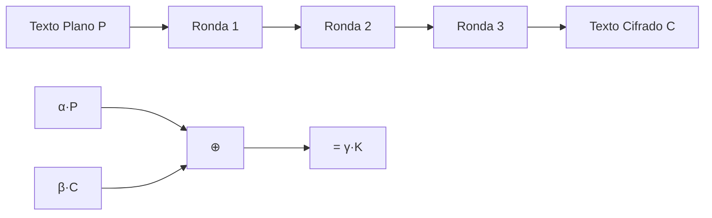

# Criptografía y Seguridad - Redes de Feistel, cifrado de bloques, DES y AES

## 3.4 Criptoanálisis lineal.

---

El criptoanálisis lineal es un ataque por texto claro conocido desarrollado por Mitsuru Matsui en 1993. Es un ataque de caja negra que busca aproximaciones lineales del cifrado, explotando desviaciones estadísticas de la aleatoriedad perfecta.

### Definición Fundamental

**Criptoanálisis Lineal:** Ataque que busca relaciones lineales probabilísticas entre bits del texto plano, texto cifrado y clave, explotando la no aleatoriedad del cifrador.

**Aproximación lineal:** Expresión de la forma:

$$\alpha \cdot P \oplus \beta \cdot C = \gamma \cdot K$$

donde:

- $P$: texto plano
- $C$: texto cifrado
- $K$: clave
- $\alpha, \beta, \gamma$: máscaras de bits
- $\cdot$: producto escalar binario (XOR de productos de bits)

### Conceptos Básicos y Terminología

#### Sesgo (Bias)

La medida de desviación de la aleatoriedad perfecta:

$$\epsilon = p - \frac{1}{2}$$

donde $p$ es la probabilidad de que la relación lineal se cumpla.

#### Probabilidad de Éxito

Para un sesgo $\epsilon$, el número de pares texto plano-texto cifrado necesarios es aproximadamente:

$$N \approx \frac{1}{\epsilon^2}$$

#### Pila de Aproximaciones (Piling-up Lemma)

Para $n$ variables aleatorias independientes $X_1, X_2, ..., X_n$:

$$\Pr(X_1 \oplus X_2 \oplus \cdots \oplus X_n = 0) = \frac{1}{2} + 2^{n-1} \prod_{i=1}^n \epsilon_i$$

donde $\epsilon_i$ es el sesgo de $X_i$.

### Fundamentos Matemáticos

#### Producto Escalar Binario

Para vectores binarios $a = (a_1, ..., a_n)$ y $x = (x_1, ..., x_n)$:

$$ a \cdot x = \bigoplus_{i=1}^n a_i x_i = a_1 x_1 \oplus a_2 x_2 \oplus \cdots \oplus a_n x_n $$

#### Sesgo de una Aproximación Lineal

Dada una aproximación $\alpha \cdot P \oplus \beta \cdot C = \gamma \cdot K$:

$$\epsilon = \Pr(\alpha \cdot P \oplus \beta \cdot C = \gamma \cdot K) - \frac{1}{2}$$

#### Tabla de Aproximaciones Lineales

Para una S-box $S: \mathbb{F}_2^n \to \mathbb{F}_2^m$, la tabla $L$ se define como:

$$L(a,b) = \#\{x \in \mathbb{F}_2^n : a \cdot x = b \cdot S(x)\} - 2^{n-1}$$

donde $a \in \mathbb{F}_2^n$, $b \in \mathbb{F}_2^m$ son máscaras de entrada/salida.

### Criptoanálisis Lineal contra DES

#### Historia y Desarrollo

- **1993:** Matsui publica el primer ataque lineal contra DES
- **1994:** Mejora el ataque a DES de 16 rondas con $2^{43}$ textos planos
- **Revelación:** Demuestra vulnerabilidad teórica de DES

#### Aproximaciones Lineales de las S-boxes de DES

**Análisis de S1 de DES:**

```python
def tabla_lineal_s1():
    """Calcula tabla de aproximaciones lineales para S-box S1 de DES"""
    s1 = [14, 4, 13, 1, 2, 15, 11, 8, 3, 10, 6, 12, 5, 9, 0, 7,
          0, 15, 7, 4, 14, 2, 13, 1, 10, 6, 12, 11, 9, 5, 3, 8,
          4, 1, 14, 8, 13, 6, 2, 11, 15, 12, 9, 7, 3, 10, 5, 0,
          15, 12, 8, 2, 4, 9, 1, 7, 5, 11, 3, 14, 10, 0, 6, 13]

    tabla = [[0]*16 for _ in range(64)]  # 6 bits entrada, 4 bits salida

    for mascara_entrada in range(64):      # α: 6 bits
        for mascara_salida in range(16):   # β: 4 bits
            conteo = 0
            for entrada in range(64):
                # Calcular producto escalar entrada
                prod_entrada = 0
                for bit in range(6):
                    if (mascara_entrada >> bit) & 1:
                        prod_entrada ^= (entrada >> bit) & 1

                # Calcular producto escalar salida
                salida = s1[entrada]
                prod_salida = 0
                for bit in range(4):
                    if (mascara_salida >> bit) & 1:
                        prod_salida ^= (salida >> bit) & 1

                if prod_entrada == prod_salida:
                    conteo += 1

            # Calcular sesgo: conteo/64 - 0.5
            sesgo = conteo/64 - 0.5
            tabla[mascara_entrada][mascara_salida] = sesgo

    return tabla

# Encontrar la mejor aproximación para S1
def mejor_aproximacion_s1():
    tabla = tabla_lineal_s1()
    mejor_sesgo = 0
    mejor_par = None

    for α in range(64):
        for β in range(16):
            sesgo_abs = abs(tabla[α][β])
            if sesgo_abs > mejor_sesgo:
                mejor_sesgo = sesgo_abs
                mejor_par = (α, β, tabla[α][β])

    return mejor_par

# Resultado: α=0x16 (010110), β=0x5 (0101) con sesgo ≈ 0.234
```

#### Aproximación Lineal de 3 Rondas para DES



**Ecuación lineal para 3 rondas:**

$$
P[7,18,24,29] \oplus C[7,18,24,29] \oplus F_1(K)[15] \oplus F_3(K)[15] = K[22]
$$

**Probabilidad:** $p = \frac{1}{2} + 0.234^2 \approx 0.555$

### Algoritmo de Matsui

#### Algoritmo 1: Obtención de bits de subclave

```python
class Algoritmo1Matsui:
    """Implementación del Algoritmo 1 de Matsui para DES"""

    def __init__(self, cifrador):
        self.cifrador = cifrador
        self.aproximaciones = self.cargar_aproximaciones()

    def encontrar_bits_clave(self, textos_planos, textos_cifrados):
        """
        Algoritmo 1: Encuentra bits de subclave usando aproximación lineal
        """
        # Contadores para posibles valores de subclave
        contadores = [0] * (2**6)  # 6 bits de subclave por S-box

        for i in range(len(textos_planos)):
            P = textos_planos[i]
            C = textos_cifrados[i]

            # Para cada posible subclave candidata
            for candidata in range(2**6):
                # Verificar si satisface la aproximación lineal
                if self.verificar_aproximacion(P, C, candidata):
                    contadores[candidata] += 1

        # La subclave correcta tendrá el conteo más alejado de N/2
        N = len(textos_planos)
        mejor_candidata = max(range(2**6),
                            key=lambda k: abs(contadores[k] - N/2))

        return mejor_candidata, contadores

    def verificar_aproximacion(self, P, C, subclave_candidata):
        """
        Verifica si se cumple la aproximación lineal:
        α·P ⊕ β·C = γ·K ⊕ δ·subclave
        """
        # Extraer bits según máscaras
        bits_P = self.extraer_bits(P, self.α)
        bits_C = self.extraer_bits(C, self.β)
        bits_K = subclave_candidata  # Simplificado

        # Calcular lado izquierdo
        izquierdo = bits_P ^ bits_C

        # Calcular lado derecho (incluye bits de clave)
        derecho = self.calcular_lado_derecho(bits_K)

        return izquierdo == derecho
```

#### Algoritmo 2: Ataque completo a DES

```python
class Algoritmo2Matsui:
    """Implementación del Algoritmo 2 de Matsui para ataque completo a DES"""

    def ataque_completo_des(self, num_pares):
        """
        Ataque lineal completo a DES de 16 rondas
        Basado en Matsui (1994)
        """
        # 1. Construir aproximación lineal de 14 rondas
        aprox_14r = self.construir_aproximacion_14_rondas()

        # 2. Recopilar N pares (P, C)
        pares = self.recopilar_pares(num_pares)

        # 3. Para cada posible valor de 56 bits de clave
        claves_candidatas = []

        # Solo probamos subconjunto de bits de clave (en la práctica)
        for k_candidata in self.generar_claves_candidatas():
            contador = 0

            for P, C in pares:
                if self.evaluar_aproximacion(P, C, k_candidata, aprox_14r):
                    contador += 1

            # Calcular desviación
            desviacion = abs(contador - num_pares/2)
            claves_candidatas.append((k_candidata, desviacion))

        # 4. Ordenar por desviación (mayor primero)
        claves_candidatas.sort(key=lambda x: x[1], reverse=True)

        # 5. Busqueda exhaustiva en las mejores candidatas
        for k_candidata, _ in claves_candidatas[:10]:
            if self.verificar_clave_completa(k_candidata):
                return k_candidata

        return None

    def construir_aproximacion_14_rondas(self):
        """
        Construye la aproximación lineal de 14 rondas usada por Matsui
        Sesgo total: 2^{-24.2}
        """
        # Aproximaciones por ronda
        aproximaciones = [
            (0x21040080, 0x21040080, 2**-7.5),  # Rondas 1-3
            (0x00008000, 0x00008000, 2**-7.5),  # Rondas 4-6
            (0x21040080, 0x21040080, 2**-7.5),  # Rondas 7-9
            (0x00008000, 0x00008000, 2**-7.5),  # Rondas 10-12
            (0x21040080, 0x21040080, 2**-7.5),  # Rondas 13-14
        ]

        # Combinar usando Piling-up Lemma
        sesgo_total = 1/2
        for _, _, sesgo in aproximaciones:
            sesgo_total = 2 * sesgo_total * sesgo

        return {
            'mascara_entrada': 0x21040080,
            'mascara_salida': 0x21040080,
            'sesgo': sesgo_total,
            'bits_clave': [22, 39, 44, 50]  # Bits de clave involucrados
        }
```

### Criptoanálisis Lineal contra AES

#### Resistencia de AES al Ataque Lineal

AES fue diseñado específicamente para resistir criptoanálisis lineal mediante:

1. **S-box altamente no lineal:** Maximalmente no lineal (NL = 112)
2. **Estructura Wide Trail:** Asegura múltiples S-boxes activas
3. **Mezcla de columnas:** Difunde no linealidad

#### Análisis de la S-box de AES

La S-box de AES $S(x) = Ax^{-1} + b$ en $GF(2^8)$ tiene:

- **No linealidad máxima:** 112
- **Bias máximo:** $2^{-6}$ (para 1 bit)
- **Propagación:** Cualquier aproximación lineal involucra al menos 25 S-boxes activas

**Cálculo de no linealidad:**

$$NL(S) = \min_{a,b \neq 0} |\{x : a \cdot x = b \cdot S(x)\}|$$

#### Límite Superior para AES

Para 4 rondas de AES, cualquier aproximación lineal satisface:

$$|\epsilon| \leq 2^{-75} \ll 2^{-128}$$

Esto hace inviable el ataque lineal contra AES completo.

### Implementación Práctica de Ataque Lineal

#### Sistema Completo para Cifrado Simplificado

```python
import random
import numpy as np
from collections import Counter

class AtaqueLinealCompleto:
    """Sistema completo de ataque lineal para cifrado educativo"""

    def __init__(self, cifrador):
        self.cifrador = cifrador
        self.sbox = cifrador.sbox
        self.tabla_lineal = self.calcular_tabla_lineal_completa()

    def calcular_tabla_lineal_completa(self):
        """Calcula tabla lineal completa L[a][b] = #sat - 2^(n-1)"""
        n = 4  # bits entrada
        m = 4  # bits salida
        tabla = np.zeros((2**n, 2**m), dtype=int)

        for a in range(2**n):
            for b in range(2**m):
                conteo = 0
                for x in range(2**n):
                    # Calcular a·x
                    prod_entrada = 0
                    for i in range(n):
                        if (a >> i) & 1:
                            prod_entrada ^= (x >> i) & 1

                    # Calcular b·S(x)
                    y = self.sbox[x]
                    prod_salida = 0
                    for i in range(m):
                        if (b >> i) & 1:
                            prod_salida ^= (y >> i) & 1

                    if prod_entrada == prod_salida:
                        conteo += 1

                tabla[a][b] = conteo - 2**(n-1)

        return tabla

    def encontrar_mejor_trayectoria(self, num_rondas):
        """Encuentra la mejor aproximación lineal para múltiples rondas"""
        # Usar algoritmo de búsqueda en grafos
        mejores = []

        # Para cada máscara de entrada inicial
        for α_inicial in range(1, 16):  # Excluir 0
            trayectoria = self.buscar_trayectoria_optima(α_inicial, num_rondas)
            mejores.append(trayectoria)

        # Ordenar por sesgo absoluto
        mejores.sort(key=lambda t: abs(t['sesgo_total']), reverse=True)
        return mejores[0]

    def ejecutar_ataque(self, num_pares):
        """Ejecuta ataque lineal completo"""
        # 1. Encontrar mejor aproximación
        trayectoria = self.encontrar_mejor_trayectoria(4)  # 4 rondas

        print(f"Mejor aproximación encontrada:")
        print(f"  Sesgo total: {trayectoria['sesgo_total']:.6f}")
        print(f"  Pares necesarios: ~{int(1/trayectoria['sesgo_total']**2)}")

        # 2. Recopilar datos
        datos = self.recopilar_datos(num_pares)

        # 3. Ataque por conteo
        clave_recuperada = self.ataque_por_conteo(datos, trayectoria)

        return clave_recuperada

    def ataque_por_conteo(self, datos, trayectoria):
        """Implementa ataque por conteo (Algoritmo 1 de Matsui)"""
        bits_clave = trayectoria['bits_clave']
        num_bits = len(bits_clave)

        contadores = np.zeros(2**num_bits, dtype=int)

        for P, C in datos:
            # Para cada posible valor de los bits de clave
            for candidata in range(2**num_bits):
                if self.evaluar_aproximacion(P, C, candidata, trayectoria):
                    contadores[candidata] += 1

        # Encontrar candidata con mayor desviación
        N = len(datos)
        desviaciones = np.abs(contadores - N/2)
        mejor_candidata = np.argmax(desviaciones)

        return mejor_candidata, desviaciones[mejor_candidata]/N
```

### Ejemplo Detallado: Mini-Cifrado SPN

#### Cifrado SPN de 4 Rondas

```python
class MiniSPN4Rounds:
    """Cifrado SPN educativo para demostrar ataque lineal"""

    def __init__(self, clave):
        self.clave = clave
        # S-box altamente no lineal pero con algunas vulnerabilidades
        self.sbox = [0xE, 0x4, 0xD, 0x1, 0x2, 0xF, 0xB, 0x8,
                     0x3, 0xA, 0x6, 0xC, 0x5, 0x9, 0x0, 0x7]
        self.inv_sbox = [0xE, 0x3, 0x4, 0x8, 0x1, 0xC, 0xA, 0xF,
                         0x7, 0xD, 0x9, 0x6, 0xB, 0x2, 0x0, 0x5]

        # Permutación de bits
        self.permutacion = [0, 4, 8, 12, 1, 5, 9, 13,
                           2, 6, 10, 14, 3, 7, 11, 15]

    def cifrar(self, texto_plano):
        """Cifrado de 4 rondas SPN"""
        estado = texto_plano ^ self.clave

        for ronda in range(4):
            # Capa de sustitución
            estado = self.capa_sustitucion(estado)

            # Capa de permutación (excepto última ronda)
            if ronda < 3:
                estado = self.capa_permutacion(estado)

            # XOR con subclave
            estado ^= self.clave

        return estado

    def analisis_lineal(self):
        """Realiza análisis lineal del cifrado"""
        # Calcular tabla lineal de la S-box
        tabla = self.tabla_lineal_sbox()

        # Encontrar mejores aproximaciones
        mejores = []
        for α in range(1, 16):
            for β in range(1, 16):
                sesgo = tabla[α][β] / 16
                if abs(sesgo) > 0.2:  # Sesgo significativo
                    mejores.append((α, β, sesgo))

        return sorted(mejores, key=lambda x: abs(x[2]), reverse=True)
```

### Ejercicios Propuestos

#### Ejercicio 1: Tabla Lineal de S-box

Dada la S-box S1 de DES (misma del ejercicio anterior):

1. Calcule la tabla lineal completa L[α][β] para α, β ≠ 0
2. Encuentre la aproximación lineal con mayor |sesgo|
3. ¿Cuál es la probabilidad correspondiente?

**Solución esperada:**

```
Para S1 de DES:
Mejor aproximación: α = 0x16 (010110), β = 0x5 (0101)
Conteo: 40/64 = 0.625
Sesgo: 0.625 - 0.5 = 0.125
Probabilidad: 0.625
```

#### Ejercicio 2: Piling-up Lemma

Tres variables aleatorias tienen sesgos:

- ε₁ = 0.25
- ε₂ = 0.125
- ε₃ = -0.0625

Calcule:

1. Pr(X₁ ⊕ X₂ ⊕ X₃ = 0) usando Piling-up Lemma
2. El sesgo combinado
3. Número de muestras necesarias para distinguir de aleatorio

**Solución:**

```
1. Pr = 1/2 + 2² * (0.25)*(0.125)*(-0.0625)
     = 0.5 + 4 * (-0.001953125)
     = 0.5 - 0.0078125 = 0.4921875

2. ε_total = 0.4921875 - 0.5 = -0.0078125

3. N ≈ 1/ε² ≈ 1/(0.0078125)² ≈ 16384 muestras
```

#### Ejercicio 3: Ataque a 2 Rondas

Para un cifrado Feistel de 2 rondas con:

- Bloque: 8 bits
- S-box: {0:14, 1:4, 2:13, 3:1, 4:2, 5:15, 6:11, 7:8, 8:3, 9:10, 10:6, 11:12, 12:5, 13:9, 14:0, 15:7}
- Mejor aproximación: α=0xB (1011), β=0x4 (0100), sesgo=0.25

Calcule:

1. La ecuación lineal aproximada
2. Número de pares necesarios
3. Implemente el ataque en Python

#### Ejercicio 4: Comparación Diferencial vs Lineal

Complete la tabla comparativa:

| Característica        | Criptoanálisis Diferencial | Criptoanálisis Lineal      |
| --------------------- | -------------------------- | -------------------------- |
| **Tipo de ataque**    | Texto claro elegido        | Texto claro conocido       |
| **Complejidad datos** | $O(1/ε)$                   | $O(1/ε²)$                  |
| **DES completo**      | $2^{47}$ pares             | $2^{43}$ pares             |
| **Mejor contra**      | Cifrados con S-box débil   | Cifrados con mala difusión |
| **Inventores**        | Biham y Shamir (1990)      | Matsui (1993)              |

### Ataques Avanzados y Variantes

#### Criptoanálisis Lineal Múltiple

Usa múltiples aproximaciones lineales simultáneamente para reducir datos necesarios.

#### Criptoanálisis Lineal con Cero Conocido

Variante que funciona con menos datos pero más procesamiento.

#### Ataques Lineal-Diferencial

Combinación de ambas técnicas para ataques más potentes.

### Defensas y Contramedidas

#### Principios de Diseño Resistente

1. **S-boxes de alta no linealidad:**
   - AES: No linealidad = 112 (máxima para 8 bits)
   - Criterio: $NL(S) = \min_{a,b \neq 0} |2^{n-1} - WL(a,b)|$

2. **Múltiples S-boxes activas:**
   - AES: Mínimo 25 S-boxes activas en 4 rondas
   - Estrategia Wide Trail

3. **Mezcla completa rápida:**
   - Asegurar que cualquier bit afecte muchos bits rápidamente

#### Análisis de AES

**Límites teóricos para AES-128:**

- Sesgo máximo por 4 rondas: $2^{-75}$
- S-boxes activas mínimas: 25
- Complejidad ataque lineal: $> 2^{128}$

### Implementación Completa: Laboratorio de Ataque Lineal

```python
class LaboratorioAtaqueLineal:
    """Laboratorio completo para experimentar con ataques lineales"""

    def __init__(self):
        self.resultados = []

    def experimento_sbox(self, sbox):
        """Experimento 1: Análisis de S-box"""
        print("=== ANÁLISIS DE S-box ===")

        # 1. Tabla lineal
        tabla = self.calcular_tabla_lineal(sbox)

        # 2. Encontrar mejores aproximaciones
        mejores = self.encontrar_mejores_aproximaciones(tabla)

        print(f"Mejores aproximaciones (top 5):")
        for i, (α, β, sesgo) in enumerate(mejores[:5]):
            print(f"  {i+1}. α={α:04b}, β={β:04b}, sesgo={sesgo:.3f}")

        # 3. Calcular no linealidad
        nl = self.calcular_no_linealidad(tabla)
        print(f"No linealidad: {nl}")

        return tabla, mejores

    def experimento_cifrado(self, cifrador, num_rondas):
        """Experimento 2: Ataque a cifrado completo"""
        print(f"\n=== ATAQUE A CIFRADO DE {num_rondas} RONDAS ===")

        # 1. Buscar mejor aproximación lineal
        trayectoria = self.buscar_mejor_trayectoria(cifrador, num_rondas)

        print(f"Mejor trayectoria encontrada:")
        print(f"  Sesgo total: {trayectoria['sesgo']:.2e}")
        print(f"  Pares teóricos: {int(1/trayectoria['sesgo']**2):,}")

        # 2. Simular ataque con diferentes tamaños de muestra
        tamanos_muestra = [100, 1000, 10000, 100000]

        for N in tamanos_muestra:
            exito = self.simular_ataque(cifrador, trayectoria, N)
            print(f"  N={N:,}: Éxito = {exito:.1%}")

        return trayectoria

    def demostracion_piling_up(self):
        """Demostración del Piling-up Lemma"""
        print("\n=== DEMOSTRACIÓN PILING-UP LEMMA ===")

        # Valores de sesgo de ejemplo
        sesgos = [0.25, -0.125, 0.0625, -0.03125]

        print("Sesgos individuales:", sesgos)

        # Calcular combinación
        sesgo_combinado = 0.5
        for ε in sesgos:
            sesgo_combinado = 2 * sesgo_combinado * ε

        print(f"Sesgo combinado: {sesgo_combinado:.6f}")
        print(f"N muestras necesarias: ~{int(1/sesgo_combinado**2):,}")

        # Verificación empírica
        N = 1000000
        verificacion = self.verificar_piling_up(sesgos, N)
        print(f"Verificación empírica (N={N:,}): {verificacion:.6f}")
```

### Referencias según Bibliografía

#### Stallings (2010) - Cryptography and Network Security

- **Capítulo 3.5:** "Linear Cryptanalysis" (págs. 92-94)
- **Capítulo 5.3:** "AES Math" - propiedades de no linealidad

#### Forouzan (2008) - Cryptography and Network Security

- **Capítulo 6.4:** "Linear Cryptanalysis" - explicación con ejemplos
- **Capítulo 7.3:** "AES Analysis" - resistencia a ataques lineales

#### Pfleeger y Pfleeger (2006) - Security in Computing

- **Capítulo 2.4:** "Cryptanalysis" - incluye criptoanálisis lineal

#### Bibliografía Complementaria

**Menezes et al. (1996) - Handbook of Applied Cryptography:**

- **Sección 7.7:** "Linear cryptanalysis" - tratamiento matemático completo
- **Sección 7.8:** "Comparison of attacks" - diferencial vs lineal

**Schneier (1996) - Applied Cryptography:**

- **Capítulo 12.5:** "Linear Cryptanalysis" - aplicación a DES
- **Capítulo 14.6:** "AES Security Analysis" - resistencia lineal

**Matsui, M. (1994):**

- "The First Experimental Cryptanalysis of the Data Encryption Standard"
- Artículo original que describe el ataque completo

**Ferguson et al. (2010) - Cryptography Engineering:**

- **Capítulo 7.7:** "Linear Cryptanalysis" - enfoque práctico
- **Capítulo 7.8:** "Design Principles" - lecciones para resistencia

### Ejercicios de Integración

#### Ejercicio Final: Proyecto de Investigación

Implemente y compare ataques diferencial y lineal a un cifrado Feistel de 8 rondas:

**Parámetros:**

- Bloque: 32 bits
- S-box personalizada de 8 bits
- 8 rondas Feistel

**Entregables:**

1. Análisis de S-box (tablas diferencial y lineal)
2. Mejor característica diferencial (probabilidad)
3. Mejor aproximación lineal (sesgo)
4. Estimación de complejidad para cada ataque
5. Implementación funcional de ambos ataques
6. Comparación de resultados y eficiencia

#### Preguntas de Reflexión

1. ¿Por qué el criptoanálisis lineal necesita más datos que el diferencial?
2. ¿Cómo afecta la no linealidad de las S-boxes a ambos ataques?
3. ¿Qué diseño hace a AES más resistente que DES a estos ataques?
4. ¿Por qué el Piling-up Lemma supone independencia y por qué esto es importante?

### Herramientas y Recursos

#### Software Recomendado

1. **SageMath:** Para cálculos algebraicos y criptoanálisis
2. **Python con numpy/scipy:** Para simulaciones estadísticas
3. **Cryptool 2:** Incluye módulos para criptoanálisis lineal

#### Conjuntos de Datos

1. S-boxes estándar (DES, AES, Serpent, etc.)
2. Textos planos/cifrados para práctica
3. Implementaciones de referencia de cifrados

#### Métricas Importantes

1. **No linealidad:** $NL(S) = min_{a,b≠0} |2^{n-1} - WL(a,b)|$
2. **Sesgo máximo:** $max_{a,b≠0} |Pr(a·x = b·S(x)) - 1/2|$
3. **Distancia a linealidad:** $d(S, L) = min_{L lineal} |\{x: S(x) ≠ L(x)\}|$

_Nota pedagógica: El criptoanálisis lineal es fundamental para entender el diseño moderno de cifrados. Se recomienda implementar versiones simplificadas y experimentar con diferentes S-boxes para comprender cómo la no linealidad afecta la seguridad._
