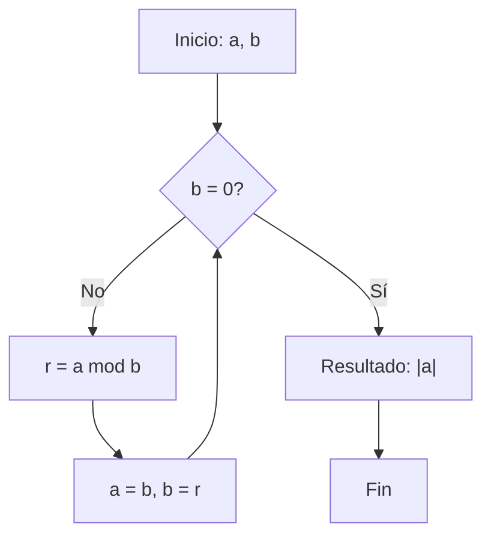

# Criptografía y Seguridad -Elementos de teoría de números y campos finitos

## 4.1 Repaso de aritmética modular, divisibilidad, algoritmo de Euclides, MCD Y MCM.

---

La teoría de números constituye la base matemática de la criptografía moderna. Los conceptos de aritmética modular, divisibilidad y algoritmos relacionados son esenciales para comprender sistemas criptográficos como RSA, Diffie-Hellman y algoritmos basados en curvas elípticas.

### 1. Divisibilidad

#### Definición

Sean $a, b \in \mathbb{Z}$ con $b \neq 0$. Decimos que $b$ divide a $a$ ( denotado $b \mid a$ ) si existe un entero $c$ tal que:

$$a = b \cdot c$$

#### Propiedades

1. **Transitividad**: Si $a \mid b$ y $b \mid c$, entonces $a \mid c$
2. **Linealidad**: Si $a \mid b$ y $a \mid c$, entonces $a \mid (mb + nc)$ para cualquier $m, n \in \mathbb{Z}$
3. Si $a \mid b$ y $b \mid a$, entonces $a = \pm b$

#### Ejemplo

- $3 \mid 12$ porque $12 = 3 \times 4$
- $5 \nmid 12$ porque no existe entero $c$ tal que $12 = 5c$

### 2. Algoritmo de Euclides para el Máximo Común Divisor (MCD)

#### Definición

El máximo común divisor de dos enteros $a$ y $b$ (no ambos cero), denotado $\text{mcd}(a,b)$ o $(a,b)$, es el mayor entero positivo que divide tanto a $a$ como a $b$.

#### Teorema Fundamental

Para cualquier par de enteros $a, b \in \mathbb{Z}$ con $b \neq 0$, existen enteros únicos $q$ (cociente) y $r$ (residuo) tales que:

$$a = bq + r, \quad 0 \leq r < |b|$$

#### Algoritmo de Euclides

```
FUNCIÓN mcd_euclides(a, b):
    MIENTRAS b ≠ 0:
        r = a mod b
        a = b
        b = r
    DEVOLVER |a|
```

#### Implementación en Python

```python
def mcd_euclides(a, b):
    """Calcula el MCD usando el algoritmo de Euclides"""
    a = abs(a)
    b = abs(b)
    while b != 0:
        a, b = b, a % b
    return a

def mcd_extendido(a, b):
    """Algoritmo de Euclides extendido, devuelve (mcd, x, y)"""
    if b == 0:
        return (abs(a), 1 if a >= 0 else -1, 0)

    mcd, x1, y1 = mcd_extendido(b, a % b)
    x = y1
    y = x1 - (a // b) * y1
    return (mcd, x, y)

# Ejemplo de uso
print(mcd_euclides(48, 18))  # Devuelve 6
print(mcd_extendido(48, 18)) # Devuelve (6, -1, 3)
```

#### Ejemplo Paso a Paso

Calcular $\text{mcd}(48, 18)$:

1. $48 = 18 \times 2 + 12$
2. $18 = 12 \times 1 + 6$
3. $12 = 6 \times 2 + 0$
4. $\text{mcd}(48, 18) = 6$

#### Algoritmo Extendido de Euclides

Este algoritmo no solo calcula $\text{mcd}(a,b)$ sino que también encuentra enteros $x, y$ tales que:

$$ax + by = \text{mcd}(a,b)$$

Esta identidad es crucial en criptografía para calcular inversos modulares.

### 3. Mínimo Común Múltiplo (MCM)

#### Definición

El mínimo común múltiplo de dos enteros $a$ y $b$, denotado $\text{mcm}(a,b)$ o $[a,b]$, es el menor entero positivo que es múltiplo tanto de $a$ como de $b$.

#### Relación entre MCD y MCM

Para cualquier par de enteros $a, b$:

$$a \cdot b = \text{mcd}(a,b) \cdot \text{mcm}(a,b)$$

Por lo tanto:

$$\text{mcm}(a,b) = \frac{|a \cdot b|}{\text{mcd}(a,b)}$$

#### Ejemplo

$\text{mcd}(12, 18) = 6$, entonces:

$$\text{mcm}(12, 18) = \frac{12 \times 18}{6} = 36$$

### 4. Aritmética Modular

#### Definición

Sean $a, b \in \mathbb{Z}$ y $n \in \mathbb{Z}^+$. Decimos que $a$ es congruente con $b$ módulo $n$ ( denotado $a \equiv b \pmod{n}$ ) si:

$$n \mid (a - b)$$

Equivalentemente:

$$a \equiv b \pmod{n} \iff a \mod n = b \mod n$$

#### Propiedades

1. **Reflexividad**: $a \equiv a \pmod{n}$
2. **Simetría**: Si $a \equiv b \pmod{n}$, entonces $b \equiv a \pmod{n}$
3. **Transitividad**: Si $a \equiv b \pmod{n}$ y $b \equiv c \pmod{n}$, entonces $a \equiv c \pmod{n}$
4. **Operaciones**: Si $a \equiv b \pmod{n}$ y $c \equiv d \pmod{n}$, entonces:
   - $a + c \equiv b + d \pmod{n}$
   - $a - c \equiv b - d \pmod{n}$
   - $ac \equiv bd \pmod{n}$

#### Clases de Equivalencia

La relación de congruencia módulo $n$ divide a $\mathbb{Z}$ en $n$ clases de equivalencia:

$$\overline{a} = \{b \in \mathbb{Z} \mid b \equiv a \pmod{n}\}$$

El conjunto de clases de residuo módulo $n$ se denota $\mathbb{Z}_n = \{0, 1, 2, \ldots, n-1\}$.

#### Inverso Modular

Un entero $a$ tiene inverso multiplicativo módulo $n$ si existe $x$ tal que:

$$ax \equiv 1 \pmod{n}$$

El inverso existe si y solo si $\text{mcd}(a, n) = 1$. Se denota $a^{-1} \pmod{n}$.

### 5. Teorema Fundamental de la Aritmética

#### Enunciado

Todo entero $n > 1$ puede representarse de manera única como producto de potencias de números primos:

$$n = p_1^{e_1} p_2^{e_2} \cdots p_k^{e_k}$$

donde $p_1 < p_2 < \cdots < p_k$ son primos y $e_i \in \mathbb{Z}^+$.

#### Diagrama de Flujo del Algoritmo de Euclides



### 6. Ejercicios Propuestos

#### Ejercicio 1: Divisibilidad

1. Demuestre que si $a \mid b$ y $a \mid c$, entonces $a \mid (3b - 2c)$.
2. Encuentre todos los enteros $n$ tales que $n \mid (n + 3)$.

#### Ejercicio 2: Algoritmo de Euclides

1. Calcule $\text{mcd}(1071, 462)$ usando el algoritmo de Euclides.
2. Encuenter enteros $x, y$ tales que $1071x + 462y = \text{mcd}(1071, 462)$.

#### Ejercicio 3: Aritmética Modular

1. Resuelva la congruencia $7x \equiv 3 \pmod{12}$.
2. Demuestre que $n^3 \equiv n \pmod{6}$ para todo $n \in \mathbb{Z}$.

#### Ejercicio 4: MCD y MCM

1. Si $\text{mcd}(a, b) = 12$ y $ab = 1800$, encuentre $\text{mcm}(a, b)$.
2. Demuestre que $\text{mcd}(a, b) \cdot \text{mcm}(a, b) = |ab|$.

#### Ejercicio 5: Aplicación Criptográfica

En el algoritmo RSA, se necesitan dos números primos grandes $p$ y $q$. Si $p = 61$ y $q = 53$:

1. Calcule $n = pq$ y $\phi(n) = (p-1)(q-1)$
2. Elija un $e$ tal que $1 < e < \phi(n)$ y $\text{mcd}(e, \phi(n)) = 1$
3. Encuentre $d$ tal que $ed \equiv 1 \pmod{\phi(n)}$ (use el algoritmo extendido de Euclides)

### 7. Soluciones a Ejercicios Seleccionados

#### Solución Ejercicio 2.1

Calcular $\text{mcd}(1071, 462)$:

- $1071 = 462 \times 2 + 147$
- $462 = 147 \times 3 + 21$
- $147 = 21 \times 7 + 0$
- $\text{mcd}(1071, 462) = 21$

#### Solución Ejercicio 3.1

Resolver $7x \equiv 3 \pmod{12}$:

1. Buscamos el inverso de 7 módulo 12
2. $\text{mcd}(7, 12) = 1$, luego existe inverso
3. $7 \times 7 = 49 \equiv 1 \pmod{12}$, entonces $7^{-1} \equiv 7 \pmod{12}$
4. Multiplicamos: $x \equiv 3 \times 7 \equiv 21 \equiv 9 \pmod{12}$
5. Solución: $x \equiv 9 \pmod{12}$

#### Solución Ejercicio 5

Para RSA con $p=61$, $q=53$:

1. $n = 61 \times 53 = 3233$
2. $\phi(n) = 60 \times 52 = 3120$
3. Elegimos $e = 17$ ( verificamos $\text{mcd}(17, 3120) = 1$ )
4. Usando Euclides extendido: $17 \times 2753 \equiv 1 \pmod{3120}$, luego $d = 2753$

### 8. Aplicaciones en Criptografía

#### Importancia del MCD

- Verificación de claves públicas en RSA
- Generación de claves en criptografía de curvas elípticas
- Algoritmo de intercambio de claves Diffie-Hellman

#### Importancia de la Aritmética Modular

- Operaciones en campos finitos $\mathbb{F}_p$
- Generadores de números pseudoaleatorios
- Funciones hash criptográficas
- Algoritmos de firma digital

### 9. Referencias

#### Bibliografía Básica

1. **Stallings, William** (2010). _Cryptography and Network Security: Principles and Practice, 5th Ed._, Prentice Hall. (Capítulo 4: Basic Concepts in Number Theory and Finite Fields)
2. **Forouzan, Behrouz A.** (2008). _Cryptography and Network Security_, McGraw Hill. (Capítulo 9: Mathematics of Cryptography)
3. **Pfleeger, Charles P. y Shari L. Pfleeger** (2006). _Security in Computing, 4th Ed._, Prentice Hall. (Apéndice sobre teoría de números)

#### Bibliografía Complementaria

1. **Stallings, William** (2010). _Network Security Essentials: Applications and Standards, 4th Ed._, Prentice Hall.
2. **Ferguson, Niels, Bruce Schneier y Tadayoshi Kohno** (2010). _Cryptography Engineering: Design Principles and Practical Applications_, Wiley.
3. **Menezes, Alfred, Paul van Oorschot y Scott Vanstone** (1996). _Handbook of Applied Cryptography_, CRC Press. (Capítulo 2: Mathematics Background)
4. **Schneier, Bruce** (1996). _Applied Cryptography: Protocols, Algorithms, and Source Code in C, 2nd Ed._, Wiley. (Capítulo 11: Mathematical Background)

#### Recursos Adicionales

- Implementaciones prácticas de algoritmos en Python
- Calculadoras online de MCD, MCM y congruencias
- Simuladores de algoritmos criptográficos básicos

### 10. Resumen de Fórmulas Importantes

1. **Divisibilidad**: $b \mid a \iff \exists c \in \mathbb{Z}: a = bc$
2. **Algoritmo de Euclides**: $\text{mcd}(a,b) = \text{mcd}(b, a \mod b)$
3. **Relación MCD-MCM**: $ab = \text{mcd}(a,b) \cdot \text{mcm}(a,b)$
4. **Congruencia**: $a \equiv b \pmod{n} \iff n \mid (a-b)$
5. **Inverso modular**: $a^{-1} \pmod{n}$ existe $\iff \text{mcd}(a,n) = 1$
6. **Teorema de Bézout**: $\exists x,y \in \mathbb{Z}: ax + by = \text{mcd}(a,b)$
