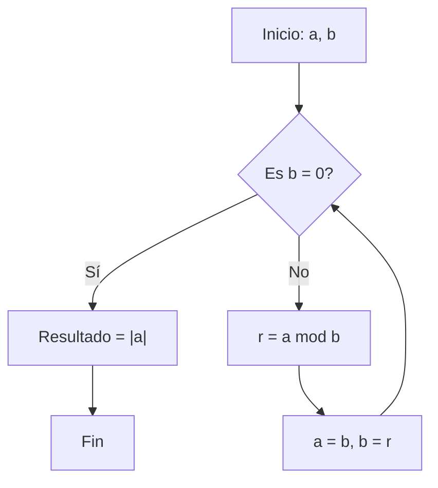
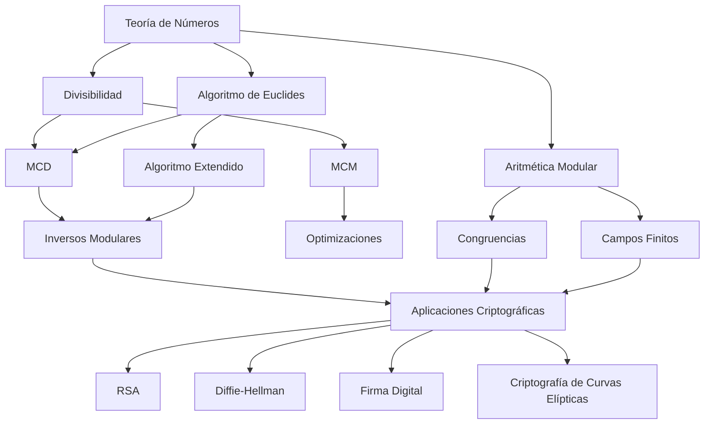

# Criptografía y Seguridad -Elementos de teoría de números y campos finitos

## 4.2 Teoremas de Fermat y de Euler, teorema chino del residuo.

---

La teoría de números es el fundamento matemático de la criptografía moderna. Los sistemas criptográficos como RSA, Diffie-Hellman, y aquellos basados en curvas elípticas, dependen críticamente de conceptos de aritmética modular y propiedades de los números enteros. Esta guía cubre los conceptos esenciales necesarios para comprender estos sistemas (Stallings, 2010).

### 1. Divisibilidad

#### Definición Formal

Sean $a, b \in \mathbb{Z}$ con $b \neq 0$. Decimos que **$b$ divide a $a$**, denotado por $b \mid a$, si existe un entero $c$ tal que:

$$a = b \cdot c$$

Si $b$ no divide a $a$, escribimos $b \nmid a$.

#### Propiedades de la Divisibilidad

1. **Reflexividad**: $a \mid a$ para todo $a \in \mathbb{Z}, a \neq 0$
2. **Transitividad**: Si $a \mid b$ y $b \mid c$, entonces $a \mid c$
3. **Linealidad**: Si $a \mid b$ y $a \mid c$, entonces $a \mid (mb + nc)$ para todo $m, n \in \mathbb{Z}$
4. Si $a \mid b$ y $b \mid a$, entonces $a = \pm b$

#### Ejemplo Práctico

- $3 \mid 15$ porque $15 = 3 \times 5$
- $4 \nmid 10$ porque no existe $c \in \mathbb{Z}$ tal que $10 = 4c$

#### Teorema de la División (Algoritmo de la División)

Para cualesquiera enteros $a$ y $b$ con $b > 0$, existen enteros únicos $q$ (cociente) y $r$ (residuo) tales que:

$$a = bq + r, \quad 0 \leq r < b$$

### 2. Máximo Común Divisor (MCD)

#### Definición

El máximo común divisor de dos enteros $a$ y $b$, no ambos cero, denotado $\text{mcd}(a, b)$ o $(a, b)$, es el mayor entero positivo que divide tanto a $a$ como a $b$.

#### Propiedades del MCD

1. $\text{mcd}(a, b) = \text{mcd}(b, a)$
2. $\text{mcd}(a, 0) = |a|$ para $a \neq 0$
3. $\text{mcd}(a, b) = \text{mcd}(-a, b) = \text{mcd}(a, -b)$
4. Si $a \mid b$, entonces $\text{mcd}(a, b) = |a|$

#### Algoritmo de Euclides

El algoritmo de Euclides es un método eficiente para calcular el MCD de dos números enteros.

##### Proceso Iterativo

Dados $a, b \in \mathbb{Z}$ con $b \neq 0$:

1. Dividir $a$ por $b$ para obtener $a = bq_1 + r_1$ con $0 \leq r_1 < b$
2. Si $r_1 = 0$, entonces $\text{mcd}(a, b) = b$
3. Si $r_1 \neq 0$, reemplazar $(a, b)$ por $(b, r_1)$ y repetir



##### Implementación en Python

```python
def mcd_euclides(a, b):
    """
    Calcula el MCD usando el algoritmo de Euclides
    Referencia: Forouzan (2008), Capítulo 9
    """
    a = abs(a)
    b = abs(b)

    while b != 0:
        a, b = b, a % b

    return a

# Ejemplo de uso
print(f"MCD(48, 18) = {mcd_euclides(48, 18)}")  # Resultado: 6
print(f"MCD(1071, 462) = {mcd_euclides(1071, 462)}")  # Resultado: 21
```

##### Ejemplo Paso a Paso

Calcular $\text{mcd}(48, 18)$:

1. $48 = 18 \times 2 + 12$ → $\text{mcd}(48, 18) = \text{mcd}(18, 12)$
2. $18 = 12 \times 1 + 6$ → $\text{mcd}(18, 12) = \text{mcd}(12, 6)$
3. $12 = 6 \times 2 + 0$ → $\text{mcd}(12, 6) = 6$

Por lo tanto, $\text{mcd}(48, 18) = 6$.

#### Algoritmo Extendido de Euclides

Este algoritmo no solo calcula $\text{mcd}(a, b)$ sino que también encuentra enteros $x, y$ tales que:

$$ax + by = \text{mcd}(a, b)$$

Esta identidad es crucial en criptografía para calcular inversos modulares.

##### Implementación del Algoritmo Extendido

```python
def euclides_extendido(a, b):
    """
    Algoritmo extendido de Euclides
    Devuelve (mcd, x, y) tal que ax + by = mcd(a, b)
    Referencia: Menezes et al. (1996), Capítulo 2
    """
    if b == 0:
        return (abs(a), 1 if a >= 0 else -1, 0)

    mcd, x1, y1 = euclides_extendido(b, a % b)
    x = y1
    y = x1 - (a // b) * y1

    return (mcd, x, y)

# Ejemplo de uso
mcd, x, y = euclides_extendido(48, 18)
print(f"48*({x}) + 18*({y}) = {mcd}")
# Resultado: 48*(-1) + 18*(3) = 6
```

### 3. Mínimo Común Múltiplo (MCM)

#### Definición

El mínimo común múltiplo de dos enteros $a$ y $b$, denotado $\text{mcm}(a, b)$ o $[a, b]$, es el menor entero positivo que es múltiplo tanto de $a$ como de $b$.

#### Relación entre MCD y MCM

Para cualquier par de enteros $a, b$:

$$\text{mcd}(a, b) \cdot \text{mcm}(a, b) = |ab|$$

Por lo tanto:

$$\text{mcm}(a, b) = \frac{|ab|}{\text{mcd}(a, b)}$$

#### Ejemplo

Calcular $\text{mcm}(12, 18)$:

1. $\text{mcd}(12, 18) = 6$
2. $\text{mcm}(12, 18) = \frac{12 \times 18}{6} = 36$

##### Implementación en Python

```python
def mcm(a, b):
    """
    Calcula el mínimo común múltiplo usando la relación con MCD
    """
    return abs(a * b) // mcd_euclides(a, b)

# Ejemplo de uso
print(f"MCM(12, 18) = {mcm(12, 18)}")  # Resultado: 36
```

### 4. Aritmética Modular

#### Definición de Congruencia

Sean $a, b \in \mathbb{Z}$ y $n \in \mathbb{Z}^+$. Decimos que **$a$ es congruente con $b$ módulo $n$**, denotado $a \equiv b \pmod{n}$, si:

$$n \mid (a - b)$$

Equivalentemente:

$$a \equiv b \pmod{n} \iff a \mod n = b \mod n$$

#### Propiedades de las Congruencias

Para $a, b, c, d \in \mathbb{Z}$ y $n \in \mathbb{Z}^+$:

1. **Reflexividad**: $a \equiv a \pmod{n}$
2. **Simetría**: Si $a \equiv b \pmod{n}$, entonces $b \equiv a \pmod{n}$
3. **Transitividad**: Si $a \equiv b \pmod{n}$ y $b \equiv c \pmod{n}$, entonces $a \equiv c \pmod{n}$
4. **Operaciones compatibles**:
   - Si $a \equiv b \pmod{n}$ y $c \equiv d \pmod{n}$, entonces:
     - $a + c \equiv b + d \pmod{n}$
     - $a - c \equiv b - d \pmod{n}$
     - $ac \equiv bd \pmod{n}$
5. **Cancelación**: Si $\text{mcd}(c, n) = 1$ y $ac \equiv bc \pmod{n}$, entonces $a \equiv b \pmod{n}$

#### Clases de Residuo

La relación de congruencia módulo $n$ divide a $\mathbb{Z}$ en $n$ clases de equivalencia:

$$\overline{a} = \{b \in \mathbb{Z} \mid b \equiv a \pmod{n}\}$$

El conjunto de todas las clases de residuo módulo $n$ se denota:

$$\mathbb{Z}_n = \{\overline{0}, \overline{1}, \overline{2}, \ldots, \overline{n-1}\}$$

#### Operaciones en $\mathbb{Z}_n$

Para $\overline{a}, \overline{b} \in \mathbb{Z}_n$:

- $\overline{a} + \overline{b} = \overline{a + b}$
- $\overline{a} \cdot \overline{b} = \overline{a \cdot b}$

#### Inverso Multiplicativo Modular

Un elemento $\overline{a} \in \mathbb{Z}_n$ tiene inverso multiplicativo si existe $\overline{b} \in \mathbb{Z}_n$ tal que:

$$\overline{a} \cdot \overline{b} \equiv \overline{1} \pmod{n}$$

El inverso existe si y solo si $\text{mcd}(a, n) = 1$, y se denota por $a^{-1} \pmod{n}$.

##### Cálculo del Inverso Modular

Para encontrar $a^{-1} \pmod{n}$ cuando $\text{mcd}(a, n) = 1$:

1. Usar el algoritmo extendido de Euclides para encontrar $x, y$ tales que $ax + ny = 1$
2. Entonces $a^{-1} \equiv x \pmod{n}$

```python
def inverso_modular(a, n):
    """
    Calcula el inverso modular a^{-1} mod n si existe
    """
    mcd, x, y = euclides_extendido(a, n)

    if mcd != 1:
        return None  # No existe inverso

    return x % n

# Ejemplo de uso
print(f"Inverso de 7 módulo 12: {inverso_modular(7, 12)}")  # Resultado: 7
# Verificación: 7 * 7 = 49 ≡ 1 mod 12
```

### 5. Teorema Fundamental de la Aritmética

#### Enunciado

Todo entero $n > 1$ puede expresarse de manera única como producto de potencias de números primos:

$$n = p_1^{e_1} p_2^{e_2} \cdots p_k^{e_k}$$

donde $p_1 < p_2 < \cdots < p_k$ son números primos y $e_i \in \mathbb{Z}^+$.

#### Aplicación al Cálculo de MCD y MCM

Si $a = p_1^{e_1} p_2^{e_2} \cdots p_k^{e_k}$ y $b = p_1^{f_1} p_2^{f_2} \cdots p_k^{f_k}$ ( con $e_i, f_i \geq 0$ ), entonces:

1. $\text{mcd}(a, b) = p_1^{\min(e_1, f_1)} p_2^{\min(e_2, f_2)} \cdots p_k^{\min(e_k, f_k)}$
2. $\text{mcm}(a, b) = p_1^{\max(e_1, f_1)} p_2^{\max(e_2, f_2)} \cdots p_k^{\max(e_k, f_k)}$

### 6. Ejercicios Propuestos

#### Ejercicio 1: Divisibilidad

1. Demuestre que si $a \mid b$ y $a \mid c$, entonces $a \mid (2b - 3c)$.
2. Encuentre todos los enteros $n$ tales que $n \mid (2n + 5)$.

#### Ejercicio 2: Algoritmo de Euclides

1. Calcule $\text{mcd}(315, 231)$ usando el algoritmo de Euclides.
2. Encuentre enteros $x, y$ tales que $315x + 231y = \text{mcd}(315, 231)$ usando el algoritmo extendido.

#### Ejercicio 3: Aritmética Modular

1. Resuelva la congruencia $5x \equiv 7 \pmod{13}$.
2. Demuestre que $n^2 \equiv 0, 1, \text{ o } 4 \pmod{8}$ para todo $n \in \mathbb{Z}$.

#### Ejercicio 4: MCD y MCM

1. Si $\text{mcd}(a, b) = 15$ y $\text{mcm}(a, b) = 180$, y se sabe que $a = 60$, encuentre $b$.
2. Demuestre que para cualquier $a, b \in \mathbb{Z}^+$, $\text{mcd}(a, b) \mid \text{mcm}(a, b)$.

#### Ejercicio 5: Aplicación Criptográfica (RSA)

En el sistema RSA:

1. Si $p = 17$ y $q = 11$, calcule $n = pq$ y $\phi(n) = (p-1)(q-1)$
2. Elija $e = 7$ y verifique que $\text{mcd}(e, \phi(n)) = 1$
3. Calcule $d = e^{-1} \pmod{\phi(n)}$ usando el algoritmo extendido de Euclides
4. Verifique que $ed \equiv 1 \pmod{\phi(n)}$

### 7. Soluciones a Ejercicios Seleccionados

#### Solución Ejercicio 2.1

Calcular $\text{mcd}(315, 231)$:

1. $315 = 231 \times 1 + 84$
2. $231 = 84 \times 2 + 63$
3. $84 = 63 \times 1 + 21$
4. $63 = 21 \times 3 + 0$
5. $\text{mcd}(315, 231) = 21$

#### Solución Ejercicio 3.1

Resolver $5x \equiv 7 \pmod{13}$:

1. Buscar inverso de 5 módulo 13
2. $5 \times 8 = 40 \equiv 1 \pmod{13}$ → $5^{-1} \equiv 8 \pmod{13}$
3. $x \equiv 7 \times 8 \equiv 56 \equiv 4 \pmod{13}$
4. Solución: $x \equiv 4 \pmod{13}$

#### Solución Ejercicio 5 (RSA)

1. $p = 17$, $q = 11$
2. $n = 17 \times 11 = 187$
3. $\phi(n) = (17-1)(11-1) = 16 \times 10 = 160$
4. $e = 7$, verificar $\text{mcd}(7, 160) = 1$ ✓
5. Calcular $d = 7^{-1} \pmod{160}$ usando Euclides extendido:
   - $160 = 7 \times 22 + 6$
   - $7 = 6 \times 1 + 1$
   - $6 = 1 \times 6 + 0$
   - Trabajando hacia atrás: $1 = 7 - 6 \times 1 = 7 - (160 - 7 \times 22) = 7 \times 23 - 160$
   - Por lo tanto, $d \equiv 23 \pmod{160}$
6. Verificación: $7 \times 23 = 161 \equiv 1 \pmod{160}$ ✓

### 8. Aplicaciones en Criptografía

#### Relevancia del MCD y Algoritmo de Euclides

1. **Generación de claves en RSA**: Verificación de que $e$ y $\phi(n)$ son coprimos
2. **Cálculo de inversos modulares**: Esencial para descifrado en RSA
3. **Algoritmo de Diffie-Hellman**: Basado en aritmética modular
4. **Criptografía de Curvas Elípticas**: Operaciones en campos finitos

#### Importancia de la Aritmética Modular

1. **Operaciones en campos finitos $\mathbb{F}_p$**: Base de muchos sistemas criptográficos
2. **Generadores de números pseudoaleatorios**
3. **Funciones hash criptográficas**
4. **Algoritmos de firma digital**

### 9. Diagrama Conceptual de Relaciones



### 10. Referencias Bibliográficas

#### Bibliografía Básica

1. **Stallings, William** (2010). _Cryptography and Network Security: Principles and Practice, 5th Edition_. Prentice Hall.
   - **Capítulo 4**: "Basic Concepts in Number Theory and Finite Fields"
   - **Sección 4.1**: "Divisibility and the Division Algorithm"
   - **Sección 4.2**: "The Euclidean Algorithm"
   - **Sección 4.3**: "Modular Arithmetic"

2. **Forouzan, Behrouz A.** (2008). _Cryptography and Network Security_. McGraw Hill.
   - **Capítulo 9**: "Mathematics of Cryptography"
   - **Sección 9.1**: "Integer Arithmetic"
   - **Sección 9.2**: "Modular Arithmetic"

3. **Pfleeger, Charles P. y Shari L. Pfleeger** (2006). _Security in Computing, 4th Edition_. Prentice Hall.
   - **Apéndice A**: "Mathematics for Cryptography"

#### Bibliografía Complementaria

1. **Stallings, William** (2010). _Network Security Essentials: Applications and Standards, 4th Edition_. Prentice Hall.
   - **Capítulo 3**: "Public-Key Cryptography and Message Authentication"

2. **Ferguson, Niels, Bruce Schneier y Tadayoshi Kohno** (2010). _Cryptography Engineering: Design Principles and Practical Applications_. Wiley.
   - **Capítulo 6**: "Introduction to Number Theory"

3. **Menezes, Alfred, Paul van Oorschot y Scott Vanstone** (1996). _Handbook of Applied Cryptography_. CRC Press.
   - **Capítulo 2**: "Mathematical Background"
   - **Sección 2.4**: "Number theory"

4. **Schneier, Bruce** (1996). _Applied Cryptography: Protocols, Algorithms, and Source Code in C, 2nd Edition_. Wiley.
   - **Capítulo 11**: "Mathematical Background"

#### Recursos Adicionales Recomendados

1. **Implementaciones prácticas**: Repositorios GitHub con implementaciones de algoritmos en Python/C++
2. **Calculadoras online**: Herramientas para verificar cálculos de MCD, MCM y congruencias
3. **Simuladores interactivos**: Para visualizar el algoritmo de Euclides
4. **Cursos online**: MIT OpenCourseWare, Coursera (Cryptography I de Stanford)

### 11. Resumen de Fórmulas Esenciales

| Concepto                  | Fórmula                                                      | Notas                               |
| ------------------------- | ------------------------------------------------------------ | ----------------------------------- |
| **Divisibilidad**         | $b \mid a \iff \exists c: a = bc$                            | $b \neq 0$                          |
| **División entera**       | $a = bq + r$, $0 \leq r < \lvert b \rvert$                   | $q$ cociente, $r$ residuo           |
| **MCD**                   | $\text{mcd}(a,b)$ mayor divisor común                        | $\text{mcd}(a,0) = \lvert a \rvert$ |
| **Algoritmo de Euclides** | $\text{mcd}(a,b) = \text{mcd}(b, a \mod b)$                  | Iterar hasta $b=0$                  |
| **Identidad de Bézout**   | $\exists x,y: ax + by = \text{mcd}(a,b)$                     | Algoritmo extendido                 |
| **MCM**                   | $\text{mcm}(a,b) = \frac{\lvert ab \rvert}{\text{mcd}(a,b)}$ | $a,b \neq 0$                        |
| **Congruencia**           | $a \equiv b \pmod{n} \iff n \mid (a-b)$                      | Relación de equivalencia            |
| **Inverso modular**       | $a^{-1} \pmod{n}$ existe $\iff \text{mcd}(a,n)=1$            | Usar algoritmo extendido            |

### 12. Consejos para el Estudio

1. **Comprender las demostraciones**: No solo memorizar algoritmos, entender por qué funcionan
2. **Practicar con ejemplos**: Resolver manualmente varios ejercicios de cada tipo
3. **Implementar los algoritmos**: Escribir código en Python para reforzar la comprensión
4. **Relacionar conceptos**: Ver cómo MCD y aritmética modular se aplican en RSA
5. **Consultar múltiples fuentes**: Usar las referencias bibliográficas para diferentes perspectivas

_Esta guía cubre los fundamentos necesarios para avanzar al estudio de campos finitos y sus aplicaciones en criptografía, que serán tratados en la siguiente sección del curso. Se recomienda dominar estos conceptos antes de proceder a temas más avanzados._
