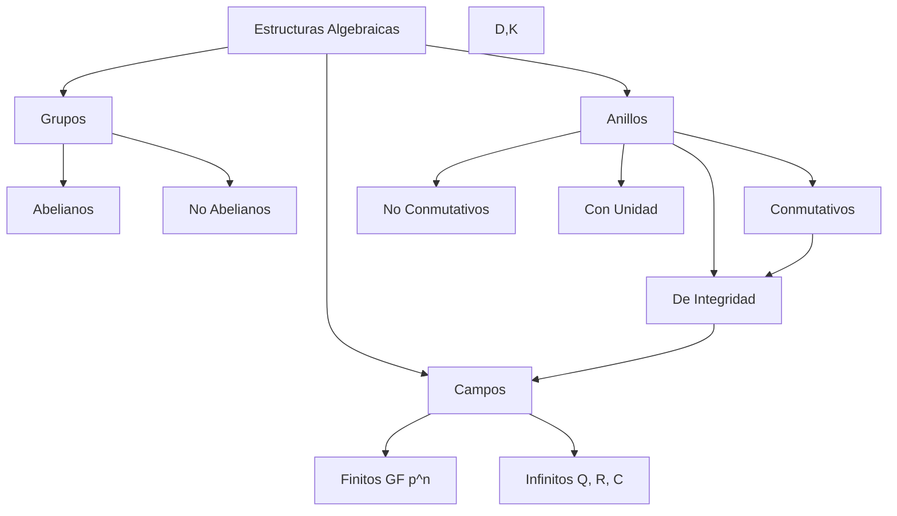
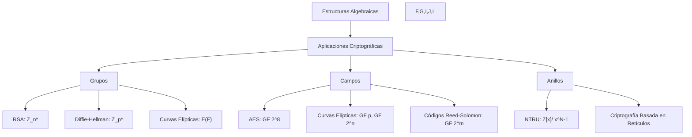

# Criptografía y Seguridad -Elementos de teoría de números y campos finitos

## 4.3 Un poco de estructuras algebraicas: grupos, anillos y campos.

---

Las estructuras algebraicas (grupos, anillos y campos) constituyen el marco matemático esencial para comprender los algoritmos criptográficos modernos. Esta guía presenta estos conceptos fundamentales con énfasis en sus aplicaciones en criptografía, siguiendo principalmente a Stallings (2010) y Menezes et al. (1996).

### 1. Grupos

#### 1.1 Definición Formal

Un **grupo** $ \lparen G, * \rparen $ es un conjunto $ G $ junto con una operación binaria $ *: G \times G \to G $ que satisface:

1. **Clausura**: $\forall a, b \in G: a * b \in G$
2. **Asociatividad**: $\forall a, b, c \in G: (a * b) * c = a * (b * c)$
3. **Elemento neutro**: $\exists e \in G: \forall a \in G: a * e = e * a = a$
4. **Elemento inverso**: $\forall a \in G, \exists a^{-1} \in G: a * a^{-1} = a^{-1} * a = e$

Si además se cumple la **conmutatividad** ( $\forall a, b \in G: a * b = b * a$ ), el grupo se denomina **abeliano** o conmutativo.

#### 1.2 Propiedades de los Grupos

**Teorema 1.1** (Propiedades básicas):

1. El elemento neutro es único
2. El inverso de cada elemento es único
3. $\forall a \in G: (a^{-1})^{-1} = a$
4. $\forall a, b \in G: (a * b)^{-1} = b^{-1} * a^{-1}$

#### 1.3 Ejemplos de Grupos

##### Ejemplo 1: Grupo aditivo de enteros

$(\mathbb{Z}, +)$ es un grupo abeliano:

- Clausura: $a + b \in \mathbb{Z}$
- Asociativa: $(a + b) + c = a + (b + c)$
- Neutro: $0$
- Inverso de $a$: $-a$

##### Ejemplo 2: Grupo multiplicativo módulo n

Para $n$ primo, $ \lparen \mathbb{Z}_n^*, \cdot \rparen $ donde $ \mathbb{Z}_n ^ * = \lbrace a \in \mathbb{Z}_n : \text{mcd}(a, n) = 1\rbrace $ es un grupo abeliano bajo multiplicación módulo $n$.

##### Ejemplo 3: Grupo de simetrías

El conjunto de simetrías de un cuadrado forma un grupo no abeliano bajo composición.

#### 1.4 Subgrupos

**Definición**: Un subconjunto $H \subseteq G$ es un **subgrupo** de $G$ si $(H, *)$ es un grupo con la misma operación.

**Teorema 1.2** (Criterio de subgrupo): $H \subseteq G$ es subgrupo si:

1. $e \in H$
2. $\forall a, b \in H: a * b \in H$ (clausura)
3. $\forall a \in H: a^{-1} \in H$

#### 1.5 Orden de un Grupo y de un Elemento

**Definiciones**:

- **Orden del grupo**: $|G|$ = número de elementos en $G$
- **Orden de un elemento**: Para $a \in G$, el menor entero positivo $n$ tal que $a^n = e$ (si existe)

**Teorema 1.3** (Lagrange): Si $G$ es finito y $H$ es subgrupo de $G$, entonces $|H|$ divide $|G|$.

```python
class Grupo:
    """Implementación básica de un grupo finito"""

    def __init__(self, conjunto, operacion, neutro, inversos):
        self.conjunto = conjunto
        self.operacion = operacion  # función (a, b) -> a*b
        self.neutro = neutro
        self.inversos = inversos  # diccionario a -> a^{-1}

    def verificar_grupo(self):
        """Verifica los axiomas de grupo"""
        resultados = []

        # 1. Clausura
        clausura = all(
            self.operacion(a, b) in self.conjunto
            for a in self.conjunto
            for b in self.conjunto
        )
        resultados.append(("Clausura", clausura))

        # 2. Asociatividad (verificación para grupos pequeños)
        asociativa = True
        for a in self.conjunto:
            for b in self.conjunto:
                for c in self.conjunto:
                    ab_c = self.operacion(self.operacion(a, b), c)
                    a_bc = self.operacion(a, self.operacion(b, c))
                    if ab_c != a_bc:
                        asociativa = False
        resultados.append(("Asociatividad", asociativa))

        # 3. Elemento neutro
        neutro_ok = all(
            self.operacion(a, self.neutro) == a and
            self.operacion(self.neutro, a) == a
            for a in self.conjunto
        )
        resultados.append(("Elemento neutro", neutro_ok))

        # 4. Elementos inversos
        inversos_ok = all(
            self.operacion(a, self.inversos[a]) == self.neutro and
            self.operacion(self.inversos[a], a) == self.neutro
            for a in self.conjunto
        )
        resultados.append(("Elementos inversos", inversos_ok))

        return resultados

# Ejemplo: Grupo aditivo módulo 4
def suma_mod_4(a, b):
    return (a + b) % 4

grupo_Z4 = Grupo(
    conjunto={0, 1, 2, 3},
    operacion=suma_mod_4,
    neutro=0,
    inversos={0: 0, 1: 3, 2: 2, 3: 1}
)

print("Verificación de grupo Z4:")
for propiedad, valor in grupo_Z4.verificar_grupo():
    print(f"  {propiedad}: {valor}")
```

### 2. Anillos

#### 2.1 Definición Formal

Un **anillo** $(R, +, \cdot)$ es un conjunto $R$ con dos operaciones binarias (usualmente llamadas suma y multiplicación) que satisface:

1. $(R, +)$ es un **grupo abeliano**:
   - Clausura de la suma
   - Asociatividad de la suma
   - Elemento neutro aditivo (0)
   - Elemento inverso aditivo (-a)
   - Conmutatividad de la suma

2. **Propiedades de la multiplicación**:
   - Clausura: $\forall a, b \in R: a \cdot b \in R$
   - Asociatividad: $\forall a, b, c \in R: (a \cdot b) \cdot c = a \cdot (b \cdot c)$

3. **Distributividad**:
   - $a \cdot (b + c) = a \cdot b + a \cdot c$
   - $(a + b) \cdot c = a \cdot c + b \cdot c$

Si además la multiplicación es conmutativa, el anillo se llama **anillo conmutativo**. Si existe elemento neutro multiplicativo (1), se llama **anillo con unidad**.

#### 2.2 Ejemplos de Anillos

##### Ejemplo 1: Anillo de los enteros

$(\mathbb{Z}, +, \cdot)$ es un anillo conmutativo con unidad.

##### Ejemplo 2: Anillo de polinomios

$\mathbb{Z}[x]$ (polinomios con coeficientes enteros) es un anillo conmutativo con unidad.

##### Ejemplo 3: Anillo de matrices

$M_{n \times n}(\mathbb{R})$ (matrices cuadradas reales) es un anillo no conmutativo con unidad.

#### 2.3 Tipos Especiales de Anillos

**Anillo de integridad**: Anillo conmutativo con unidad sin divisores de cero ( si $ab = 0$, entonces $a=0$ o $b=0$ ).

**Cuerpo**: Anillo conmutativo con unidad donde todo elemento no nulo tiene inverso multiplicativo.



### 3. Campos

#### 3.1 Definición Formal

Un **campo** $(F, +, \cdot)$ es un conjunto $F$ con dos operaciones binarias que satisface:

1. $(F, +)$ es un grupo abeliano con elemento neutro $0$
2. $(F^*, \cdot)$ es un grupo abeliano, donde $F^* = F \setminus \{0\}$, con elemento neutro $1$
3. **Distributividad**: $\forall a, b, c \in F: a \cdot (b + c) = a \cdot b + a \cdot c$

En otras palabras, un campo es un anillo conmutativo con unidad donde todo elemento no nulo tiene inverso multiplicativo.

#### 3.2 Propiedades de los Campos

**Teorema 3.1**: En un campo $F$:

1. $a \cdot 0 = 0 \cdot a = 0$ para todo $a \in F$
2. Si $a \cdot b = 0$, entonces $a = 0$ o $b = 0$ (no hay divisores de cero)
3. $(-a) \cdot b = a \cdot (-b) = -(a \cdot b)$
4. $a^{-1}$ es único para cada $a \neq 0$

#### 3.3 Ejemplos de Campos

##### Ejemplo 1: Campos infinitos

- $\mathbb{Q}$: números racionales
- $\mathbb{R}$: números reales
- $\mathbb{C}$: números complejos

##### Ejemplo 2: Campos finitos (Galois)

- $\mathbb{F}_p = \mathbb{Z}_p$ para $p$ primo
- $\mathbb{F}_{p^n}$: campos de Galois con $p^n$ elementos

#### 3.4 Campos Finitos (Campos de Galois)

**Teorema 3.2** (Existencia de campos finitos): Existe un campo finito con $q$ elementos si y solo si $q = p^n$ donde $p$ es primo y $n \in \mathbb{N}$. Denotamos este campo como $GF(q)$ o $\mathbb{F}_q$.

##### Construcción de $GF(p)$

Para $p$ primo, $GF(p) = \mathbb{Z}_p$ con suma y multiplicación módulo $p$.

##### Construcción de $GF(p^n)$

Para $n > 1$, se construye como $\mathbb{F}_p[x]/(f(x))$ donde $f(x)$ es un polinomio irreducible de grado $n$ sobre $\mathbb{F}_p$.

```python
class CampoFinito:
    """Implementación de un campo finito GF(p)"""

    def __init__(self, p):
        if not self.es_primo(p):
            raise ValueError(f"{p} no es primo")
        self.p = p
        self.elementos = list(range(p))

    @staticmethod
    def es_primo(n):
        """Verifica si n es primo"""
        if n < 2:
            return False
        for i in range(2, int(n**0.5) + 1):
            if n % i == 0:
                return False
        return True

    def suma(self, a, b):
        """Suma en GF(p)"""
        return (a + b) % self.p

    def producto(self, a, b):
        """Producto en GF(p)"""
        return (a * b) % self.p

    def inverso_aditivo(self, a):
        """Inverso aditivo en GF(p)"""
        return (-a) % self.p

    def inverso_multiplicativo(self, a):
        """Inverso multiplicativo en GF(p) usando algoritmo extendido de Euclides"""
        if a == 0:
            raise ValueError("0 no tiene inverso multiplicativo")

        # Algoritmo extendido de Euclides
        def egcd(a, b):
            if b == 0:
                return (a, 1, 0)
            g, x1, y1 = egcd(b, a % b)
            return (g, y1, x1 - (a // b) * y1)

        g, x, y = egcd(a, self.p)
        if g != 1:
            raise ValueError(f"{a} no tiene inverso en GF({self.p})")

        return x % self.p

    def verificar_campo(self):
        """Verifica los axiomas de campo"""
        resultados = []

        # 1. (F, +) es grupo abeliano
        resultados.append(("Grupo aditivo abeliano", True))  # Simplificado

        # 2. (F*, ·) es grupo abeliano
        abeliano_multi = all(
            self.producto(a, b) == self.producto(b, a)
            for a in self.elementos if a != 0
            for b in self.elementos if b != 0
        )
        resultados.append(("Grupo multiplicativo abeliano", abeliano_multi))

        # 3. Distributividad
        distributivo = all(
            self.producto(a, self.suma(b, c)) ==
            self.suma(self.producto(a, b), self.producto(a, c))
            for a in self.elementos
            for b in self.elementos
            for c in self.elementos
        )
        resultados.append(("Distributividad", distributivo))

        return resultados

# Ejemplo: GF(5)
gf5 = CampoFinito(5)
print(f"Campo GF(5):")
print(f"  3 + 4 = {gf5.suma(3, 4)}")
print(f"  3 * 4 = {gf5.producto(3, 4)}")
print(f"  Inverso aditivo de 2: {gf5.inverso_aditivo(2)}")
print(f"  Inverso multiplicativo de 3: {gf5.inverso_multiplicativo(3)}")
print(f"  Verificación: 3 * {gf5.inverso_multiplicativo(3)} = {gf5.producto(3, gf5.inverso_multiplicativo(3))} mod 5")
```

### 4. Homomorfismos e Isomorfismos

#### 4.1 Homomorfismo de Grupos

**Definición**: Una función $\phi: G \to H$ entre grupos es un **homomorfismo** si:

$$\forall a, b \in G: \phi(a * b) = \phi(a) * \phi(b)$$

**Propiedades**:

1. $\phi(e_G) = e_H$
2. $\phi(a^{-1}) = (\phi(a))^{-1}$

#### 4.2 Isomorfismo de Grupos

**Definición**: Un homomorfismo biyectivo se llama **isomorfismo**. Dos grupos son isomorfos si existe un isomorfismo entre ellos ( notación: $G \cong H$ ).

#### 4.3 Homomorfismo de Anillos

**Definición**: $\phi: R \to S$ entre anillos es un homomorfismo si:

1. $\phi(a + b) = \phi(a) + \phi(b)$
2. $\phi(a \cdot b) = \phi(a) \cdot \phi(b)$
3. $\phi(1_R) = 1_S$ (si los anillos tienen unidad)

#### 4.4 Aplicación en Criptografía

Los isomorfismos permiten transferir problemas entre estructuras algebraicas, lo que se utiliza en criptografía basada en el problema del logaritmo discreto en diferentes grupos.

### 5. Ejercicios Propuestos

#### Ejercicio 1: Grupos

1. Demuestre que el conjunto $\{1, -1, i, -i\}$ con la multiplicación compleja forma un grupo. ¿Es abeliano?
2. Sea $G = \{z \in \mathbb{C} : |z| = 1\}$. Demuestre que $G$ es un grupo bajo multiplicación.
3. Encuentre todos los subgrupos de $(\mathbb{Z}_6, +)$.

#### Ejercicio 2: Anillos

1. Demuestre que $\mathbb{Z}_n$ es un anillo conmutativo con unidad para cualquier $n \geq 2$.
2. ¿Es $\mathbb{Z}_6$ un anillo de integridad? Justifique.
3. Sea $R = \{a + b\sqrt{2} : a, b \in \mathbb{Z}\}$. Demuestre que $R$ es un anillo con las operaciones usuales.

#### Ejercicio 3: Campos

1. Demuestre que $\mathbb{Z}_p$ es un campo si y solo si $p$ es primo.
2. Construya las tablas de suma y multiplicación para $GF(3)$.
3. Demuestre que en un campo, la ecuación $ax = b$ tiene solución única si $a \neq 0$.

#### Ejercicio 4: Homomorfismos

1. Sea $\phi: \mathbb{Z} \to \mathbb{Z}_n$ definida por $\phi(k) = k \mod n$. Demuestre que $\phi$ es un homomorfismo de anillos.
2. ¿Existe un isomorfismo entre $(\mathbb{Z}_4, +)$ y el grupo de Klein $V_4$? Justifique.

#### Ejercicio 5: Aplicación Criptográfica

En el algoritmo Diffie-Hellman se utiliza el grupo multiplicativo $\mathbb{Z}_p^*$ para $p$ primo:

1. Demuestre que $|\mathbb{Z}_p^*| = p-1$
2. Verifique que para $p=7$, $\mathbb{Z}_7^* = \{1, 2, 3, 4, 5, 6\}$ forma un grupo bajo multiplicación módulo 7
3. Encuentre todos los generadores de $\mathbb{Z}_7^*$

### 6. Soluciones a Ejercicios Seleccionados

#### Solución Ejercicio 1.1

El conjunto $G = \{1, -1, i, -i\}$ con multiplicación compleja:

- **Clausura**: La tabla de multiplicación muestra que el producto de cualesquiera dos elementos está en $G$
- **Asociatividad**: La multiplicación compleja es asociativa
- **Elemento neutro**: $1$
- **Elementos inversos**: $1^{-1}=1$, $-1^{-1}=-1$, $i^{-1}=-i$, $-i^{-1}=i$
- **Conmutatividad**: La multiplicación compleja es conmutativa

Por lo tanto, $(G, \cdot)$ es un grupo abeliano.

#### Solución Ejercicio 2.2

$\mathbb{Z}_6$ no es un anillo de integridad porque tiene divisores de cero. Por ejemplo:

$$2 \cdot 3 \equiv 0 \pmod{6}$$

pero $2 \not\equiv 0 \pmod{6}$ y $3 \not\equiv 0 \pmod{6}$.

#### Solución Ejercicio 3.1

$\mathbb{Z}_p$ es campo si y solo si $p$ es primo:

- **Si $p$ es primo**: Todo $a \in \{1, 2, ..., p-1\}$ satisface $\text{mcd}(a, p)=1$, luego tiene inverso multiplicativo módulo $p$.
- **Si $p$ no es primo**: Existen $a, b \neq 0$ tales que $ab \equiv 0 \pmod{p}$, por lo que no todos los elementos no nulos tienen inverso.

#### Solución Ejercicio 5.3

Para $\mathbb{Z}_7^* = \{1, 2, 3, 4, 5, 6\}$:

- Orden del grupo: $|\mathbb{Z}_7^*| = 6$
- Un elemento $g$ es generador si $\{g^k : k=1,...,6\} = \mathbb{Z}_7^*$
- Probamos:
  - $2^1=2$, $2^2=4$, $2^3=1$, $2^4=2$, ... → No genera
  - $3^1=3$, $3^2=2$, $3^3=6$, $3^4=4$, $3^5=5$, $3^6=1$ → Generador
  - $5^1=5$, $5^2=4$, $5^3=6$, $5^4=2$, $5^5=3$, $5^6=1$ → Generador

Los generadores de $\mathbb{Z}_7^*$ son 3 y 5.

### 7. Aplicaciones en Criptografía

#### 7.1 Grupos en Criptografía

- **RSA**: Grupo multiplicativo $\mathbb{Z}_n^*$ donde $n=pq$
- **Diffie-Hellman**: Grupo cíclico $\mathbb{Z}_p^*$ o grupo de puntos de una curva elíptica
- **Firma Digital**: Grupos donde el problema del logaritmo discreto es difícil

#### 7.2 Campos en Criptografía

- **AES (Advanced Encryption Standard)**: Opera en el campo $GF(2^8)$
- **Criptografía de Curvas Elípticas**: Campos finitos $GF(p)$ o $GF(2^n)$
- **Códigos Correctores**: Campos de Galois para detección y corrección de errores

#### 7.3 Anillos en Criptografía

- **Criptografía basada en retículos**: Anillos de polinomios
- **NTRU**: Criptosistema basado en anillos de polinomios



### 8. Referencias Bibliográficas

#### Bibliografía Básica

1. **Stallings, William** (2010). _Cryptography and Network Security: Principles and Practice, 5th Edition_. Prentice Hall.
   - **Capítulo 4**: "Basic Concepts in Number Theory and Finite Fields"
   - **Sección 4.4**: "Groups, Rings, and Fields"
   - **Sección 4.5**: "Finite Fields of the Form GF(p)"
   - **Sección 4.6**: "Polynomial Arithmetic"
   - **Sección 4.7**: "Finite Fields of the Form GF(2^n)"

2. **Forouzan, Behrouz A.** (2008). _Cryptography and Network Security_. McGraw Hill.
   - **Capítulo 4**: "Mathematics of Cryptography: Algebraic Structures"
   - **Sección 4.1**: "Groups"
   - **Sección 4.2**: "Rings"
   - **Sección 4.3**: "Fields"

3. **Pfleeger, Charles P. y Shari L. Pfleeger** (2006). _Security in Computing, 4th Edition_. Prentice Hall.
   - **Apéndice A**: "Mathematics for Cryptography"
   - **Sección A.2**: "Algebraic Structures"

#### Bibliografía Complementaria

1. **Stallings, William** (2010). _Network Security Essentials: Applications and Standards, 4th Edition_. Prentice Hall.
   - **Capítulo 3**: "Public-Key Cryptography and Message Authentication"

2. **Ferguson, Niels, Bruce Schneier y Tadayoshi Kohno** (2010). _Cryptography Engineering: Design Principles and Practical Applications_. Wiley.
   - **Capítulo 6**: "Introduction to Number Theory"
   - **Sección 6.4**: "Groups, Rings, and Fields"

3. **Menezes, Alfred, Paul van Oorschot y Scott Vanstone** (1996). _Handbook of Applied Cryptography_. CRC Press.
   - **Capítulo 2**: "Mathematical Background"
   - **Sección 2.5**: "Abstract algebra"
   - **Sección 2.6**: "Finite fields"

4. **Schneier, Bruce** (1996). _Applied Cryptography: Protocols, Algorithms, and Source Code in C, 2nd Edition_. Wiley.
   - **Capítulo 11**: "Mathematical Background"
   - **Sección 11.3**: "Algebra"

#### Recursos Adicionales

1. **Libros de Álgebra Abstracta**:
   - Fraleigh, J.B. _A First Course in Abstract Algebra_
   - Herstein, I.N. _Topics in Algebra_

2. **Recursos Online**:
   - MIT OpenCourseWare: 18.701 Algebra I
   - Grupo de estudio de criptografía en Crypto Stack Exchange

3. **Software para experimentación**:
   - SageMath para cálculos con estructuras algebraicas
   - Python con sympy para álgebra simbólica

### 9. Resumen de Conceptos Clave

| Estructura           | Operaciones           | Propiedades                                                | Ejemplos en Criptografía                                       |
| -------------------- | --------------------- | ---------------------------------------------------------- | -------------------------------------------------------------- |
| **Grupo** $(G,*)$    | Una operación binaria | Clausura, Asociatividad, Neutro, Inversos                  | $\mathbb{Z}_n^+$, $\mathbb{Z}_p^*$, $E(\mathbb{F}_q)$          |
| **Anillo** $(R,+,·)$ | Dos operaciones       | $(R,+)$ grupo abeliano, $(R,·)$ semigrupo, Distributividad | $\mathbb{Z}_n$, $\mathbb{F}_p[x]$, Matrices                    |
| **Campo** $(F,+,·)$  | Dos operaciones       | $(F,+)$ y $(F^*,·)$ grupos abelianos, Distributividad      | $\mathbb{F}_p$, $\mathbb{F}_{2^n}$, $\mathbb{R}$, $\mathbb{C}$ |

#### Fórmulas Importantes

1. **Orden de un grupo**: $|G| =$ número de elementos
2. **Teorema de Lagrange**: Si $H \leq G$ finito, entonces $|H|$ divide $|G|$
3. **Estructura de campos finitos**: Existe $GF(p^n)$ si y solo si $p$ es primo
4. **Cardinalidad de $GF(p^n)$**: $p^n$ elementos
5. **Grupo multiplicativo de un campo finito**: $GF(p^n)^*$ es cíclico de orden $p^n - 1$

### 10. Consejos para el Estudio

1. **Comprender las definiciones axiomáticas**: Cada estructura se define por sus propiedades fundamentales
2. **Construir ejemplos concretos**: Implementar grupos, anillos y campos en Python
3. **Identificar estructuras en algoritmos criptográficos**: Reconocer qué estructura algebraica subyace a cada algoritmo
4. **Practicar con tablas de operaciones**: Para grupos y campos pequeños
5. **Relacionar con teoría de números**: Los campos finitos extienden la aritmética modular
6. **Consultar múltiples fuentes**: Comparar las presentaciones en Stallings, Forouzan y Menezes

_Esta guía proporciona los fundamentos algebraicos necesarios para comprender los algoritmos criptográficos modernos. Se recomienda dominar estos conceptos antes de estudiar aplicaciones específicas como RSA, Diffie-Hellman o criptografía de curvas elípticas._
