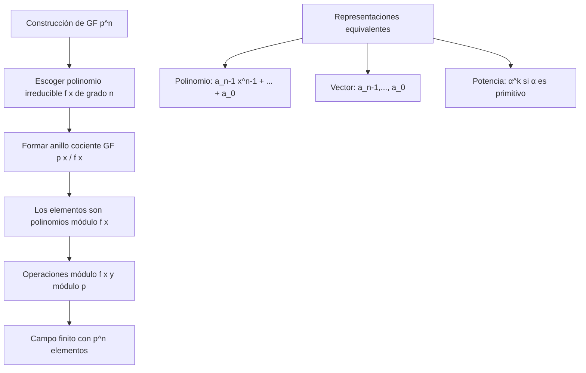

# Criptografía y Seguridad -Elementos de teoría de números y campos finitos

## 4.4 Campos finitos, polinomios.

---

Los campos finitos (también llamados campos de Galois) son estructuras algebraicas fundamentales en criptografía moderna. Sistemas como AES, ECC (Criptografía de Curvas Elípticas) y algoritmos de corrección de errores utilizan extensivamente campos finitos. Esta guía cubre la teoría y construcción de campos finitos mediante polinomios, siguiendo principalmente a Stallings (2010) y Menezes et al. (1996).

### 1. Campos Finitos: Definición y Propiedades Básicas

#### 1.1 Definición Formal

Un **campo finito** (o campo de Galois) es un campo que contiene un número finito de elementos. Denotado como $GF(q)$ o $\mathbb{F}_q$, donde $q$ es el número de elementos.

**Teorema 1.1** (Característica de un campo finito):
Todo campo finito tiene característica prima $p$ ( el menor entero positivo tal que $p \cdot 1 = 0$ ), y su cardinalidad es $q = p^n$ para algún $n \geq 1$.

#### 1.2 Teorema Fundamental de los Campos Finitos

**Teorema 1.2** (Existencia y unicidad):

1. Para cada potencia de primo $q = p^n$, existe un campo finito con $q$ elementos.
2. Dos campos finitos con el mismo número de elementos son isomorfos.

#### 1.3 Estructura de Campos Finitos

Para $GF(p^n)$:

- Característica: $p$
- Grupo aditivo: Isomorfo a $(\mathbb{Z}_p)^n$ (suma componente a componente)
- Grupo multiplicativo: $GF(p^n)^* = GF(p^n) \setminus \{0\}$ es cíclico de orden $p^n - 1$

```python
def es_potencia_de_primo(q):
    """Verifica si q es potencia de un número primo"""
    if q < 2:
        return False, None, None

    # Encontrar el menor divisor primo
    for p in range(2, int(q**0.5) + 1):
        if q % p == 0:
            # Verificar si es potencia de p
            temp = q
            n = 0
            while temp % p == 0:
                temp //= p
                n += 1
            if temp == 1:
                return True, p, n
            return False, None, None

    # q es primo (n=1)
    return True, q, 1

# Ejemplos
print(f"8 es potencia de primo? {es_potencia_de_primo(8)}")  # (True, 2, 3)
print(f"9 es potencia de primo? {es_potencia_de_primo(9)}")  # (True, 3, 2)
print(f"10 es potencia de primo? {es_potencia_de_primo(10)}") # (False, None, None)
```

### 2. Polinomios sobre Campos Finitos

#### 2.1 Anillo de Polinomios

El conjunto de polinomios con coeficientes en $GF(p)$ se denota $GF(p)[x]$. Es un **anillo de polinomios** con las operaciones usuales.

**Ejemplo**: $GF(2)[x]$ contiene polinomios como:

- $x^3 + x + 1$
- $x^4 + x^2 + 1$
- $1$ (polinomio constante)

#### 2.2 Grado de un Polinomio

Para $f(x) = a_nx^n + a_{n-1}x^{n-1} + \cdots + a_1x + a_0$ con $a_n \neq 0$:

$$\deg(f) = n$$

#### 2.3 Polinomios Irreducibles

**Definición 2.1**: Un polinomio $f(x) \in GF(p)[x]$ de grado $n \geq 1$ es **irreducible** si no puede factorizarse como producto de dos polinomios de grado menor.

**Teorema 2.1**: Para cada $n \geq 1$, existe al menos un polinomio irreducible de grado $n$ sobre $GF(p)$.

#### 2.4 Polinomios Primitivos

**Definición 2.2**: Un polinomio irreducible $f(x)$ de grado $n$ sobre $GF(p)$ es **primitivo** si las raíces de $f(x)$ en $GF(p^n)$ son generadores del grupo multiplicativo $GF(p^n)^*$.

**Propiedad**: Si $\alpha$ es raíz de un polinomio primitivo de grado $n$, entonces:

$$GF(p^n) = \{0, 1, \alpha, \alpha^2, \ldots, \alpha^{p^n-2}\}$$

### 3. Construcción de Campos Finitos $GF(p^n)$

#### 3.1 Método de Construcción

Para construir $GF(p^n)$:

1. Escoger un polinomio irreducible $f(x)$ de grado $n$ sobre $GF(p)$
2. Definir $GF(p^n) = GF(p)[x] / \langle f(x) \rangle$
3. Los elementos son clases de equivalencia de polinomios módulo $f(x)$
4. La suma y multiplicación se realizan módulo $f(x)$

#### 3.2 Representación de Elementos

Cada elemento de $GF(p^n)$ puede representarse como:

1. **Polinomio**: $a_{n-1}x^{n-1} + \cdots + a_1x + a_0$, $a_i \in GF(p)$
2. **Vector**: $(a_{n-1}, \ldots, a_1, a_0)$
3. **Potencia de elemento primitivo**: $\alpha^k$ (si $\alpha$ es generador)



#### 3.3 Ejemplo: Construcción de $GF(2^3)$

**Paso 1**: Escoger polinomio irreducible de grado 3 sobre $GF(2)$.
Opción: $f(x) = x^3 + x + 1$ ( es irreducible sobre $GF(2)$ ).

**Paso 2**: Los elementos de $GF(2^3)$ son polinomios de grado < 3:

$$GF(2^3) = \{0, 1, x, x+1, x^2, x^2+1, x^2+x, x^2+x+1\}$$

**Paso 3**: Si $\alpha$ es raíz de $f(x)$ ( es decir, $\alpha^3 + \alpha + 1 = 0$ ), entonces:

- $\alpha^3 = \alpha + 1$ ( en $GF(2)$ )
- Podemos expresar todos los elementos como potencias de $\alpha$

```python
class GF2n:
    """Implementación de GF(2^n) usando representación polinomial"""

    def __init__(self, n, poly_irreducible=None):
        """
        Inicializa GF(2^n)
        n: grado de la extensión
        poly_irreducible: polinomio irreducible en forma de lista de coeficientes
        """
        self.n = n
        self.p = 2

        if poly_irreducible is None:
            # Polinomios irreducibles comunes para GF(2^n)
            irreducible_polys = {
                2: [1, 1, 1],           # x^2 + x + 1
                3: [1, 0, 1, 1],        # x^3 + x + 1
                4: [1, 0, 0, 1, 1],     # x^4 + x + 1
                8: [1, 0, 0, 0, 1, 1, 0, 1, 1]  # x^8 + x^4 + x^3 + x + 1 (AES)
            }
            if n in irreducible_polys:
                self.irreducible = irreducible_polys[n]
            else:
                raise ValueError(f"No hay polinomio irreducible predefinido para n={n}")
        else:
            self.irreducible = poly_irreducible

        # Verificar que el polinomio sea de grado n
        if len(self.irreducible) != n + 1:
            raise ValueError(f"El polinomio debe ser de grado {n}")

    def poly_to_int(self, poly):
        """Convierte lista de coeficientes a entero"""
        result = 0
        for coeff in poly:
            result = (result << 1) | (coeff & 1)
        return result

    def int_to_poly(self, num):
        """Convierte entero a lista de coeficientes"""
        poly = []
        for _ in range(self.n):
            poly.append(num & 1)
            num >>= 1
        return poly[::-1]

    def add(self, a, b):
        """Suma en GF(2^n) - XOR bit a bit"""
        return a ^ b

    def multiply(self, a, b):
        """Multiplicación en GF(2^n)"""
        # Multiplicación polinomial seguida de reducción módulo el polinomio irreducible
        result = 0
        for i in range(self.n):
            if (b >> i) & 1:
                result ^= a << i

        # Reducción módulo el polinomio irreducible
        return self._reduce(result)

    def _reduce(self, poly):
        """Reduce un polinomio módulo el polinomio irreducible"""
        irr_int = self.poly_to_int(self.irreducible)
        irr_degree = self.n

        # Eliminar el bit más alto del polinomio irreducible para el algoritmo
        irr_without_msb = irr_int & ((1 << irr_degree) - 1)

        # Algoritmo de reducción
        for i in range(2 * irr_degree - 2, irr_degree - 1, -1):
            if (poly >> i) & 1:
                poly ^= irr_without_msb << (i - irr_degree)

        return poly & ((1 << irr_degree) - 1)

    def inverse(self, a):
        """Calcula el inverso multiplicativo usando el algoritmo extendido de Euclides"""
        if a == 0:
            raise ValueError("0 no tiene inverso")

        # Algoritmo extendido de Euclides para polinomios
        def egcd_poly(a, b):
            if b == 0:
                return (a, 1, 0)
            g, x1, y1 = egcd_poly(b, self._reduce(a))
            return (g, y1, x1 ^ self.multiply(self._divide(a, b), y1))

        def _divide(a, b):
            # División de polinomios (simplificada)
            result = 0
            while self._degree(a) >= self._degree(b):
                shift = self._degree(a) - self._degree(b)
                result ^= 1 << shift
                a ^= b << shift
            return result

        g, x, y = egcd_poly(a, self.poly_to_int(self.irreducible))
        return x & ((1 << self.n) - 1)

    def _degree(self, poly):
        """Calcula el grado de un polinomio representado como entero"""
        if poly == 0:
            return -1
        degree = 0
        while poly > 0:
            poly >>= 1
            degree += 1
        return degree - 1

    def generate_field(self):
        """Genera todos los elementos del campo"""
        elements = []
        for i in range(1 << self.n):
            elements.append(i)
        return elements

# Ejemplo: GF(2^3)
gf8 = GF2n(3)
print("GF(2^3) con polinomio irreducible x^3 + x + 1")
print(f"Polinomio irreducible: {gf8.irreducible}")

# Operaciones de ejemplo
a = 0b101  # x^2 + 1
b = 0b011  # x + 1

print(f"\nOperaciones:")
print(f"a = {bin(a)} (x^2 + 1)")
print(f"b = {bin(b)} (x + 1)")
print(f"a + b = {bin(gf8.add(a, b))} (XOR)")
print(f"a * b = {bin(gf8.multiply(a, b))}")
print(f"Inverso de a = {bin(gf8.inverse(a))}")
```

### 4. Aritmética en Campos Finitos

#### 4.1 Suma en $GF(p^n)$

Para elementos representados como polinomios:

$$(a_{n-1}x^{n-1} + \cdots + a_0) + (b_{n-1}x^{n-1} + \cdots + b_0) = \sum_{i=0}^{n-1} (a_i + b_i \mod p)x^i$$

En $GF(2^n)$, la suma es XOR bit a bit.

#### 4.2 Multiplicación en $GF(p^n)$

La multiplicación se realiza en dos pasos:

1. Multiplicación polinomial usual
2. Reducción módulo el polinomio irreducible $f(x)$

**Algoritmo**:

1. Calcular $c(x) = a(x) \cdot b(x)$
2. Encontrar $r(x)$ tal que $c(x) = q(x)f(x) + r(x)$ con $\deg(r) < n$
3. Resultado: $r(x)$

#### 4.3 Inverso Multiplicativo

Para $a(x) \in GF(p^n)^*$, el inverso $a(x)^{-1}$ satisface:

$$a(x) \cdot a(x)^{-1} \equiv 1 \pmod{f(x)}$$

Se calcula usando el **algoritmo extendido de Euclides** para polinomios.

### 5. Polinomios Irreducibles y Primitivos

#### 5.1 Contando Polinomios Irreducibles

**Fórmula 5.1** ( Número de polinomios irreducibles de grado $n$ sobre $GF(p)$ ):

$$N_p(n) = \frac{1}{n} \sum_{d|n} \mu(d) p^{n/d}$$

donde $\mu$ es la función de Möbius.

**Ejemplo**: Para $p=2, n=4$:

$$N_2(4) = \frac{1}{4} (\mu(1)2^4 + \mu(2)2^2 + \mu(4)2^1) = \frac{1}{4}(16 - 4 + 0) = 3$$

#### 5.2 Polinomios Primitivos

**Teorema 5.1**: El número de polinomios primitivos de grado $n$ sobre $GF(p)$ es:

$$\frac{\phi(p^n - 1)}{n}$$

donde $\phi$ es la función totient de Euler.

**Ejemplo**: Para $GF(2^4)$:

- $2^4 - 1 = 15$
- $\phi(15) = 8$
- Número de polinomios primitivos: $8/4 = 2$

#### 5.3 Tabla de Polinomios Irreducibles para $GF(2^n)$

| n   | Polinomios Irreducibles sobre GF(2)                       | AES |
| --- | --------------------------------------------------------- | --- |
| 2   | $x^2 + x + 1$                                             |     |
| 3   | $x^3 + x + 1$, $x^3 + x^2 + 1$                            |     |
| 4   | $x^4 + x + 1$, $x^4 + x^3 + 1$, $x^4 + x^3 + x^2 + x + 1$ |     |
| 8   | $x^8 + x^4 + x^3 + x + 1$                                 | ✓   |

### 6. Campos Finitos en Criptografía

#### 6.1 AES (Advanced Encryption Standard)

AES utiliza $GF(2^8)$ con polinomio irreducible:

$$f(x) = x^8 + x^4 + x^3 + x + 1$$

Las operaciones en MixColumns y SubBytes se realizan en $GF(2^8)$.

#### 6.2 Criptografía de Curvas Elípticas (ECC)

Las curvas elípticas pueden definirse sobre:

- $GF(p)$ para $p$ primo grande
- $GF(2^n)$ para eficiencia en hardware

#### 6.3 Códigos Correctores de Errores

**Códigos Reed-Solomon**: Operan en $GF(2^m)$ y pueden corregir múltiples errores.

### 7. Ejercicios Propuestos

#### Ejercicio 1: Polinomios sobre GF(2)

1. Factorice $x^4 + x^2 + 1$ sobre $GF(2)$
2. Demuestre que $x^3 + x + 1$ es irreducible sobre $GF(2)$
3. Encuentre todos los polinomios irreducibles de grado 2 sobre $GF(3)$

#### Ejercicio 2: Construcción de Campos

1. Construya $GF(2^2)$ usando el polinomio $x^2 + x + 1$
2. Calcule $(x+1)(x^2+x+1)$ en $GF(2^3)$ con polinomio irreducible $x^3 + x + 1$
3. Encuentre el inverso multiplicativo de $x^2 + 1$ en $GF(2^4)$ con $x^4 + x + 1$

#### Ejercicio 3: Aritmética en GF(2^n)

1. Para $GF(2^4)$ con $f(x) = x^4 + x + 1$, calcule:
   a) $(x^3 + x^2) + (x^2 + x + 1)$
   b) $(x^3 + 1) \cdot (x^2 + x)$
   c) $(x^3 + x)^{-1}$

#### Ejercicio 4: Propiedades Algebraicas

1. Demuestre que el grupo multiplicativo de $GF(p^n)$ es cíclico
2. ¿Cuántos elementos generadores tiene $GF(2^4)^*$?
3. Demuestre que $GF(p)[x]/\langle f(x) \rangle$ es un campo si $f(x)$ es irreducible

#### Ejercicio 5: Aplicación Criptográfica (AES)

En AES, el byte `0x57` corresponde al polinomio $x^6 + x^4 + x^2 + x + 1$:

1. Calcule `0x57 * 0x83` en $GF(2^8)$ con polinomio $x^8 + x^4 + x^3 + x + 1$
2. Verifique que `0x57 * 0x57^{-1} = 0x01`

### 8. Soluciones a Ejercicios Seleccionados

#### Solución Ejercicio 1.2

Para demostrar que $f(x) = x^3 + x + 1$ es irreducible sobre $GF(2)$:

1. Un polinomio de grado 3 es irreducible si no tiene raíces en $GF(2)$ y no puede factorizarse como producto de polinomios de grados 1 y 2
2. Evaluamos en los elementos de $GF(2)$:
   - $f(0) = 0^3 + 0 + 1 = 1 \neq 0$
   - $f(1) = 1^3 + 1 + 1 = 1 + 1 + 1 = 1 \neq 0$ ( en $GF(2)$, $1+1=0$ )
3. Por lo tanto, no tiene raíces en $GF(2)$
4. La única posible factorización sería $(x^2+ax+b)(x+c)$, pero esto implicaría que $c$ es raíz
5. Conclusión: $x^3 + x + 1$ es irreducible sobre $GF(2)$

#### Solución Ejercicio 2.2

En $GF(2^3)$ con $f(x) = x^3 + x + 1$:

1. $(x+1)(x^2+x+1) = x^3 + x^2 + x + x^2 + x + 1 = x^3 + 1$
2. Reducir módulo $x^3 + x + 1$: Como $x^3 \equiv x+1$, tenemos:

   $$x^3 + 1 \equiv (x+1) + 1 = x$$

3. Resultado: $x$

#### Solución Ejercicio 3.1c

En $GF(2^4)$ con $f(x) = x^4 + x + 1$, encontrar $(x^3 + x)^{-1}$:

1. Usar algoritmo extendido de Euclides para polinomios
2. Encontrar polinomios $a(x), b(x)$ tales que:

   $$(x^3 + x)a(x) + (x^4 + x + 1)b(x) = 1$$

3. Solución: $a(x) = x^3 + x^2 + 1$ es el inverso
4. Verificación: $(x^3 + x)(x^3 + x^2 + 1) \equiv 1 \pmod{x^4 + x + 1}$

### 9. Implementación Completa de GF(2^n)

```python
import numpy as np

class GF2NField:
    """Implementación completa de un campo finito GF(2^n)"""

    def __init__(self, n, irreducible_poly=None):
        self.n = n
        self.order = 1 << n  # 2^n

        if irreducible_poly is None:
            # Polinomios irreducibles estándar
            self.irreducible = self._get_default_irreducible(n)
        else:
            self.irreducible = irreducible_poly

        # Generar tablas para operaciones rápidas
        self._generate_tables()

    def _get_default_irreducible(self, n):
        """Devuelve polinomio irreducible por defecto para GF(2^n)"""
        defaults = {
            2: 0x7,    # x^2 + x + 1
            3: 0xB,    # x^3 + x + 1
            4: 0x13,   # x^4 + x + 1
            8: 0x11B,  # x^8 + x^4 + x^3 + x + 1 (AES)
            16: 0x1100B  # x^16 + x^12 + x^3 + x + 1
        }
        return defaults.get(n, None)

    def _generate_tables(self):
        """Genera tablas de logaritmos y antilogaritmos para multiplicación rápida"""
        # Encontrar un elemento primitivo
        primitive = self._find_primitive_element()

        # Generar tablas
        self.log_table = [0] * self.order
        self.antilog_table = [0] * (self.order - 1)

        current = 1
        for i in range(self.order - 1):
            self.antilog_table[i] = current
            self.log_table[current] = i
            current = self._multiply_poly(current, primitive)

        self.log_table[0] = None  # 0 no tiene logaritmo

    def _find_primitive_element(self):
        """Encuentra un elemento primitivo de GF(2^n)"""
        # Para campos pequeños, probar elementos hasta encontrar uno generador
        for element in range(1, self.order):
            if self._is_primitive(element):
                return element
        return None

    def _is_primitive(self, element):
        """Verifica si un elemento es primitivo"""
        if element == 0:
            return False

        visited = set()
        current = 1

        for i in range(self.order - 1):
            if current in visited:
                return False
            visited.add(current)
            current = self._multiply_poly(current, element)

        return True

    def _multiply_poly(self, a, b):
        """Multiplicación polinomial con reducción"""
        # Multiplicación estándar
        result = 0
        for i in range(self.n):
            if (b >> i) & 1:
                result ^= a << i

        # Reducción
        return self._reduce_poly(result)

    def _reduce_poly(self, poly):
        """Reduce un polinomio módulo el polinomio irreducible"""
        irr = self.irreducible
        irr_degree = self.n

        # Eliminar el bit más significativo del polinomio irreducible
        mask = (1 << irr_degree) - 1
        irr_without_msb = irr & mask

        # Reducción
        for i in range(2 * irr_degree - 2, irr_degree - 1, -1):
            if (poly >> i) & 1:
                poly ^= irr_without_msb << (i - irr_degree)

        return poly & mask

    def add(self, a, b):
        """Suma en GF(2^n) - XOR"""
        return a ^ b

    def multiply(self, a, b):
        """Multiplicación usando tablas de logaritmos"""
        if a == 0 or b == 0:
            return 0

        log_a = self.log_table[a]
        log_b = self.log_table[b]
        log_result = (log_a + log_b) % (self.order - 1)

        return self.antilog_table[log_result]

    def inverse(self, a):
        """Inverso multiplicativo"""
        if a == 0:
            raise ValueError("0 no tiene inverso")

        log_a = self.log_table[a]
        log_inv = (self.order - 1 - log_a) % (self.order - 1)

        return self.antilog_table[log_inv]

    def power(self, a, exponent):
        """Calcula a^exponent en GF(2^n)"""
        if exponent == 0:
            return 1
        if a == 0:
            return 0

        log_a = self.log_table[a]
        log_result = (log_a * exponent) % (self.order - 1)

        return self.antilog_table[log_result]

    def polynomial_to_string(self, poly):
        """Convierte polinomio a string legible"""
        if poly == 0:
            return "0"

        terms = []
        for i in range(self.n - 1, -1, -1):
            if (poly >> i) & 1:
                if i == 0:
                    terms.append("1")
                elif i == 1:
                    terms.append("x")
                else:
                    terms.append(f"x^{i}")

        return " + ".join(terms)

    def display_field_elements(self):
        """Muestra todos los elementos del campo"""
        print(f"Elementos de GF(2^{self.n}):")
        print("Decimal | Binario | Polinomio")
        print("-" * 40)

        for i in range(self.order):
            binary = format(i, f'0{self.n}b')
            poly_str = self.polynomial_to_string(i)
            print(f"{i:7} | {binary} | {poly_str}")

# Ejemplo de uso
gf16 = GF2NField(4)
print("Campo GF(2^4) construido")
print(f"Polinomio irreducible: {gf16.polynomial_to_string(gf16.irreducible)}")

# Operaciones
a = 0b1011  # x^3 + x + 1
b = 0b1101  # x^3 + x^2 + 1

print(f"\na = {gf16.polynomial_to_string(a)}")
print(f"b = {gf16.polynomial_to_string(b)}")
print(f"a + b = {gf16.polynomial_to_string(gf16.add(a, b))}")
print(f"a * b = {gf16.polynomial_to_string(gf16.multiply(a, b))}")
print(f"a^(-1) = {gf16.polynomial_to_string(gf16.inverse(a))}")
print(f"a^5 = {gf16.polynomial_to_string(gf16.power(a, 5))}")
```

### 10. Aplicaciones Avanzadas

#### 10.1 MixColumns en AES

La transformación MixColumns en AES realiza multiplicación por una matriz constante en $GF(2^8)$:

$$ \begin{bmatrix} 02 & 03 & 01 & 01 \\\ 01 & 02 & 03 & 01 \\\ 01 & 01 & 02 & 03 \\\ 03 & 01 & 01 & 02 \end{bmatrix} $$

Donde `01`, `02`, `03` son elementos de $GF(2^8)$.

#### 10.2 Multiplicación en AES

```python
def aes_multiplication(a, b, irr_poly=0x11B):
    """Multiplicación en GF(2^8) como en AES"""
    result = 0
    for i in range(8):
        if b & 1:
            result ^= a
        # Verificar si hay que reducir
        hi_bit_set = a & 0x80
        a <<= 1
        if hi_bit_set:
            a ^= irr_poly
        b >>= 1
    return result & 0xFF
```

#### 10.3 Códigos Reed-Solomon

Los códigos Reed-Solomon operan en $GF(2^m)$ y pueden corregir hasta $t$ errores con $2t$ símbolos de redundancia.

### 11. Referencias Bibliográficas

#### Bibliografía Básica

1. **Stallings, William** (2010). _Cryptography and Network Security: Principles and Practice, 5th Edition_. Prentice Hall.
   - **Capítulo 4**: "Basic Concepts in Number Theory and Finite Fields"
   - **Sección 4.5**: "Finite Fields of the Form GF(p)"
   - **Sección 4.6**: "Polynomial Arithmetic"
   - **Sección 4.7**: "Finite Fields of the Form GF(2^n)"
   - **Sección 5.1**: "Advanced Encryption Standard" (AES)

2. **Forouzan, Behrouz A.** (2008). _Cryptography and Network Security_. McGraw Hill.
   - **Capítulo 4**: "Mathematics of Cryptography: Algebraic Structures"
   - **Capítulo 7**: "Advanced Encryption Standard"

3. **Pfleeger, Charles P. y Shari L. Pfleeger** (2006). _Security in Computing, 4th Edition_. Prentice Hall.
   - **Apéndice A**: "Mathematics for Cryptography"

#### Bibliografía Complementaria

1. **Stallings, William** (2010). _Network Security Essentials: Applications and Standards, 4th Edition_. Prentice Hall.
   - **Capítulo 2**: "Symmetric Encryption and Message Confidentiality"

2. **Ferguson, Niels, Bruce Schneier y Tadayoshi Kohno** (2010). _Cryptography Engineering: Design Principles and Practical Applications_. Wiley.
   - **Capítulo 4**: "Block Ciphers"
   - **Capítulo 6**: "Introduction to Number Theory"

3. **Menezes, Alfred, Paul van Oorschot y Scott Vanstone** (1996). _Handbook of Applied Cryptography_. CRC Press.
   - **Capítulo 2**: "Mathematical Background"
   - **Sección 2.6**: "Finite fields"
   - **Capítulo 7**: "Block Ciphers"

4. **Schneier, Bruce** (1996). _Applied Cryptography: Protocols, Algorithms, and Source Code in C, 2nd Edition_. Wiley.
   - **Capítulo 12**: "Data Encryption Standard"
   - **Capítulo 14**: "Other Block Ciphers"

#### Recursos Específicos sobre Campos Finitos

1. **Lidl, R. y Niederreiter, H.** (1997). _Finite Fields_. Cambridge University Press.
2. **McEliece, R.J.** (1987). _Finite Fields for Computer Scientists and Engineers_. Kluwer Academic Publishers.
3. **National Institute of Standards and Technology (NIST)**. FIPS PUB 197: Advanced Encryption Standard (AES).

### 12. Resumen de Fórmulas y Teoremas

#### Teoremas Principales

1. **Teorema de existencia**: $\exists GF(p^n) \iff q = p^n$ con $p$ primo
2. **Grupo multiplicativo**: $GF(p^n)^*$ es cíclico de orden $p^n - 1$
3. **Subcampos**: $GF(p^m) \subseteq GF(p^n) \iff m \mid n$

#### Fórmulas de Conteo

1. Polinomios irreducibles de grado $n$ sobre $GF(p)$:

   $$N_p(n) = \frac{1}{n} \sum_{d|n} \mu(d) p^{n/d}$$

2. Polinomios primitivos de grado $n$:

   $$\frac{\phi(p^n - 1)}{n}$$

#### Operaciones en GF(2^n)

1. Suma: XOR bit a bit
2. Multiplicación:
   - Método estándar: multiplicación polinomial + reducción
   - Método con tablas: $a \cdot b = \alpha^{\log_\alpha(a) + \log_\alpha(b)}$

### 13. Consejos para el Estudio

1. **Comience con GF(2) y GF(2^n)**: Son más simples y usados en criptografía
2. **Implemente los algoritmos**: Escriba código para operaciones en GF(2^n)
3. **Use representaciones múltiples**: Aprenda a convertir entre polinomio, vector y potencia
4. **Practique con AES**: Estudie cómo AES usa GF(2^8) en SubBytes y MixColumns
5. **Visualice con diagramas**: Dibuje las relaciones entre campos y subcampos
6. **Resuelva problemas**: Los ejercicios de factorización de polinomios son esenciales

_Esta guía proporciona los fundamentos de campos finitos y polinomios necesarios para comprender algoritmos criptográficos modernos como AES y ECC. Se recomienda practicar con implementaciones en Python y estudiar aplicaciones específicas en los sistemas criptográficos mencionados._
