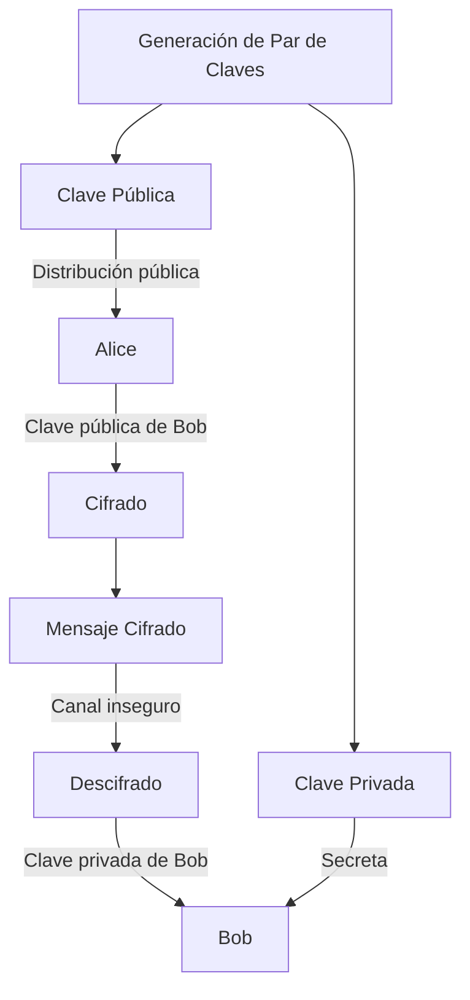
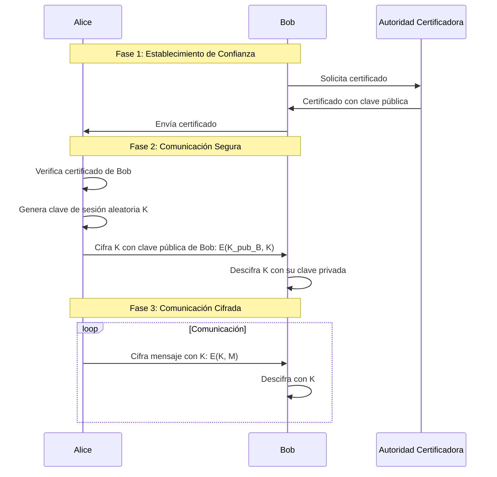

# Criptografía y Seguridad - Criptosistemas de llave pública

## 5.1 Motivación, principios de sistemas de llave pública.

---

### Introducción Histórica y Motivación

La criptografía de llave pública, también conocida como criptografía asimétrica, surgió en la década de 1970 como respuesta a las limitaciones de la criptografía simétrica tradicional. Hasta ese momento, todos los sistemas criptográficos utilizaban la misma clave para cifrar y descifrar, lo que generaba el **problema de distribución de claves**.

**Problema fundamental de la criptografía simétrica:**

- Si Alice y Bob quieren comunicarse de manera segura, deben compartir una clave secreta.
- Para compartir esa clave, necesitan un canal seguro.
- Pero si ya tienen un canal seguro, ¿por qué necesitan cifrado?

Este dilema se conoce como el **problema del huevo y la gallina** en criptografía clásica.

### Definiciones Fundamentales

**Criptosistema de Llave Pública:** Sistema criptográfico que utiliza un par de claves matemáticamente relacionadas: una clave pública para cifrar y una clave privada para descifrar.

**Propiedades esenciales:**

1. Computacionalmente fácil generar un par de claves (pública y privada)
2. Computacionalmente fácil cifrar con la clave pública: $C = E(K_{pub}, M)$
3. Computacionalmente fácil descifrar con la clave privada: $M = D(K_{priv}, C)$
4. Computacionalmente imposible derivar $K_{priv}$ a partir de $K_{pub}$
5. Computacionalmente imposible recuperar $M$ a partir de $C$ sin $K_{priv}$

### Funciones Matemáticas Base

#### Función Unidireccional (One-Way Function)

Una función $f$ es unidireccional si:

- Es fácil calcular $y = f(x)$ para cualquier $x$
- Es difícil calcular $x = f^{-1}(y)$ para (casi) todo $y$

**Ejemplo:** Multiplicación vs Factorización

$$f(p, q) = p \times q \quad\text{(fácil)}$$

$$f^{-1}(n) = (p, q) \quad\text{(difícil para n grande)}$$

#### Función Trampilla (Trapdoor Function)

Una función unidireccional con trampilla es una función $f$ tal que:

- $y = f(x)$ es fácil de calcular
- $x = f^{-1}(y)$ es difícil de calcular
- Pero si se conoce información secreta (trampilla), $x = f^{-1}(y)$ se vuelve fácil

### Principios de Diseño

#### Modelo Conceptual



#### Comparación: Criptografía Simétrica vs Asimétrica

| Característica        | Simétrica           | Asimétrica                                        |
| --------------------- | ------------------- | ------------------------------------------------- |
| Número de claves      | 1                   | 2 (pública y privada)                             |
| Velocidad             | Rápida              | Lenta (100-1000x más lenta)                       |
| Uso típico            | Cifrado de datos    | Distribución de claves, firmas digitales          |
| Longitud clave típica | 128-256 bits        | 1024-4096 bits                                    |
| Seguridad basada en   | Secreto de la clave | Dificultad computacional de problemas matemáticos |

### Algoritmos Representativos

#### RSA (Rivest-Shamir-Adleman, 1977)

Basado en la dificultad de factorizar números grandes.

**Generación de claves:**

1. Elegir dos primos grandes $p$ y $q$
2. Calcular $n = p \times q$
3. Calcular $\phi(n) = (p-1)(q-1)$
4. Elegir $e$ tal que $1 < e < \phi(n)$ y $gcd(e, \phi(n)) = 1$
5. Calcular $d = e^{-1} \mod \phi(n)$

**Clave pública:** $(e, n)$  
**Clave privada:** $(d, n)$

**Cifrado:** $C = M^e \mod n$  
**Descifrado:** $M = C^d \mod n$

#### Ejemplo RSA Simple

```python
# Ejemplo educativo (números pequeños)
def rsa_example():
    # Paso 1: Elegir primos
    p, q = 61, 53

    # Paso 2: Calcular n
    n = p * q  # 3233

    # Paso 3: Calcular φ(n)
    phi = (p-1) * (q-1)  # 3120

    # Paso 4: Elegir e
    e = 17  # gcd(17, 3120) = 1

    # Paso 5: Calcular d (inverso modular)
    # d = e^(-1) mod phi
    # En la práctica se usa el algoritmo extendido de Euclides
    d = 2753  # 17 * 2753 mod 3120 = 1

    # Clave pública: (17, 3233)
    # Clave privada: (2753, 3233)

    # Mensaje a cifrar (convertido a número)
    M = 65  # ASCII para 'A'

    # Cifrado: C = M^e mod n
    C = pow(M, e, n)  # 2790

    # Descifrado: M = C^d mod n
    M_decrypted = pow(C, d, n)  # 65

    return {
        "public_key": (e, n),
        "private_key": (d, n),
        "original": M,
        "encrypted": C,
        "decrypted": M_decrypted
    }

print(rsa_example())
```

### Aplicaciones Principales

#### 1. Confidencialidad

Alice cifra con la clave pública de Bob → Solo Bob puede descifrar.

#### 2. Autenticación y Firmas Digitales

Alice cifra con su clave privada → Cualquiera puede verificar con su clave pública.

#### 3. Intercambio de Claves

Protocolos como Diffie-Hellman para establecer una clave secreta compartida.

### Problemas Computacionales Base

#### Problema de la Factorización Entera (RSA)

Dado $n = p \times q$ (con $p$ y $q$ primos grandes), encontrar $p$ y $q$.

**Seguridad:** Mejor algoritmo conocido (criba general del cuerpo de números) tiene complejidad subexponencial:  
$$O\left(\exp\left((\sqrt[3]{\frac{64}{9}} + o(1)) (\ln n)^{\frac{1}{3}} (\ln \ln n)^{\frac{2}{3}}\right)\right)$$

#### Problema del Logaritmo Discreto (Diffie-Hellman, ElGamal)

Dado $g$, $p$ primo, y $y = g^x \mod p$, encontrar $x$.

#### Problema de la Mochila (Merkle-Hellman)

Aunque fue roto, fue el primer sistema de llave pública propuesto.

### Ejercicios Propuestos

#### Ejercicio 1: Comprensión Conceptual

Explica por qué los siguientes problemas son fundamentales para la criptografía de llave pública:
a) Problema de distribución de claves en criptografía simétrica
b) Necesidad de funciones unidireccionales con trampilla
c) Importancia de que sea computacionalmente imposible derivar la clave privada de la pública

#### Ejercicio 2: Análisis Matemático

Dado un sistema RSA con parámetros:

- $p = 47$, $q = 71$
- $e = 79$

Calcula:
a) $n$ y $\phi(n)$
b) La clave privada $d$
c) Cifra el mensaje $M = 100$
d) Descifra el resultado obtenido en c)

#### Ejercicio 3: Diseño de Protocolo

Diseña un protocolo que permita:

1. Autenticación mutua entre Alice y Bob
2. Establecimiento de una clave de sesión
3. Cifrado de la comunicación posterior

Utiliza criptografía asimétrica para los pasos 1 y 2, y simétrica para el paso 3.

#### Ejercicio 4: Implementación Básica

Implementa en Python una función que:

```python
def generate_rsa_keys(bits=1024):
    """Genera un par de claves RSA"""
    # Tu código aquí
    pass

def rsa_encrypt(message, public_key):
    """Cifra un mensaje con RSA"""
    pass

def rsa_decrypt(ciphertext, private_key):
    """Descifra un mensaje con RSA"""
    pass
```

### Diagrama de Flujo Completo



### Consideraciones de Seguridad

#### Ataques Comunes

1. **Ataque por factorización:** Contra RSA
2. **Ataque por logaritmo discreto:** Contra Diffie-Hellman y ElGamal
3. **Ataques de canal lateral:** Tiempo, consumo energético, etc.
4. **Ataques de implementación:** Errores en el código

#### Buenas Prácticas

- Usar longitudes de clave adecuadas (≥2048 bits para RSA)
- Implementar padding seguro (OAEP para RSA)
- Renovar claves periódicamente
- Usar generadores aleatorios criptográficamente seguros

### Referencias

#### Bibliografía Básica

1. Stallings, W. (2010). _Cryptography and Network Security: Principles and Practice_ (5ª ed.). Prentice Hall.
   - Capítulo 9: Public-Key Cryptography and RSA
   - Capítulo 10: Key Management; Other Public-Key Cryptosystems

2. Forouzan, B. A. (2008). _Cryptography and Network Security_. McGraw Hill.
   - Capítulo 10: Asymmetric-Key Cryptography

3. Pfleeger, C. P., & Pfleeger, S. L. (2006). _Security in Computing_ (4ª ed.). Prentice Hall.
   - Capítulo 11: Cryptography Explained

#### Bibliografía Complementaria

1. Stallings, W. (2010). _Network Security Essentials_ (4ª ed.). Prentice Hall.
2. Ferguson, N., Schneier, B., & Kohno, T. (2010). _Cryptography Engineering_. Wiley.
3. Menezes, A. J., van Oorschot, P. C., & Vanstone, S. A. (1996). _Handbook of Applied Cryptography_. CRC Press.
4. Schneier, B. (1996). _Applied Cryptography_ (2ª ed.). Wiley.

#### Recursos Adicionales

- [NIST Special Publication 800-57](https://csrc.nist.gov/publications/detail/sp/800-57-part-1/rev-5/final): Recomendaciones para gestión de claves
- [RFC 3447](https://tools.ietf.org/html/rfc3447): Especificaciones PKCS #1 para RSA
- [A Computational Introduction to Number Theory and Algebra](https://shoup.net/ntb/): Libro gratuito de Victor Shoup

### Evaluación de Conocimientos

#### Preguntas de Revisión

1. ¿Cuál es la principal ventaja de los criptosistemas de llave pública sobre los simétricos?
2. Explica el concepto de "función con trampilla" y su importancia en criptografía asimétrica.
3. ¿Por qué RSA es seguro mientras factorizar números grandes sea difícil?
4. Describe al menos tres aplicaciones prácticas de la criptografía de llave pública.
5. ¿Qué medidas de seguridad deben considerarse al implementar un sistema de llave pública?

#### Actividad Práctica

Implementa un sistema simple de correo seguro que permita:

- Generación de pares de claves RSA
- Cifrado/descifrado de mensajes
- Verificación de integridad usando firmas digitales

**Nota:** Este material es educativo y las implementaciones mostradas son simplificadas. Para uso en producción, se deben utilizar bibliotecas criptográficas estandarizadas y seguir las mejores prácticas de seguridad actuales.
