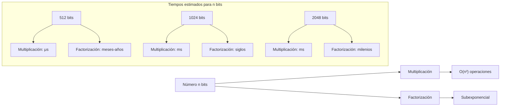
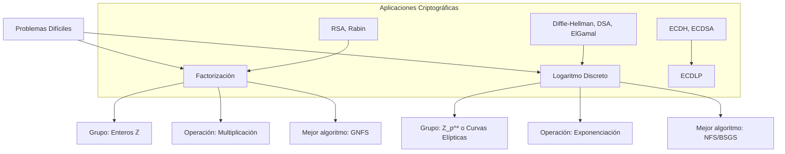

# Criptografía y Seguridad - Criptosistemas de llave pública

## 5.2 Funciones de un sólo sentido: factorización y logaritmo discreto.

---

### 1. Función de Un Solo Sentido Basada en Factorización

#### 1.1 Definición del Problema

**Problema de Factorización Entera:**
Dado un número compuesto $n = p \times q$ donde $p$ y $q$ son números primos grandes, encontrar $p$ y $q$.

**Función de ida (fácil):** $f(p, q) = p \times q = n$
**Función inversa (difícil):** $f^{-1}(n) = (p, q)$

#### 1.2 Complejidad Computacional

La multiplicación de dos números de $k$ bits tiene complejidad:

$$T_{\text{mult}}(k) = O(k^2) \quad \text{(o } O(k^{1.585}) \text{ con Karatsuba)}$$

Mientras que los mejores algoritmos de factorización conocidos tienen complejidad subexponencial:

**Criba General del Cuerpo de Números (GNFS):**

$$T_{\text{factor}}(n) = O\left(\exp\left(\left(\frac{64}{9}\right)^{1/3} (\log n)^{1/3} (\log \log n)^{2/3}\right)\right)$$

**Comparación práctica (Forouzan, 2008):**



#### 1.3 Ejemplo Didáctico

```python
def factorization_one_way_example():
    """Demostración de la naturaleza unidireccional de la multiplicación/factorización"""

    # Función de ida (FÁCIL): Multiplicación
    p = 1234567891  # primo de 10 dígitos
    q = 9876543211  # primo de 10 dígitos

    n = p * q
    print(f"Multiplicación (fácil):")
    print(f"p = {p}")
    print(f"q = {q}")
    print(f"n = p × q = {n}")
    print(f"Tiempo de multiplicación: instantáneo\n")

    # Función inversa (DIFÍCIL): Factorización
    print(f"Factorización (difícil):")
    print(f"Dado n = {n}")
    print(f"Encontrar p y q tales que p × q = {n}")
    print(f"Para números de este tamaño: computacionalmente inviable en tiempo práctico")

    return {"p": p, "q": q, "n": n}

print(factorization_one_way_example())
```

#### 1.4 Algoritmos de Factorización (Stallings, 2010)

##### a) Fuerza Bruta

```python
def brute_force_factorization(n):
    """Factorización por fuerza bruta - O(√n)"""
    import math
    factors = []
    i = 2
    while i <= math.isqrt(n):
        if n % i == 0:
            factors.append(i)
            n //= i
        else:
            i += 1
    if n > 1:
        factors.append(n)
    return factors

# Ejemplo pequeño para ilustración
print(f"Fuerza bruta para n=91: {brute_force_factorization(91)}")
```

##### b) Método ρ de Pollard

$$f(x) = (x^2 + c) \mod n$$
Complejidad: $O(n^{1/4})$

##### c) Criba Cuadrática (QS)

Complejidad: $O(e^{(1+o(1))\sqrt{\ln n \ln \ln n}})$

##### d) Criba General del Cuerpo de Números (GNFS)

Complejidad: $O(e^{(1.92+o(1))(\ln n)^{1/3}(\ln \ln n)^{2/3}})$

### 2. Función de Un Solo Sentido Basada en Logaritmo Discreto

#### 2.1 Definición del Problema

**Grupo Cíclico:** Sea $G$ un grupo cíclico de orden $n$, $g$ un generador de $G$.

**Problema del Logaritmo Discreto (DLP):**
Dado $g$ y $h = g^x$ en $G$, encontrar $x$.

**Función de ida (fácil):** $f(x) = g^x \mod p$
**Función inversa (difícil):** $f^{-1}(h) = \log_g h$

#### 2.2 Grupos Utilizados en Criptografía

##### a) Grupo Multiplicativo de Campo Finito

$$\mathbb{Z}_p^* = \{1, 2, ..., p-1\}$$
donde $p$ es primo y la operación es multiplicación módulo $p$.

##### b) Grupos de Curvas Elípticas

$$E(\mathbb{F}_p): y^2 = x^3 + ax + b \mod p$$
El DLP en curvas elípticas (ECDLP) es más difícil que en $\mathbb{Z}_p^*$.

#### 2.3 Complejidad Computacional

**Mejores algoritmos conocidos para DLP en $\mathbb{Z}_p^*$:**

1. **Fuerza Bruta:** $O(p)$
2. **Baby-step Giant-step:** $O(\sqrt{n})$
3. **Algoritmo ρ de Pollard:** $O(\sqrt{n})$
4. **Criba del Campo de Números (NFS):**
   $$L_p[1/3, (64/9)^{1/3}] = O\left(\exp\left((64/9)^{1/3} (\ln p)^{1/3} (\ln \ln p)^{2/3}\right)\right)$$

#### 2.4 Ejemplo Didáctico

```python
def discrete_log_example():
    """Ejemplo de logaritmo discreto en grupo cíclico pequeño"""

    # Parámetros pequeños para ilustración
    p = 101  # primo
    g = 3    # generador de Z_p^*

    # Función de ida (FÁCIL): Exponenciación modular
    x = 17
    h = pow(g, x, p)  # g^x mod p
    print(f"Exponenciación modular (fácil):")
    print(f"g = {g}, x = {x}, p = {p}")
    print(f"h = g^x mod p = {g}^{x} mod {p} = {h}\n")

    # Función inversa (DIFÍCIL): Logaritmo discreto
    print(f"Logaritmo discreto (difícil):")
    print(f"Dado g = {g}, h = {h}, p = {p}")
    print(f"Encontrar x tal que {g}^x ≡ {h} mod {p}")

    # Búsqueda por fuerza bruta (solo para ejemplo pequeño)
    found = None
    for i in range(p):
        if pow(g, i, p) == h:
            found = i
            break

    print(f"Solución encontrada: x = {found}")
    print(f"Para p grande (>2048 bits), esta búsqueda es inviable")

    return {"g": g, "x": x, "h": h, "p": p}

print(discrete_log_example())
```

#### 2.5 Comparación: Factorización vs Logaritmo Discreto



### 3. Definiciones Matemáticas Formales

#### 3.1 Función Unidireccional (One-Way Function)

**Definición (Menezes et al., 1996):**
Una función $f: \{0,1\}^* \rightarrow \{0,1\}^*$ es unidireccional si:

1. **Facilidad de cómputo:**
   Existe un algoritmo polinomial $A$ tal que $A(x) = f(x)$ para todo $x$.

2. **Dificultad de inversión:**
   Para todo algoritmo polinomial probabilístico $A'$, para toda constante $c$, y para $n$ suficientemente grande:
   $$\Pr[A'(f(x), 1^n) \in f^{-1}(f(x))] < n^{-c}$$
   donde $x$ se elige uniformemente de $\{0,1\}^n$.

#### 3.2 Función Unidireccional con Trampilla

**Definición (Schneier, 1996):**
Una función unidireccional con trampilla es una función $f: X \rightarrow Y$ tal que:

1. $f(x)$ es fácil de computar para todo $x \in X$
2. $f^{-1}(y)$ es difícil de computar para casi todo $y \in Y$
3. Existe información secreta $t$ (trampilla) que hace fácil computar $f^{-1}(y)$

**Ejemplo RSA como función con trampilla:**

- $f(x) = x^e \mod n$ ( fácil con $(e,n)$ )
- $f^{-1}(y) = y^d \mod n$ ( difícil sin $d$, fácil con $d$ )
- Trampilla: $d = e^{-1} \mod \phi(n)$

### 4. Ejercicios Propuestos

#### Ejercicio 1: Análisis de Complejidad

Dados los siguientes tamaños de clave:

1. RSA con $n$ de 1024 bits
2. DH con $p$ de 1024 bits
3. ECC con curva de 256 bits

Calcula:
a) Número aproximado de operaciones para ataque por fuerza bruta
b) Tiempo estimado con computadora de $10^9$ operaciones/segundo
c) Tamaño equivalente en criptografía simétrica

#### Ejercicio 2: Implementación de Algoritmos

Implementa en Python:

```python
def baby_step_giant_step(g, h, p):
    """Resuelve g^x ≡ h mod p usando Baby-step Giant-step"""
    # Tu implementación aquí
    pass

def pollard_rho_factorization(n):
    """Factoriza n usando método ρ de Pollard"""
    # Tu implementación aquí
    pass
```

#### Ejercicio 3: Análisis de Seguridad

Analiza por qué los siguientes problemas se consideran unidireccionales:

1. Dado $n = p \times q$, encontrar $\phi(n)$
2. Dado $g$ y $g^{ab} \mod p$, encontrar $g^a \mod p$
3. Dado punto $P$ y $kP$ en curva elíptica, encontrar $k$

#### Ejercicio 4: Comparación Teórica

Completa la siguiente tabla:

| Característica                     | Factorización | Log. Discreto Z_p^* | Log. Discreto EC |
| ---------------------------------- | ------------- | ------------------- | ---------------- |
| Grupo base                         |               |                     |                  |
| Operación directa                  |               |                     |                  |
| Operación inversa                  |               |                     |                  |
| Mejor ataque conocido              |               |                     |                  |
| Complejidad                        |               |                     |                  |
| Tamaño clave equivalente a AES-128 |               |                     |                  |

### 5. Referencias a Bibliografía

#### Stallings (2010) - Cryptography and Network Security

- **Capítulo 8:** "Introduction to Number Theory" - Fundamentos matemáticos
- **Capítulo 9:** "Public-Key Cryptography and RSA" - Aplicación de factorización
- **Sección 10.1:** "The Diffie-Hellman Key Exchange" - Aplicación de DLP

#### Forouzan (2008) - Cryptography and Network Security

- **Capítulo 9:** "Mathematics of Cryptography" - Teoría de números
- **Sección 10.2:** "Diffie-Hellman" - Implementación práctica de DLP

#### Menezes et al. (1996) - Handbook of Applied Cryptography

- **Capítulo 3:** "Number-Theoretic Reference Problems" - Tratamiento formal
- **Sección 3.6:** "The integer factorization problem"
- **Sección 3.7:** "The RSA problem"
- **Capítulo 8:** "Public-Key Encryption"

#### Schneier (1996) - Applied Cryptography

- **Capítulo 11:** "Mathematical Background" - Explicación accesible
- **Capítulo 19:** "Public-Key Algorithms" - Implementaciones prácticas

### 6. Consideraciones de Seguridad Modernas

#### 6.1 Amenazas Computacionales

- **Computación Cuántica:** Algoritmo de Shor resuelve factorización y DLP en tiempo polinomial
- **Mejoras en Algoritmos:** Avances en GNFS y NFS
- **Hardware Especializado:** ASICs para ataques por fuerza bruta

#### 6.2 Recomendaciones Actuales (NIST)

- **RSA:** Mínimo 2048 bits (3072 para seguridad a largo plazo)
- **DH/DSA:** Mínimo 2048 bits para $p$
- **ECC:** Mínimo 256 bits
- **Transición post-cuántica:** Algoritmos basados en retículos, códigos, etc.

#### 6.3 Implementaciones Seguras

```python
import cryptography
from cryptography.hazmat.primitives.asymmetric import rsa, dsa, ec
from cryptography.hazmat.primitives import hashes
from cryptography.hazmat.primitives.asymmetric import padding

# Generación segura de claves RSA
private_key = rsa.generate_private_key(
    public_exponent=65537,
    key_size=2048,  # Mínimo recomendado
)

# Generación segura de parámetros DH
from cryptography.hazmat.primitives.asymmetric import dh
parameters = dh.generate_parameters(generator=2, key_size=2048)
```

### 7. Aplicaciones Prácticas

#### 7.1 Protocolos Basados en Factorización

- **RSA:** Cifrado, firmas digitales
- **Rabin:** Cifrado, más seguro teóricamente que RSA
- **Paillier:** Cifrado homomórfico

#### 7.2 Protocolos Basados en Logaritmo Discreto

- **Diffie-Hellman:** Intercambio de claves
- **DSA/ECDSA:** Firmas digitales
- **ElGamal:** Cifrado
- **Schnorr:** Firmas eficientes

### 8. Preguntas de Evaluación

1. **Conceptuales:**
   - ¿Por qué la multiplicación es considerada función unidireccional?
   - Explica la diferencia entre función unidireccional y función con trampilla.
   - ¿Por qué el DLP en curvas elípticas es más difícil que en $\mathbb{Z}_p^*$?

2. **Matemáticas:**
   - Demuestra que si se puede resolver DLP, se puede romper DH.
   - Explica la relación entre factorización y cálculo de $\phi(n)$.
   - Calcula la complejidad asintótica del algoritmo baby-step giant-step.

3. **Prácticas:**
   - Implementa un sistema que demuestre la unidireccionalidad de RSA.
   - Diseña un experimento para medir tiempos de exponenciación vs búsqueda de logaritmo.
   - Analiza vulnerabilidades en implementaciones reales de estas funciones.
