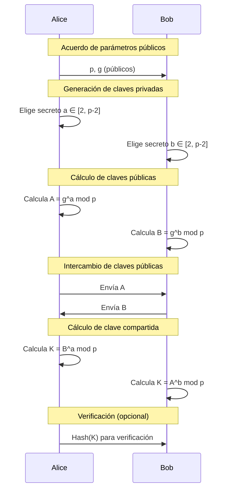
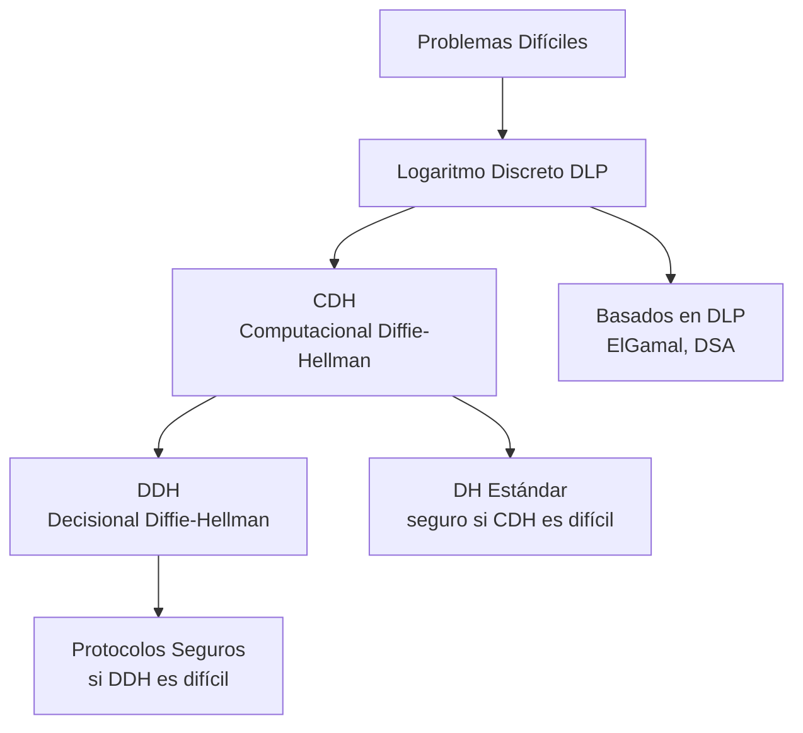
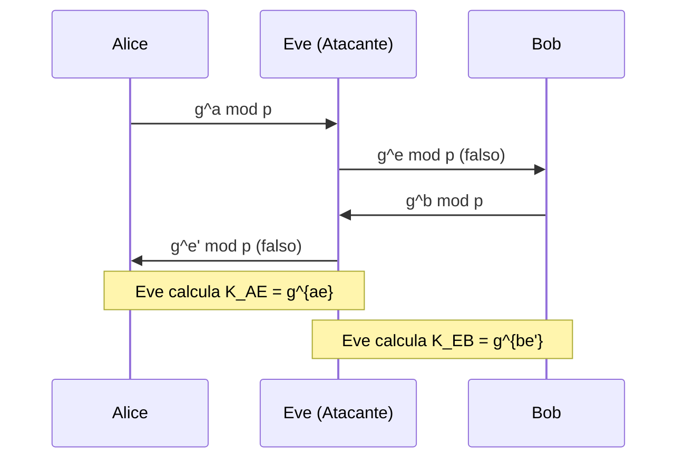
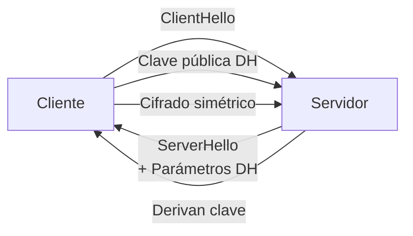

# Criptografía y Seguridad - Criptosistemas de llave pública

## 5.3 Algoritmo de Diffie Hellman.

---

### 1. Introducción Histórica y Contexto

**El algoritmo Diffie-Hellman (DH)** fue publicado en 1976 por Whitfield Diffie y Martin Hellman en su artículo "New Directions in Cryptography". Representa un hito histórico por ser el primer protocolo criptográfico práctico que permitió el **intercambio seguro de claves** a través de un canal inseguro sin haber compartido previamente secretos.

**Contexto histórico (Stallings, 2010):**

- Antes de DH: Criptografía simétrica exclusivamente
- Problema fundamental: Distribución segura de claves
- DH introdujo el concepto de **criptografía de llave pública**

### 2. Definición Formal

#### 2.1 Concepto Base

El algoritmo Diffie-Hellman es un protocolo criptográfico que permite a dos partes establecer una **clave secreta compartida** sobre un canal de comunicación inseguro, basándose en la dificultad del **problema del logaritmo discreto (DLP)**.

#### 2.2 Componentes Matemáticos

Sea $p$ un número primo grande y $g$ un **generador** del grupo multiplicativo $\mathbb{Z}_p^*$ ( es decir, $g$ es una raíz primitiva módulo $p$ ).

**Propiedades requeridas:**

1. $p$: número primo grande (≥ 2048 bits para seguridad actual)
2. $g$: $2 \leq g \leq p-2$, tal que $g^x \mod p$ genera todo $\mathbb{Z}_p^*$
3. $|g| = p-1$ (orden del grupo)

### 3. Descripción del Protocolo

#### 3.1 Protocolo Clásico Diffie-Hellman



#### 3.2 Fórmulas Matemáticas

**Generación de parámetros públicos:**

- $p$: primo grande
- $g$: generador de $\mathbb{Z}_p^*$

**Claves privadas:**

- Alice: $a \in_R \{2, 3, ..., p-2\}$
- Bob: $b \in_R \{2, 3, ..., p-1\}$

**Claves públicas:**

- Alice: $A = g^a \mod p$
- Bob: $B = g^b \mod p$

**Clave compartida:**

- Alice calcula: $K_{AB} = B^a \mod p = (g^b)^a \mod p = g^{ab} \mod p$
- Bob calcula: $K_{BA} = A^b \mod p = (g^a)^b \mod p = g^{ab} \mod p$

**Verificación:** $K_{AB} = K_{BA} = g^{ab} \mod p$

### 4. Implementación Práctica

#### 4.1 Código Python Didáctico

```python
import random
import sympy  # Para generación de primos (solo educativo)

class DiffieHellman:
    def __init__(self, prime_bits=512):
        """Inicializa parámetros DH"""
        self.p = self.generate_prime(prime_bits)
        self.g = self.find_generator(self.p)
        self.private_key = None
        self.public_key = None
        self.shared_secret = None

    def generate_prime(self, bits):
        """Genera un número primo de n bits (EDUCACIONAL)"""
        # En producción usar primos seguros específicos
        return sympy.randprime(2**(bits-1), 2**bits - 1)

    def find_generator(self, p):
        """Encuentra un generador de Z_p^* (EDUCACIONAL)"""
        # Para primos seguros, generalmente g=2 o g=5
        factors = sympy.factorint(p-1)

        for g in range(2, p):
            is_generator = True
            for q in factors:
                if pow(g, (p-1)//q, p) == 1:
                    is_generator = False
                    break
            if is_generator:
                return g
        return None

    def generate_keys(self):
        """Genera par de claves"""
        self.private_key = random.randint(2, self.p-2)
        self.public_key = pow(self.g, self.private_key, self.p)
        return self.public_key

    def compute_shared_secret(self, other_public_key):
        """Calcula secreto compartido"""
        if self.private_key is None:
            raise ValueError("Primero generar clave privada")

        self.shared_secret = pow(other_public_key, self.private_key, self.p)
        return self.shared_secret

    def get_shared_key(self, num_bytes=32):
        """Deriva clave simétrica del secreto compartido"""
        import hashlib
        if self.shared_secret is None:
            raise ValueError("Primero calcular secreto compartido")

        # Usar KDF en producción
        ss_bytes = self.shared_secret.to_bytes((self.shared_secret.bit_length() + 7) // 8, 'big')
        return hashlib.sha256(ss_bytes).digest()[:num_bytes]

# Ejemplo de uso
def dh_example():
    print("=== EJEMPLO DIDÁCTICO DIFFIE-HELLMAN ===\n")

    # Alice y Bob inicializan
    print("1. Inicialización:")
    alice = DiffieHellman(prime_bits=128)  # 128 bits para ejemplo
    bob = DiffieHellman()
    bob.p = alice.p  # Mismo primo
    bob.g = alice.g  # Mismo generador

    print(f"   Parámetros públicos compartidos:")
    print(f"   p (primo) = {alice.p}")
    print(f"   g (generador) = {alice.g}\n")

    # Generación de claves
    print("2. Generación de claves:")
    A = alice.generate_keys()
    B = bob.generate_keys()
    print(f"   Clave pública de Alice: A = g^a mod p = {A}")
    print(f"   Clave pública de Bob: B = g^b mod p = {B}")
    print(f"   Claves privadas (secretas): a = {alice.private_key}, b = {bob.private_key}\n")

    # Intercambio y cálculo
    print("3. Cálculo de secreto compartido:")
    K_alice = alice.compute_shared_secret(B)
    K_bob = bob.compute_shared_secret(A)
    print(f"   Alice calcula: K = B^a mod p = {K_alice}")
    print(f"   Bob calcula: K = A^b mod p = {K_bob}")

    print(f"\n4. Verificación:")
    print(f"   ¿Coinciden? {K_alice == K_bob}")
    print(f"   Secreto compartido: {K_alice}")

    # Derivar clave simétrica
    print(f"\n5. Clave simétrica derivada (32 bytes):")
    key_alice = alice.get_shared_key()
    key_bob = bob.get_shared_key()
    print(f"   Key Alice: {key_alice.hex()}")
    print(f"   Key Bob: {key_bob.hex()}")
    print(f"   ¿Coinciden? {key_alice == key_bob}")

    return alice, bob

# Ejecutar ejemplo
alice, bob = dh_example()
```

#### 4.2 Implementación con cryptography (Producción)

```python
# Implementación para producción usando biblioteca cryptography
from cryptography.hazmat.primitives import hashes
from cryptography.hazmat.primitives.asymmetric import dh
from cryptography.hazmat.primitives.kdf.hkdf import HKDF

def dh_production_example():
    """Ejemplo de DH usando parámetros seguros estándar"""

    # Generar parámetros DH seguros (2048 bits mínimo)
    parameters = dh.generate_parameters(generator=2, key_size=2048)

    # Alice genera su par de claves
    alice_private_key = parameters.generate_private_key()
    alice_public_key = alice_private_key.public_key()

    # Bob genera su par de claves
    bob_private_key = parameters.generate_private_key()
    bob_public_key = bob_private_key.public_key()

    # Alice calcula secreto compartido
    alice_shared_secret = alice_private_key.exchange(bob_public_key)

    # Bob calcula secreto compartido
    bob_shared_secret = bob_private_key.exchange(alice_public_key)

    # Verificar que coinciden
    assert alice_shared_secret == bob_shared_secret

    # Derivar clave simétrica usando KDF
    derived_key = HKDF(
        algorithm=hashes.SHA256(),
        length=32,
        salt=None,
        info=b'dh key derivation',
    ).derive(alice_shared_secret)

    return derived_key.hex()
```

### 5. Seguridad del Protocolo

#### 5.1 Suposiciones de Seguridad

**Problema del Logaritmo Discreto (DLP):**
Dados $p$, $g$, y $g^x \mod p$, es computacionalmente inviable encontrar $x$.

**Problema de Diffie-Hellman Computacional (CDH):**
Dados $p$, $g$, $g^a \mod p$, y $g^b \mod p$, es inviable calcular $g^{ab} \mod p$.

**Problema de Diffie-Hellman Decisional (DDH):**
Dados $p$, $g$, $g^a \mod p$, $g^b \mod p$, y $g^c \mod p$, determinar si $c = ab$.

#### 5.2 Jerarquía de Problemas (Forouzan, 2008)



#### 5.3 Ataques Conocidos

##### a) Ataque de Hombre en el Medio (MitM)



**Contramedidas:** Autenticación mediante certificados digitales, STS (Station-to-Station)

##### b) Ataque por Subgrupo Pequeño

Si $g$ no es generador completo, reduce espacio de búsqueda.

**Contramedida:** Verificar que $g$ sea generador de subgrupo primo grande.

##### c) Logjam Attack (2015)

Explota parámetros DH débiles (512 bits).

**Contramedida:** Usar parámetros fuertes (≥ 2048 bits).

#### 5.4 Parámetros Seguros Recomendados

| Aplicación         | Tamaño de p (bits) | Grupo            | Estándar          |
| ------------------ | ------------------ | ---------------- | ----------------- |
| Mínimo actual      | 2048               | $\mathbb{Z}_p^*$ | NIST SP 800-56A   |
| Largo plazo        | 3072               | $\mathbb{Z}_p^*$ | NIST SP 800-56B   |
| Alto rendimiento   | 256                | Curva elíptica   | P-256, Curve25519 |
| Muy alta seguridad | 384                | Curva elíptica   | P-384             |

### 6. Variantes y Extensiones

#### 6.1 Diffie-Hellman de Curva Elíptica (ECDH)

```python
from cryptography.hazmat.primitives.asymmetric import ec

def ecdh_example():
    """ECDH usando curva P-256"""
    # Alice
    alice_private = ec.generate_private_key(ec.SECP256R1())
    alice_public = alice_private.public_key()

    # Bob
    bob_private = ec.generate_private_key(ec.SECP256R1())
    bob_public = bob_private.public_key()

    # Secreto compartido
    shared_secret_alice = alice_private.exchange(ec.ECDH(), bob_public)
    shared_secret_bob = bob_private.exchange(ec.ECDH(), alice_public)

    assert shared_secret_alice == shared_secret_bob
    return shared_secret_alice
```

#### 6.2 Diffie-Hellman Autenticado

**Protocolo Station-to-Station (STS):**
Combina DH con firmas digitales para prevenir MitM.

#### 6.3 Diffie-Hellman Ephemeral (DHE)

Usa parámetros temporales para **forward secrecy**.

#### 6.4 Diffie-Hellman en Grupo (Multi-party)

Extensión a múltiples participantes: $K = g^{a_1 a_2 ... a_n} \mod p$

### 7. Ejercicios Propuestos

#### Ejercicio 1: Implementación Manual

Implementa manualmente DH con:

- $p = 23$ (primo pequeño para cálculo manual)
- $g = 5$ ( generador de $\mathbb{Z}_{23}^*$ )
- $a = 6$ (secreto de Alice)
- $b = 15$ (secreto de Bob)

Calcula:

1. Claves públicas $A$ y $B$
2. Secreto compartido $K$
3. Verifica que ambas partes obtienen el mismo $K$

#### Ejercicio 2: Análisis de Seguridad

Dado un sistema DH con:

- $p = 101$ (demasiado pequeño)
- $g = 2$

Analiza:

1. ¿Cuántas operaciones necesitaría un atacante para romperlo por fuerza bruta?
2. Implementa un ataque por fuerza bruta
3. Propone parámetros más seguros

#### Ejercicio 3: Ataque MitM

Diseña e implementa un escenario de ataque MitM contra DH sin autenticación. Luego implementa una solución usando:

1. Certificados digitales
2. Firmas digitales (STS)

#### Ejercicio 4: Comparación DH vs ECDH

Completa la tabla comparativa:

| Característica               | DH (2048 bits) | ECDH (P-256) |
| ---------------------------- | -------------- | ------------ |
| Tamaño clave pública         |                |              |
| Operaciones para intercambio |                |              |
| Seguridad equivalente        |                |              |
| Forward secrecy nativo       |                |              |
| Uso en TLS 1.3               |                |              |

#### Ejercicio 5: Implementación Completa

Crea una aplicación cliente-servidor que:

1. Negocie parámetros DH
2. Establezca clave compartida
3. Use la clave para cifrar comunicación AES-GCM
4. Incluya autenticación para prevenir MitM

### 8. Aplicaciones en el Mundo Real

#### 8.1 TLS/SSL



#### 8.2 SSH

Protocolo de autenticación y establecimiento de clave.

#### 8.3 IPsec

Establecimiento de SA (Security Associations) con IKE.

#### 8.4 Signal/WhatsApp

Protocolo Double Ratchet (combina DH con otras técnicas).

### 9. Consideraciones Prácticas

#### 9.1 Selección de Parámetros (Stallings, 2010)

- **Primos seguros:** Primos de Sophie Germain, primos fuertes
- **Grupos estandarizados:** RFC 7919, RFC 3526
- **Validación:** Verificar que $g$ genere subgrupo grande

#### 9.2 Manejo de Claves

```python
# Buenas prácticas
import os
from cryptography.hazmat.primitives.kdf.hkdf import HKDF

def secure_dh_key_derivation(shared_secret, salt=None, context=b""):
    """Derivación segura de clave"""
    return HKDF(
        algorithm=hashes.SHA256(),
        length=32,
        salt=salt,
        info=context,
    ).derive(shared_secret)
```

#### 9.3 Forward Secrecy

Siempre usar **DHE** o **ECDHE** (Ephemeral Diffie-Hellman).

### 10. Referencias Bibliográficas

#### Stallings (2010) - Cryptography and Network Security

- **Capítulo 10:** "Key Management; Other Public-Key Cryptosystems"
- **Sección 10.2:** "The Diffie-Hellman Key Exchange"
- **Apéndice 10A:** "Proof of the Diffie-Hellman Algorithm"

#### Forouzan (2008) - Cryptography and Network Security

- **Capítulo 10:** "Asymmetric-Key Cryptography"
- **Sección 10.2:** "Diffie-Hellman"
- **Ejemplos detallados y ejercicios**

#### Menezes et al. (1996) - Handbook of Applied Cryptography

- **Capítulo 12:** "Key Establishment Protocols"
- **Sección 12.6:** "Diffie-Hellman and related key agreement protocols"
- **Análisis matemático formal**

#### Schneier (1996) - Applied Cryptography

- **Capítulo 22:** "Key Exchange Algorithms"
- **Sección 22.1:** "Diffie-Hellman"
- **Implementaciones y variantes**

### 11. Preguntas de Evaluación

#### Nivel Básico

1. Explica con tus palabras cómo funciona el intercambio DH.
2. ¿Por qué DH no es vulnerable a eavesdropping pasivo?
3. Nombra dos aplicaciones reales que usen DH.

#### Nivel Intermedio

4. Demuestra matemáticamente por qué $g^{ab} \mod p = g^{ba} \mod p$.
5. Explica la diferencia entre CDH y DDH.
6. ¿Cómo proporciona forward secrecy DHE?

#### Nivel Avanzado

7. Implementa un ataque MitM contra DH y una contramedida.
8. Compara complejidad computacional de DH vs ECDH.
9. Analiza vulnerabilidades en implementaciones específicas de DH.

### 12. Laboratorio Práctico

#### Configuración:

```python
# Esqueleto para laboratorio
class DiffieHellmanLab:
    def __init__(self):
        self.p = self.get_secure_prime()
        self.g = self.get_generator()

    def simulate_protocol(self):
        # Implementar protocolo completo
        pass

    def simulate_mitm_attack(self):
        # Implementar ataque
        pass

    def implement_countermeasures(self):
        # Agregar autenticación
        pass
```

#### Tareas del Laboratorio:

1. Implementar DH básico
2. Agregar derivación de clave con HKDF
3. Implementar ataque MitM
4. Agregar autenticación con certificados
5. Medir rendimiento con diferentes tamaños de parámetros

**Nota de Seguridad:** Esta guía es para fines educativos. En sistemas de producción:

1. Siempre usar bibliotecas criptográficas estandarizadas
2. Seguir estándares actuales (NIST, RFC)
3. Usar parámetros suficientemente grandes (≥ 2048 bits para DH)
4. Implementar autenticación adecuada
5. Considerar forward secrecy usando variantes ephemeral

**Última actualización según referencias:** Las recomendaciones de seguridad pueden cambiar. Consultar fuentes actualizadas regularmente.
