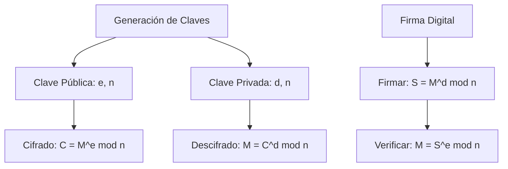
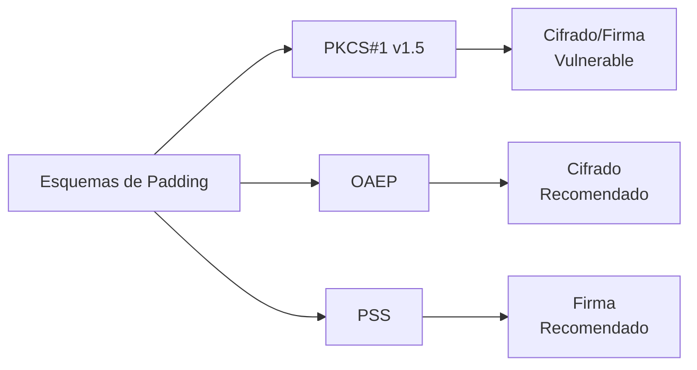
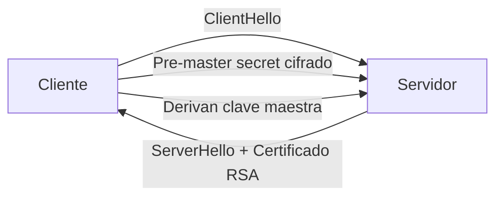

# Criptografía y Seguridad - Criptosistemas de llave pública

## 5.4 Algoritmo de RSA.

---

### 1. Introducción Histórica

**RSA** (Rivest-Shamir-Adleman) es el primer algoritmo de criptografía de llave pública práctico, publicado en 1977 por Ron Rivest, Adi Shamir y Leonard Adleman del MIT. Es el algoritmo de cifrado asimétrico más utilizado en el mundo.

**Contexto histórico (Stallings, 2010):**

- Basado en el trabajo teórico de Diffie y Hellman (1976)
- Primer implementación práctica de criptografía de llave pública
- Patentado en 1983, patent expired en 2000
- Fundamento de seguridad: **Problema de la factorización de enteros grandes**

### 2. Fundamentos Matemáticos

#### 2.1 Teoremas Esenciales

**Teorema de Euler:** Para todo $a$ coprimo con $n$:

$$a^{\phi(n)} \equiv 1 \pmod{n}$$

donde $\phi(n)$ es la función phi de Euler ( número de enteros menores que $n$ coprimos con $n$ ).

**Para $n = pq$ (producto de dos primos):**

$$\phi(n) = \phi(pq) = (p-1)(q-1)$$

**Teorema del Resto Chino (TRC):** Acelera el descifrado RSA.

#### 2.2 Propiedades Clave

Si $n = pq$ y $ed \equiv 1 \pmod{\phi(n)}$, entonces:

$$\forall m \in \mathbb{Z}_n: (m^e)^d \equiv m \pmod{n}$$

### 3. Descripción del Algoritmo RSA

#### 3.1 Esquema General



#### 3.2 Pasos Detallados

##### 3.2.1 Generación de Claves

**Paso 1: Selección de primos**

- Elegir dos números primos grandes $p$ y $q$ aleatorios
- Deben ser de tamaño similar pero no demasiado cercanos

  $$p \neq q, \quad |p| \approx |q| \approx \frac{k}{2} \text{ bits para } n \text{ de } k \text{ bits}$$

**Paso 2: Calcular módulo**

$$n = p \times q$$

**Paso 3: Calcular φ(n)**

$$\phi(n) = (p-1)(q-1)$$

**Paso 4: Elegir exponente público $e$**

- $1 < e < \phi(n)$
- $\gcd(e, \phi(n)) = 1$ (coprimo)
- Valores comunes: $e = 3, 17, 65537$ (2^16 + 1)

**Paso 5: Calcular exponente privado $d$**

$$d \equiv e^{-1} \pmod{\phi(n)}$$

Es decir, $ed \equiv 1 \pmod{\phi(n)}$

##### 3.2.2 Cifrado

Para un mensaje $M < n$:

$$C \equiv M^e \pmod{n}$$

##### 3.2.3 Descifrado

$$M \equiv C^d \pmod{n}$$

#### 3.3 Ejemplo Numérico Pequeño

```python
def rsa_small_example():
    """Ejemplo RSA con números pequeños para comprensión"""

    # Paso 1: Seleccionar primos (PEQUEÑOS para ejemplo)
    p = 61
    q = 53

    # Paso 2: Calcular n
    n = p * q  # 3233

    # Paso 3: Calcular φ(n)
    phi = (p-1) * (q-1)  # 3120

    # Paso 4: Elegir e
    e = 17  # gcd(17, 3120) = 1

    # Paso 5: Calcular d (inverso modular)
    # d ≡ e^{-1} mod φ(n)
    # 17 * d ≡ 1 mod 3120
    d = modular_inverse(e, phi)  # 2753

    print("=== EJEMPLO RSA CON NÚMEROS PEQUEÑOS ===")
    print(f"p = {p}, q = {q}")
    print(f"n = p × q = {n}")
    print(f"φ(n) = (p-1)(q-1) = {phi}")
    print(f"e = {e}")
    print(f"d = {d}")
    print(f"Verificación: e × d mod φ(n) = {e*d % phi}\n")

    # Cifrado y descifrado
    M = 65  # ASCII 'A'
    C = pow(M, e, n)
    M_dec = pow(C, d, n)

    print(f"Mensaje original M = {M}")
    print(f"Cifrado: C = M^e mod n = {M}^{e} mod {n} = {C}")
    print(f"Descifrado: M = C^d mod n = {C}^{d} mod {n} = {M_dec}")
    print(f"¿M = M_dec? {M == M_dec}")

    return {
        "public_key": (e, n),
        "private_key": (d, n),
        "primes": (p, q)
    }

def modular_inverse(a, m):
    """Calcula inverso modular usando algoritmo extendido de Euclides"""
    def egcd(a, b):
        if b == 0:
            return (1, 0, a)
        else:
            x, y, g = egcd(b, a % b)
            return (y, x - (a // b) * y, g)

    x, y, g = egcd(a, m)
    if g != 1:
        raise ValueError("No existe inverso modular")
    return x % m

# Ejecutar ejemplo
rsa_small_example()
```

### 4. Implementación Práctica

#### 4.1 Implementación Didáctica Completa

```python
import random
import math
from sympy import isprime, randprime  # Solo para fines educativos

class RSAEducational:
    def __init__(self, key_size=1024):
        """Inicializa RSA con tamaño de clave especificado"""
        self.key_size = key_size
        self.p = self.q = self.n = self.phi = self.e = self.d = None

    def generate_primes(self):
        """Genera dos primos grandes (EDUCACIONAL)"""
        half_size = self.key_size // 2

        # En producción usar métodos criptográficamente seguros
        self.p = randprime(2**(half_size-1), 2**half_size)
        self.q = randprime(2**(half_size-1), 2**half_size)

        # Asegurar que p y q son diferentes
        while self.p == self.q:
            self.q = randprime(2**(half_size-1), 2**half_size)

        return self.p, self.q

    def compute_parameters(self):
        """Calcula todos los parámetros RSA"""
        if self.p is None or self.q is None:
            self.generate_primes()

        self.n = self.p * self.q
        self.phi = (self.p - 1) * (self.q - 1)

        # Elegir e (comúnmente 65537)
        self.e = 65537
        while math.gcd(self.e, self.phi) != 1:
            self.e = randprime(2, self.phi - 1)

        # Calcular d (inverso modular)
        self.d = self.mod_inverse(self.e, self.phi)

        return {
            'n': self.n,
            'e': self.e,
            'd': self.d,
            'phi': self.phi
        }

    def mod_inverse(self, a, m):
        """Inverso modular usando algoritmo extendido de Euclides"""
        def extended_gcd(aa, bb):
            lastremainder, remainder = abs(aa), abs(bb)
            x, lastx, y, lasty = 0, 1, 1, 0
            while remainder:
                lastremainder, (quotient, remainder) = remainder, divmod(lastremainder, remainder)
                x, lastx = lastx - quotient * x, x
                y, lasty = lasty - quotient * y, y
            return lastremainder, lastx * (-1 if aa < 0 else 1), lasty * (-1 if bb < 0 else 1)

        g, x, y = extended_gcd(a, m)
        if g != 1:
            raise ValueError('No existe inverso modular')
        return x % m

    def encrypt(self, message, e=None, n=None):
        """Cifra un mensaje (entero)"""
        if e is None: e = self.e
        if n is None: n = self.n

        if message >= n:
            raise ValueError("Mensaje demasiado grande para n")

        return pow(message, e, n)

    def decrypt(self, ciphertext):
        """Descifra un ciphertext"""
        if self.d is None or self.n is None:
            raise ValueError("Claves no generadas")

        return pow(ciphertext, self.d, self.n)

    def encrypt_bytes(self, data):
        """Cifra datos binarios"""
        # Convertir bytes a entero
        m = int.from_bytes(data, 'big')

        # Cifrar
        c = self.encrypt(m)

        # Convertir a bytes
        return c.to_bytes((c.bit_length() + 7) // 8, 'big')

    def decrypt_bytes(self, data):
        """Descifra datos binarios"""
        # Convertir bytes a entero
        c = int.from_bytes(data, 'big')

        # Descifrar
        m = self.decrypt(c)

        # Convertir a bytes
        return m.to_bytes((m.bit_length() + 7) // 8, 'big')

    def sign(self, message_hash):
        """Firma digital: S = H(m)^d mod n"""
        return pow(message_hash, self.d, self.n)

    def verify(self, message_hash, signature):
        """Verifica firma: H(m) = S^e mod n"""
        recovered_hash = pow(signature, self.e, self.n)
        return recovered_hash == message_hash

# Ejemplo completo
def rsa_complete_example():
    print("=== EJEMPLO COMPLETO RSA ===")

    # Crear instancia RSA
    rsa = RSAEducational(key_size=512)  # 512 bits para ejemplo rápido

    # Generar claves
    params = rsa.compute_parameters()
    print("1. PARÁMETROS GENERADOS:")
    print(f"   p = {rsa.p}")
    print(f"   q = {rsa.q}")
    print(f"   n = {rsa.n} ({rsa.n.bit_length()} bits)")
    print(f"   φ(n) = {rsa.phi}")
    print(f"   e = {rsa.e}")
    print(f"   d = {rsa.d}")

    # Mensaje de prueba
    message = 123456789
    print(f"\n2. MENSAJE ORIGINAL: {message}")

    # Cifrado
    ciphertext = rsa.encrypt(message)
    print(f"   Cifrado: C = {message}^{rsa.e} mod {rsa.n}")
    print(f"   Ciphertext: {ciphertext}")

    # Descifrado
    decrypted = rsa.decrypt(ciphertext)
    print(f"\n3. DESCIFRADO: M = {ciphertext}^{rsa.d} mod {rsa.n}")
    print(f"   Mensaje descifrado: {decrypted}")
    print(f"   ¿Coincide? {message == decrypted}")

    # Firma digital
    print(f"\n4. FIRMA DIGITAL:")
    import hashlib
    message_str = "Mensaje importante"
    message_hash = int.from_bytes(hashlib.sha256(message_str.encode()).digest(), 'big') % rsa.n

    signature = rsa.sign(message_hash)
    print(f"   Hash del mensaje: {message_hash}")
    print(f"   Firma: S = hash^d mod n = {signature}")

    verification = rsa.verify(message_hash, signature)
    print(f"   Verificación: hash = S^e mod n? {verification}")

    return rsa

# Ejecutar ejemplo
rsa = rsa_complete_example()
```

#### 4.2 Implementación para Producción (usando cryptography)

```python
from cryptography.hazmat.primitives.asymmetric import rsa, padding
from cryptography.hazmat.primitives import hashes
from cryptography.hazmat.primitives.asymmetric import utils

def rsa_production_example():
    """Ejemplo de RSA usando biblioteca cryptography"""

    # Generar par de claves
    private_key = rsa.generate_private_key(
        public_exponent=65537,
        key_size=2048,  # Mínimo recomendado
    )
    public_key = private_key.public_key()

    # Cifrado con RSA-OAEP (recomendado)
    message = b"Mensaje secreto"
    ciphertext = public_key.encrypt(
        message,
        padding.OAEP(
            mgf=padding.MGF1(algorithm=hashes.SHA256()),
            algorithm=hashes.SHA256(),
            label=None
        )
    )

    # Descifrado
    plaintext = private_key.decrypt(
        ciphertext,
        padding.OAEP(
            mgf=padding.MGF1(algorithm=hashes.SHA256()),
            algorithm=hashes.SHA256(),
            label=None
        )
    )

    # Firma digital
    message = b"Mensaje importante"
    signature = private_key.sign(
        message,
        padding.PSS(
            mgf=padding.MGF1(hashes.SHA256()),
            salt_length=padding.PSS.MAX_LENGTH
        ),
        hashes.SHA256()
    )

    # Verificación
    try:
        public_key.verify(
            signature,
            message,
            padding.PSS(
                mgf=padding.MGF1(hashes.SHA256()),
                salt_length=padding.PSS.MAX_LENGTH
            ),
            hashes.SHA256()
        )
        print("Firma válida")
    except Exception as e:
        print(f"Firma inválida: {e}")

    return plaintext == message
```

### 5. Esquemas de Relleno (Padding)

#### 5.1 Necesidad del Padding

RSA sin padding es **determinístico** e **inseguro**.

#### 5.2 Esquemas Comunes

##### PKCS#1 v1.5 (Obsoleto para cifrado)

```python
# NO USAR para cifrado (vulnerable a ataques)
padding.PKCS1v15()
```

##### OAEP (Optimal Asymmetric Encryption Padding)

```math
\text{OAEP}(M) = M \oplus G(R) \| R \oplus H(M \oplus G(R))
$$
Donde:
- $G$, $H$: Funciones hash
- $R$: Random seed
```

##### PSS (Probabilistic Signature Scheme)

Para firmas digitales.

#### 5.3 Comparación



### 6. Optimizaciones y Variantes

#### 6.1 Teorema del Resto Chino (CRT)

Acelera el descifrado y firma por ~4x.

$$M_p = C^{d \mod (p-1)} \mod p$$

$$M_q = C^{d \mod (q-1)} \mod q$$

$$M = M_p \cdot q \cdot q^{-1} \mod p + M_q \cdot p \cdot p^{-1} \mod q \mod n$$

#### 6.2 Exponenciación Modular Rápida

```python
def mod_pow(base, exp, mod):
    """Exponenciación modular usando método binario"""
    result = 1
    base = base % mod

    while exp > 0:
        if exp & 1:  # Si bit menos significativo es 1
            result = (result * base) % mod
        exp = exp >> 1  # Desplazar bits
        base = (base * base) % mod

    return result
```

#### 6.3 RSA Multi-Prime

Usa más de dos primos: $n = p \cdot q \cdot r \cdots$

#### 6.4 RSA para Transferencia de Claves

```python
# Patrón común: RSA para cifrar clave de sesión
def hybrid_encryption(message, rsa_public_key):
    # Generar clave de sesión aleatoria
    session_key = os.urandom(32)

    # Cifrar mensaje con AES
    ciphertext = aes_encrypt(message, session_key)

    # Cifrar clave de sesión con RSA
    encrypted_key = rsa_public_key.encrypt(
        session_key,
        padding.OAEP(mgf=padding.MGF1(hashes.SHA256()),
                    algorithm=hashes.SHA256())
    )

    return encrypted_key + ciphertext
```

### 7. Seguridad de RSA

#### 7.1 Ataques Conocidos

##### a) Factorización de n

- **Fuerza bruta:** $O(\sqrt{n})$
- **GNFS:** $O(e^{1.92 (\log n)^{1/3} (\log \log n)^{2/3}})$

##### b) Ataques Matemáticos

- **Ataque de Wiener:** $d < \frac{1}{3}n^{1/4}$
- **Ataque de Hastad:** Mismo mensaje cifrado con múltiples claves
- **Ataque de Franklin-Reiter:** Mensajes relacionados

##### c) Ataques de Implementación

- **Timing attacks**
- **Power analysis**
- **Fault attacks**

#### 7.2 Tamaños de Clave Recomendados

| Año   | Tamaño mínimo (bits) | Seguridad equivalente |
| ----- | -------------------- | --------------------- |
| 2000  | 1024                 | 80 bits               |
| 2010  | 2048                 | 112 bits              |
| 2020  | 3072                 | 128 bits              |
| 2030+ | 4096                 | 150+ bits             |

#### 7.3 Post-Cuántica

Algoritmo de Shor rompe RSA en tiempo polinomial con computadora cuántica.

### 8. Ejercicios Propuestos

#### Ejercicio 1: Implementación Manual

Implementa RSA desde cero con:

1. Generación de primos (usar Miller-Rabin)
2. Cálculo de parámetros
3. Cifrado/descifrado básico
4. Implementar CRT para optimizar

#### Ejercicio 2: Ataque por Factorización

Dado:

- $n = 323$ (producto de dos primos)
- $e = 5$

Encuentra:

1. $p$ y $q$
2. $\phi(n)$
3. $d$
4. Descifra $C = 300$

#### Ejercicio 3: Firma Digital

Implementa un sistema de firma digital que:

1. Hash del mensaje con SHA-256
2. Firma con RSA-PSS
3. Verificación
4. Prueba con mensajes modificados

#### Ejercicio 4: Análisis de Seguridad

Analiza un sistema RSA con:

- $n$ de 1024 bits
- $e = 3$
- Sin padding

Propón mejoras y justifica cada una.

#### Ejercicio 5: Sistema Híbrido

Crea un sistema que:

1. Use RSA para intercambiar clave de sesión
2. Use AES-GCM para cifrado de datos
3. Implemente autenticación mutua
4. Incluya protección contra replay attacks

### 9. Aplicaciones del Mundo Real

#### 9.1 TLS/SSL



#### 9.2 PGP/GPG

Cifrado y firma de emails.

#### 9.3 SSH

Autenticación con clave pública.

#### 9.4 Certificados Digitales (X.509)

```python
# Estructura simplificada
certificate = {
    "version": "v3",
    "serial": "123456",
    "signature_algorithm": "sha256WithRSA",
    "issuer": "CA Example",
    "validity": {"from": "2024-01-01", "to": "2025-01-01"},
    "subject": "example.com",
    "public_key": {"algorithm": "RSA", "key": "MIIBIjANBgkqh..."},
    "extensions": {...},
    "signature": "RSA-SHA256(...)"
}
```

#### 9.5 Firma de Código

Verificación de integridad de software.

### 10. Referencias Bibliográficas

#### Stallings (2010) - Cryptography and Network Security

- **Capítulo 9:** "Public-Key Cryptography and RSA"
- **Sección 9.2:** "The RSA Algorithm"
- **Apéndice 9A:** "Proof of the RSA Algorithm"
- **Sección 9.3:** "Recommended Reading and Web Sites"

#### Forouzan (2008) - Cryptography and Network Security

- **Capítulo 10:** "Asymmetric-Key Cryptography"
- **Sección 10.5:** "RSA Cryptosystem"
- **Ejemplos detallados paso a paso**

#### Menezes et al. (1996) - Handbook of Applied Cryptography

- **Capítulo 8:** "Public-Key Encryption"
- **Sección 8.2:** "RSA encryption"
- **Sección 8.3:** "RSA signatures"
- **Análisis matemático completo**

#### Schneier (1996) - Applied Cryptography

- **Capítulo 19:** "Public-Key Algorithms"
- **Sección 19.3:** "RSA"
- **Implementaciones y código fuente**

### 11. Preguntas de Evaluación

#### Nivel Básico

1. Explica por qué RSA funciona matemáticamente.
2. ¿Por qué necesitamos padding en RSA?
3. Nombra 3 aplicaciones reales de RSA.

#### Nivel Intermedio

4. Demuestra que $(m^e)^d \equiv m \pmod{n}$.
5. Compara RSA-OAEP vs PKCS#1 v1.5.
6. Explica cómo funciona el CRT para optimizar RSA.

#### Nivel Avanzado

7. Implementa un ataque de tiempo contra RSA.
8. Analiza la seguridad de RSA vs ECC.
9. Diseña un sistema post-cuántico que reemplace RSA.

### 12. Laboratorio Práctico

#### Configuración del Laboratorio

```python
class RSALaboratory:
    def __init__(self, key_sizes=[512, 1024, 2048]):
        self.key_sizes = key_sizes
        self.results = {}

    def benchmark_generation(self):
        """Mide tiempo de generación de claves"""
        for size in self.key_sizes:
            start = time.time()
            key = RSAEducational(key_size=size)
            key.compute_parameters()
            elapsed = time.time() - start
            self.results[size] = {'gen_time': elapsed}

    def benchmark_operations(self):
        """Mide tiempos de cifrado/descifrado"""
        message = 123456789

        for size in self.key_sizes:
            rsa = RSAEducational(key_size=size)
            rsa.compute_parameters()

            # Cifrado
            start = time.time()
            ciphertext = rsa.encrypt(message)
            enc_time = time.time() - start

            # Descifrado
            start = time.time()
            plaintext = rsa.decrypt(ciphertext)
            dec_time = time.time() - start

            self.results[size].update({
                'enc_time': enc_time,
                'dec_time': dec_time,
                'correct': plaintext == message
            })

    def run_experiments(self):
        """Ejecuta todos los experimentos"""
        self.benchmark_generation()
        self.benchmark_operations()
        return self.results
```

#### Experimentos Sugeridos:

1. Comparar tiempos para diferentes tamaños de clave
2. Implementar y medir optimización con CRT
3. Simular ataques de factorización
4. Probar diferentes esquemas de padding
5. Implementar sistema híbrido RSA-AES

**Advertencia de Seguridad:** Esta guía es para fines educativos. En sistemas de producción:

1. **Nunca implementar RSA desde cero** - usar bibliotecas probadas
2. **Usar parámetros adecuados** - mínimo 2048 bits, preferible 3072+
3. **Siempre usar padding seguro** - OAEP para cifrado, PSS para firmas
4. **Validar todas las entradas** - prevenir ataques de oráculo
5. **Proteger claves privadas** - usar HSMs cuando sea posible
6. **Planificar migración post-cuántica** - RSA será vulnerable a computación cuántica

**Recursos Actualizados:** Consultar regularmente:

- NIST Special Publications (800-57, 800-56)
- RFC 8017 (PKCS #1)
- Actualizaciones de OWASP
- Noticias sobre avances en factorización y computación cuántica
