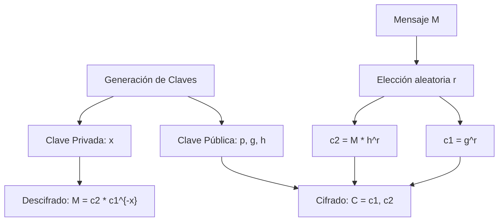
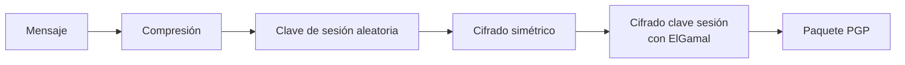

# Criptografía y Seguridad - Criptosistemas de llave pública

## 5.5 Algoritmo de El-Gamal.

---

### 1. Introducción Histórica

**El algoritmo de ElGamal** fue propuesto en 1985 por Taher ElGamal, basándose en el trabajo de Diffie-Hellman. A diferencia de RSA, ElGamal es un sistema **probabilístico** que proporciona **cifrado y firma digital** basados en el problema del logaritmo discreto.

**Contribuciones principales (Stallings, 2010):**

- Primer sistema de cifrado asimétrico basado en DLP
- Esquema de firma digital ampliamente adoptado (DSA está basado en ElGamal)
- Cifrado **probabilístico**: el mismo mensaje produce diferentes ciphertexts
- Provee **secreto perfecto** bajo ciertas condiciones

### 2. Fundamentos Matemáticos

#### 2.1 Grupo Cíclico y Generadores

Sea $G$ un **grupo cíclico finito** de orden $q$ (primo), y sea $g$ un **generador** de $G$:

$$G = \langle g \rangle = \{g^0, g^1, g^2, ..., g^{q-1}\}$$

#### 2.2 Problema del Logaritmo Discreto (DLP)

Dado $h = g^x$ en $G$, encontrar $x$ es computacionalmente difícil:

$$\text{DLP}(g, h) = x \text{ tal que } g^x = h$$

#### 2.3 Parámetros del Sistema

1. **Grupo cíclico** $G$ de orden primo $q$
2. **Generador** $g$ de $G$
3. **Clave privada:** $x \in_R \mathbb{Z}_q^*$ (aleatorio)
4. **Clave pública:** $h = g^x \in G$

### 3. Esquema de Cifrado ElGamal

#### 3.1 Descripción General



#### 3.2 Algoritmo Detallado

##### 3.2.1 Generación de Claves

**Entrada:** Parámetros de seguridad $(p, q, g)$

1. Elegir primo grande $p$ tal que $p = 2q + 1$ (primo seguro)
2. Elegir generador $g$ de subgrupo de orden $q$ en $\mathbb{Z}_p^*$
3. Seleccionar clave privada: $x \in_R \{1, 2, ..., q-1\}$
4. Calcular clave pública: $h = g^x \mod p$

**Salida:** Clave pública $(p, g, h)$, Clave privada $x$

##### 3.2.2 Cifrado

Para cifrar mensaje $M \in \mathbb{Z}_p^*$:

1. Elegir aleatorio $r \in_R \{1, 2, ..., q-1\}$
2. Calcular $c_1 = g^r \mod p$
3. Calcular $c_2 = M \cdot h^r \mod p$
4. **Ciphertext:** $C = (c_1, c_2)$

##### 3.2.3 Descifrado

Para descifrar $C = (c_1, c_2)$:

1. Calcular $s = c_1^x \mod p$
2. Calcular $s^{-1} \mod p$ (inverso multiplicativo)
3. Recuperar $M = c_2 \cdot s^{-1} \mod p$

**Demostración:**
$$c_2 \cdot (c_1^x)^{-1} \equiv M \cdot h^r \cdot (g^{rx})^{-1} \equiv M \cdot (g^x)^r \cdot g^{-rx} \equiv M \pmod{p}$$

#### 3.3 Ejemplo Numérico Pequeño

```python
def elgamal_small_example():
    """Ejemplo de ElGamal con números pequeños para comprensión"""

    # Parámetros pequeños (SOLO PARA EJEMPLO)
    p = 23  # primo
    g = 5   # generador de Z_p^*
    q = 22  # orden del grupo (p-1)

    print("=== EJEMPLO ELGAMAL CON NÚMEROS PEQUEÑOS ===")
    print(f"Parámetros públicos:")
    print(f"  p = {p} (primo)")
    print(f"  g = {g} (generador)")
    print(f"  q = {q} (orden del grupo)\n")

    # 1. GENERACIÓN DE CLAVES
    # Clave privada
    x = 6  # secreto
    # Clave pública
    h = pow(g, x, p)

    print("1. GENERACIÓN DE CLAVES:")
    print(f"  Clave privada x = {x}")
    print(f"  Clave pública h = g^x mod p = {g}^{x} mod {p} = {h}\n")

    # 2. CIFRADO
    M = 9  # mensaje a cifrar
    r = 13 # valor aleatorio

    c1 = pow(g, r, p)
    c2 = (M * pow(h, r, p)) % p

    print("2. CIFRADO:")
    print(f"  Mensaje M = {M}")
    print(f"  Aleatorio r = {r}")
    print(f"  c1 = g^r mod p = {g}^{r} mod {p} = {c1}")
    print(f"  c2 = M * h^r mod p = {M} * {h}^{r} mod {p}")
    print(f"     = {M} * {pow(h, r, p)} mod {p} = {c2}")
    print(f"  Ciphertext: C = ({c1}, {c2})\n")

    # 3. DESCIFRADO
    s = pow(c1, x, p)
    s_inv = pow(s, p-2, p)  # Por Fermat, s^{p-1} ≡ 1 mod p
    M_dec = (c2 * s_inv) % p

    print("3. DESCIFRADO:")
    print(f"  s = c1^x mod p = {c1}^{x} mod {p} = {s}")
    print(f"  s^{-1} mod p = {s_inv}")
    print(f"  M = c2 * s^{-1} mod p = {c2} * {s_inv} mod {p} = {M_dec}")
    print(f"\n¿Mensaje original == descifrado? {M == M_dec}")

    # Verificación matemática
    print(f"\n4. VERIFICACIÓN MATEMÁTICA:")
    print(f"  h^r = g^{x*r} = {pow(g, x*r, p)}")
    print(f"  c1^x = g^{r*x} = {pow(c1, x, p)}")
    print(f"  Estos deben ser iguales: {pow(h, r, p) == pow(c1, x, p)}")

    return {
        'public_key': (p, g, h),
        'private_key': x,
        'ciphertext': (c1, c2),
        'decrypted': M_dec
    }

# Ejecutar ejemplo pequeño
elgamal_small_example()
```

### 4. Implementación Práctica

#### 4.1 Implementación Didáctica Completa

```python
import random
import math
from sympy import isprime, primerange  # Solo educativo

class ElGamalEducational:
    def __init__(self, key_size=512):
        """Inicializa ElGamal con tamaño de clave"""
        self.key_size = key_size
        self.p = self.g = self.h = None
        self.x = None
        self.q = None  # Orden del subgrupo

    def generate_safe_prime(self, bits):
        """Genera primo seguro p = 2q + 1 (EDUCACIONAL)"""
        while True:
            # q primo de (bits-1) bits
            q = random.getrandbits(bits-1)
            q = self.next_prime(q)

            # p = 2q + 1
            p = 2 * q + 1

            if isprime(p) and isprime(q):
                return p, q

    def next_prime(self, n):
        """Encuentra siguiente primo (EDUCACIONAL)"""
        while not isprime(n):
            n += 1
        return n

    def find_generator(self, p, q):
        """Encuentra generador de subgrupo de orden q"""
        # Para primo seguro p = 2q + 1
        # g es generador si g^2 ≠ 1 y g^q ≠ 1 mod p
        while True:
            g = random.randint(2, p-2)
            if pow(g, 2, p) != 1 and pow(g, q, p) != 1:
                return g

    def generate_keys(self):
        """Genera par de claves ElGamal"""
        # Generar primo seguro
        self.p, self.q = self.generate_safe_prime(self.key_size)

        # Encontrar generador
        self.g = self.find_generator(self.p, self.q)

        # Clave privada
        self.x = random.randint(1, self.q-1)

        # Clave pública
        self.h = pow(self.g, self.x, self.p)

        return {
            'public_key': (self.p, self.g, self.h),
            'private_key': self.x,
            'parameters': (self.p, self.q, self.g)
        }

    def encrypt(self, message):
        """Cifra un mensaje (entero en [1, p-1])"""
        if message <= 0 or message >= self.p:
            raise ValueError(f"Mensaje debe estar en [1, {self.p-1}]")

        # Elegir r aleatorio
        r = random.randint(1, self.q-1)

        # Calcular componentes del ciphertext
        c1 = pow(self.g, r, self.p)
        c2 = (message * pow(self.h, r, self.p)) % self.p

        return (c1, c2)

    def decrypt(self, ciphertext):
        """Descifra un ciphertext"""
        c1, c2 = ciphertext

        # Calcular s = c1^x
        s = pow(c1, self.x, self.p)

        # Calcular inverso de s
        s_inv = pow(s, self.p-2, self.p)  # Teorema de Fermat

        # Recuperar mensaje
        message = (c2 * s_inv) % self.p

        return message

    def encrypt_bytes(self, data):
        """Cifra datos binarios usando esquema híbrido"""
        # Convertir mensaje a entero
        m_int = int.from_bytes(data, 'big')

        # Dividir si es necesario (m < p)
        if m_int >= self.p:
            # En la práctica usar esquema híbrido
            raise ValueError("Mensaje demasiado grande. Usar esquema híbrido.")

        # Cifrar
        c1, c2 = self.encrypt(m_int)

        # Convertir a bytes
        c1_bytes = c1.to_bytes((self.p.bit_length() + 7) // 8, 'big')
        c2_bytes = c2.to_bytes((self.p.bit_length() + 7) // 8, 'big')

        return c1_bytes + c2_bytes

    def decrypt_bytes(self, data):
        """Descifra datos binarios"""
        # Tamaño de cada componente
        size = (self.p.bit_length() + 7) // 8

        # Separar componentes
        c1_bytes = data[:size]
        c2_bytes = data[size:]

        c1 = int.from_bytes(c1_bytes, 'big')
        c2 = int.from_bytes(c2_bytes, 'big')

        # Descifrar
        m_int = self.decrypt((c1, c2))

        # Convertir a bytes
        # Calcular longitud original
        m_bytes = m_int.to_bytes((m_int.bit_length() + 7) // 8, 'big')

        return m_bytes

def elgamal_complete_example():
    print("=== EJEMPLO COMPLETO ELGAMAL ===\n")

    # Crear instancia
    elgamal = ElGamalEducational(key_size=256)  # 256 bits para ejemplo rápido

    # Generar claves
    keys = elgamal.generate_keys()

    print("1. GENERACIÓN DE CLAVES:")
    print(f"   p (primo seguro) = {elgamal.p}")
    print(f"   q (orden subgrupo) = {elgamal.q}")
    print(f"   g (generador) = {elgamal.g}")
    print(f"   x (clave privada) = {elgamal.x}")
    print(f"   h (clave pública) = g^x mod p = {elgamal.h}\n")

    # Mensaje de prueba
    message = 123456789
    print(f"2. MENSAJE ORIGINAL: {message}")
    print(f"   Verificación: 1 ≤ M ≤ p-1? {1 <= message <= elgamal.p-1}\n")

    # Cifrado
    ciphertext = elgamal.encrypt(message)
    print(f"3. CIFRADO:")
    print(f"   c1 = g^r mod p = {ciphertext[0]}")
    print(f"   c2 = M * h^r mod p = {ciphertext[1]}")
    print(f"   Ciphertext: ({ciphertext[0]}, {ciphertext[1]})\n")

    # Segundo cifrado del mismo mensaje
    ciphertext2 = elgamal.encrypt(message)
    print(f"4. SEGUNDO CIFRADO (mismo mensaje):")
    print(f"   c1' = {ciphertext2[0]}")
    print(f"   c2' = {ciphertext2[1]}")
    print(f"   ¿Ciphertexts iguales? {ciphertext == ciphertext2}")
    print(f"   (Demuestra que ElGamal es probabilístico)\n")

    # Descifrado
    decrypted = elgamal.decrypt(ciphertext)
    print(f"5. DESCIFRADO:")
    print(f"   Mensaje descifrado: {decrypted}")
    print(f"   ¿Coincide con original? {message == decrypted}")

    # Prueba con bytes
    print(f"\n6. PRUEBA CON BYTES:")
    test_message = b"Hello ElGamal!"
    print(f"   Mensaje original: {test_message}")

    # Convertir a entero (limitación: debe ser < p)
    m_int = int.from_bytes(test_message, 'big')
    if m_int < elgamal.p:
        encrypted = elgamal.encrypt(m_int)
        decrypted_int = elgamal.decrypt(encrypted)
        decrypted_bytes = decrypted_int.to_bytes(
            (decrypted_int.bit_length() + 7) // 8, 'big'
        )
        print(f"   Mensaje descifrado: {decrypted_bytes}")
        print(f"   ¿Coincide? {test_message == decrypted_bytes}")
    else:
        print(f"   Mensaje demasiado grande para p. Requiere esquema híbrido.")

    return elgamal

# Ejecutar ejemplo completo
elgamal = elgamal_complete_example()
```

#### 4.2 Implementación para Producción (esquema híbrido)

```python
from cryptography.hazmat.primitives import hashes, serialization
from cryptography.hazmat.primitives.asymmetric import dh
from cryptography.hazmat.primitives.kdf.hkdf import HKDF
from cryptography.hazmat.primitives.ciphers.aead import AESGCM
import os

class HybridElGamal:
    """ElGamal híbrido: cifra clave de sesión con ElGamal, datos con AES"""

    def __init__(self, key_size=2048):
        self.key_size = key_size
        self.params = None
        self.private_key = None
        self.public_key = None

    def generate_keys(self):
        """Genera parámetros DH (similar a ElGamal)"""
        # Usar parámetros DH estandarizados
        if self.key_size == 2048:
            # RFC 3526 - Grupo 14
            self.params = dh.DHParameterNumbers(
                p=int("""FFFFFFFFFFFFFFFFC90FDAA22168C234C4C6628B80DC1CD1
                        29024E088A67CC74020BBEA63B139B22514A08798E3404DD
                        EF9519B3CD3A431B302B0A6DF25F14374FE1356D6D51C245
                        E485B576625E7EC6F44C42E9A637ED6B0BFF5CB6F406B7ED
                        EE386BFB5A899FA5AE9F24117C4B1FE649286651ECE45B3D
                        C2007CB8A163BF0598DA48361C55D39A69163FA8FD24CF5F
                        83655D23DCA3AD961C62F356208552BB9ED529077096966D
                        670C354E4ABC9804F1746C08CA18217C32905E462E36CE3B
                        E39E772C180E86039B2783A2EC07A28FB5C55DF06F4C52C9
                        DE2BCBF6955817183995497CEA956AE515D2261898FA0510
                        15728E5A8AACAA68FFFFFFFFFFFFFFFF""".replace("\n", ""), 16),
                g=2
            ).parameters()
        else:
            # Generar parámetros personalizados
            self.params = dh.generate_parameters(generator=2, key_size=self.key_size)

        # Generar par de claves
        self.private_key = self.params.generate_private_key()
        self.public_key = self.private_key.public_key()

        return self.public_key

    def encrypt(self, plaintext, recipient_public_key):
        """Cifrado híbrido: ElGamal + AES-GCM"""
        # 1. Generar clave de sesión aleatoria
        session_key = os.urandom(32)  # 256 bits

        # 2. Cifrar clave de sesión con ElGamal/DH
        # shared_secret = g^{ab} mod p
        shared_secret = self.private_key.exchange(recipient_public_key)

        # Derivar clave de encapsulación
        kdf = HKDF(
            algorithm=hashes.SHA256(),
            length=32,
            salt=None,
            info=b'elgamal key encapsulation'
        )
        encapsulation_key = kdf.derive(shared_secret)

        # Cifrar clave de sesión (simplificado)
        # En implementación real usar KEM

        # 3. Cifrar datos con AES-GCM
        aesgcm = AESGCM(session_key)
        nonce = os.urandom(12)
        ciphertext = aesgcm.encrypt(nonce, plaintext, None)

        # 4. Paquete: (encapsulated_key, nonce, ciphertext)
        # Nota: Esta es una simplificación
        return session_key + nonce + ciphertext

    def decrypt(self, ciphertext_package, sender_public_key):
        """Descifrado híbrido"""
        # Separar componentes
        session_key = ciphertext_package[:32]
        nonce = ciphertext_package[32:44]
        ciphertext = ciphertext_package[44:]

        # Descifrar datos
        aesgcm = AESGCM(session_key)
        plaintext = aesgcm.decrypt(nonce, ciphertext, None)

        return plaintext

# Ejemplo de uso híbrido
def hybrid_example():
    print("=== EJEMPLO ELGAMAL HÍBRIDO ===\n")

    # Alice genera sus claves
    alice = HybridElGamal(key_size=1024)
    alice_pub = alice.generate_keys()

    # Bob genera sus claves
    bob = HybridElGamal(key_size=1024)
    bob_pub = bob.generate_keys()

    # Mensaje
    message = b"Mensaje secreto para Bob"

    print("1. Alice cifra mensaje para Bob")
    ciphertext = alice.encrypt(message, bob_pub)
    print(f"   Longitud ciphertext: {len(ciphertext)} bytes")

    print("\n2. Bob descifra mensaje")
    # Nota: En realidad Bob usaría su clave privada
    plaintext = bob.decrypt(ciphertext, alice_pub)
    print(f"   Mensaje descifrado: {plaintext}")
    print(f"   ¿Coincide? {message == plaintext}")

    return alice, bob
```

### 5. Esquema de Firma Digital ElGamal

#### 5.1 Algoritmo de Firma

**Generación de firma para mensaje $m$:**

1. Elegir aleatorio $k \in_R \mathbb{Z}_q^*$ (ephemeral key)
2. Calcular $r = g^k \mod p$
3. Calcular $s = k^{-1}(H(m) - xr) \mod q$

**Firma:** $\sigma = (r, s)$

**Verificación:**

1. Verificar $0 < r < p$ y $0 < s < q$
2. Calcular $v_1 = g^{H(m)} \mod p$
3. Calcular $v_2 = h^r \cdot r^s \mod p$
4. Aceptar si $v_1 \equiv v_2 \pmod{p}$

#### 5.2 Implementación de Firma

```python
class ElGamalSignature:
    """Implementación de firma digital ElGamal"""

    def __init__(self, p, g, x):
        self.p = p
        self.g = g
        self.x = x  # clave privada
        self.h = pow(g, x, p)  # clave pública

        # Orden del grupo (simplificado)
        self.q = p - 1

    def hash_message(self, message):
        """Hash del mensaje (simplificado)"""
        import hashlib
        # En producción usar hash criptográfico apropiado
        hash_bytes = hashlib.sha256(message).digest()
        return int.from_bytes(hash_bytes, 'big') % self.q

    def sign(self, message):
        """Genera firma para mensaje"""
        # Hash del mensaje
        h_m = self.hash_message(message)

        # Elegir k aleatorio (debe ser único por firma)
        while True:
            k = random.randint(1, self.q-1)
            if math.gcd(k, self.q) == 1:
                break

        # Calcular r
        r = pow(self.g, k, self.p)

        # Calcular k^{-1} mod q
        k_inv = pow(k, -1, self.q)  # Python 3.8+

        # Calcular s
        s = (k_inv * (h_m - self.x * r)) % self.q

        return (r, s)

    def verify(self, message, signature):
        """Verifica firma"""
        r, s = signature

        # Verificar rango
        if not (0 < r < self.p and 0 < s < self.q):
            return False

        # Hash del mensaje
        h_m = self.hash_message(message)

        # Calcular v1 = g^{H(m)} mod p
        v1 = pow(self.g, h_m, self.p)

        # Calcular v2 = h^r * r^s mod p
        v2 = (pow(self.h, r, self.p) * pow(r, s, self.p)) % self.p

        return v1 == v2

# Ejemplo de firma
def signature_example():
    print("=== FIRMA DIGITAL ELGAMAL ===\n")

    # Parámetros (pequeños para ejemplo)
    p = 467  # primo
    g = 2    # generador
    x = 127  # clave privada

    # Crear instancia
    signer = ElGamalSignature(p, g, x)

    # Mensaje
    message = b"Mensaje importante a firmar"

    # Firmar
    signature = signer.sign(message)
    print(f"1. FIRMA GENERADA:")
    print(f"   Mensaje: {message}")
    print(f"   Firma (r, s): ({signature[0]}, {signature[1]})")

    # Verificar
    valid = signer.verify(message, signature)
    print(f"\n2. VERIFICACIÓN:")
    print(f"   ¿Firma válida? {valid}")

    # Verificar con mensaje modificado
    modified_msg = b"Mensaje modificado"
    invalid = signer.verify(modified_msg, signature)
    print(f"   ¿Firma válida para mensaje modificado? {invalid}")

    return signer, signature
```

### 6. Seguridad y Consideraciones

#### 6.1 Propiedades de Seguridad

**Cifrado ElGamal provee:**

1. **Confidencialidad:** Basada en DLP
2. **No-determinismo:** Mismo mensaje → diferentes ciphertexts
3. **Secreto perfecto:** Bajo ciertas condiciones

**Vulnerabilidades conocidas:**

1. **Ataque de texto plano elegido:** Sin padding adecuado
2. **Reuso de k en firmas:** Expone clave privada
3. **Subgrupos pequeños:** Reduce seguridad

#### 6.2 Comparación con RSA

| Característica       | RSA             | ElGamal            |
| -------------------- | --------------- | ------------------ |
| Base matemática      | Factorización   | Logaritmo discreto |
| Tipo de cifrado      | Determinístico  | Probabilístico     |
| Tamaño ciphertext    | Igual que clave | 2× tamaño clave    |
| Velocidad cifrado    | Más rápido      | Más lento          |
| Velocidad descifrado | Similar         | Similar            |
| Forward Secrecy      | No (sin DHE)    | Sí (con ephemeral) |
| Patente              | Expirada        | Libre              |

#### 6.3 Esquemas de Padding para ElGamal

```python
def oaep_pad(message, n_bits, label=b''):
    """Padding OAEP para ElGamal"""
    import hashlib

    k = n_bits // 8
    m_len = len(message)

    # Hash de la label
    l_hash = hashlib.sha256(label).digest()

    # Padding PS
    ps = b'\x00' * (k - m_len - 2 * 32 - 2)

    # DB = lHash || PS || 0x01 || M
    db = l_hash + ps + b'\x01' + message

    # Seed aleatoria
    seed = os.urandom(32)

    # Masking
    # (simplificado - implementación real requiere mgf1)

    return db  # simplificado
```

### 7. Ejercicios Propuestos

#### Ejercicio 1: Implementación Manual

Implementa ElGamal desde cero con:

1. Generación de primo seguro
2. Búsqueda de generador
3. Cifrado/descifrado
4. Demostración del no-determinismo

#### Ejercicio 2: Ataque por Reuso de k

Dado:

- $p = 467$, $g = 2$, $y = 132$
- Dos firmas con mismo k:
  - $m_1 = 100$, firma $(r, s_1) = (33, 45)$
  - $m_2 = 200$, firma $(r, s_2) = (33, 237)$

Encuentra:

1. El valor de k
2. La clave privada x

#### Ejercicio 3: Sistema Híbrido

Diseña un sistema que:

1. Use ElGamal para intercambiar clave de sesión
2. Use ChaCha20-Poly1305 para cifrado de datos
3. Implemente autenticación con firma ElGamal
4. Provea forward secrecy

#### Ejercicio 4: Análisis de Seguridad

Analiza un sistema ElGamal con:

- $p$ de 1024 bits
- Subgrupo de orden $q$ de 160 bits
- Sin padding

Calcula:

1. Complejidad del mejor ataque conocido
2. Tiempo estimado para romper con hardware actual
3. Mejoras recomendadas

#### Ejercicio 5: Comparativa RSA vs ElGamal

Crea una tabla comparativa que incluya:

- Complejidad computacional
- Tamaño de claves
- Propiedades de seguridad
- Casos de uso recomendados
- Vulnerabilidades específicas

### 8. Aplicaciones en el Mundo Real

#### 8.1 PGP/GPG



#### 8.2 GNU Privacy Guard (GPG)

```bash
# Generar par de claves ElGamal en GPG
gpg --full-generate-key
# Seleccionar: (4) RSA (sign only)
# Luego: (5) ElGamal (encrypt only)
```

#### 8.3 Estándar de Firma Digital (DSA)

Basado en ElGamal, definido en FIPS 186.

#### 8.4 Criptografía de Umbral

```python
# ElGamal permite esquemas de umbral
def threshold_elgamal():
    """Cifrado donde se necesitan t de n partes para descifrar"""
    # Implementación simplificada
    # 1. Dividir clave privada x en n shares
    # 2. Cifrar con clave pública
    # 3. Cualquier t shares pueden reconstruir x y descifrar
    pass
```

### 9. Referencias Bibliográficas

#### Stallings (2010) - Cryptography and Network Security

- **Capítulo 10:** "Key Management; Other Public-Key Cryptosystems"
- **Sección 10.3:** "ElGamal Cryptographic System"
- **Discusión de seguridad y aplicaciones**

#### Forouzan (2008) - Cryptography and Network Security

- **Capítulo 10:** "Asymmetric-Key Cryptography"
- **Sección 10.4:** "ElGamal Cryptosystem"
- **Ejemplos numéricos detallados**

#### Menezes et al. (1996) - Handbook of Applied Cryptography

- **Capítulo 8:** "Public-Key Encryption"
- **Sección 8.4:** "ElGamal encryption"
- **Sección 11.5:** "ElGamal signature scheme"
- **Análisis matemático completo**

#### Schneier (1996) - Applied Cryptography

- **Capítulo 19:** "Public-Key Algorithms"
- **Sección 19.6:** "ElGamal"
- **Implementaciones y variantes**

### 10. Preguntas de Evaluación

#### Nivel Básico

1. Explica por qué ElGamal es un cifrado probabilístico.
2. ¿Cuál es la relación entre Diffie-Hellman y ElGamal?
3. Nombra dos ventajas de ElGamal sobre RSA.

#### Nivel Intermedio

4. Demuestra la corrección del descifrado ElGamal.
5. Explica el ataque por reuso de k en firmas ElGamal.
6. Compara firma ElGamal vs DSA.

#### Nivel Avanzado

7. Implementa un esquema de umbral usando ElGamal.
8. Analiza la seguridad de ElGamal contra ataques cuánticos.
9. Diseña un protocolo de votación electrónica usando ElGamal.

### 11. Laboratorio Práctico

#### Configuración:

```python
class ElGamalLaboratory:
    def __init__(self):
        self.results = {}

    def experiment_1_randomness(self):
        """Demuestra no-determinismo de ElGamal"""
        elgamal = ElGamalEducational(256)
        elgamal.generate_keys()

        message = 123456
        ciphertexts = []

        for _ in range(10):
            ciphertexts.append(elgamal.encrypt(message))

        # Todos deben ser diferentes
        unique = len(set(ciphertexts)) == 10
        return {"unique_ciphertexts": unique, "samples": ciphertexts[:3]}

    def experiment_2_performance(self):
        """Compara rendimiento vs tamaño de clave"""
        sizes = [256, 512, 1024, 2048]
        results = {}

        for size in sizes:
            elgamal = ElGamalEducational(size)

            import time
            start = time.time()
            elgamal.generate_keys()
            gen_time = time.time() - start

            message = 123456
            start = time.time()
            ciphertext = elgamal.encrypt(message)
            enc_time = time.time() - start

            start = time.time()
            decrypted = elgamal.decrypt(ciphertext)
            dec_time = time.time() - start

            results[size] = {
                'generation': gen_time,
                'encryption': enc_time,
                'decryption': dec_time,
                'correct': decrypted == message
            }

        return results

    def experiment_3_security(self):
        """Simula ataque por reuso de k"""
        # Implementar ataque descrito en ejercicio 2
        pass
```

#### Experimentos Sugeridos:

1. Medir overhead de ciphertext (2×)
2. Demostrar secreto perfecto bajo ciertas condiciones
3. Implementar y probar esquema de padding
4. Comparar con ECIES (ElGamal elíptico)
5. Implementar esquema de compartición de secretos

**Notas de Seguridad para Implementación:**

1. **Generación de k:** Debe ser única por cifrado/firma
2. **Primos seguros:** Usar $p = 2q + 1$ con $q$ primo
3. **Validación:** Verificar que mensaje ∈ [1, p-1]
4. **Padding:** Siempre usar
