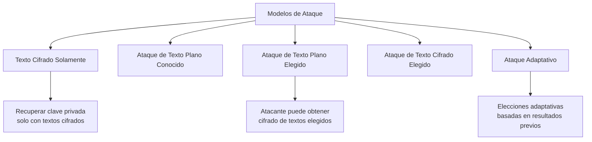
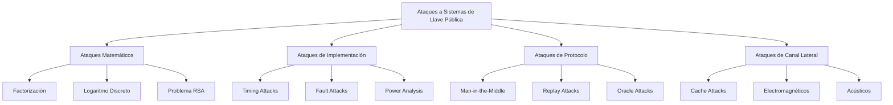
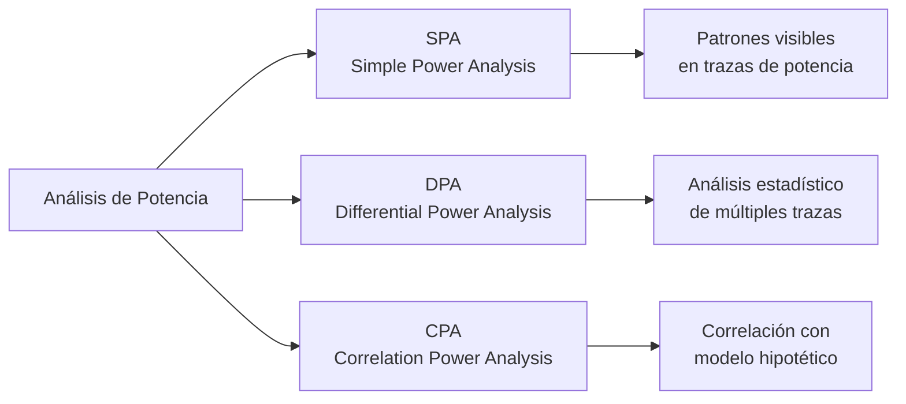
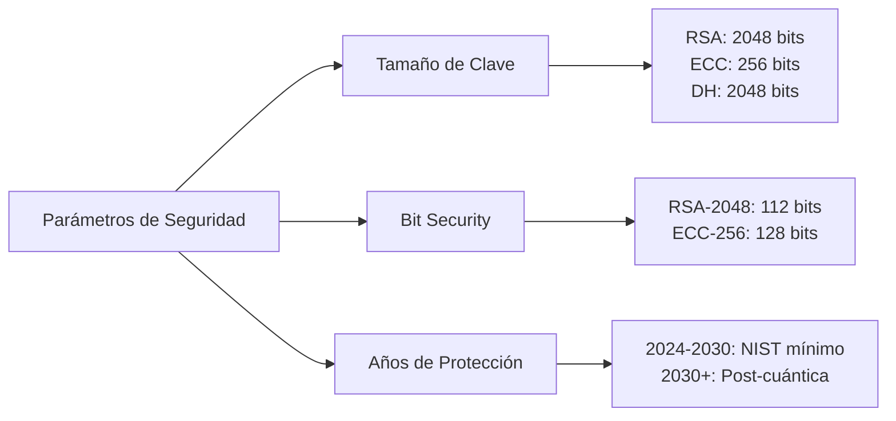

# Criptografía y Seguridad - Criptosistemas de llave pública

## 5.6 Elementos de criptoanálisis de sistemas de llave pública.

---

### 1. Introducción al Criptoanálisis de Llave Pública

**Criptoanálisis** es la ciencia de estudiar y romper sistemas criptográficos. En el contexto de criptografía de llave pública, el criptoanálisis se enfoca en **encontrar debilidades matemáticas, implementacionales o protocolares** que permitan recuperar la clave privada o mensajes sin autorización.

**Según Stallings (2010):** "El criptoanálisis de sistemas de llave pública se basa en explotar la estructura matemática subyacente, a diferencia del criptoanálisis de sistemas simétricos que frecuentemente usa análisis estadístico."

### 2. Modelos de Ataque

#### 2.1 Modelos de Seguridad para Cifrado Asimétrico



#### 2.2 Modelos de Seguridad para Firmas Digitales

1. **Ataque de Falsa Firma Existencial:** Crear firma válida para cualquier mensaje
2. **Ataque de Falsa Firma Selectiva:** Crear firma para mensaje específico elegido
3. **Ataque de Falsa Firma Universal:** Crear firma para cualquier mensaje

### 3. Metodologías de Criptoanálisis

#### 3.1 Enfoques Generales

```python
class CryptoAnalysisFramework:
    """Framework para análisis de sistemas de llave pública"""

    def __init__(self):
        self.attack_methods = {
            'mathematical': ['factorization', 'discrete_log', 'lattice'],
            'implementation': ['timing', 'power', 'fault'],
            'protocol': ['man_in_middle', 'replay', 'oracle'],
            'side_channel': ['cache', 'electromagnetic', 'acoustic']
        }

    def analyze_system(self, system_type, key_size, implementation_details):
        """Analiza vulnerabilidades potenciales"""
        vulnerabilities = []

        if system_type == 'RSA':
            vulnerabilities.extend(self.analyze_rsa(key_size))
        elif system_type == 'ElGamal':
            vulnerabilities.extend(self.analyze_elgamal(key_size))

        return vulnerabilities
```

#### 3.2 Taxonomía de Ataques



### 4. Criptoanálisis Matemático

#### 4.1 Ataques a RSA

##### 4.1.1 Factorización de n

**Objetivo:** Dado $n = pq$, encontrar $p$ y $q$

**Complejidad de mejores algoritmos:**

- **GNFS:** $L_n[1/3, (64/9)^{1/3}] = O\left(e^{(1.92+o(1))(\ln n)^{1/3}(\ln \ln n)^{2/3}}\right)$
- **ECM:** $L_p[1/2, \sqrt{2}] = O\left(e^{(\sqrt{2}+o(1))\sqrt{\ln p \ln \ln p}}\right)$

```python
import sympy
import math
import time

class RSA_Analysis:
    """Herramientas para análisis de RSA"""

    @staticmethod
    def trial_division(n, limit=None):
        """División por prueba - O(√n)"""
        if limit is None:
            limit = int(math.isqrt(n)) + 1

        for i in range(2, limit):
            if n % i == 0:
                return i, n // i
        return None

    @staticmethod
    def pollard_rho(n):
        """Método ρ de Pollard para factorización"""
        if n % 2 == 0:
            return 2

        x = 2
        y = 2
        d = 1

        f = lambda a: (a*a + 1) % n

        while d == 1:
            x = f(x)
            y = f(f(y))
            d = math.gcd(abs(x - y), n)

        return d if d != n else None

    @staticmethod
    def fermat_factorization(n):
        """Método de Fermat para n = a² - b²"""
        a = math.isqrt(n)
        b2 = a*a - n

        while not math.isqrt(b2)**2 == b2:
            a += 1
            b2 = a*a - n

        b = math.isqrt(b2)
        return a - b, a + b

    @staticmethod
    def analyze_rsa_key(n, e=None):
        """Análisis completo de clave RSA"""
        print(f"=== ANÁLISIS DE CLAVE RSA ===")
        print(f"n = {n} ({n.bit_length()} bits)")

        # 1. Verificar si n es primo
        if sympy.isprime(n):
            print("¡ALERTA! n es primo, no compuesto")
            return None

        # 2. Verificar factores pequeños
        small_primes = [2, 3, 5, 7, 11, 13, 17, 19, 23, 29]
        for p in small_primes:
            if n % p == 0:
                print(f"Factor pequeño encontrado: {p}")
                return p, n//p

        # 3. Método de Fermat (si factores cercanos)
        start = time.time()
        try:
            p, q = RSA_Analysis.fermat_factorization(n)
            print(f"Método Fermat: p={p}, q={q}")
            print(f"Tiempo: {time.time()-start:.4f}s")
            return p, q
        except:
            pass

        # 4. Pollard Rho
        start = time.time()
        factor = RSA_Analysis.pollard_rho(n)
        if factor:
            print(f"Pollard Rho: {factor}, {n//factor}")
            print(f"Tiempo: {time.time()-start:.4f}s")
            return factor, n//factor

        print("No se encontraron factores con métodos básicos")
        return None

# Ejemplo de análisis
n_small = 323  # 61 * 53
print(RSA_Analysis.analyze_rsa_key(n_small))
```

##### 4.1.2 Ataque de Wiener

**Condición:** $d < \frac{1}{3}n^{1/4}$

**Algoritmo:** Usa fracciones continuas de $e/n$

```python
def wiener_attack(e, n):
    """Ataque de Wiener para RSA con d pequeño"""
    from fractions import Fraction

    # Fracción continua de e/n
    def convergents(e, n):
        convergents = []
        a = e
        b = n

        while b != 0:
            q = a // b
            convergents.append(q)
            a, b = b, a - q * b

        return convergents

    conv = convergents(e, n)

    for k in range(1, len(conv)):
        # Reconstruir posibles d
        # Implementación simplificada
        pass

    return None
```

##### 4.1.3 Ataque Hastad (Broadcast)

**Escenario:** Mismo mensaje cifrado con múltiples claves públicas $(e_i, n_i)$

**Solución:** Usar Teorema del Resto Chino para resolver:

$$M^e \equiv C_i \pmod{n_i}$$

#### 4.2 Ataques a Diffie-Hellman y ElGamal

##### 4.2.1 Problema del Logaritmo Discreto

**Algoritmos para DLP:**

1. **Baby-step Giant-step:** $O(\sqrt{n})$ tiempo y espacio
2. **Pollard's Rho:** $O(\sqrt{n})$ tiempo, $O(1)$ espacio
3. **Index Calculus:** Subexponencial para $\mathbb{Z}_p^*$
4. **Pohlig-Hellman:** $O(\sum e_i(\log n + \sqrt{p_i}))$

```python
class DLP_Analysis:
    """Análisis de Logaritmo Discreto"""

    @staticmethod
    def baby_step_giant_step(g, h, p):
        """Baby-step Giant-step para DLP"""
        import math

        n = p - 1  # Asumiendo grupo cíclico completo
        m = math.isqrt(n) + 1

        # Baby steps
        baby_steps = {}
        gi = 1
        for i in range(m):
            baby_steps[gi] = i
            gi = (gi * g) % p

        # Calcular g^{-m}
        gm = pow(g, -m, p)

        # Giant steps
        hj = h
        for j in range(m):
            if hj in baby_steps:
                i = baby_steps[hj]
                return j * m + i
            hj = (hj * gm) % p

        return None

    @staticmethod
    def pohlig_hellman(g, h, p, factors):
        """Algoritmo Pohlig-Hellman para DLP"""
        # factors: [(p_i, e_i)] factores de p-1
        congruences = []

        for pi, ei in factors:
            # Reducir problema módulo p_i^e_i
            gi = pow(g, (p-1)//(pi**ei), p)
            hi = pow(h, (p-1)//(pi**ei), p)

            # Resolver DLP en subgrupo de orden p_i^e_i
            xi = DLP_Analysis.solve_dlp_prime_power(gi, hi, p, pi, ei)
            congruences.append((xi, pi**ei))

        # Combinar con Teorema Chino del Resto
        return chinese_remainder(congruences)

    @staticmethod
    def solve_dlp_prime_power(g, h, p, q, e):
        """Resuelve DLP en grupo de orden q^e"""
        # Implementación del algoritmo
        x = 0
        gamma = pow(g, q**(e-1), p)

        for k in range(e):
            hk = pow(h * pow(g, -x, p), q**(e-1-k), p)
            dk = DLP_Analysis.baby_step_giant_step(gamma, hk, p)
            x = x + dk * (q**k)

        return x

# Ejemplo DLP pequeño
p, g, h = 101, 2, 3  # Encontrar x tal que 2^x ≡ 3 mod 101
print(f"Baby-step Giant-step: {DLP_Analysis.baby_step_giant_step(g, h, p)}")
```

### 5. Ataques de Implementación

#### 5.1 Timing Attacks

```python
import time
import statistics

class TimingAttack:
    """Ataque de tiempo contra exponenciación modular"""

    @staticmethod
    def square_and_multiply(base, exp, mod):
        """Exponenciación modular vulnerable"""
        result = 1
        base = base % mod

        # Implementación vulnerable
        bit_length = exp.bit_length()
        for i in range(bit_length-1, -1, -1):
            # Square
            result = (result * result) % mod

            # Multiplicación condicional
            if (exp >> i) & 1:
                result = (result * base) % mod

        return result

    @staticmethod
    def analyze_timing(public_key, oracle_function):
        """Analiza tiempos de respuesta"""
        # oracle_function(ciphertext) -> tiempo de descifrado
        samples = 1000
        timings = []

        for _ in range(samples):
            # Generar ciphertext de prueba
            test_input = generate_test_input()

            start = time.perf_counter_ns()
            oracle_function(test_input)
            end = time.perf_counter_ns()

            timings.append(end - start)

        return statistics.mean(timings), statistics.stdev(timings)
```

#### 5.2 Fault Attacks

```python
class FaultAttack:
    """Ataques por inyección de fallos"""

    @staticmethod
    def rsa_fault_attack(ciphertext, n, e, faulty_results):
        """
        Ataque a RSA usando fallos en el cálculo
        Basado en: C^d mod n con fallo -> revela factores
        """
        # Implementación del ataque de Bellcore
        # Requiere: C, y C' (ciphertext descifrado con fallo)

        for faulty in faulty_results:
            # Si conocemos M y M' (correcto y con fallo)
            # podemos calcular gcd(M - M', n)
            pass

        return None
```

#### 5.3 Power Analysis



### 6. Ataques de Protocolo

#### 6.1 Man-in-the-Middle (MitM)

```python
class MITM_Attack:
    """Simulación de ataque Man-in-the-Middle"""

    def __init__(self):
        self.intercepted_messages = []

    def intercept_dh(self, p, g, A, B):
        """Intercepta intercambio Diffie-Hellman"""
        # 1. Interceptar A = g^a mod p
        # 2. Interceptar B = g^b mod p
        # 3. Reemplazar con valores propios

        # Claves propias del atacante
        a_attacker = random.randint(2, p-2)
        b_attacker = random.randint(2, p-2)

        A_fake = pow(g, a_attacker, p)
        B_fake = pow(g, b_attacker, p)

        # Alice piensa que B_fake es de Bob
        # Bob piensa que A_fake es de Alice

        K_alice_attacker = pow(B_fake, a_attacker, p)  # Alice con atacante
        K_bob_attacker = pow(A_fake, b_attacker, p)    # Bob con atacante

        return {
            'alice_attacker_key': K_alice_attacker,
            'bob_attacker_key': K_bob_attacker,
            'intercepted': (A, B)
        }
```

#### 6.2 Ataques de Oráculo

**Ejemplo: Padding Oracle Attack**

```python
class PaddingOracleAttack:
    """Ataque a RSA con PKCS#1 v1.5 padding"""

    def __init__(self, oracle):
        self.oracle = oracle  # Función que dice si padding es válido

    def attack(self, ciphertext, n, e):
        """Ataque de Bleichenbacher"""
        # Implementación simplificada
        c = ciphertext

        # Paso 1: Encontrar s0 tal que padding válido
        s0 = 1
        while True:
            c_prime = (c * pow(s0, e, n)) % n
            if self.oracle(c_prime):
                break
            s0 += 1

        # Pasos posteriores (simplificado)
        # Refinar intervalo hasta encontrar mensaje

        return None
```

### 7. Métricas de Seguridad

#### 7.1 Medidas de Complejidad

**Notación O grande:**

- **Polinomial:** $O(n^k)$
- **Subexponencial:** $O(e^{c(\log n)^a(\log \log n)^{1-a}})$
- **Exponencial:** $O(e^{cn})$

**Función L para algoritmos subexponenciales:**
$$L_n[\alpha, c] = e^{(c+o(1))(\ln n)^\alpha(\ln \ln n)^{1-\alpha}}$$

#### 7.2 Bit Security

**Definición:** Un sistema tiene **k-bit security** si el mejor ataque conocido requiere $2^k$ operaciones.

**Ejemplo (NIST SP 800-57):**

| Algoritmo | Tamaño clave | Bit security |
| --------- | ------------ | ------------ |
| RSA       | 1024 bits    | 80 bits      |
| RSA       | 2048 bits    | 112 bits     |
| RSA       | 3072 bits    | 128 bits     |
| ECC       | 256 bits     | 128 bits     |

#### 7.3 Análisis Asintótico de Algoritmos

```python
import numpy as np
import matplotlib.pyplot as plt

def plot_attack_complexities():
    """Visualiza complejidades de ataques"""
    bits = np.arange(128, 4096, 64)

    # Tiempos estimados para diferentes ataques
    times = {
        'Brute Force': 2**(bits/2),  # √n para factorización
        'GNFS': np.exp(1.92 * (np.log(2**bits))**(1/3) *
                      (np.log(np.log(2**bits)))**(2/3)),
        'ECM': np.exp(np.sqrt(2 * np.log(2**bits) *
                             np.log(np.log(2**bits)))),
        'Quantum (Shor)': bits**3  # Polinomial
    }

    fig, ax = plt.subplots()
    for name, t in times.items():
        ax.plot(bits, np.log10(t), label=name)

    ax.set_xlabel('Key Size (bits)')
    ax.set_ylabel('log10(Operations)')
    ax.legend()
    ax.grid(True)
    return fig
```

### 8. Ejercicios Propuestos

#### Ejercicio 1: Ataque a RSA con n Pequeño

Dado:

- $n = 323$ (61 × 53)
- $e = 17$
- $C = 2790$

Implementa:

1. Factorización por Fermat
2. Cálculo de φ(n) y d
3. Descifrado del mensaje

#### Ejercicio 2: Ataque de Texto Plano Conocido a ElGamal

Dado:

- $p = 467$, $g = 2$, $h = 132$
- Mensaje conocido $M = 100$, ciphertext $(c_1, c_2) = (33, 189)$

Encuentra:

1. El valor aleatorio $r$ usado
2. La clave privada $x$
3. Descifra otro ciphertext $(41, 215)$

#### Ejercicio 3: Análisis de Timing

Implementa un ataque de tiempo a una implementación vulnerable de exponenciación modular. Mide:

1. Diferencia de tiempo entre multiplicación y cuadrado
2. Recuperación de bits de la clave
3. Contramedidas (exponenciación de tiempo constante)

#### Ejercicio 4: Ataque de Oráculo de Padding

Simula un ataque de oráculo contra RSA-PKCS#1 v1.5:

1. Implementa oráculo que detecta padding inválido
2. Aplica ataque de Bleichenbacher
3. Estima número de consultas necesarias

#### Ejercicio 5: Análisis Comparativo

Para un sistema hipotético:

- RSA-2048 vs ECC-256 vs DH-2048

Calcula:

1. Operaciones para romper con mejores ataques conocidos
2. Costo computacional estimado
3. Impacto de computación cuántica (algoritmo de Shor)

### 9. Herramientas de Criptoanálisis

#### 9.1 Software Especializado

```python
class CryptoAnalysisToolkit:
    """Kit de herramientas para criptoanálisis"""

    tools = {
        'factorization': ['yafu', 'msieve', 'gmp-ecm'],
        'discrete_log': ['cado-nfs', 'magma', 'pari/gp'],
        'lattice': ['fpLLL', 'NTL', 'SageMath'],
        'side_channel': ['ChipWhisperer', 'DPA Contest']
    }

    @staticmethod
    def estimate_security(algorithm, key_size, year=2024):
        """Estima años de seguridad restante"""
        # Basado en la Ley de Moore y avances algorítmicos
        mips_year = 10**12  # Operaciones por año

        if algorithm == 'RSA':
            # GNFS complexity
            ops = CryptoAnalysisToolkit.gnfs_complexity(key_size)
        elif algorithm == 'ECC':
            # Pollard's Rho complexity
            ops = 2**(key_size/2)

        years = ops / mips_year

        # Ajuste por avances algorítmicos
        years *= 0.5  # Reducción conservadora

        return years
```

#### 9.2 Benchmarks de Seguridad



### 10. Defensas y Contramedidas

#### 10.1 Mejores Prácticas

```python
class DefenseMechanisms:
    """Mecanismos de defensa contra criptoanálisis"""

    @staticmethod
    def secure_rsa_implementation():
        return {
            'key_size': '≥ 2048 bits (3072 recomendado)',
            'public_exponent': '65537 (0x10001)',
            'padding': 'OAEP para cifrado, PSS para firma',
            'key_generation': 'Primos seguros, no cercanos',
            'implementation': 'Tiempo constante, sin canales laterales',
            'key_management': 'HSM para claves privadas'
        }

    @staticmethod
    def secure_dh_implementation():
        return {
            'prime_size': '≥ 2048 bits',
            'generator': 'Subgrupo primo grande',
            'key_validation': 'Verificar que 1 < g < p-1',
            'ephemeral_keys': 'Usar DHE/ECDHE para forward secrecy',
            'authentication': 'Certificados digitales o PSK'
        }

    @staticmethod
    def side_channel_protections():
        return [
            'Tiempo constante para operaciones criptográficas',
            'Enmascaramiento de datos sensibles',
            'Aleatorización de ejecución',
            'Protección física (faraday cage)',
            'Monitoreo de anomalías'
        ]
```

#### 10.2 Validación de Parámetros

```python
def validate_rsa_parameters(p, q, e):
    """Valida parámetros RSA para seguridad"""
    issues = []

    n = p * q
    phi = (p-1) * (q-1)

    # 1. Verificar tamaño
    if n.bit_length() < 2048:
        issues.append(f"n demasiado pequeño: {n.bit_length()} bits")

    # 2. Verificar primos fuertes
    if p.bit_length() != q.bit_length():
        issues.append("p y q de diferente tamaño")

    # 3. Verificar que no sean cercanos
    ratio = max(p, q) / min(p, q)
    if ratio < 1.1:
        issues.append("p y q demasiado cercanos")

    # 4. Verificar que e sea apropiado
    if e <= 1 or e >= phi:
        issues.append(f"e fuera de rango: {e}")

    # 5. Verificar que gcd(e, phi) = 1
    if math.gcd(e, phi) != 1:
        issues.append(f"e y φ(n) no son coprimos")

    # 6. Verificar que d no sea pequeño
    d = pow(e, -1, phi)
    if d < n**0.25 / 3:
        issues.append("d demasiado pequeño (vulnerable a Wiener)")

    return issues
```

### 11. Referencias Bibliográficas

#### Stallings (2010) - Cryptography and Network Security

- **Capítulo 9:** "Public-Key Cryptography and RSA" - Análisis de seguridad
- **Capítulo 10:** "Key Management" - Ataques a protocolos
- **Apéndice B:** "Projects for Teaching Cryptography and Network Security"

#### Forouzan (2008) - Cryptography and Network Security

- **Capítulo 10:** "Asymmetric-Key Cryptography" - Ejemplos de ataques
- **Sección 15.2:** "Attacks on Digital Signature" - Análisis de firmas

#### Menezes et al. (1996) - Handbook of Applied Cryptography

- **Capítulo 3:** "Number-Theoretic Reference Problems" - Complejidad
- **Capítulo 12:** "Key Establishment Protocols" - Ataques a protocolos
- **Capítulo 13:** "Key Management Techniques" - Aspectos prácticos

#### Schneier (1996) - Applied Cryptography

- **Capítulo 7:** "Key Length" - Análisis de seguridad
- **Capítulo 8:** "Key Management" - Ataques y defensas
- **Capítulo 19:** "Public-Key Algorithms" - Vulnerabilidades

#### Referencias Especializadas:

1. **Boneh, D. (1999).** "Twenty Years of Attacks on the RSA Cryptosystem"
2. **Kocher, P. (1996).** "Timing Attacks on Implementations of Diffie-Hellman, RSA, DSS, and Other Systems"
3. **Bleichenbacher, D. (1998).** "Chosen Ciphertext Attacks Against Protocols Based on the RSA Encryption Standard PKCS #1"

### 12. Preguntas de Evaluación

#### Nivel Básico

1. Explica la diferencia entre criptografía y criptoanálisis.
2. Nombra tres tipos de ataques a sistemas de llave pública.
3. ¿Por qué el tamaño de la clave afecta la seguridad?

#### Nivel Intermedio

4. Describe el ataque de Wiener contra RSA.
5. Explica cómo funciona un ataque de canal lateral.
6. Compara la complejidad de factorización vs logaritmo discreto.

#### Nivel Avanzado

7. Implementa un ataque de texto cifrado elegido.
8. Analiza la seguridad de un sistema híbrido RSA-AES.
9. Diseña un protocolo resistente a ataques de MitM.

### 13. Laboratorio Práctico

#### Configuración del Laboratorio

```python
class CryptoAnalysisLab:
    """Laboratorio de criptoanálisis práctico"""

    def __init__(self):
        self.experiments = []

    def experiment_1_factorization(self):
        """Compara métodos de factorización"""
        numbers = [
            323,           # 17×19 (fácil)
            8051,          # 83×97 (moderado)
            9991,          # 97×103 (cercanos)
            10403,         # 101×103 (muy cercanos)
        ]

        results = {}
        for n in numbers:
            results[n] = {
                'trial_division': RSA_Analysis.trial_division(n),
                'fermat': RSA_Analysis.fermat_factorization(n),
                'pollard_rho': RSA_Analysis.pollard_rho(n)
            }

        return results

    def experiment_2_dlp(self):
        """Compara algoritmos para logaritmo discreto"""
        test_cases = [
            (101, 2, 3),    # pequeño
            (1009, 11, 23), # mediano
            # Agregar casos más grandes
        ]

        results = {}
        for p, g, h in test_cases:
            results[(p, g, h)] = {
                'bsgs': DLP_Analysis.baby_step_giant_step(g, h, p),
                'pollard_rho': None,  # Implementar
                'index_calculus': None  # Para grandes
            }

        return results

    def experiment_3_side_channel(self):
        """Demuestra ataques de canal lateral"""
        # Implementar demostración de timing attack
        pass

    def run_all_experiments(self):
        """Ejecuta todos los experimentos"""
        self.experiments.append(('factorization', self.experiment_1_factorization()))
        self.experiments.append(('dlp', self.experiment_2_dlp()))
        return self.experiments
```

#### Protocolo de Investigación:

1. **Identificación:** Reconocer tipo de sistema y parámetros
2. **Análisis:** Aplicar técnicas apropiadas
3. **Explotación:** Implementar ataques específicos
4. **Evaluación:** Medir éxito y recursos requeridos
5. **Mitigación:** Proponer defensas

**Consideraciones Éticas y Legales:**

1. **Autorización:** Solo analizar sistemas propios o con permiso
2. **Responsabilidad:** Reportar vulnerabilidades a desarrolladores
3. **Legalidad:** Cumplir con leyes locales e internacionales
4. **Educación:** Usar conocimiento para mejorar seguridad, no para dañar

**Nota:** El criptoanálisis es un campo en constante evolución. Las técnicas presentadas aquí representan el estado del arte al momento de la publicación de las referencias. Consultar fuentes actualizadas para análisis de seguridad contemporáneos.
