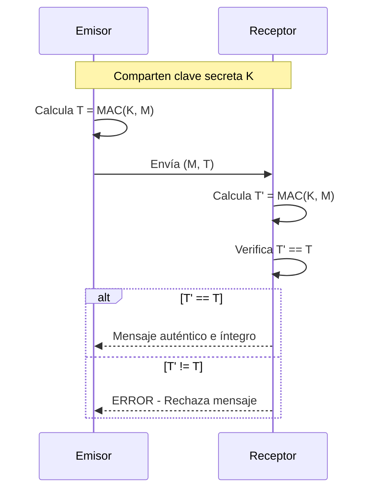
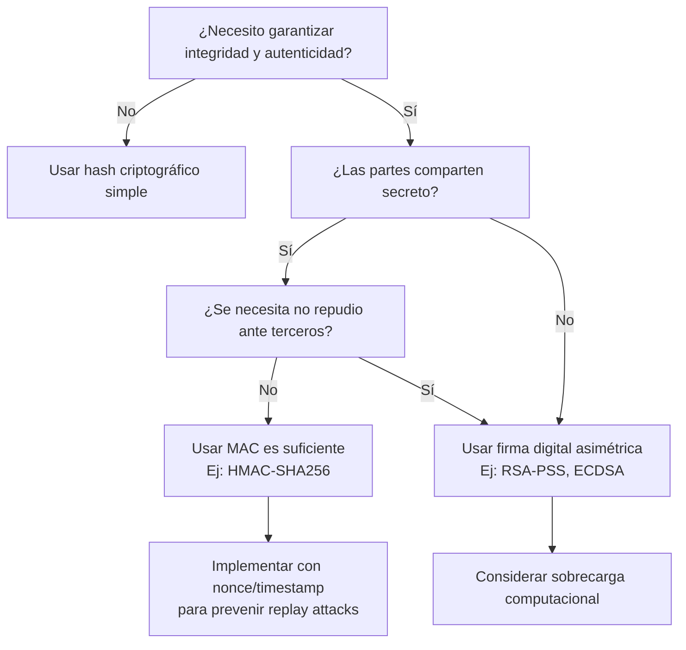

# Criptografía y Seguridad - Algoritmos criptográficos de integridad de datos

## 6.1 Códigos de autentificación de mensajes.

---

### 1. Definición y objetivos

Un **Código de Autentificación de Mensajes (MAC)** es una técnica criptográfica que garantiza:

- **Integridad**: Detecta modificaciones no autorizadas del mensaje.
- **Autenticidad**: Verifica el origen del mensaje (procedente del poseedor de la clave secreta compartida).
- **No repudio en un contexto simétrico**: Dentro de las partes que comparten la clave, ninguna puede negar la autoría.

Matemáticamente, un MAC es una función:

$$
\text{MAC}(K, M) = T
$$

donde:

- $K$: clave secreta compartida
- $M$: mensaje de longitud variable
- $T$: etiqueta (tag) de longitud fija

### 2. Estructura básica y propiedades

#### Modelo general de comunicación con MAC



#### Propiedades esenciales

1. **Resistencia a la falsificación**: Dada una o más parejas $(M_i, T_i)$, es computacionalmente inviable forjar una nueva pareja $(M', T')$ válida sin conocer $K$.
2. **Uniformidad**: La salida debe distribuirse uniformemente para evitar colisiones predecibles.
3. **Eficiencia**: El cálculo debe ser rápido para mensajes largos.

### 3. Construcción de MACs

#### 3.1 MAC basado en cifrado por bloques (CBC-MAC)

Basado en modo CBC de cifrado, pero solo se utiliza el último bloque cifrado.

**Algoritmo CBC-MAC** (para mensajes de longitud fija):

1. Sea $M = M_1 || M_2 || \dots || M_n$ (bloques de $b$ bits)
2. $C_0 = IV = 0$
3. Para $i = 1$ hasta $n$: $C_i = E_K(M_i \oplus C_{i-1})$
4. $T = C_n$

**Advertencia**: El CBC-MAC básico solo es seguro para mensajes de longitud fija. Para mensajes de longitud variable, se usa **CMAC** (Cipher-based MAC).

#### 3.2 MAC basado en funciones hash (HMAC)

Combinación de función hash con clave secreta. Definición según RFC 2104:

$$
\text{HMAC}(K, M) = H\left((K \oplus opad) || H((K \oplus ipad) || M)\right)
$$

donde:

- $H$: función hash (SHA-256, SHA-512, etc.)
- $opad$ = `0x5c5c...5c`
- $ipad$ = `0x3636...36`
- $K$: clave completada/recortada al tamaño del bloque de $H$

**Implementación en Python** (conceptual):

```python
import hashlib
import hmac

def hmac_sha256(key, message):
    """Calcula HMAC-SHA256"""
    return hmac.new(key, message, hashlib.sha256).digest()

# Ejemplo de uso
key = b'clave_secreta_32bytes'
msg = b'Mensaje importante para autenticar'
tag = hmac_sha256(key, msg)
print(f"Tag (hex): {tag.hex()}")
```

#### 3.3 MAC basado en funciones de hash con clave (KMAC)

Utilizado en SHA-3/Keccak, sigue el estándar NIST SP 800-185.

### 4. Fórmulas y análisis matemático

#### Longitud de la clave y seguridad

La seguridad de un MAC depende de:

- Longitud de la clave: $|K| \geq 128$ bits para seguridad mínima
- Longitud del tag: $|T| \geq 64$ bits (aunque se recomiendan 128 bits)

**Probabilidad de falsificación aleatoria**:

$$
P_{\text{falsificar}} = \frac{1}{2^{|T|}}
$$

#### Fuerza de seguridad

Para HMAC con hash ideal, la ventaja de un adversario $A$ está limitada por:

$$
\text{Adv}^{\text{HMAC}}_A \leq \frac{q^2}{2^{n+1}} + \text{Adv}^{\text{PRF}}_B
$$

donde $q$ es el número de consultas y $n$ el tamaño de salida del hash.

### 5. Comparación: MAC vs Hash vs Firma digital

| Característica | MAC                    | Hash criptográfico | Firma digital                |
| -------------- | ---------------------- | ------------------ | ---------------------------- |
| Clave          | Simétrica (compartida) | Sin clave          | Asimétrica (privada/pública) |
| Integridad     | Sí                     | Sí                 | Sí                           |
| Autenticación  | Sí (del origen)        | No                 | Sí                           |
| No repudio     | No (entre partes)      | No                 | Sí                           |
| Ejemplos       | HMAC, CMAC             | SHA-256, SHA-3     | RSA, ECDSA                   |

### 6. Ejemplo paso a paso: HMAC-SHA256

**Entrada**:

- $K$ = "MiClaveSecreta32Bytes12345678901234"
- $M$ = "Transferir 1000€ a cuenta 12345"

**Proceso**:

1. $K$ se ajusta al tamaño del bloque SHA-256 (512 bits)
2. Se calcula $K \oplus ipad$
3. Se concatena: $(K \oplus ipad) || M$
4. Se aplica SHA-256: $H_1 = \text{SHA-256}((K \oplus ipad) || M)$
5. Se calcula $K \oplus opad$
6. Se concatena: $(K \oplus opad) || H_1$
7. Se aplica SHA-256: $T = \text{SHA-256}((K \oplus opad) || H_1)$

**Resultado**: Tag de 256 bits (32 bytes)

### 7. Ejercicios propuestos

#### Ejercicio 1: Análisis conceptual

Un sistema usa CBC-MAC con AES-128 para mensajes de exactamente 1024 bytes.

1. ¿Cuál es la longitud del tag generado?
2. Si un atacante intercepta $(M, T)$ válido, ¿puede generar un tag válido para $M' = M || X$ sin conocer $K$?
3. ¿Qué modificación al esquema lo haría seguro para mensajes de longitud variable?

#### Ejercicio 2: Cálculo manual simplificado

Dado un hash simplificado $H(x)$ = últimos 8 bits de SHA-256(x), y:

- $K$ = `0xAA` (8 bits)
- $M$ = `"HOLA"`
- $ipad$ = `0x36`
- $opad$ = `0x5C`

Calcula HMAC simplificado.

#### Ejercicio 3: Implementación

```python
# Completa la función para verificar MAC
def verificar_mac(mensaje, tag_recibido, clave):
    # Tu código aquí
    pass

# Test
clave = b"clave_secreta"
mensaje = b"datos_importantes"
tag_correcto = hmac_sha256(clave, mensaje)
print(verificar_mac(mensaje, tag_correcto, clave))  # Debe retornar True
print(verificar_mac(mensaje + b"x", tag_correcto, clave))  # Debe retornar False
```

#### Ejercicio 4: Ataque de extensión (para hash sin clave interna)

Si un sistema calcula $T = H(K || M)$ (en lugar de HMAC), muestra cómo un atacante que conoce $(M, T)$ puede generar $T'$ válido para $M' = M || P$, sin conocer $K$, asumiendo que conoce la longitud de $K$.

### 8. Aplicaciones prácticas

#### 8.1 Autenticación en protocolos

- **TLS/SSL**: HMAC en registros de datos
- **IPsec**: Uso de HMAC-SHA-256/384/512
- **SSH**: Autenticación de paquetes

#### 8.2 Integridad de datos almacenados

```python
# Ejemplo: Verificar integridad de archivo
import hashlib
import hmac
import os

def proteger_archivo(ruta_archivo, clave):
    with open(ruta_archivo, 'rb') as f:
        contenido = f.read()
    mac = hmac.new(clave, contenido, hashlib.sha256).digest()
    # Guardar MAC junto con el archivo o en base de datos segura
    return mac

def verificar_archivo(ruta_archivo, clave, mac_almacenado):
    with open(ruta_archivo, 'rb') as f:
        contenido = f.read()
    mac_calculado = hmac.new(clave, contenido, hashlib.sha256).digest()
    return hmac.compare_digest(mac_calculado, mac_almacenado)
```

### 9. Consideraciones de seguridad

#### Ataques comunes

1. **Fuerza bruta en la clave**: $O(2^{|K|})$
2. **Colisiones en el hash subyacente**: Importante en HMAC
3. **Ataque de extensión de longitud**: En construcciones mal diseñadas
4. **Ataques de canal lateral**: Tiempo, potencia, etc.

#### Mejores prácticas

1. **Claves de mínimo 128 bits** (256 bits recomendado)
2. **Tags de mínimo 128 bits**
3. **Usar HMAC con SHA-256 o superior**
4. **Renovar claves periódicamente**
5. **Usar contadores o nonces** para evitar replay attacks:

   $$T = \text{MAC}(K, \text{nonce} || M)$$

### 10. Diagrama de flujo: Decisión de uso de MAC



### 11. Referencias

#### Bibliografía básica

1. **Stallings, William** (2010). _Cryptography and Network Security: Principles and Practice, 5a Ed._, Prentice Hall.
   - Capítulo 12: Message Authentication Codes

2. **Forouzan, Behrouz A.** (2008). _Cryptography and Network Security_, McGraw Hill.
   - Sección 11.3: Message Authentication

3. **Pfleeger, Charles P. y Shari L. Pfleeger** (2006). _Security in Computing, 4a. Ed._, Prentice Hall.
   - Capítulo 8: Cryptography in Practice

#### Bibliografía complementaria

1. **Stallings, William** (2010). _Network Security Essentials: Applications and Standards, 4a Ed._, Prentice Hall.
   - Capítulo 3: Message Authentication

2. **Ferguson, Niels; Schneier, Bruce; Kohno, Tadayoshi** (2010). _Cryptography Engineering: Design Principles and Practical Applications_, Wiley.
   - Capítulo 6: Message Authentication Codes

3. **Menezes, Alfred; van Oorschot, Paul; Vanstone, Scott** (1996). _Handbook of Applied Cryptography_, CRC Press.
   - Capítulo 9: Hash Functions and Data Integrity

4. **Schneier, Bruce** (1996). _Applied Cryptography: Protocols, Algorithms, and Source Code in C. 2a Ed._, Wiley.
   - Capítulo 18: One-Way Hash Functions

#### Estándares y RFCs

- **RFC 2104**: HMAC: Keyed-Hashing for Message Authentication
- **NIST FIPS 198-1**: The Keyed-Hash Message Authentication Code (HMAC)
- **NIST SP 800-107**: Recommendation for Applications Using Approved Hash Algorithms
- **NIST SP 800-185**: SHA-3 Derived Functions

### 12. Soluciones a ejercicios seleccionados

#### Ejercicio 1:

1. 128 bits (igual al tamaño de bloque de AES)
2. No, sin conocer K no puede generar tag válido para M'. Sin embargo, si el sistema acepta tags para mensajes de longitud variable sin usar medidas adicionales, podría ser vulnerable.
3. Usar CMAC (Cipher-based MAC) o incluir la longitud del mensaje en el primer bloque.

#### Ejercicio 2 (simplificado):

```
K = 0xAA
ipad = 0x36
opad = 0x5C

K ⊕ ipad = 0xAA ⊕ 0x36 = 0x9C
inner = H((K ⊕ ipad) || M) = últimos_8_bits(SHA-256(0x9C || "HOLA"))
K ⊕ opad = 0xAA ⊕ 0x5C = 0xF6
T = H((K ⊕ opad) || inner)
```

### 13. Práctica adicional: Laboratorio virtual

1. **Implementa HMAC desde cero** usando SHA-256 como función hash subyacente
2. **Simula un ataque de extensión** en MAC mal construido $H(K||M)$
3. **Compara tiempos de ejecución** de HMAC-SHA256 vs CMAC-AES para mensajes de diferentes tamaños
4. **Diseña un protocolo** que use MAC para autenticar mensajes entre cliente-servidor, incluyendo protección contra replay attacks

**Nota**: Esta guía cubre los aspectos fundamentales de MACs. Para implementaciones reales, siempre consultar los estándares actualizados y utilizar bibliotecas criptográficas bien revisadas como OpenSSL, libsodium, o las bibliotecas criptográficas de cada lenguaje.
