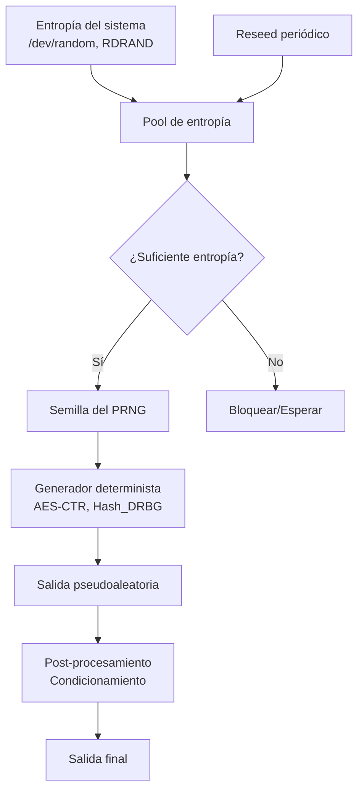
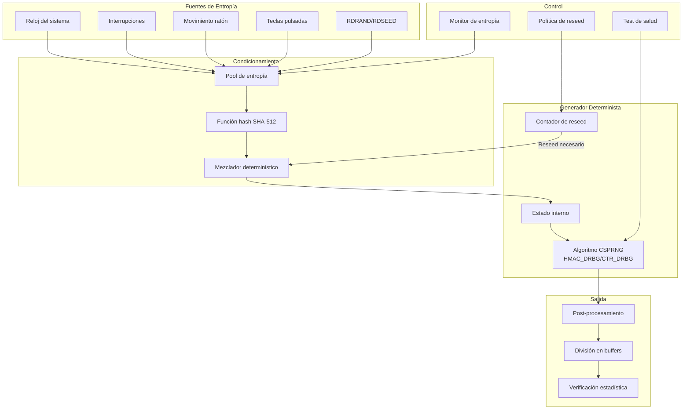

# Criptografía y Seguridad - Algoritmos criptográficos de integridad de datos

## 6.2 Generadores de números pseudoaleatorios.

---

### 1. Conceptos fundamentales

#### 1.1 Definición de PRNG

Un **Generador de Números Pseudoaleatorios (PRNG - PseudoRandom Number Generator)** es un algoritmo determinista que produce una secuencia de números que parece estadísticamente aleatoria, pero que se genera a partir de un valor inicial llamado **semilla (seed)**.

Matemáticamente, un PRNG se define como:

$$
f: S \rightarrow S \times \{0,1\}^n
$$

donde:

- $S$ es el espacio de estados
- $f$ es una función de transición determinista
- $n$ es el número de bits de salida por iteración

La secuencia se genera mediante:

$$
(s_{i+1}, r_i) = f(s_i), \quad i = 0, 1, 2, \dots
$$

con $s_0$ como semilla inicial.

#### 1.2 Propiedades deseables en PRNGs criptográficos

1. **Aleatoriedad estadística**: Pasa pruebas estadísticas de aleatoriedad
2. **Impredecibilidad**: No es posible predecir el siguiente bit/output con probabilidad > 1/2
3. **Periodo largo**: La secuencia no se repite en tiempos computacionalmente accesibles
4. **Eficiencia**: Generación rápida de números
5. **Reproducibilidad**: Misma semilla → misma secuencia

### 2. Clasificación de PRNGs

#### 2.1 No criptográficos vs criptográficos

| Característica | PRNG No Criptográfico | PRNG Criptográfico (CSPRNG) |
| -------------- | --------------------- | --------------------------- |
| **Seguridad**  | Baja, predecible      | Alta, impredecible          |
| **Velocidad**  | Muy rápida            | Más lenta                   |
| **Aplicación** | Simulaciones, juegos  | Claves, nonces, IVs         |
| **Ejemplos**   | Mersenne Twister, LCG | /dev/urandom, CTR_DRBG      |

#### 2.2 Pruebas estadísticas de aleatoriedad

Las secuencias deben pasar:

1. **Prueba de frecuencia**: Números 0 y 1 aproximadamente iguales
2. **Prueba de rachas**: Secuencias de bits iguales
3. **Prueba del poker**: Distribución de patrones
4. **Prueba de autocorrelación**: Independencia entre bits

### 3. Generadores no criptográficos

#### 3.1 Generador Lineal Congruencial (LCG)

Definido por la recurrencia:

$$
X_{n+1} = (aX_n + c) \mod m
$$

donde:

- $m$: módulo $(m > 0)$
- $a$: multiplicador $(0 < a < m)$
- $c$: incremento $(0 \leq c < m)$
- $X_0$: semilla

**Ejemplo en Python**:

```python
class LCG:
    def __init__(self, seed, a=1664525, c=1013904223, m=2**32):
        self.state = seed
        self.a = a
        self.c = c
        self.m = m

    def next(self):
        self.state = (self.a * self.state + self.c) % self.m
        return self.state

    def random(self):
        return self.next() / self.m

# Uso
lcg = LCG(seed=12345)
print("10 números pseudoaleatorios:")
for i in range(10):
    print(f"{lcg.random():.6f}")
```

**Problemas de LCG**: Patrones visibles en dimensiones altas, periodo limitado.

#### 3.2 Mersenne Twister (MT19937)

- Periodo: $2^{19937} - 1$
- Pasa pruebas estadísticas
- **NO es criptográfico**: Estado recuperable con 624 outputs

```python
import random

# Mersenne Twister en Python
random.seed(42)
print("Mersenne Twister output:")
for _ in range(5):
    print(random.randint(0, 100))
```

### 4. Generadores criptográficos (CSPRNG)

#### 4.1 Requisitos de seguridad

Un **Generador de Bits Pseudoaleatorios Criptográficamente Seguro (CSPRNG)** debe satisfacer:

1. **Prueba del próximo bit**: Dados los primeros $k$ bits, no existe algoritmo polinomial que pueda predecir el bit $(k+1)$ con probabilidad significativamente mayor a 1/2.

   $$
   |P[\mathcal{A}(s_1, \dots, s_k) = s_{k+1}] - \frac{1}{2}| \leq \epsilon(n)
   $$

   para $\epsilon(n)$ negligible.

2. **Resistencia a retroceso**: Si el estado es comprometido, bits anteriores deben permanecer impredecibles.

#### 4.2 Construcciones basadas en cifrado por bloques

##### Modo CTR como PRNG:

$$
C_i = E_K(IV + i) \oplus P_i
$$

Para PRNG: $R_i = E_K(counter_i)$

```python
from Crypto.Cipher import AES
from Crypto.Util import Counter
import os

class AES_CTR_PRNG:
    def __init__(self, key=None, seed=None):
        self.key = key or os.urandom(32)  # AES-256
        self.cipher = AES.new(self.key, AES.MODE_CTR,
                             counter=Counter.new(128))
        self.buffer = b""

    def generate(self, num_bytes):
        # CTR mode genera keystream pseudoaleatoria
        keystream = self.cipher.encrypt(b'\x00' * num_bytes)
        return keystream

# Ejemplo
prng = AES_CTR_PRNG(key=os.urandom(32))
random_data = prng.generate(16)
print(f"Random bytes: {random_data.hex()}")
```

#### 4.3 Generadores basados en funciones hash

##### Construcción simple:

$$
R_i = H(K \| i)
$$

##### Mejor construcción (Hash_DRBG según NIST):

```python
import hashlib

class Hash_DRBG:
    def __init__(self, entropy_input, personalization_string=b""):
        # Inicialización según NIST SP 800-90A
        self.V = entropy_input + personalization_string
        self.C = hashlib.sha256(self.V).digest()
        self.reseed_counter = 1

    def generate(self, num_bytes):
        output = b""
        while len(output) < num_bytes:
            self.V = hashlib.sha256(self.V).digest()
            output += self.V

        # Actualizar estado
        self.V = hashlib.sha256(self.V + self.C +
                               self.reseed_counter.to_bytes(4, 'big')).digest()
        self.reseed_counter += 1

        return output[:num_bytes]
```

#### 4.4 Diagrama de funcionamiento CSPRNG típico



### 5. Algoritmos estándar

#### 5.1 ANSI X9.17 (Generador de triple DES)

$$
R_i = E_K(E_K(T_i) \oplus V_i)
$$

$$
V_{i+1} = E_K(E_K(T_i) \oplus R_i)
$$

donde:

- $T_i$: timestamp de alta resolución
- $V_i$: vector de inicialización
- $K$: clave maestra

#### 5.2 Fortuna

Diseñado por Ferguson y Schneier, usa:

- Múltiples pools de entropía
- Reseed automático periódico
- AES como función de generación

**Estructura Fortuna**:

```
Entropía → Pool1, Pool2, ... → Semilla → Generador AES-CTR
```

#### 5.3 NIST SP 800-90A: DRBGs (Deterministic Random Bit Generators)

1. **Hash_DRBG**: Basado en SHA-256, SHA-512
2. **HMAC_DRBG**: Más seguro, usa HMAC
3. **CTR_DRBG**: Basado en cifrado por bloques (AES)

##### HMAC_DRBG (recomendado por NIST):

Algoritmo de actualización:

$$
K = \text{HMAC}(K, V \| 0x00 \| \text{entropy} \| \text{nonce})
$$

$$
V = \text{HMAC}(K, V)
$$

### 6. Implementación práctica: HMAC_DRBG

```python
import hmac
import hashlib
import os

class HMAC_DRBG:
    def __init__(self, entropy, personalization=b""):
        """Inicialización HMAC_DRBG según NIST"""
        # Parámetros de seguridad
        self.security_strength = 256  # bits
        self.seedlen = 440  # para SHA-256
        self.outlen = 32  # SHA-256 output length

        # Paso 1: entropy_input || personalization_string
        seed_material = entropy + personalization

        # Paso 2: Key = 0x00 00...00
        self.K = b'\x00' * self.outlen

        # Paso 3: V = 0x01 01...01
        self.V = b'\x01' * self.outlen

        # Paso 4: Actualizar con seed material
        self._update(seed_material)

        self.reseed_counter = 1

    def _update(self, provided_data=b""):
        """Algoritmo de actualización"""
        # K = HMAC(K, V || 0x00 || provided_data)
        data = self.V + b'\x00' + provided_data
        self.K = hmac.new(self.K, data, hashlib.sha256).digest()

        # V = HMAC(K, V)
        self.V = hmac.new(self.K, self.V, hashlib.sha256).digest()

        if provided_data:
            # K = HMAC(K, V || 0x01 || provided_data)
            data = self.V + b'\x01' + provided_data
            self.K = hmac.new(self.K, data, hashlib.sha256).digest()

            # V = HMAC(K, V)
            self.V = hmac.new(self.K, self.V, hashlib.sha256).digest()

    def generate(self, num_bytes, additional_input=b""):
        """Generar bytes pseudoaleatorios"""
        if self.reseed_counter > 10000:
            raise Exception("Reseed necesario")

        if additional_input:
            self._update(additional_input)

        # Generar salida
        output = b""
        while len(output) < num_bytes:
            self.V = hmac.new(self.K, self.V, hashlib.sha256).digest()
            output += self.V

        # Actualizar estado
        self._update(additional_input)
        self.reseed_counter += 1

        return output[:num_bytes]

    def reseed(self, entropy, additional_input=b""):
        """Recargar con nueva entropía"""
        seed_material = entropy + additional_input
        self._update(seed_material)
        self.reseed_counter = 1

# Ejemplo de uso
entropy = os.urandom(48)  # 384 bits de entropía
drbg = HMAC_DRBG(entropy, personalization=b"mi_app")

# Generar clave AES-256
aes_key = drbg.generate(32)
print(f"Clave AES-256 generada: {aes_key.hex()}")
```

### 7. Fuentes de entropía

#### 7.1 Tipos de entropía

1. **Entropía de hardware**: RDRAND, RDSEED (Intel), variaciones de reloj
2. **Entropía de sistema**: /dev/random (Linux), CryptGenRandom (Windows)
3. **Entropía de usuario**: Timing de teclas, movimientos del mouse

#### 7.2 Estimación de entropía

La entropía de Shannon mide la incertidumbre:

$$ H(X) = -\sum_{i=1}^{n} P(x_i) \log_2 P(x_i) $$

Para una fuente binaria ideal: $H(X) = 1$ bit por muestra.

#### 7.3 Condicionamiento de entropía

Usar funciones hash para "condicionar" entropía baja:

$$ \text{seed} = \text{SHA-512}( \text{entropía\_1} | \text{entropía\_2} | \dots) $$

### 8. Ejercicios propuestos

#### Ejercicio 1: Análisis de LCG
Dado un LCG con parámetros: $m = 31$, $a = 3$, $c = 0$, $X_0 = 1$

1. Calcula los primeros 10 valores
2. ¿Cuál es el período de este generador?
3. ¿Por qué no es criptográficamente seguro?

#### Ejercicio 2: Implementación de Blum Blum Shub
Implementa el generador BBS definido por:
- Escoger $p, q$ primos grandes $\equiv 3 \mod 4$
- $n = p \cdot q$
- $X_{i+1} = X_i^2 \mod n$
- Bit de salida = bit menos significativo de $X_i$

```python
def bbs_generator(p, q, seed, num_bits):
    # Tu implementación aquí
    pass
```

#### Ejercicio 3: Ataque a PRNG predictible
Supón un sistema que usa: $R_i = \text{SHA-256}(K \| i)$
Si un atacante obtiene $R_{100}$ a $R_{200}$, ¿puede predecir $R_{201}$?
¿Y si obtiene $R_{100}$ a $R_{150}$?

#### Ejercicio 4: Diseño de sistema de reseed
Diseña un esquema para un servidor que:
- Necesita 1 MB/segundo de datos aleatorios
- Tiene acceso a 100 bits/segundo de entropía real
- ¿Con qué frecuencia debe hacer reseed?

### 9. Consideraciones de seguridad

#### 9.1 Ataques comunes
1. **Ataque de estado comprometido**: Si se filtra el estado interno
2. **Ataque de predicción**: Patrones en la salida
3. **Ataque de entropía insuficiente**: Semillas débiles
4. **Ataque de reseed**: Forzar reseed con entropía controlada

#### 9.2 Mejores prácticas
1. **Usar CSPRNGs estándar**: /dev/urandom, CryptGenRandom, SecureRandom
2. **Semillas adecuadas**: Mínimo 128 bits de entropía
3. **Reseed periódico**: Especialmente en entornos virtualizados
4. **Protección de estado**: Aislar en memoria segura

#### 9.3 Ejemplo de vulnerabilidad real
**Debian OpenSSL (2008)**: Solo 15 bits de entropía en PRNG → claves SSH/DSA predecibles.

### 10. Comparativa de algoritmos

| Algoritmo | Seguridad | Velocidad | Periodo | Estándar |
|-----------|-----------|-----------|---------|----------|
| LCG | Muy baja | Muy alta | $m$ | No |
| Mersenne Twister | Baja | Alta | $2^{19937}-1$ | No |
| ANSI X9.17 | Media | Media | $2^{56}$ (DES) | ANSI |
| Fortuna | Alta | Media | $2^{128}$ (AES) | No estándar |
| Hash_DRBG | Alta | Media | $2^{48}$ solicitudes | NIST |
| CTR_DRBG | Alta | Alta | $2^{48}$ solicitudes | NIST |

### 11. Aplicaciones en criptografía

#### 11.1 Generación de claves
```python
def generar_clave_rsa(bits):
    """Generar clave RSA usando CSPRNG"""
    from Crypto.PublicKey import RSA

    # Usar CSPRNG del sistema
    import secrets

    # Generar números primos aleatorios
    key = RSA.generate(bits, randfunc=secrets.token_bytes)
    return key
```

#### 11.2 Nonces y IVs
```python
def generar_nonce(longitud):
    """Generar nonce criptográfico"""
    return os.urandom(longitud)

def generar_iv_aes():
    """IV para modo CBC"""
    return os.urandom(16)  # 128 bits
```

#### 11.3 Salt para contraseñas
```python
def generar_salt(longitud=16):
    """Salt para hash de contraseñas"""
    return secrets.token_bytes(longitud)
```

### 12. Diagrama: Arquitectura completa PRNG seguro



### 13. Referencias bibliográficas

#### Bibliografía básica
1. **Stallings, William** (2010). *Cryptography and Network Security: Principles and Practice, 5a Ed.*, Prentice Hall.
   - Capítulo 7: Random and Pseudorandom Number Generation
   - Sección 7.1: Principles of Pseudorandom Number Generation
   - Sección 7.2: Pseudorandom Number Generators

2. **Forouzan, Behrouz A.** (2008). *Cryptography and Network Security*, McGraw Hill.
   - Capítulo 7: Random Number Generation and Stream Ciphers
   - Sección 7.1: Random Number Generation

3. **Pfleeger, Charles P. y Shari L. Pfleeger** (2006). *Security in Computing, 4a. Ed.*, Prentice Hall.
   - Capítulo 2: Toolbox: Encryption, Access Control, and Protocols
   - Sección sobre generación de números aleatorios

#### Bibliografía complementaria
1. **Stallings, William** (2010). *Network Security Essentials: Applications and Standards, 4a Ed.*, Prentice Hall.
   - Apéndice B: Random Number Generation

2. **Ferguson, Niels; Schneier, Bruce; Kohno, Tadayoshi** (2010). *Cryptography Engineering: Design Principles and Practical Applications*, Wiley.
   - Capítulo 10: Random Number Generation
   - Sección 10.4: The Generator

3. **Menezes, Alfred; van Oorschot, Paul; Vanstone, Scott** (1996). *Handbook of Applied Cryptography*, CRC Press.
   - Capítulo 5: Pseudorandom Bits and Sequences
   - Sección 5.1: Introduction
   - Sección 5.2: Random Bit Generation

4. **Schneier, Bruce** (1996). *Applied Cryptography: Protocols, Algorithms, and Source Code in C. 2a Ed.*, Wiley.
   - Capítulo 16: Pseudo-Random-Sequence Generators and Stream Ciphers
   - Sección 16.1: Pseudorandom Sequence Generators

#### Estándares y documentos técnicos
- **NIST SP 800-90A**: Recommendation for Random Number Generation Using Deterministic Random Bit Generators
- **NIST SP 800-90B**: Recommendation for the Entropy Sources Used for Random Bit Generation
- **NIST SP 800-90C**: Recommendation for Random Bit Generator (RBG) Constructions
- **RFC 4086**: Randomness Requirements for Security
- **FIPS 140-2**: Security Requirements for Cryptographic Modules

### 14. Ejercicios de laboratorio

#### Laboratorio 1: Análisis estadístico
Implementa pruebas estadísticas para evaluar PRNGs:
```python
import collections
import math

def prueba_frecuencia(bits):
    """Prueba de frecuencia (monobit)"""
    unos = sum(bits)
    ceros = len(bits) - unos
    s = abs(unos - ceros) / math.sqrt(len(bits))
    p_valor = math.erfc(s / math.sqrt(2))
    return p_valor > 0.01  # Nivel de significancia 1%

def prueba_rachas(bits):
    """Prueba de rachas (runs test)"""
    # Implementación según NIST
    pass

# Probar diferentes generadores
```

#### Laboratorio 2: Implementación completa CSPRNG
Desarrolla un CSPRNG completo con:
1. Captura de entropía múltiple
2. Condicionamiento con SHA-512
3. Generador HMAC_DRBG
4. Sistema de reseed automático
5. Pruebas de salud continuas

### 15. Preguntas de repaso

1. ¿Cuál es la diferencia fundamental entre un PRNG y un CSPRNG?
2. Explica por qué Mersenne Twister no es adecuado para criptografía
3. Describe el ataque de estado comprometido y cómo prevenirlo
4. ¿Por qué es importante el reseed periódico en CSPRNGs?
5. Compara Hash_DRBG vs HMAC_DRBG vs CTR_DRBG
6. Explica el concepto de "backtracking resistance"
7. ¿Cómo se estima la entropía de una fuente física?
8. Describe la arquitectura de Fortuna y sus ventajas

**Nota**: Para aplicaciones reales, siempre usar bibliotecas criptográficas validadas como:
- `secrets` en Python 3.6+
- `Crypto.Random` en pycryptodome
- `/dev/urandom` en Linux
- `CryptGenRandom` en Windows
- `SecureRandom` en Java

Nunca implementar PRNGs criptográficos propios para producción sin una auditoría de seguridad exhaustiva.
