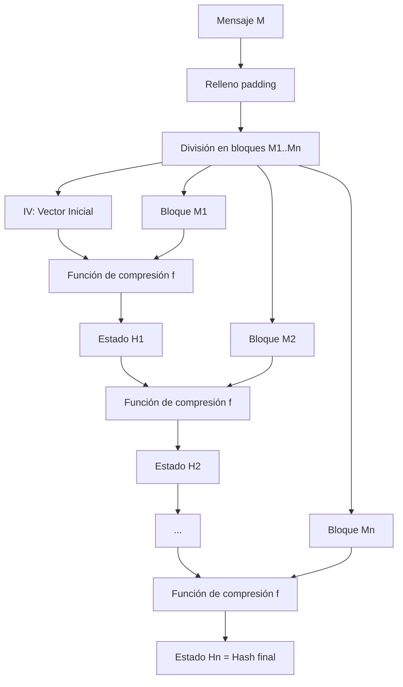
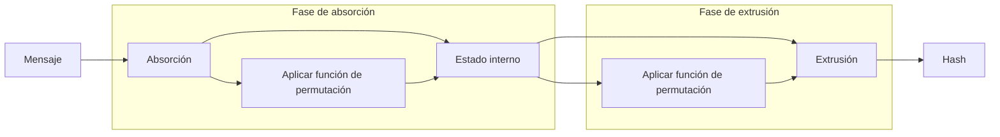
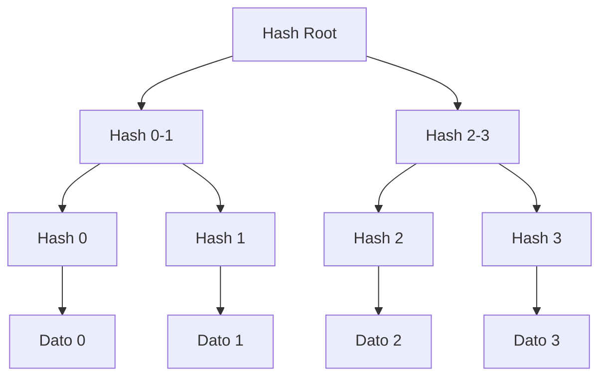
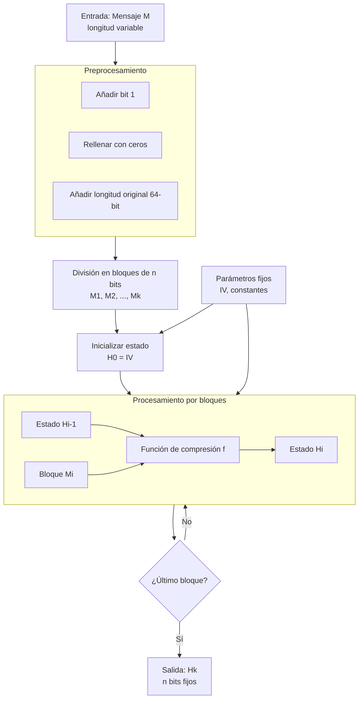

# Criptografía y Seguridad - Algoritmos criptográficos de integridad de datos

## 6.3 Funciones de dispersión, características, usos para sintetizar mensajes.

---

### 1. Conceptos fundamentales

#### 1.1 Definición de función hash criptográfica

Una **función hash criptográfica** es una función matemática que transforma una entrada de tamaño arbitrario en una salida de tamaño fijo (digest o hash), con propiedades especiales de seguridad.

Formalmente:

$$
H: \{0,1\}^* \rightarrow \{0,1\}^n
$$

donde:

- $\{0,1\}^*$: Conjunto de cadenas binarias de longitud arbitraria
- $\{0,1\}^n$: Conjunto de cadenas binarias de longitud fija $n$
- $H$: Función hash determinista

#### 1.2 Propiedades esenciales

Para que una función hash sea considerada criptográfica, debe cumplir:

1. **Preimagen resistente (Unidireccionalidad)**:
   Dado $y = H(x)$, es computacionalmente inviable encontrar cualquier $x'$ tal que $H(x') = y$.

   $$
   \forall y \in \{0,1\}^n, \quad \text{Hallar } x' \text{ con } H(x') = y \text{ es difícil}
   $$

2. **Segunda preimagen resistente (Resistencia débil a colisiones)**:
   Dado $x$, es inviable encontrar $x' \neq x$ tal que $H(x) = H(x')$.

   $$
   \text{Dado } x, \quad \text{Hallar } x' \neq x \text{ con } H(x) = H(x') \text{ es difícil}
   $$

3. **Resistencia a colisiones (Resistencia fuerte a colisiones)**:
   Es inviable encontrar cualquier par $(x, x')$ con $x \neq x'$ tal que $H(x) = H(x')$.
   $$
   \text{Hallar } (x, x') \text{ con } x \neq x' \text{ y } H(x) = H(x') \text{ es difícil}
   $$

### 2. Características técnicas

#### 2.1 Propiedades adicionales

- **Determinismo**: Misma entrada → misma salida
- **Eficiencia**: Cálculo rápido incluso para entradas grandes
- **Efecto avalancha**: Pequeño cambio en entrada → gran cambio en salida (aprox. 50% bits cambian)
- **Compresión**: Entrada arbitraria → salida tamaño fijo
- **Difusión**: Los bits de entrada se dispersan en toda la salida

#### 2.2 Paradoja del cumpleaños

La probabilidad de encontrar una colisión por fuerza bruta en una función hash de $n$ bits es aproximadamente $\sqrt{2^n} = 2^{n/2}$ (ataque de cumpleaños).

**Fórmula general**:

$$
P(\text{colisión}) \approx 1 - e^{-k(k-1)/(2^{n+1})}
$$

donde $k$ es el número de mensajes probados.

Para seguridad de 128 bits se requieren $2^{64}$ operaciones, por eso SHA-256 tiene 256 bits de salida.

### 3. Estructura de funciones hash

#### 3.1 Construcción Merkle-Damgård

La mayoría de funciones hash (MD5, SHA-1, SHA-2) usan esta estructura:



**Pasos del algoritmo**:

1. **Padding**: Añadir bits al mensaje hasta que longitud ≡ 448 mod 512
2. **Añadir longitud**: Añadir 64 bits con longitud original
3. **Inicializar buffer**: Valores iniciales fijos (IV)
4. **Procesar bloques**: Aplicar función de compresión a cada bloque
5. **Salida**: Último valor del buffer es el hash

#### 3.2 Función de compresión típica

Para SHA-256, la función de compresión procesa bloques de 512 bits:

$$
H_i = f(H_{i-1}, M_i)
$$

donde:

- $H_i$: Estado intermedio (256 bits)
- $M_i$: Bloque de mensaje (512 bits)
- $f$: Función compleja con operaciones lógicas y rotaciones

### 4. Algoritmos principales

#### 4.1 Familia MD (Message Digest)

##### MD5 (obsoleto):

- Salida: 128 bits
- Bloque: 512 bits
- **Vulnerable**: Colisiones en $2^{20}$ operaciones

```python
import hashlib

# MD5 (SOLO PARA EJEMPLO, NO USAR EN PRODUCCIÓN)
mensaje = b"Mensaje importante"
hash_md5 = hashlib.md5(mensaje).hexdigest()
print(f"MD5: {hash_md5}")  # 32 caracteres hex
```

#### 4.2 Familia SHA (Secure Hash Algorithm)

##### Comparativa:

| Algoritmo | Salida (bits) | Bloque (bits) | Seguridad (bits) | Estado   |
| --------- | ------------- | ------------- | ---------------- | -------- |
| SHA-1     | 160           | 512           | ≤ 63 (roto)      | Obsoleto |
| SHA-224   | 224           | 512           | 112              | Seguro   |
| SHA-256   | 256           | 512           | 128              | Seguro   |
| SHA-384   | 384           | 1024          | 192              | Seguro   |
| SHA-512   | 512           | 1024          | 256              | Seguro   |
| SHA-3-256 | 256           | 1088          | 128              | Seguro   |

##### SHA-256 en detalle:

**Constantes iniciales** (primeros 32 bits de las partes fraccionarias de las raíces cuadradas de los primeros 8 primos):

$$
\begin{aligned}
h_0 &= 6a09e667 \\
h_1 &= bb67ae85 \\
h_2 &= 3c6ef372 \\
h_3 &= a54ff53a \\
h_4 &= 510e527f \\
h_5 &= 9b05688c \\
h_6 &= 1f83d9ab \\
h_7 &= 5be0cd19
\end{aligned}
$$

**Ejemplo SHA-256**:

```python
import hashlib

def calcular_sha256(mensaje):
    """Calcula SHA-256 de un mensaje"""
    sha256 = hashlib.sha256()
    sha256.update(mensaje)
    return sha256.digest(), sha256.hexdigest()

# Ejemplo
mensaje = b"Transferir 1000€ a cuenta 12345"
digest, hexdigest = calcular_sha256(mensaje)
print(f"SHA-256: {hexdigest}")
print(f"Longitud: {len(digest)} bytes = {len(digest)*8} bits")
```

#### 4.3 SHA-3 (Keccak)

Estructura de esponja (sponge) en lugar de Merkle-Damgård:



**Ventajas de SHA-3**:

- Resistente a ataques de extensión de longitud
- Diseño más simple
- Mayor seguridad teórica

```python
import hashlib

# SHA-3 (Keccak)
mensaje = b"Datos confidenciales"
sha3_256 = hashlib.sha3_256(mensaje).hexdigest()
sha3_512 = hashlib.sha3_512(mensaje).hexdigest()
print(f"SHA3-256: {sha3_256}")
print(f"SHA3-512: {sha3_512}")
```

### 5. Aplicaciones prácticas

#### 5.1 Verificación de integridad

```python
class VerificadorIntegridad:
    def __init__(self, algoritmo='sha256'):
        self.algoritmo = algoritmo

    def calcular_hash_archivo(self, ruta):
        """Calcula hash de un archivo"""
        import hashlib

        if self.algoritmo == 'sha256':
            hasher = hashlib.sha256()
        elif self.algoritmo == 'sha512':
            hasher = hashlib.sha512()
        elif self.algoritmo == 'sha3_256':
            hasher = hashlib.sha3_256()
        else:
            raise ValueError("Algoritmo no soportado")

        with open(ruta, 'rb') as f:
            while chunk := f.read(8192):
                hasher.update(chunk)

        return hasher.hexdigest()

    def verificar_integridad(self, ruta_archivo, hash_esperado):
        """Verifica si el hash del archivo coincide con el esperado"""
        hash_calculado = self.calcular_hash_archivo(ruta_archivo)
        return hash_calculado == hash_esperado, hash_calculado

# Ejemplo de uso
verificador = VerificadorIntegridad('sha256')
archivo = "documento.pdf"
hash_correcto = "a1b2c3d4e5f6789012345678901234567890123456789012345678901234"

es_valido, hash_calculado = verificador.verificar_integridad(archivo, hash_correcto)
print(f"Archivo válido: {es_valido}")
print(f"Hash calculado: {hash_calculado}")
```

#### 5.2 Almacenamiento seguro de contraseñas

```python
import hashlib
import os
import hashlib

def hash_contrasena(contrasena, salt=None, iteraciones=100000):
    """Hash seguro de contraseña con salt y múltiples iteraciones"""
    if salt is None:
        salt = os.urandom(16)  # 128 bits de salt

    # PBKDF2-like usando SHA-256
    clave = hashlib.pbkdf2_hmac(
        'sha256',
        contrasena.encode('utf-8'),
        salt,
        iteraciones
    )

    return salt, clave, iteraciones

def verificar_contrasena(contrasena, salt, hash_almacenado, iteraciones):
    """Verifica si una contraseña coincide con el hash almacenado"""
    hash_calculado = hashlib.pbkdf2_hmac(
        'sha256',
        contrasena.encode('utf-8'),
        salt,
        iteraciones
    )

    # Comparación segura contra timing attacks
    return hashlib.compare_digest(hash_calculado, hash_almacenado)

# Ejemplo
contrasena = "MiContraseñaSegura123"
salt, hash_guardado, iteraciones = hash_contrasena(contrasena)

print(f"Salt: {salt.hex()}")
print(f"Hash: {hash_guardado.hex()}")
print(f"Iteraciones: {iteraciones}")

# Verificación
es_correcta = verificar_contrasena(contrasena, salt, hash_guardado, iteraciones)
print(f"Contraseña correcta: {es_correcta}")
```

#### 5.3 Árboles de Merkle (Merkle Trees)

Estructura para verificar eficientemente grandes conjuntos de datos:



```python
class MerkleTree:
    def __init__(self, datos):
        self.datos = datos
        self.hojas = [self._hash(d) for d in datos]
        self.raiz = self._construir_arbol(self.hojas)

    def _hash(self, dato):
        """Calcula SHA-256 de un dato"""
        if isinstance(dato, str):
            dato = dato.encode('utf-8')
        return hashlib.sha256(dato).digest()

    def _construir_arbol(self, nodos):
        """Construye el árbol de Merkle recursivamente"""
        if len(nodos) == 1:
            return nodos[0]

        nuevo_nivel = []
        for i in range(0, len(nodos), 2):
            izquierda = nodos[i]
            derecha = nodos[i+1] if i+1 < len(nodos) else nodos[i]
            # Hash de la concatenación de los hijos
            combinado = izquierda + derecha
            nuevo_nivel.append(self._hash(combinado))

        return self._construir_arbol(nuevo_nivel)

    def get_root(self):
        """Retorna la raíz del árbol"""
        return self.raiz.hex()

    def generar_prueba(self, indice):
        """Genera prueba de inclusión para un dato"""
        prueba = []
        nodos = self.hojas[:]

        while len(nodos) > 1:
            nivel_siguiente = []
            for i in range(0, len(nodos), 2):
                if i == indice or i == indice - 1:
                    # Añadir hermano a la prueba
                    if i == indice and i + 1 < len(nodos):
                        prueba.append(('derecha', nodos[i+1].hex()))
                    elif i == indice - 1:
                        prueba.append(('izquierda', nodos[i].hex()))

                izquierda = nodos[i]
                derecha = nodos[i+1] if i+1 < len(nodos) else izquierda
                combinado = izquierda + derecha
                nuevo_hash = self._hash(combinado)
                nivel_siguiente.append(nuevo_hash)

            indice = indice // 2
            nodos = nivel_siguiente

        return prueba

# Ejemplo
datos = ["trans1", "trans2", "trans3", "trans4"]
arbol = MerkleTree(datos)
print(f"Raíz Merkle: {arbol.get_root()}")

# Prueba de inclusión para transacción 0
prueba = arbol.generar_prueba(0)
print(f"Prueba para dato 0: {prueba}")
```

### 6. Ejercicios propuestos

#### Ejercicio 1: Análisis de propiedades

Dado el siguiente comportamiento de una función hash H:

- H("Hola") = "a1b2c3"
- H("hola") = "f4e5d6"
- H("Hola Mundo") = "c3b2a1"
- H("Hola Mundo!") = "d6e5f4"

1. ¿Existe efecto avalancha? Justifica
2. Si conoces que H usa SHA-256 truncado a 24 bits, ¿cuántos mensajes necesitarías probar para encontrar una colisión con 50% de probabilidad?

#### Ejercicio 2: Implementación de función de compresión simple

Implementa una función de compresión simplificada:

```python
def compresion_simple(estado, bloque):
    """
    estado: 32 bits (entero)
    bloque: 16 bits (entero)
    Retorna: nuevo estado de 32 bits
    """
    # Tu implementación aquí
    # Usar operaciones: XOR, rotaciones, suma modular
    pass
```

#### Ejercicio 3: Ataque de extensión de longitud

Dada una función hash construida con Merkle-Damgård sin salting final:

- Hash conocido: H(K || M) donde K es clave secreta
- Longitud de K desconocida
- M conocido

Demuestra cómo calcular H(K || M || P) para algún P arbitrario sin conocer K.

#### Ejercicio 4: Diseño de sistema de integridad

Diseña un sistema para verificar integridad de archivos en un servidor con:

- 10,000 archivos de 1GB cada uno
- Verificación diaria de integridad
- Alertas ante modificaciones no autorizadas

¿Qué algoritmo hash usarías? ¿Cómo almacenarías los hashes? ¿Cómo optimizarías el proceso?

### 7. Ataques y vulnerabilidades

#### 7.1 Tipos de ataques

1. **Ataque de fuerza bruta**:
   - Preimagen: $O(2^n)$
   - Colisión: $O(2^{n/2})$ (paradoja del cumpleaños)

2. **Ataques criptoanalíticos**:
   - MD5: Colisiones en $2^{20}$ operaciones
   - SHA-1: Colisiones prácticas demostradas (SHAttered)

3. **Ataque de extensión de longitud**:
   Aplicable a construcciones Merkle-Damgård sin protección

4. **Ataques de canal lateral**:
   Timing attacks, análisis de potencia

#### 7.2 Ejemplo: Colisión MD5 práctica

```python
# Ejemplo de dos mensajes diferentes con mismo MD5
# (Valores de ejemplo, no reales)
mensaje1 = b"d131dd02c5e6eec4693d9a0698aff95c2fcab58712467eab4004583eb8fb7f8955ad340609f4b30283e488832571415a085125e8f7cdc99fd91dbdf280373c5bd8823e3156348f5bae6dacd436c919c6dd53e2b487da03fd02396306d248cda0e99f33420f577ee8ce54b67080a80d1ec69821bcb6a8839396f9652b6ff72a70"
mensaje2 = b"d131dd02c5e6eec4693d9a0698aff95c2fcab50712467eab4004583eb8fb7f8955ad340609f4b30283e4888325f1415a085125e8f7cdc99fd91dbd7280373c5bd8823e3156348f5bae6dacd436c919c6dd53e23487da03fd02396306d248cda0e99f33420f577ee8ce54b67080280d1ec69821bcb6a8839396f965ab6ff72a70"

# Ambos tendrían el mismo MD5 (en un caso real)
```

### 8. Mejores prácticas y recomendaciones

#### 8.1 Selección de algoritmo

| Requisito           | Algoritmo recomendado      | Tamaño salida |
| ------------------- | -------------------------- | ------------- |
| Contraseñas         | Argon2, PBKDF2 con SHA-256 | ≥ 256 bits    |
| Integridad archivos | SHA-256, SHA-3-256         | 256 bits      |
| Firmas digitales    | SHA-384, SHA-512           | 384-512 bits  |
| Blockchain          | SHA-256, SHA-3             | 256-512 bits  |
| HMAC                | SHA-256, SHA-3             | 256 bits      |

#### 8.2 Consideraciones de seguridad

1. **No usar MD5 o SHA-1** para seguridad
2. **Usar salt** para hashes de contraseñas
3. **Múltiples iteraciones** para derivación de claves
4. **Considerar SHA-3** para nuevas implementaciones
5. **Verificar firmas** de hashes distribuidos

#### 8.3 Ejemplo completo: Sistema de integridad

```python
import hashlib
import json
import os
from datetime import datetime

class SistemaIntegridad:
    def __init__(self, directorio_base):
        self.directorio_base = directorio_base
        self.base_datos_hashes = {}
        self.algoritmo = 'sha256'

    def escanear_directorio(self):
        """Escanea directorio y calcula hashes de todos los archivos"""
        for raiz, dirs, archivos in os.walk(self.directorio_base):
            for archivo in archivos:
                ruta_completa = os.path.join(raiz, archivo)
                ruta_relativa = os.path.relpath(ruta_completa, self.directorio_base)

                # Calcular hash
                hash_archivo = self._calcular_hash_archivo(ruta_completa)

                # Almacenar metadatos
                self.base_datos_hashes[ruta_relativa] = {
                    'hash': hash_archivo,
                    'fecha_modificacion': os.path.getmtime(ruta_completa),
                    'tamaño': os.path.getsize(ruta_completa),
                    'ultima_verificacion': datetime.now().isoformat()
                }

    def _calcular_hash_archivo(self, ruta):
        """Calcula hash de un archivo"""
        hasher = hashlib.sha256()

        with open(ruta, 'rb') as f:
            while chunk := f.read(65536):  # 64KB chunks
                hasher.update(chunk)

        return hasher.hexdigest()

    def verificar_integridad(self):
        """Verifica integridad de todos los archivos"""
        cambios = []

        for ruta_relativa, metadatos in self.base_datos_hashes.items():
            ruta_completa = os.path.join(self.directorio_base, ruta_relativa)

            if not os.path.exists(ruta_completa):
                cambios.append({
                    'archivo': ruta_relativa,
                    'estado': 'ELIMINADO',
                    'detalles': 'Archivo no encontrado'
                })
                continue

            # Verificar tamaño
            tamaño_actual = os.path.getsize(ruta_completa)
            if tamaño_actual != metadatos['tamaño']:
                cambios.append({
                    'archivo': ruta_relativa,
                    'estado': 'MODIFICADO',
                    'detalles': f"Tamaño cambiado: {metadatos['tamaño']} -> {tamaño_actual}"
                })
                continue

            # Verificar hash
            hash_actual = self._calcular_hash_archivo(ruta_completa)
            if hash_actual != metadatos['hash']:
                cambios.append({
                    'archivo': ruta_relativa,
                    'estado': 'ALTERADO',
                    'detalles': 'Hash no coincide'
                })

        return cambios

    def guardar_base_datos(self, ruta):
        """Guarda la base de datos de hashes"""
        with open(ruta, 'w') as f:
            json.dump(self.base_datos_hashes, f, indent=2)

    def cargar_base_datos(self, ruta):
        """Carga la base de datos de hashes"""
        with open(ruta, 'r') as f:
            self.base_datos_hashes = json.load(f)

# Uso del sistema
sistema = SistemaIntegridad('/ruta/a/directorio')
sistema.escanear_directorio()
sistema.guardar_base_datos('hashes.json')

# Verificación periódica
cambios = sistema.verificar_integridad()
if cambios:
    print(f"Se detectaron {len(cambios)} cambios:")
    for cambio in cambios:
        print(f"- {cambio['archivo']}: {cambio['estado']}")
```

### 9. Diagrama: Flujo completo de función hash



### 10. Referencias bibliográficas

#### Bibliografía básica

1. **Stallings, William** (2010). _Cryptography and Network Security: Principles and Practice, 5a Ed._, Prentice Hall.
   - Capítulo 11: Cryptographic Hash Functions
   - Sección 11.1: Applications of Cryptographic Hash Functions
   - Sección 11.2: Two Simple Hash Functions
   - Sección 11.3: Requirements and Security

2. **Forouzan, Behrouz A.** (2008). _Cryptography and Network Security_, McGraw Hill.
   - Capítulo 12: Cryptographic Hash Functions
   - Sección 12.1: Introduction
   - Sección 12.2: Merkle-Damgård Scheme
   - Sección 12.3: SHA-512

3. **Pfleeger, Charles P. y Shari L. Pfleeger** (2006). _Security in Computing, 4a. Ed._, Prentice Hall.
   - Capítulo 2: Toolbox: Encryption, Access Control, and Protocols
   - Sección sobre funciones hash

#### Bibliografía complementaria

1. **Stallings, William** (2010). _Network Security Essentials: Applications and Standards, 4a Ed._, Prentice Hall.
   - Capítulo 11: Cryptographic Hash Functions

2. **Ferguson, Niels; Schneier, Bruce; Kohno, Tadayoshi** (2010). _Cryptography Engineering: Design Principles and Practical Applications_, Wiley.
   - Capítulo 5: Message Authentication Codes
   - Sección 5.3: Hash Functions

3. **Menezes, Alfred; van Oorschot, Paul; Vanstone, Scott** (1996). _Handbook of Applied Cryptography_, CRC Press.
   - Capítulo 9: Hash Functions and Data Integrity
   - Sección 9.1: Introduction
   - Sección 9.2: Classification and framework
   - Sección 9.3: Basic constructions and general results
   - Sección 9.4: Unkeyed hash functions (MDCs)

4. **Schneier, Bruce** (1996). _Applied Cryptography: Protocols, Algorithms, and Source Code in C. 2a Ed._, Wiley.
   - Capítulo 18: One-Way Hash Functions
   - Sección 18.1: Background
   - Sección 18.2: Snefru
   - Sección 18.3: N-Hash
   - Sección 18.11: Using One-Way Hash Functions

#### Estándares y RFCs

- **FIPS PUB 180-4**: Secure Hash Standard (SHS)
- **FIPS PUB 202**: SHA-3 Standard
- **NIST SP 800-107**: Recommendation for Applications Using Approved Hash Algorithms
- **NIST SP 800-185**: SHA-3 Derived Functions
- **RFC 1321**: The MD5 Message-Digest Algorithm
- **RFC 3174**: US Secure Hash Algorithm 1 (SHA1)
- **RFC 6234**: US Secure Hash Algorithms (SHA and SHA-based HMAC and HKDF)

### 11. Ejercicios de laboratorio

#### Laboratorio 1: Análisis de efecto avalancha

```python
import hashlib
import binascii

def analizar_efecto_avalancha(mensaje_base, variaciones):
    """Analiza cuántos bits cambian con pequeñas variaciones"""
    resultados = []
    hash_base = hashlib.sha256(mensaje_base).digest()
    bits_base = bin(int.from_bytes(hash_base, 'big'))[2:].zfill(256)

    for var in variaciones:
        hash_var = hashlib.sha256(var).digest()
        bits_var = bin(int.from_bytes(hash_var, 'big'))[2:].zfill(256)

        # Contar bits diferentes
        bits_diferentes = sum(1 for b1, b2 in zip(bits_base, bits_var) if b1 != b2)
        porcentaje = (bits_diferentes / 256) * 100

        resultados.append({
            'variacion': var,
            'bits_diferentes': bits_diferentes,
            'porcentaje': porcentaje
        })

    return resultados

# Probar con diferentes variaciones
base = b"Hello World"
variaciones = [
    b"hello World",  # Cambio de mayúscula
    b"Hello World!",  # Añadir carácter
    b"Hello Worlc",   # Cambiar último carácter
]

resultados = analizar_efecto_avalancha(base, variaciones)
for r in resultados:
    print(f"Variación: {r['variacion']}")
    print(f"  Bits diferentes: {r['bits_diferentes']}/256 ({r['porcentaje']:.1f}%)")
```

#### Laboratorio 2: Implementación de SHA-256 simplificada

Implementar una versión simplificada de SHA-256 para comprender las operaciones internas.

#### Laboratorio 3: Sistema de detección de duplicados

Crear un sistema que use hashes para detectar archivos duplicados en un directorio.

### 12. Preguntas de repaso

1. Explica las tres propiedades principales de una función hash criptográfica
2. ¿Por qué MD5 y SHA-1 ya no se consideran seguros?
3. Describe la estructura de Merkle-Damgård y sus limitaciones
4. ¿Cómo funciona la construcción de esponja en SHA-3?
5. Explica la paradoja del cumpleaños y su implicación en seguridad
6. ¿Qué es un ataque de extensión de longitud y cómo se previene?
7. Compara SHA-2 y SHA-3 en términos de estructura y seguridad
8. ¿Por qué se usan múltiples iteraciones en hash de contraseñas?
9. Explica cómo funcionan los árboles de Merkle y sus aplicaciones
10. ¿Cómo seleccionarías un algoritmo hash para una aplicación específica?

**Nota para implementación**: En sistemas reales, usar siempre bibliotecas criptográficas validadas como:

- `hashlib` en Python (SHA-256, SHA-3)
- `crypto` en Node.js
- `System.Security.Cryptography` en .NET
- `java.security.MessageDigest` en Java

Nunca implementar funciones hash criptográficas propias para producción sin una auditoría exhaustiva de seguridad.
