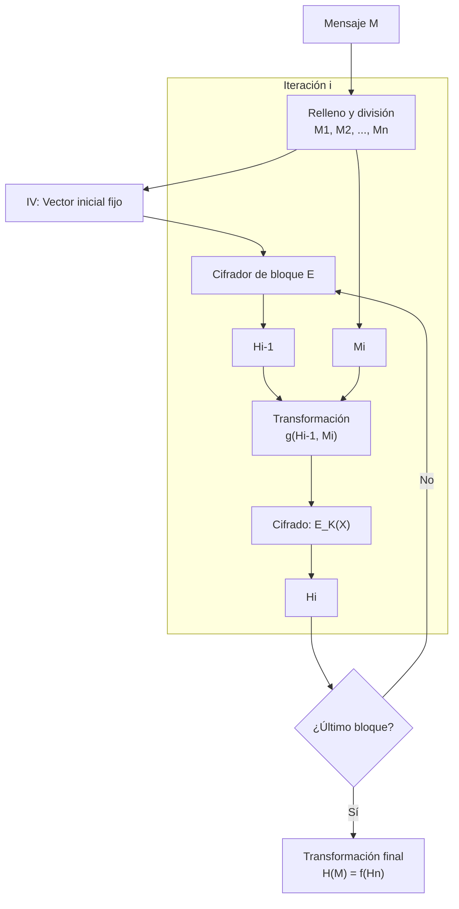
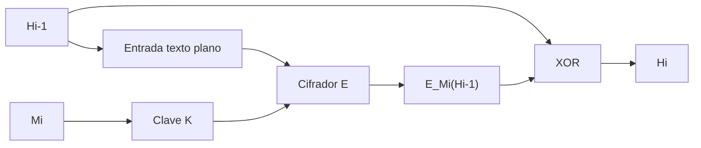
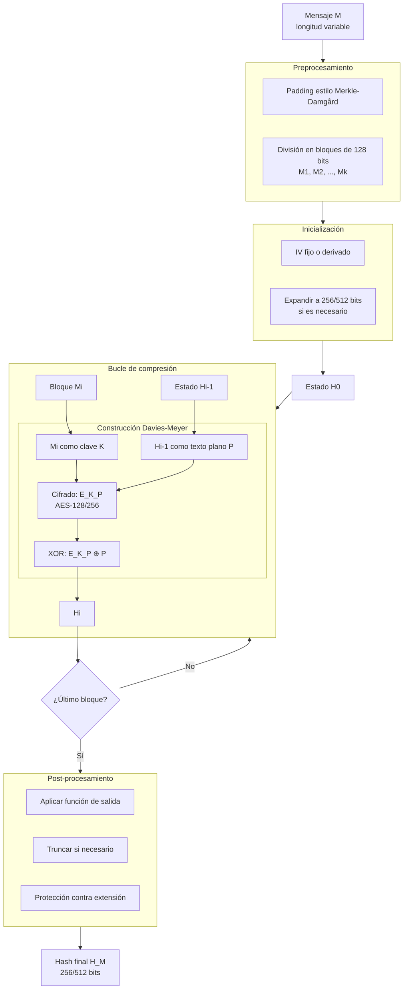

# Criptografía y Seguridad - Algoritmos criptográficos de integridad de datos

## 6.4 Funciones de dispersión basadas en cifrados de bloque.

---

### 1. Introducción y conceptos fundamentales

#### 1.1 Definición

Las **funciones de dispersión basadas en cifrados de bloque** son algoritmos hash que utilizan cifradores de bloque como componente fundamental para construir funciones hash criptográficas. En lugar de diseñar una función hash desde cero, se aprovecha la seguridad ya demostrada de cifradores de bloque como AES o DES.

Formalmente, dada una función de cifrado por bloques $E: \{0,1\}^k \times \{0,1\}^n \rightarrow \{0,1\}^n$, se construye una función hash $H: \{0,1\}^* \rightarrow \{0,1\}^m$.

#### 1.2 Ventajas de este enfoque

1. **Reutilización de primitivas**: Aprovecha cifradores ya implementados y auditados
2. **Eficiencia**: Hardware/software optimizado existente
3. **Análisis de seguridad**: Beneficia del análisis criptográfico del cifrador base
4. **Estándarización**: Menos primitivas para estandarizar y mantener

#### 1.3 Desafíos principales

1. **Tamaño de bloque**: Generalmente menor que el tamaño de hash deseado
2. **Mensajes de longitud variable**: El cifrador opera en bloques fijos
3. **Estructura iterativa**: Necesidad de modo de operación seguro

### 2. Modos de operación para funciones hash

#### 2.1 Estructura general

La mayoría de construcciones siguen el esquema de **Merkle-Damgård** adaptado para cifradores de bloque:



### 3. Construcciones clásicas

#### 3.1 Construcción de Davies-Meyer

La construcción más común para funciones hash de una sola dirección basadas en cifradores de bloque.

**Fórmula**:

$$
H_i = E_{M_i}(H_{i-1}) \oplus H_{i-1}
$$

donde:

- $E_K(P)$: Cifrado de bloque con clave $K$ y texto plano $P$
- $H_{i-1}$: Valor hash anterior (texto plano)
- $M_i$: Bloque de mensaje (clave)
- $H_i$: Nuevo valor hash

**Propiedades**:

- **Preimagen resistente** si $E$ es un cifrador ideal
- **Colisión resistente** bajo ciertas suposiciones
- Necesita que $E$ sea resistente a ataques de clave relacionada

**Diagrama**:



**Implementación en Python**:

```python
from Crypto.Cipher import AES
from Crypto.Util.Padding import pad
import hashlib

class DaviesMeyerAES:
    """Implementación simplificada de Davies-Meyer con AES"""

    def __init__(self, iv=None):
        # IV de 128 bits para AES
        self.iv = iv or b'\x00' * 16
        self.block_size = 16  # 128 bits para AES

    def compress(self, state, message_block):
        """Una iteración de Davies-Meyer"""
        # message_block como clave (128 bits para AES-128)
        # state como texto plano
        cipher = AES.new(message_block, AES.MODE_ECB)
        encrypted = cipher.encrypt(state)

        # XOR con estado anterior
        new_state = bytes(a ^ b for a, b in zip(encrypted, state))
        return new_state

    def hash(self, message):
        """Calcula hash completo del mensaje"""
        # Padding del mensaje
        padded_msg = pad(message, self.block_size)

        # Dividir en bloques
        blocks = [padded_msg[i:i+self.block_size]
                 for i in range(0, len(padded_msg), self.block_size)]

        # Estado inicial
        state = self.iv

        # Aplicar Davies-Meyer iterativamente
        for block in blocks:
            # Ajustar bloque a tamaño clave si es necesario
            if len(block) < 16:
                block = hashlib.sha256(block).digest()[:16]
            elif len(block) > 16:
                block = block[:16]

            state = self.compress(state, block)

        return state

# Ejemplo de uso
dm_hash = DaviesMeyerAES()
mensaje = b"Ejemplo de mensaje para hash"
hash_result = dm_hash.hash(mensaje)
print(f"Hash Davies-Meyer (AES): {hash_result.hex()}")
```

#### 3.2 Construcción de Matyas-Meyer-Oseas

Variante que usa el bloque de mensaje como texto plano y el hash anterior como clave:

$$
H_i = E_{H_{i-1}}(M_i) \oplus M_i
$$

**Ventajas**: Mejor resistencia a ciertos ataques de clave relacionada.

#### 3.3 Construcción de Miyaguchi-Preneel

Extensión de Davies-Meyer con XOR adicional:

$$
H_i = E_{H_{i-1}}(M_i) \oplus M_i \oplus H_{i-1}
$$

**Propiedades**: Considerada más segura que Davies-Meyer puro.

#### 3.4 Comparativa de construcciones

| Construcción       | Fórmula                                            | Ventajas                  | Desventajas                          |
| ------------------ | -------------------------------------------------- | ------------------------- | ------------------------------------ |
| Davies-Meyer       | $H_i = E_{M_i}(H_{i-1}) \oplus H_{i-1}$            | Simple, eficiente         | Vulnerable a fixed-points            |
| Matyas-Meyer-Oseas | $H_i = E_{H_{i-1}}(M_i) \oplus M_i$                | Resistente a fixed-points | Más lento si cambio de clave costoso |
| Miyaguchi-Preneel  | $H_i = E_{H_{i-1}}(M_i) \oplus M_i \oplus H_{i-1}$ | Mayor seguridad           | Más operaciones por bloque           |

### 4. Funciones hash estándar basadas en cifrado de bloque

#### 4.1 WHIRLPOOL

Basada en cifrado de bloque **W**, una modificación de AES/Rijndael:

- Tamaño de bloque: 512 bits
- Tamaño de hash: 512 bits
- Rondas: 10
- Estructura: Miyaguchi-Preneel

**Características**:

- Diseñada por Vincent Rijmen y Paulo Barreto
- Estándar ISO/IEC 10118-3
- Más lenta que SHA-512 pero con estructura similar a AES

```python
# Implementación conceptual de Whirlpool
class WhirlpoolCompression:
    def __init__(self):
        self.block_size = 64  # 512 bits
        self.state_size = 64  # 512 bits

    def compress(self, state, block):
        """Una ronda de compresión tipo Whirlpool"""
        # W es un cifrador de bloque tipo AES de 512 bits
        # Implementación simplificada para demostración
        encrypted = self._whirlpool_block(state, block)

        # Miyaguchi-Preneel
        new_state = self._xor_bytes(encrypted, block)
        new_state = self._xor_bytes(new_state, state)
        return new_state

    def _whirlpool_block(self, key, data):
        """Cifrador W simplificado (conceptual)"""
        # En realidad son 10 rondas de transformaciones
        # Similar a AES pero con bloques de 512 bits
        result = bytearray(data)
        for i in range(len(result)):
            result[i] = (result[i] + key[i % len(key)]) % 256
        return bytes(result)

    def _xor_bytes(self, a, b):
        return bytes(x ^ y for x, y in zip(a, b))
```

#### 4.2 GOST R 34.11-94 (Streebog)

Estandar ruso basado en cifrado de bloque GOST 28147-89:

- Dos variantes: 256 y 512 bits
- Estructura: Davies-Meyer modificada
- Usada en sistemas criptográficos rusos

**Estructura**:

1. Padding con valor de longitud
2. Iteración sobre bloques con transformación de compresión
3. Transformación final con XOR de mensaje

#### 4.3 SHA-1 y SHA-2 (relación conceptual)

Aunque no son puramente basadas en cifradores de bloque, SHA-1 y SHA-2 usan una función de compresión que puede verse como un cifrador de bloque modificado:

- **SHA-256**: Función de compresión similar a cifrado de bloque de 256 bits
- 64 rondas de transformaciones
- Operaciones: AND, XOR, rotaciones, suma modular

### 5. Análisis de seguridad

#### 5.1 Suposiciones de seguridad

La seguridad de estas construcciones depende de:

1. **Cifrador subyacente seguro**: Resistente a ataques diferenciales/lineales
2. **Modelo de cifrador ideal**: Asume $E$ es una permutación pseudoaleatoria
3. **Resistencia a ataques de clave relacionada**: Especialmente importante para Davies-Meyer

#### 5.2 Ataques específicos

##### Ataque de punto fijo (Fixed-point attack):

Para Davies-Meyer: encontrar $(H_{i-1}, M_i)$ tal que:

$$
E_{M_i}(H_{i-1}) = H_{i-1} \implies H_i = 0
$$

**Defensa**: Usar construcción con feedforward (como Miyaguchi-Preneel).

##### Ataque de extensión de longitud:

Común en estructuras Merkle-Damgård:

- Dado $H(M)$, calcular $H(M \| P)$ sin conocer $M$
- **Solución**: Usar función final de salida o HMAC

#### 5.3 Teorema de seguridad para Davies-Meyer

**Teorema**: Si $E$ es un cifrador de bloque ideal (permutación aleatoria para cada clave), entonces encontrar colisiones en Davies-Meyer requiere aproximadamente $2^{n/2}$ consultas a $E$, donde $n$ es el tamaño de bloque.

**Prueba conceptual**: Basada en el **paradoja del cumpleaños** y la aleatoriedad de la permutación.

### 6. Implementación práctica con AES

#### 6.1 AES como base para función hash

AES (Advanced Encryption Standard) es un candidato ideal:

- Tamaño de bloque: 128 bits
- Tamaños de clave: 128, 192, 256 bits
- Estandarizado y ampliamente analizado

**Desafío**: Tamaño de bloque pequeño (128 bits) vs necesidad de hash de 256+ bits.

#### 6.2 Construcción de función hash de 256 bits usando AES-256

```python
from Crypto.Cipher import AES
import hashlib
import struct

class AESBasedHash256:
    """Función hash de 256 bits basada en AES-256 usando Davies-Meyer"""

    def __init__(self):
        self.block_size = 16  # 128 bits
        self.hash_size = 32   # 256 bits
        # IV derivado de constantes
        self.iv = hashlib.sha256(b"AES_HASH_IV").digest()[:16]

    def pad_message(self, message):
        """Padding estilo Merkle-Damgård"""
        original_len = len(message)
        # Añadir bit 1 y luego ceros
        padded = message + b'\x80'

        # Añadir ceros hasta que longitud ≡ 56 mod 64
        while len(padded) % 64 != 56:
            padded += b'\x00'

        # Añadir longitud original (64 bits)
        padded += struct.pack('>Q', original_len * 8)  # longitud en bits

        return padded

    def compress_256(self, state, block):
        """
        Compresión de 256 bits usando dos instancias AES-256.
        state: 256 bits (32 bytes)
        block: 128 bits (16 bytes)
        """
        # Dividir estado en dos partes de 128 bits
        state_high = state[:16]  # primeros 128 bits
        state_low = state[16:]   # últimos 128 bits

        # Primera instancia AES: usar block como clave
        cipher1 = AES.new(block, AES.MODE_ECB)
        encrypted_high = cipher1.encrypt(state_high)

        # Segunda instancia AES: usar block XOR constante como clave
        constant = b'\x1f\x83\xd9\xab' * 4  # constante derivada de SHA-256
        block2 = bytes(a ^ b for a, b in zip(block, constant))
        cipher2 = AES.new(block2, AES.MODE_ECB)
        encrypted_low = cipher2.encrypt(state_low)

        # Davies-Meyer para cada parte
        new_high = bytes(a ^ b for a, b in zip(encrypted_high, state_high))
        new_low = bytes(a ^ b for a, b in zip(encrypted_low, state_low))

        # Combinar
        new_state = new_high + new_low

        # Mezclar las mitades
        return self._mix(new_state)

    def _mix(self, state):
        """Mezcla los bytes del estado para mejor difusión"""
        mixed = bytearray(state)
        for i in range(16):  # Mezclar primeros 16 con últimos 16
            mixed[i], mixed[i+16] = mixed[i+16], mixed[i]
        return bytes(mixed)

    def hash(self, message):
        """Calcula hash de 256 bits"""
        # Padding y división en bloques
        padded = self.pad_message(message)
        blocks = [padded[i:i+16] for i in range(0, len(padded), 16)]

        # Estado inicial (256 bits)
        state = self.iv + hashlib.sha256(self.iv).digest()[:16]

        # Procesar bloques
        for block in blocks:
            if len(block) < 16:
                block = block.ljust(16, b'\x00')
            state = self.compress_256(state, block)

        return state

# Ejemplo de uso
aes_hash = AESBasedHash256()
test_messages = [
    b"",
    b"a",
    b"abc",
    b"mensaje mas largo para probar la funcion hash basada en AES"
]

print("Pruebas de función hash basada en AES:")
print("-" * 70)
for msg in test_messages:
    h = aes_hash.hash(msg)
    print(f"Mensaje: {msg[:20]}...")
    print(f"Hash: {h.hex()}")
    print(f"Longitud: {len(h)} bytes")
    print()
```

#### 6.3 Modo Davies-Meyer con AES-NI (Aceleración hardware)

```python
# Implementación conceptual usando AES-NI (instrucciones específicas de CPU)
class AesNiHash:
    """Hash usando instrucciones AES-NI para mejor rendimiento"""

    def __init__(self):
        # Requiere CPU con soporte AES-NI
        try:
            from Crypto.Cipher import AES
            self.aes_available = True
        except ImportError:
            self.aes_available = False

    def compress_fast(self, state, block):
        """Compresión optimizada con AES-NI"""
        # En implementación real, se usarían instrucciones AES específicas
        # Esta es una versión conceptual
        cipher = AES.new(block, AES.MODE_ECB)

        # Procesar múltiples bloques en paralelo si es posible
        encrypted = cipher.encrypt(state)

        # Davies-Meyer
        result = bytearray(encrypted)
        for i in range(len(result)):
            result[i] ^= state[i]

        return bytes(result)
```

### 7. Comparación con funciones hash dedicadas

#### 7.1 Ventajas de funciones hash basadas en cifrado de bloque

1. **Reutilización de código**: Usa librerías criptográficas existentes
2. **Hardware optimizado**: Aceleradores AES en CPUs modernas
3. **Análisis dual**: Beneficia del análisis tanto de hash como de cifrado
4. **Flexibilidad**: Puede ajustarse tamaño de hash cambiando construcción

#### 7.2 Desventajas

1. **Eficiencia**: Generalmente más lento que hash dedicados (SHA-256)
2. **Tamaño de bloque**: Límite de 128 bits para AES vs 512 bits de SHA-256
3. **Complejidad**: Construcciones más complejas que algoritmos hash directos
4. **Ataques especializados**: Vulnerable a ataques de clave relacionada

#### 7.3 Rendimiento comparativo (operaciones por byte)

| Algoritmo              | Operaciones/byte (aprox) | Ventaja hardware        |
| ---------------------- | ------------------------ | ----------------------- |
| SHA-256                | 3-4                      | Aceleración limitada    |
| AES-128 (Davies-Meyer) | 10-12                    | **AES-NI disponible**   |
| Whirlpool              | 15-20                    | Limitada                |
| GOST Streebog          | 8-10                     | Optimización específica |

### 8. Ejercicios propuestos

#### Ejercicio 1: Análisis de resistencia a colisiones

Dada la construcción de Davies-Meyer: $H_i = E_{M_i}(H_{i-1}) \oplus H_{i-1}$

1. Demuestra que si $E$ es una permutación aleatoria para cada clave, encontrar colisiones requiere $O(2^{n/2})$ operaciones.

2. Considera un cifrador de bloque con debilidad: $E_K(P) = P \oplus K$. ¿Es segura la construcción de Davies-Meyer con este cifrador?

#### Ejercicio 2: Implementación de Matyas-Meyer-Oseas

Implementa la construcción Matyas-Meyer-Oseas usando AES-128:

```python
def matyas_meyer_oseas_aes(message, iv=None):
    """
    Implementa Matyas-Meyer-Oseas:
    H_i = E_{H_{i-1}}(M_i) ⊕ M_i
    """
    # Tu código aquí
    pass

# Prueba con vectores de prueba
test_vectors = [
    (b"", "hash_esperado"),
    (b"a", "hash_esperado"),
    (b"abc", "hash_esperado")
]
```

#### Ejercicio 3: Ataque de punto fijo en Davies-Meyer

Para Davies-Meyer, un punto fijo ocurre cuando $E_{M_i}(H_{i-1}) = H_{i-1}$.

1. Para AES-128, ¿cuál es la probabilidad de que un par $(H_{i-1}, M_i)$ sea punto fijo?
2. Diseña un algoritmo para encontrar puntos fijos.
3. ¿Cómo afecta esto a la seguridad del hash?

#### Ejercicio 4: Diseño de función hash de 512 bits

Diseña una función hash de 512 bits basada en AES-256 que:

- Use construcción Miyaguchi-Preneel
- Maneje mensajes de longitud arbitraria
- Incluya protección contra extensión de longitud

```python
class AESHash512:
    def __init__(self):
        # Inicialización
        pass

    def compress(self, state, block):
        """Función de compresión de 512 bits"""
        # Implementar
        pass

    def hash(self, message):
        """Hash completo"""
        # Implementar
        pass
```

### 9. Aplicaciones prácticas

#### 9.1 En sistemas embebidos

Cuando ya se tiene hardware AES pero no aceleración hash:

```python
class EmbeddedHash:
    """Hash para sistemas con hardware AES pero sin SHA"""

    def __init__(self):
        self.aes_engine = AESHardware()  # Hardware AES

    def secure_hash(self, data):
        """Hash seguro usando hardware AES disponible"""
        # Usar Davies-Meyer con AES hardware
        return self.davies_meyer_aes(data)
```

#### 9.2 En protocolos que ya usan AES

Para protocolos como IPSec o TLS que ya implementan AES:

```python
class IntegratedCryptoSystem:
    """Sistema que usa AES para cifrado y hash"""

    def __init__(self, master_key):
        self.master_key = master_key

    def encrypt_and_hash(self, plaintext):
        """Cifra y calcula integridad usando solo AES"""
        # Cifrado
        cipher = AES.new(self.master_key, AES.MODE_CTR)
        ciphertext = cipher.encrypt(plaintext)

        # Hash del texto plano usando construcción basada en AES
        hash_obj = AESBasedHash256()
        iv = cipher.nonce[:16]  # Usar nonce como IV
        hash_obj.iv = iv
        tag = hash_obj.hash(plaintext)

        return ciphertext, tag
```

#### 9.3 Para diversificación de funciones hash

En sistemas que requieren múltiples funciones hash independientes:

```python
def derive_hash_functions(base_key, count):
    """Deriva múltiples funciones hash de una clave base"""
    hash_functions = []

    for i in range(count):
        # Derivar clave única para cada función hash
        unique_key = hashlib.sha256(base_key + str(i).encode()).digest()

        # Crear función hash basada en AES con clave única
        class DerivedHash(AESBasedHash256):
            def __init__(self):
                super().__init__()
                # Modificar constantes basadas en la clave única
                self.iv = hashlib.sha256(unique_key).digest()[:16]

        hash_functions.append(DerivedHash())

    return hash_functions
```

### 10. Consideraciones de seguridad avanzadas

#### 10.1 Resistencia a ataques de canal lateral

Las implementaciones hardware de AES pueden ser vulnerables a:

- **Análisis de potencia**
- **Análisis de tiempo**
- **Ataques de fault injection**

**Contramedidas**:

```python
class SideChannelResistantAESHash:
    """Hash con AES resistente a canales laterales"""

    def __init__(self):
        self.masking_enabled = True

    def masked_compress(self, state, block):
        """Compresión con enmascaramiento"""
        if self.masking_enabled:
            # Añadir máscaras aleatorias
            mask_state = self._random_mask()
            mask_block = self._random_mask()

            # Operar con datos enmascarados
            masked_state = self._mask(state, mask_state)
            masked_block = self._mask(block, mask_block)

            # Compresión con datos enmascarados
            result = self._compress_core(masked_state, masked_block)

            # Remover máscara
            return self._unmask(result, mask_state)
        else:
            return self._compress_core(state, block)
```

#### 10.2 Post-procesamiento para mayor seguridad

Para mitigar debilidades teóricas:

$$
H_{final} = E_{K_1}(H_n) \oplus E_{K_2}(H_n \oplus C)
$$

donde $C$ es una constante y $K_1, K_2$ claves derivadas.

### 11. Diagrama: Sistema completo de hash basado en AES



### 12. Referencias bibliográficas

#### Bibliografía básica

1. **Stallings, William** (2010). _Cryptography and Network Security: Principles and Practice, 5a Ed._, Prentice Hall.
   - Capítulo 11: Cryptographic Hash Functions
   - Sección 11.4: Hash Functions Based on Cipher Block Chaining
   - Sección 11.5: Security of Hash Functions

2. **Forouzan, Behrouz A.** (2008). _Cryptography and Network Security_, McGraw Hill.
   - Capítulo 12: Cryptographic Hash Functions
   - Sección 12.2: Merkle-Damgård Scheme (incluye construcciones basadas en cifrado)

3. **Pfleeger, Charles P. y Shari L. Pfleeger** (2006). _Security in Computing, 4a. Ed._, Prentice Hall.
   - Capítulo 8: Cryptography in Practice
   - Sección sobre construcciones de funciones hash

#### Bibliografía complementaria

1. **Stallings, William** (2010). _Network Security Essentials: Applications and Standards, 4a Ed._, Prentice Hall.
   - Capítulo 11: Cryptographic Hash Functions
   - Apéndice: Mathematical Foundations

2. **Ferguson, Niels; Schneier, Bruce; Kohno, Tadayoshi** (2010). _Cryptography Engineering: Design Principles and Practical Applications_, Wiley.
   - Capítulo 5: Message Authentication Codes
   - Sección 5.3: Hash Functions from Block Ciphers

3. **Menezes, Alfred; van Oorschot, Paul; Vanstone, Scott** (1996). _Handbook of Applied Cryptography_, CRC Press.
   - **Capítulo 9: Hash Functions and Data Integrity**
     - Sección 9.3: Basic constructions and general results
     - **Sección 9.41: Hash functions based on block ciphers**
     - Sección 9.42: Davies-Meyer, Matyas-Meyer-Oseas, Miyaguchi-Preneel
   - Capítulo 15: Provable Security

4. **Schneier, Bruce** (1996). _Applied Cryptography: Protocols, Algorithms, and Source Code in C. 2a Ed._, Wiley.
   - Capítulo 18: One-Way Hash Functions
   - Sección 18.11: Using One-Way Hash Functions
   - Sección 18.12: Hash Functions Based on Block Ciphers

#### Estándares y documentos técnicos

- **ISO/IEC 10118-3**: Hash-functions based on block ciphers
- **NIST SP 800-107**: Recommendation for Applications Using Approved Hash Algorithms
- **RFC 2104**: HMAC: Keyed-Hashing for Message Authentication
- **FIPS PUB 197**: Advanced Encryption Standard (AES)
- **GOST R 34.11-94**: Russian hash function standard
- **Whirlpool**: Specification document (NESSIE submission)

### 13. Laboratorios y ejercicios prácticos

#### Laboratorio 1: Implementación y análisis de Davies-Meyer

```python
import time
import statistics
from Crypto.Cipher import AES

def benchmark_davies_meyer(messages, iterations=1000):
    """Benchmark de rendimiento de Davies-Meyer con AES"""
    results = []

    for msg in messages:
        times = []
        dm = DaviesMeyerAES()

        for _ in range(iterations):
            start = time.perf_counter()
            dm.hash(msg)
            end = time.perf_counter()
            times.append((end - start) * 1000)  # ms

        avg_time = statistics.mean(times)
        throughput = len(msg) / (avg_time / 1000)  # bytes/segundo

        results.append({
            'message_len': len(msg),
            'avg_time_ms': avg_time,
            'throughput_bps': throughput
        })

    return results

# Probar con diferentes tamaños
test_messages = [b"x" * size for size in [64, 256, 1024, 4096, 16384]]
results = benchmark_davies_meyer(test_messages, iterations=100)

for r in results:
    print(f"Tamaño: {r['message_len']} bytes")
    print(f"  Tiempo: {r['avg_time_ms']:.3f} ms")
    print(f"  Throughput: {r['throughput_bps']/1024:.1f} KB/s")
```

#### Laboratorio 2: Análisis de difusión

Analizar cuántos bits cambian en la salida cuando se cambia un bit en la entrada.

#### Laboratorio 3: Comparación con SHA-256

Implementar pruebas comparativas de rendimiento y seguridad.

### 14. Preguntas de repaso

1. Explica las tres construcciones principales de hash basadas en cifrado de bloque y sus diferencias.
2. ¿Por qué la construcción de Davies-Meyer necesita que el cifrador subyacente sea resistente a ataques de clave relacionada?
3. ¿Cómo se soluciona el problema del tamaño de bloque pequeño (128 bits de AES) para obtener hashes de 256 o 512 bits?
4. Describe el ataque de punto fijo en Davies-Meyer y cómo las otras construcciones lo mitigan.
5. ¿Cuáles son las ventajas y desventajas de usar funciones hash basadas en cifrado de bloque vs funciones hash dedicadas?
6. Explica cómo el padding y la codificación de longitud protegen contra ataques de extensión.
7. ¿Por qué Whirlpool usa una construcción tipo Miyaguchi-Preneel en lugar de Davies-Meyer?
8. Describe cómo se podría implementar una función hash de 512 bits usando AES-256 como primitiva.
9. ¿Qué consideraciones de seguridad adicionales son necesarias cuando se implementan estas funciones en hardware?
10. Compara el rendimiento esperado de una función hash basada en AES con aceleración AES-NI vs SHA-256 en software.

**Nota importante**: Aunque las funciones hash basadas en cifrado de bloque son teóricamente seguras, en la práctica es preferible usar funciones hash dedicadas como SHA-256 o SHA-3 para nuevas implementaciones, a menos que existan requisitos específicos de reutilización de primitivas o hardware especializado.
