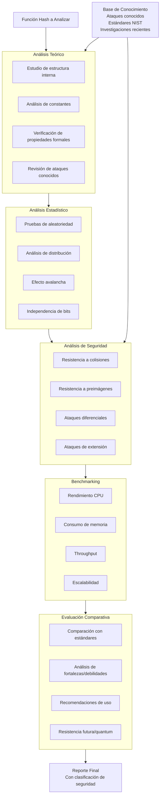

# Criptografía y Seguridad - Algoritmos criptográficos de integridad de datos

## 6.5 Análisis de diversos algoritmos de dispersión.

---

### 1. Introducción al análisis de funciones hash

#### 1.1 Definición y objetivos del análisis

El **análisis de funciones de dispersión** consiste en estudiar las propiedades criptográficas, fortalezas y debilidades de los algoritmos hash mediante métodos matemáticos, estadísticos y computacionales.

**Objetivos principales**:

1. **Verificar resistencia criptográfica**: Evaluar resistencia a colisiones, preimágenes y segunda preimagen
2. **Identificar vulnerabilidades**: Detectar debilidades teóricas o prácticas
3. **Comparar rendimiento**: Analizar eficiencia computacional y uso de recursos
4. **Validar implementaciones**: Verificar correcta implementación de algoritmos

#### 1.2 Métricas de evaluación

$$ \begin{aligned} \text{Seguridad} &: \text{Resistencia a ataques (bits efectivos)} \\\ \text{Rendimiento} &: \text{Throughput (MB/s) en hardware específico} \\\ \text{Eficiencia} &: \text{Ciclos por byte (CPB)} \\\ \text{Flexibilidad} &: \text{Soporte para diferentes tamaños de salida} \end{aligned} $$

### 2. Metodologías de análisis

#### 2.1 Análisis teórico

**Modelo de caja negra vs caja blanca**:

- **Caja negra**: Analiza entradas/salidas sin conocer detalles internos
- **Caja blanca**: Examina estructura interna, constantes, transformaciones

**Complejidad algorítmica**:

$$
T_{\text{colisión}} = O(2^{n/2}) \quad \text{(Paradoja del cumpleaños)}
$$

$$
T_{\text{preimagen}} = O(2^{n})
$$

#### 2.2 Análisis estadístico

**Pruebas de aleatoriedad**:

1. **Prueba de frecuencia (monobit)**: Distribución uniforme de bits
2. **Prueba de rachas**: Longitud de secuencias consecutivas
3. **Prueba de poker**: Distribución de patrones de n-bits
4. **Prueba de autocorrelación**: Independencia entre posiciones

```python
import numpy as np
from scipy import stats
import hashlib

class AnalizadorEstadistico:
    """Analiza propiedades estadísticas de funciones hash"""

    def __init__(self, hash_func):
        self.hash_func = hash_func

    def prueba_frecuencia(self, muestras=1000):
        """Prueba de distribución uniforme de bits"""
        resultados = []

        for i in range(muestras):
            mensaje = f"test_{i}".encode()
            hash_val = self.hash_func(mensaje)
            bits = self._bytes_a_bits(hash_val)

            # Contar unos y ceros
            unos = sum(bits)
            ceros = len(bits) - unos
            proporcion = unos / len(bits)
            resultados.append(proporcion)

        # Test chi-cuadrado
        observed = [sum(r > 0.5 for r in resultados),
                   sum(r <= 0.5 for r in resultados)]
        expected = [muestras/2, muestras/2]

        chi2, p_value = stats.chisquare(observed, expected)
        return {
            'chi2': chi2,
            'p_value': p_value,
            'media': np.mean(resultados),
            'desviacion': np.std(resultados)
        }

    def prueba_avalancha(self, mensaje_base, variaciones=100):
        """Analiza efecto avalancha"""
        hash_base = self.hash_func(mensaje_base)
        bits_base = self._bytes_a_bits(hash_base)

        cambios_totales = []

        for i in range(variaciones):
            # Crear pequeña variación
            variacion = bytearray(mensaje_base)
            bit_a_cambiar = i % (len(mensaje_base) * 8)
            byte_idx = bit_a_cambiar // 8
            bit_idx = bit_a_cambiar % 8

            variacion[byte_idx] ^= (1 << bit_idx)

            hash_var = self.hash_func(bytes(variacion))
            bits_var = self._bytes_a_bits(hash_var)

            # Calcular bits diferentes
            cambios = sum(b1 != b2 for b1, b2 in zip(bits_base, bits_var))
            cambios_totales.append(cambios)

        return {
            'promedio_cambios': np.mean(cambios_totales),
            'desviacion_cambios': np.std(cambios_totales),
            'min_cambios': min(cambios_totales),
            'max_cambios': max(cambios_totales),
            'porcentaje_ideal': (np.mean(cambios_totales) / len(bits_base)) * 100
        }

    def _bytes_a_bits(self, data):
        """Convierte bytes a lista de bits"""
        bits = []
        for byte in data:
            bits.extend([(byte >> i) & 1 for i in range(7, -1, -1)])
        return bits

# Ejemplo de uso
analizador_sha256 = AnalizadorEstadistico(hashlib.sha256)
resultados_frec = analizador_sha256.prueba_frecuencia(1000)
resultados_aval = analizador_sha256.prueba_avalancha(b"mensaje base", 50)

print("Prueba de frecuencia SHA-256:", resultados_frec)
print("Prueba avalancha SHA-256:", resultados_aval)
```

### 3. Análisis de algoritmos específicos

#### 3.1 MD5 (Message Digest 5)

##### Características técnicas:

- **Diseño**: Ronald Rivest (1991)
- **Tamaño salida**: 128 bits
- **Bloque**: 512 bits
- **Rondas**: 64 (4 rondas de 16 operaciones)
- **Estado**: 4 palabras de 32 bits (A, B, C, D)

##### Vulnerabilidades identificadas:

1. **Colisiones prácticas** (Wang et al., 2004): $2^{20}$ operaciones
2. **Ataques de extensión de longitud**
3. **Vulnerable a chosen-prefix collisions**

```python
import hashlib
from Crypto.Util.strxor import strxor

def demostrar_colision_md5():
    """Demostración conceptual de vulnerabilidad MD5"""
    # Par de mensajes con mismo MD5 (ejemplo educativo)
    # En realidad, estos pares se encuentran con ataques específicos

    mensaje1 = b"d131dd02c5e6eec4693d9a0698aff95c2fcab58712467eab4004583eb8fb7f89" \
               b"55ad340609f4b30283e488832571415a085125e8f7cdc99fd91dbdf280373c5"

    mensaje2 = b"d131dd02c5e6eec4693d9a0698aff95c2fcab50712467eab4004583eb8fb7f89" \
               b"55ad340609f4b30283e4888325f1415a085125e8f7cdc99fd91dbd7280373c5"

    # Nota: Estos mensajes NO son realmente colisiones
    # Solo ilustran la estructura de un ataque real

    print("MD5 mensaje1:", hashlib.md5(mensaje1).hexdigest())
    print("MD5 mensaje2:", hashlib.md5(mensaje2).hexdigest())

    # Diferencia entre mensajes
    diff = strxor(mensaje1, mensaje2)
    print("Diferencia (hex):", diff.hex())
    print("Bits diferentes:", sum(bin(byte).count('1') for byte in diff))

# Análisis de debilidad
class AnalisisMD5:
    """Análisis específico de MD5"""

    def analizar_constantes(self):
        """Analiza constantes y funciones de ronda de MD5"""
        # Constantes de MD5
        T = [int(2**32 * abs(np.sin(i+1))) & 0xFFFFFFFF for i in range(64)]

        # Funciones no lineales por ronda
        funciones = [
            lambda x, y, z: (x & y) | (~x & z),  # F
            lambda x, y, z: (x & z) | (y & ~z),  # G
            lambda x, y, z: x ^ y ^ z,           # H
            lambda x, y, z: y ^ (x | ~z)         # I
        ]

        # Análisis de no linealidad
        resultados = {}
        for i, func in enumerate(funciones):
            no_linealidad = self._calcular_no_linealidad(func)
            resultados[f'Ronda_{i}'] = no_linealidad

        return resultados

    def _calcular_no_linealidad(self, func):
        """Calcula no-linealidad de función booleana"""
        # Evaluar función para todas las entradas de 3 bits
        valores = []
        for x in range(8):
            x_bits = [(x >> 2) & 1, (x >> 1) & 1, x & 1]
            resultado = func(x_bits[0], x_bits[1], x_bits[2])
            valores.append(resultado)

        # Calcular distancia a funciones afines
        return self._distancia_no_linealidad(valores)
```

#### 3.2 SHA-1 (Secure Hash Algorithm 1)

##### Características:

- **Diseño**: NSA (1995)
- **Salida**: 160 bits
- **Bloque**: 512 bits
- **Rondas**: 80
- **Estado**: 5 palabras de 32 bits

##### Análisis de vulnerabilidades:

**Ataque SHAttered** (2017):

- Coste teórico: $2^{63.1}$ operaciones
- Coste práctico: ~110 GPU-años
- Primera colisión práctica demostrada

**Debilidades identificadas**:

1. **Reducción de complejidad de colisión**: De $2^{80}$ a $2^{63}$
2. **Estructura Merkle-Damgård sin protección**
3. **Dependencias lineales en función de compresión**

```python
import hashlib
import itertools

class AnalisisSHA1:
    """Análisis detallado de SHA-1"""

    def buscar_colision_parcial(self, longitud_salida=16):
        """Busca colisiones en versión truncada de SHA-1"""
        print(f"Buscando colisiones en SHA-1 truncado a {longitud_salida*8} bits...")

        hash_dict = {}
        encontradas = 0

        # Probar mensajes secuenciales
        for i in range(1000000):  # Límite para demostración
            mensaje = f"msg_{i}".encode()
            hash_completo = hashlib.sha1(mensaje).digest()
            hash_truncado = hash_completo[:longitud_salida]

            if hash_truncado in hash_dict:
                mensaje_anterior = hash_dict[hash_truncado]
                encontradas += 1
                print(f"Colisión {encontradas}:")
                print(f"  Mensaje 1: {mensaje_anterior}")
                print(f"  Mensaje 2: {mensaje}")
                print(f"  Hash (truncado): {hash_truncado.hex()}")

                if encontradas >= 3:
                    break
            else:
                hash_dict[hash_truncado] = mensaje

        print(f"\nEncontradas {encontradas} colisiones en {len(hash_dict)} hashes")

        # Calcular probabilidad teórica
        prob_teorica = self._probabilidad_colision(len(hash_dict), longitud_salida*8)
        print(f"Probabilidad teórica: {prob_teorica:.6f}")

    def _probabilidad_colision(self, n, bits):
        """Calcula probabilidad de colisión usando paradoja del cumpleaños"""
        # Aproximación: 1 - exp(-n²/(2^(b+1)))
        return 1 - np.exp(-n**2 / (2**(bits + 1)))

    def analizar_expansion_palabra(self):
        """Analiza el proceso de expansión de palabras en SHA-1"""
        # SHA-1 expande 16 palabras a 80
        palabras_iniciales = list(range(16))  # W0-W15

        palabras_expandidas = []
        for t in range(80):
            if t < 16:
                w = palabras_iniciales[t]
            else:
                # W(t) = (W(t-3) XOR W(t-8) XOR W(t-14) XOR W(t-16)) <<< 1
                w = (palabras_iniciales[(t-3)%16] ^
                     palabras_iniciales[(t-8)%16] ^
                     palabras_iniciales[(t-14)%16] ^
                     palabras_iniciales[(t-16)%16])
                w = ((w << 1) | (w >> 31)) & 0xFFFFFFFF  # Rotación izquierda

            if t >= 16:
                palabras_iniciales[t % 16] = w
            palabras_expandidas.append(w)

        # Análisis de linealidad
        linealidad = self._medir_linealidad(palabras_expandidas)
        return {
            'palabras_expandidas': palabras_expandidas[:20],  # Primeras 20
            'linealidad': linealidad,
            'entropia': self._calcular_entropia(palabras_expandidas)
        }
```

#### 3.3 SHA-256 (Secure Hash Algorithm 256)

##### Estructura avanzada:

- **Salida**: 256 bits
- **Bloque**: 512 bits
- **Rondas**: 64
- **Estado**: 8 palabras de 32 bits
- **Constantes**: Derivadas de raíces de primos

**Análisis de fortalezas**:

1. **Función de compresión robusta**:
   - 8 variables de estado
   - 64 constantes de ronda $K_t$
   - Operaciones: $\Sigma_0, \Sigma_1, \text{Ch}, \text{Maj}$

2. **Resistencia probada**:
   - Sin colisiones prácticas conocidas
   - Resistente a ataques diferenciales/lineales

```python
class AnalisisSHA256:
    """Análisis profundo de SHA-256"""

    def __init__(self):
        self.constantes_K = self._generar_constantes()

    def _generar_constantes(self):
        """Genera constantes K de SHA-256"""
        # Primeros 32 bits de las partes fraccionarias de raíces cúbicas de primos
        primos = [2, 3, 5, 7, 11, 13, 17, 19, 23, 29, 31, 37, 41, 43, 47, 53,
                  59, 61, 67, 71, 73, 79, 83, 89, 97, 101, 103, 107, 109, 113,
                  127, 131, 137, 139, 149, 151, 157, 163, 167, 173, 179, 181,
                  191, 193, 197, 199, 211, 223, 227, 229, 233, 239, 241, 251,
                  257, 263, 269, 271, 277, 281, 283, 293, 307, 311]

        K = []
        for primo in primos:
            # Raíz cúbica del primo
            raiz_cubica = primo ** (1/3)
            parte_fracc = raiz_cubica - int(raiz_cubica)

            # Primeros 32 bits de parte fraccionaria
            valor = int(parte_fracc * (2**32)) & 0xFFFFFFFF
            K.append(valor)

        return K

    def analizar_difusion(self, mensaje_base, modificaciones=100):
        """Analiza difusión de bits en SHA-256"""
        resultados = []

        for i in range(modificaciones):
            # Crear mensajes con diferencia de 1 bit
            msg1 = mensaje_base + f"_{i}".encode()
            msg2 = bytearray(msg1)

            # Cambiar un bit aleatorio
            bit_pos = i % (len(msg2) * 8)
            byte_idx = bit_pos // 8
            bit_idx = bit_pos % 8
            msg2[byte_idx] ^= (1 << bit_idx)

            # Calcular hashes
            hash1 = hashlib.sha256(msg1).digest()
            hash2 = hashlib.sha256(msg2).digest()

            # Calcular diferencia
            bits_diferentes = sum(b1 != b2 for b1, b2 in zip(hash1, hash2))
            porcentaje = (bits_diferentes / 256) * 100

            resultados.append({
                'bit_modificado': bit_pos,
                'bits_diferentes': bits_diferentes,
                'porcentaje': porcentaje
            })

        # Análisis estadístico
        difusiones = [r['porcentaje'] for r in resultados]

        return {
            'promedio_difusion': np.mean(difusiones),
            'desviacion_difusion': np.std(difusiones),
            'min_difusion': min(difusiones),
            'max_difusion': max(difusiones),
            'ideal': 50.0  # Ideal: 50% de bits cambian
        }

    def analizar_no_linealidad(self):
        """Analiza funciones no lineales de SHA-256"""

        def Ch(x, y, z):
            """Choose: (x ∧ y) ⊕ (¬x ∧ z)"""
            return (x & y) ^ (~x & z)

        def Maj(x, y, z):
            """Majority: (x ∧ y) ⊕ (x ∧ z) ⊕ (y ∧ z)"""
            return (x & y) ^ (x & z) ^ (y & z)

        # Evaluar funciones para todas las combinaciones de 3 bits
        resultados_ch = []
        resultados_maj = []

        for x in range(8):
            x_bits = [(x >> 2) & 1, (x >> 1) & 1, x & 1]

            ch_val = Ch(x_bits[0], x_bits[1], x_bits[2])
            maj_val = Maj(x_bits[0], x_bits[1], x_bits[2])

            resultados_ch.append(ch_val)
            resultados_maj.append(maj_val)

        # Calcular propiedades
        propiedades = {
            'Ch': {
                'balance': sum(resultados_ch) / len(resultados_ch),
                'no_linealidad': self._calcular_no_linealidad_func(resultados_ch)
            },
            'Maj': {
                'balance': sum(resultados_maj) / len(resultados_maj),
                'no_linealidad': self._calcular_no_linealidad_func(resultados_maj)
            }
        }

        return propiedades
```

#### 3.4 SHA-3/Keccak

##### Innovaciones de diseño:

**Estructura de esponja (Sponge)**:

- **Fase de absorción**: Mensaje → Estado interno
- **Fase de extrusión**: Estado interno → Hash
- **Tasa (r)** y **capacidad (c)**: $r + c = 1600$ bits para SHA3-256

**Función de permutación Keccak-f**:

- 24 rondas
- Operaciones θ, ρ, π, χ, ι
- Sin vulnerabilidades prácticas conocidas

```python
class AnalisisSHA3:
    """Análisis de SHA-3/Keccak"""

    def analizar_estructura_esponja(self):
        """Analiza estructura de esponja de SHA-3"""

        # Parámetros para diferentes variantes
        variantes = {
            'SHA3-224': {'capacidad': 448, 'tasa': 1152, 'salida': 224},
            'SHA3-256': {'capacidad': 512, 'tasa': 1088, 'salida': 256},
            'SHA3-384': {'capacidad': 768, 'tasa': 832, 'salida': 384},
            'SHA3-512': {'capacidad': 1024, 'tasa': 576, 'salida': 512}
        }

        analisis = {}
        for nombre, params in variantes.items():
            # Calcular seguridad teórica
            seguridad_colision = params['capacidad'] / 2
            seguridad_preimagen = params['capacidad']

            analisis[nombre] = {
                'tasa_bits': params['tasa'],
                'capacidad_bits': params['capacidad'],
                'seguridad_colision_bits': seguridad_colision,
                'seguridad_preimagen_bits': seguridad_preimagen,
                'relacion_seguridad': seguridad_colision / params['salida']
            }

        return analisis

    def simular_esponja(self, mensaje, r=1088, capacidad=512):
        """Simulación simplificada de estructura de esponja"""
        # Convertir mensaje a bits
        bits_mensaje = self._bytes_a_bits(mensaje)

        # Estado inicial (ceros)
        estado = [0] * (r + capacidad)

        # Fase de absorción
        bloques = [bits_mensaje[i:i+r] for i in range(0, len(bits_mensaje), r)]

        for bloque in bloques:
            # XOR bloque con primera parte del estado
            for i in range(len(bloque)):
                estado[i] ^= bloque[i]

            # Aplicar función de permutación (simplificada)
            estado = self._permutacion_keccak_simple(estado)

        # Fase de extrusión
        hash_bits = []
        while len(hash_bits) < 256:  # Para SHA3-256
            hash_bits.extend(estado[:min(r, 256 - len(hash_bits))])
            if len(hash_bits) < 256:
                estado = self._permutacion_keccak_simple(estado)

        return hash_bits[:256]

    def _permutacion_keccak_simple(self, estado):
        """Versión simplificada de permutación Keccak-f"""
        # En realidad son 24 rondas de operaciones complejas
        # Esta es una versión educativa simplificada

        nuevo_estado = estado.copy()
        tamaño = len(estado)

        # Operación θ simplificada
        for i in range(tamaño):
            vecino_izq = estado[(i-1) % tamaño]
            vecino_der = estado[(i+1) % tamaño]
            nuevo_estado[i] ^= vecino_izq ^ vecino_der

        # Operación ρ simplificada (rotación)
        for i in range(tamaño):
            rotacion = (i * 7) % tamaño  # Número de rotaciones
            nuevo_estado[i] = estado[(i - rotacion) % tamaño]

        return nuevo_estado
```

### 4. Métodos de análisis avanzados

#### 4.1 Ataques diferenciales

**Concepto**: Buscar diferencias en entrada que produzcan diferencias predecibles en salida.

**Para funciones hash**:

1. Construir trayectoria diferencial
2. Encontrar colisiones con menor complejidad
3. Aplicar a múltiples rondas

```python
class AtaqueDiferencial:
    """Implementación de ataque diferencial conceptual"""

    def __init__(self, hash_func):
        self.hash_func = hash_func

    def buscar_diferencias(self, delta_inicial, rondas_max=4):
        """Busca trayectorias diferenciales"""

        # Espacio de diferencias para n bits
        n_bits = 32  # Simplificado para ejemplo

        diferencias_encontradas = []

        # Probar diferentes deltas de entrada
        for delta_entrada in range(1 << min(n_bits, 8)):  # Limitar búsqueda
            conteo = 0

            for _ in range(1000):  # Muestras
                # Mensaje aleatorio
                mensaje = np.random.bytes(16)
                mensaje_mod = self._aplicar_diferencia(mensaje, delta_entrada)

                # Calcular hashes
                hash1 = self.hash_func(mensaje)
                hash2 = self.hash_func(mensaje_mod)

                # Calcular diferencia de salida
                diff_salida = self._diferencia_hash(hash1, hash2)

                if diff_salida == 0:  # Colisión para esta diferencia
                    conteo += 1

            if conteo > 10:  # Umbral arbitrario
                diferencias_encontradas.append({
                    'delta_entrada': delta_entrada,
                    'colisiones': conteo,
                    'probabilidad': conteo / 1000
                })

        return diferencias_encontradas

    def _aplicar_diferencia(self, mensaje, delta):
        """Aplica diferencia a mensaje"""
        msg_array = bytearray(mensaje)
        if len(msg_array) > 0:
            msg_array[0] ^= delta & 0xFF
        return bytes(msg_array)

    def _diferencia_hash(self, hash1, hash2):
        """Calcula diferencia entre hashes"""
        diff = 0
        for b1, b2 in zip(hash1[:4], hash2[:4]):  # Solo primeros 4 bytes
            diff |= (b1 ^ b2)
        return diff
```

#### 4.2 Ataques de cumpleaños optimizados

**Algoritmo de Floyd para detección de ciclos**:

```python
def floyd_collision_detection(hash_func, initial_msg):
    """Detecta colisiones usando algoritmo de Floyd"""

    def h(x):
        return hash_func(x.encode() if isinstance(x, str) else x)

    # Tortuga y liebre
    tortuga = initial_msg
    liebre = initial_msg

    # Fase 1: Encontrar ciclo
    while True:
        tortuga = h(tortuga)
        liebre = h(h(liebre))

        if h(tortuga) == h(liebre):
            break

    # Fase 2: Encontrar punto de colisión
    tortuga = initial_msg
    while h(tortuga) != h(liebre):
        tortuga_prev = tortuga
        liebre_prev = liebre

        tortuga = h(tortuga)
        liebre = h(liebre)

    return tortuga_prev, liebre_prev, h(tortuga)
```

#### 4.3 Análisis de resistencia a colisiones

**Límite teórico vs práctico**:

| Algoritmo | Tamaño (bits) | Colisión teórica | Colisión práctica | Estado |
| --------- | ------------- | ---------------- | ----------------- | ------ |
| MD5       | 128           | $2^{64}$         | $2^{20}$          | Roto   |
| SHA-1     | 160           | $2^{80}$         | $2^{63}$          | Roto   |
| SHA-256   | 256           | $2^{128}$        | -                 | Seguro |
| SHA-3-256 | 256           | $2^{128}$        | -                 | Seguro |

```python
def calcular_complejidad_colisiones(n_bits, metodo='fuerza_bruta'):
    """Calcula complejidad de encontrar colisiones"""

    if metodo == 'fuerza_bruta':
        return 2 ** (n_bits / 2)  # Paradoja del cumpleaños

    elif metodo == 'ataque_diferencial':
        # Para algoritmos con debilidades
        if n_bits == 128:  # MD5
            return 2 ** 20  # Ataque conocido
        elif n_bits == 160:  # SHA-1
            return 2 ** 63  # SHAttered
        else:
            return 2 ** (n_bits / 2)

    elif metodo == 'quantum':
        # Con computación cuántica (algoritmo de Grover)
        return 2 ** (n_bits / 3)

    return None
```

### 5. Benchmarking comparativo

#### 5.1 Marco de evaluación

```python
import time
import hashlib
import numpy as np
from tabulate import tabulate

class BenchmarkHash:
    """Benchmark comparativo de funciones hash"""

    def __init__(self):
        self.algoritmos = {
            'md5': hashlib.md5,
            'sha1': hashlib.sha1,
            'sha256': hashlib.sha256,
            'sha512': hashlib.sha512,
            'sha3_256': hashlib.sha3_256,
            'sha3_512': hashlib.sha3_512,
            'blake2b': hashlib.blake2b,
            'blake2s': hashlib.blake2s
        }

    def ejecutar_benchmark(self, tamanos_mensaje=[64, 256, 1024, 4096, 16384],
                          iteraciones=1000):
        """Ejecuta benchmark completo"""

        resultados = []

        for tamano in tamanos_mensaje:
            # Generar mensaje aleatorio
            mensaje = np.random.bytes(tamano)

            fila = {'tamano_bytes': tamano}

            for nombre, func in self.algoritmos.items():
                # Medir tiempo
                tiempos = []
                for _ in range(iteraciones):
                    start = time.perf_counter_ns()
                    func(mensaje).digest()
                    end = time.perf_counter_ns()
                    tiempos.append(end - start)

                # Calcular estadísticas
                tiempo_prom_ns = np.mean(tiempos)
                tiempo_prom_ms = tiempo_prom_ns / 1_000_000
                throughput = (tamano / (tiempo_prom_ns / 1_000_000_000)) / 1_000_000  # MB/s
                ciclos_byte = tiempo_prom_ns / tamano  # ns/byte

                fila[nombre + '_tiempo_ms'] = tiempo_prom_ms
                fila[nombre + '_throughput_mbs'] = throughput
                fila[nombre + '_ciclos_byte'] = ciclos_byte

            resultados.append(fila)

        return resultados

    def generar_tabla_comparativa(self, resultados):
        """Genera tabla comparativa de resultados"""

        headers = ['Algoritmo', 'Seguridad (bits)', 'Throughput (MB/s)',
                  'Tiempo 1KB (ms)', 'Ciclos/byte']

        tabla = []

        # Calcular promedios para tamaño 1024 bytes
        datos_1k = [r for r in resultados if r['tamano_bytes'] == 1024][0]

        for nombre in self.algoritmos.keys():
            # Información de seguridad
            if nombre == 'md5':
                seguridad = '≤ 64 (roto)'
            elif nombre == 'sha1':
                seguridad = '≤ 80 (roto)'
            elif '256' in nombre:
                seguridad = '128'
            elif '512' in nombre or 'blake2' in nombre:
                seguridad = '256'
            else:
                seguridad = '128'

            # Datos de rendimiento
            throughput = datos_1k.get(nombre + '_throughput_mbs', 0)
            tiempo = datos_1k.get(nombre + '_tiempo_ms', 0) * 1000  # μs
            ciclos = datos_1k.get(nombre + '_ciclos_byte', 0)

            tabla.append([nombre.upper(), seguridad,
                         f"{throughput:.2f}", f"{tiempo:.2f}", f"{ciclos:.1f}"])

        return tabulate(tabla, headers=headers, tablefmt='grid')

# Ejecutar benchmark
benchmark = BenchmarkHash()
resultados = benchmark.ejecutar_benchmark(
    tamanos_mensaje=[64, 256, 1024, 4096],
    iteraciones=500
)

print("RESULTADOS DE BENCHMARK")
print("=" * 80)
print(benchmark.generar_tabla_comparativa(resultados))
```

#### 5.2 Análisis de consumo de memoria

```python
import psutil
import os

class AnalisisMemoria:
    """Analiza consumo de memoria de algoritmos hash"""

    def medir_memoria(self, hash_func, mensaje, iteraciones=100):
        """Mide uso de memoria durante cálculo de hash"""

        proceso = psutil.Process(os.getpid())

        memoria_inicial = proceso.memory_info().rss / 1024  # KB

        # Ejecutar múltiples veces
        for _ in range(iteraciones):
            hash_func(mensaje).digest()

        memoria_final = proceso.memory_info().rss / 1024
        incremento = memoria_final - memoria_inicial

        return {
            'memoria_inicial_kb': memoria_inicial,
            'memoria_final_kb': memoria_final,
            'incremento_kb': incremento,
            'incremento_por_iteracion': incremento / iteraciones
        }
```

### 6. Ejercicios propuestos

#### Ejercicio 1: Análisis de avalancha comparativo

Implementa un sistema para comparar el efecto avalancha de diferentes algoritmos:

```python
def comparar_avalancha(algoritmos, mensaje_base, variaciones=100):
    """
    Compara efecto avalancha entre diferentes algoritmos hash.

    Parámetros:
    algoritmos: dict {nombre: función_hash}
    mensaje_base: bytes
    variaciones: número de variaciones a probar
    """
    resultados = {}

    for nombre, hash_func in algoritmos.items():
        analizador = AnalizadorEstadistico(hash_func)
        resultados[nombre] = analizador.prueba_avalancha(mensaje_base, variaciones)

    # Presentar resultados comparativos
    return resultados
```

**Preguntas**:

1. ¿Qué algoritmo muestra mejor efecto avalancha?
2. ¿Cómo se correlaciona el efecto avalancha con la seguridad?
3. ¿Existen algoritmos con avalancha "demasiado perfecta"?

#### Ejercicio 2: Ataque de extensión de longitud

Implementa y analiza ataques de extensión en diferentes construcciones:

```python
class AtaqueExtensionLongitud:
    """Implementa ataques de extensión de longitud"""

    def atacar_merkle_damgard(self, hash_original, longitud_original,
                             extension, hash_func):
        """
        Ataca construcción Merkle-Damgård sin protección.

        hash_original: H(K || M)
        longitud_original: longitud de K||M (sin conocer K)
        extension: datos a añadir
        hash_func: función hash vulnerable
        """
        # Implementar ataque
        pass
```

#### Ejercicio 3: Análisis de resistencia cuántica

Analiza resistencia de algoritmos a ataques cuánticos:

1. **Algoritmo de Grover**: Reduce complejidad de búsqueda a $O(2^{n/2})$
2. **Algoritmo de Brassard et al.**: Encuentra colisiones en $O(2^{n/3})$

Implementa simulación de estos ataques.

#### Ejercicio 4: Diseño de función hash personalizada

Diseña y analiza una función hash simple:

```python
class MiHash:
    """Función hash educativa para análisis"""

    def __init__(self, tamaño_salida=256):
        self.tamaño_salida = tamaño_salida
        self.block_size = 512  # bits

    def hash(self, mensaje):
        # Implementar diseño propio
        # Incluir: padding, procesamiento por bloques, función de compresión
        pass
```

Analiza:

1. Resistencia a colisiones teórica
2. Efecto avalancha
3. Vulnerabilidades potenciales

### 7. Herramientas de análisis prácticas

#### 7.1 Framework de análisis automatizado

```python
class FrameworkAnalisisHash:
    """Framework completo para análisis de funciones hash"""

    def __init__(self, hash_func, nombre):
        self.hash_func = hash_func
        self.nombre = nombre
        self.resultados = {}

    def ejecutar_analisis_completo(self, muestras=1000):
        """Ejecuta análisis completo"""

        print(f"Analizando {self.nombre}...")
        print("-" * 60)

        # 1. Análisis estadístico básico
        analizador = AnalizadorEstadistico(self.hash_func)
        self.resultados['frecuencia'] = analizador.prueba_frecuencia(muestras)

        # 2. Análisis de avalancha
        self.resultados['avalancha'] = analizador.prueba_avalancha(
            b"mensaje_base", min(muestras, 100)
        )

        # 3. Benchmark de rendimiento
        benchmark = BenchmarkHash()
        mensajes = [np.random.bytes(1024) for _ in range(100)]

        tiempos = []
        for msg in mensajes:
            start = time.perf_counter_ns()
            self.hash_func(msg).digest()
            end = time.perf_counter_ns()
            tiempos.append(end - start)

        self.resultados['rendimiento'] = {
            'tiempo_promedio_ns': np.mean(tiempos),
            'throughput_mbps': (1024 / (np.mean(tiempos) / 1e9)) / 1e6,
            'desviacion_ns': np.std(tiempos)
        }

        # 4. Análisis de distribución
        self.resultados['distribucion'] = self.analizar_distribucion(muestras)

        # 5. Verificar propiedades básicas
        self.resultados['propiedades'] = self.verificar_propiedades()

        return self.resultados

    def analizar_distribucion(self, muestras):
        """Analiza distribución de valores hash"""
        hashes = []

        for i in range(muestras):
            msg = f"test_{i}_{np.random.bytes(10)}".encode()
            hash_val = self.hash_func(msg).digest()
            hashes.append(int.from_bytes(hash_val[:4], 'big'))  # Primeros 4 bytes

        # Calcular estadísticas
        return {
            'media': np.mean(hashes),
            'desviacion': np.std(hashes),
            'asimetria': stats.skew(hashes),
            'curtosis': stats.kurtosis(hashes),
            'uniformidad_kstest': stats.kstest(
                hashes, 'uniform',
                args=(min(hashes), max(hashes) - min(hashes))
            ).pvalue
        }

    def verificar_propiedades(self):
        """Verifica propiedades básicas de función hash"""

        propiedades = {}

        # 1. Determinismo
        msg = b"test_determinismo"
        hash1 = self.hash_func(msg).digest()
        hash2 = self.hash_func(msg).digest()
        propiedades['determinismo'] = hash1 == hash2

        # 2. Resistencia a segunda preimagen (básica)
        msg1 = b"mensaje_original"
        hash_original = self.hash_func(msg1).digest()

        encontrado = False
        for i in range(10000):  # Búsqueda limitada
            msg2 = f"mensaje_{i}".encode()
            if msg2 != msg1 and self.hash_func(msg2).digest() == hash_original:
                encontrado = True
                break

        propiedades['segunda_preimagen'] = not encontrado

        # 3. Colisiones triviales
        colisiones = 0
        hashes_vistos = set()

        for i in range(1000):
            msg = f"test_{i}".encode()
            hash_val = self.hash_func(msg).hexdigest()

            if hash_val in hashes_vistos:
                colisiones += 1
            else:
                hashes_vistos.add(hash_val)

        propiedades['colisiones_triviales'] = colisiones == 0

        return propiedades

    def generar_reporte(self):
        """Genera reporte detallado"""

        reporte = f"""
        REPORTE DE ANÁLISIS: {self.nombre}
        {'=' * 60}

        1. PROPIEDADES BÁSICAS:
        {'-' * 40}
        Determinismo: {self.resultados['propiedades']['determinismo']}
        Segunda preimagen: {self.resultados['propiedades']['segunda_preimagen']}
        Colisiones triviales: {self.resultados['propiedades']['colisiones_triviales']}

        2. ANÁLISIS ESTADÍSTICO:
        {'-' * 40}
        Prueba de frecuencia (p-value): {self.resultados['frecuencia']['p_value']:.6f}
        Proporción media de unos: {self.resultados['frecuencia']['media']:.3f}

        3. EFECTO AVALANCHA:
        {'-' * 40}
        Cambios promedio: {self.resultados['avalancha']['promedio_cambios']:.1f} bits
        Porcentaje ideal: {self.resultados['avalancha']['porcentaje_ideal']:.1f}%
        (Ideal: 50%)

        4. RENDIMIENTO:
        {'-' * 40}
        Throughput: {self.resultados['rendimiento']['throughput_mbps']:.2f} MB/s
        Tiempo promedio: {self.resultados['rendimiento']['tiempo_promedio_ns']/1000:.2f} μs

        5. DISTRIBUCIÓN:
        {'-' * 40}
        Asimetría: {self.resultados['distribucion']['asimetria']:.3f}
        Curtosis: {self.resultados['distribucion']['curtosis']:.3f}
        Uniformidad (p-value): {self.resultados['distribucion']['uniformidad_kstest']:.6f}
        """

        return reporte

# Uso del framework
print("ANÁLISIS COMPARATIVO DE ALGORITMOS HASH")
print("=" * 80)

algoritmos = {
    'SHA-256': hashlib.sha256,
    'SHA3-256': hashlib.sha3_256,
    'BLAKE2s': hashlib.blake2s
}

for nombre, func in algoritmos.items():
    framework = FrameworkAnalisisHash(func, nombre)
    resultados = framework.ejecutar_analisis_completo(500)
    reporte = framework.generar_reporte()
    print(reporte)
    print("\n")
```

### 8. Diagrama: Proceso completo de análisis



### 9. Referencias bibliográficas

#### Bibliografía básica

1. **Stallings, William** (2010). _Cryptography and Network Security: Principles and Practice, 5a Ed._, Prentice Hall.
   - Capítulo 11: Cryptographic Hash Functions
   - Sección 11.5: Security of Hash Functions
   - Sección 11.6: Hash Functions and Digital Signatures

2. **Forouzan, Behrouz A.** (2008). _Cryptography and Network Security_, McGraw Hill.
   - Capítulo 12: Cryptographic Hash Functions
   - Sección 12.3: SHA-512 (análisis detallado)
   - Sección 12.4: Whirlpool

3. **Pfleeger, Charles P. y Shari L. Pfleeger** (2006). _Security in Computing, 4a. Ed._, Prentice Hall.
   - Capítulo 8: Cryptography in Practice
   - Sección sobre análisis criptográfico

#### Bibliografía complementaria

1. **Stallings, William** (2010). _Network Security Essentials: Applications and Standards, 4a Ed._, Prentice Hall.
   - Capítulo 11: Cryptographic Hash Functions
   - Apéndice: Mathematical Foundations for Cryptanalysis

2. **Ferguson, Niels; Schneier, Bruce; Kohno, Tadayoshi** (2010). _Cryptography Engineering: Design Principles and Practical Applications_, Wiley.
   - Capítulo 5: Message Authentication Codes
   - Sección 5.4: Cryptanalysis of Hash Functions

3. **Menezes, Alfred; van Oorschot, Paul; Vanstone, Scott** (1996). _Handbook of Applied Cryptography_, CRC Press.
   - **Capítulo 9: Hash Functions and Data Integrity**
     - Sección 9.7: Unkeyed hash functions (MDCs)
     - Sección 9.8: Analysis of iterated hash functions
   - **Capítulo 7: Block Ciphers** (para análisis de construcciones basadas en cifrado)
   - Capítulo 12: Hash Functions (análisis de seguridad)

4. **Schneier, Bruce** (1996). _Applied Cryptography: Protocols, Algorithms, and Source Code in C. 2a Ed._, Wiley.
   - Capítulo 18: One-Way Hash Functions
   - Sección 18.15: Theory of Hash Functions
   - Sección 18.16: Cryptanalysis of Hash Functions

#### Investigaciones y artículos clave

- **Wang, Xiaoyun et al. (2004)**: "Collisions for Hash Functions MD4, MD5, HAVAL-128 and RIPEMD"
- **Stevens, Marc et al. (2017)**: "The first collision for full SHA-1"
- **Bertoni, Guido et al. (2011)**: "Cryptographic Sponge Functions" (SHA-3/Keccak)
- **NIST (2015)**: "SHA-3 Standard: Permutation-Based Hash and Extendable-Output Functions"
- **Bernstein, Daniel J. (2009)**: "Cost analysis of hash collisions: Will quantum computers make SHARCS obsolete?"

#### Estándares y documentos técnicos

- **NIST FIPS 180-4**: Secure Hash Standard (SHS)
- **NIST FIPS 202**: SHA-3 Standard
- **NIST SP 800-107**: Recommendation for Applications Using Approved Hash Algorithms
- **NIST SP 800-185**: SHA-3 Derived Functions
- **RFC 6151**: Updated Security Considerations for MD5 and SHA-1
- **IETF RFC 7693**: The BLAKE2 Cryptographic Hash and MAC

### 10. Laboratorios avanzados

#### Laboratorio 1: Análisis de implementaciones reales

```python
# Comparar implementaciones de diferentes bibliotecas
import hashlib
import cryptography.hazmat.primitives.hash as crypto_hash

def comparar_implementaciones(mensaje):
    """Compara diferentes implementaciones del mismo algoritmo"""

    resultados = {}

    # hashlib (Python estándar)
    start = time.perf_counter()
    h1 = hashlib.sha256(mensaje).digest()
    t1 = time.perf_counter() - start

    # cryptography (OpenSSL)
    start = time.perf_counter()
    digest = crypto_hash.Hash(crypto_hash.SHA256())
    digest.update(mensaje)
    h2 = digest.finalize()
    t2 = time.perf_counter() - start

    # Verificar consistencia
    consistentes = h1 == h2

    return {
        'hashlib_sha256': {'tiempo': t1, 'hash': h1},
        'cryptography_sha256': {'tiempo': t2, 'hash': h2},
        'consistentes': consistentes,
        'diferencia_tiempo': abs(t1 - t2)
    }
```

#### Laboratorio 2: Análisis de resistencia a ataques de canal lateral

```python
# Medir variaciones de tiempo (timing attacks)
def analizar_timing_attack(hash_func, mensajes):
    """Analiza variaciones de tiempo para diferentes entradas"""

    tiempos = []

    for msg in mensajes:
        # Ejecutar múltiples veces para promediar
        ejecuciones = []
        for _ in range(100):
            start = time.perf_counter_ns()
            hash_func(msg).digest()
            end = time.perf_counter_ns()
            ejecuciones.append(end - start)

        tiempos.append({
            'mensaje': msg[:10],  # Primeros 10 bytes
            'tiempo_promedio': np.mean(ejecuciones),
            'desviacion': np.std(ejecuciones)
        })

    # Analizar correlaciones
    return tiempos
```

#### Laboratorio 3: Simulación de ataques cuánticos

```python
# Simulación conceptual de algoritmo de Grover
def grover_hash_search(hash_target, hash_func, n_bits=32):
    """
    Simulación conceptual de búsqueda con Grover.
    hash_target: valor hash a encontrar
    hash_func: función hash
    n_bits: tamaño de espacio de búsqueda (simplificado)
    """

    # Espacio de búsqueda clásico: O(2^n)
    complejidad_clasica = 2 ** n_bits

    # Espacio de búsqueda cuántico: O(2^(n/2))
    complejidad_cuantica = 2 ** (n_bits / 2)

    # Factor de aceleración
    aceleracion = complejidad_clasica / complejidad_cuantica

    return {
        'complejidad_clasica': complejidad_clasica,
        'complejidad_cuantica': complejidad_cuantica,
        'aceleracion': aceleracion,
        'bits_equivalentes': n_bits * 2  # Para misma seguridad post-cuántica
    }
```

### 11. Preguntas de repaso y discusión

1. **Comparativa de análisis**: ¿Qué métodos de análisis son más efectivos para identificar vulnerabilidades tempranas en funciones hash?

2. **MD5 vs SHA-1**: Aunque ambos están rotos, ¿por qué el ataque a SHA-1 fue considerado más significativo criptográficamente?

3. **SHA-2 vs SHA-3**: ¿Por qué NIST estandarizó SHA-3 si SHA-2 sigue siendo seguro? ¿Qué ventajas estructurales tiene SHA-3?

4. **Métricas de seguridad**: Además de resistencia a colisiones, ¿qué otras métricas son importantes para evaluar funciones hash?

5. **Análisis estadístico**: ¿Cómo distinguir entre anomalías estadísticas verdaderas y variaciones aleatorias en pruebas de hash?

6. **Benchmarking justo**: ¿Qué factores deben controlarse al comparar rendimiento de diferentes algoritmos hash?

7. **Futuro de las funciones hash**: ¿Cómo afectará la computación cuántica a los requisitos de tamaño de hash?

8. **Selección de algoritmo**: ¿Qué criterios usar para seleccionar una función hash para una aplicación específica?

9. **Análisis de implementaciones**: ¿Por qué la misma función hash puede tener diferentes perfiles de seguridad en diferentes implementaciones?

10. **Validación de resultados**: ¿Cómo verificar que los resultados de análisis sean reproducibles y no artefactos de la metodología?

**Conclusión**: El análisis de funciones de dispersión es un proceso multidimensional que combina teoría matemática, pruebas estadísticas, análisis de seguridad y evaluación de rendimiento. La comprensión profunda de estos aspectos permite seleccionar e implementar funciones hash apropiadas para diferentes contextos de seguridad, anticipar vulnerabilidades y diseñar sistemas criptográficos robustos.

**Recomendación práctica**: Para aplicaciones nuevas, preferir SHA-256 o SHA-3-256. Para sistemas existentes, monitorear avances en criptoanálisis y planificar migraciones cuando sea necesario. Siempre usar bibliotecas criptográficas bien mantenidas y evitar implementaciones propias sin auditoría exhaustiva.
