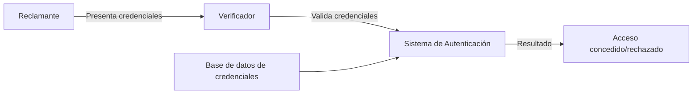
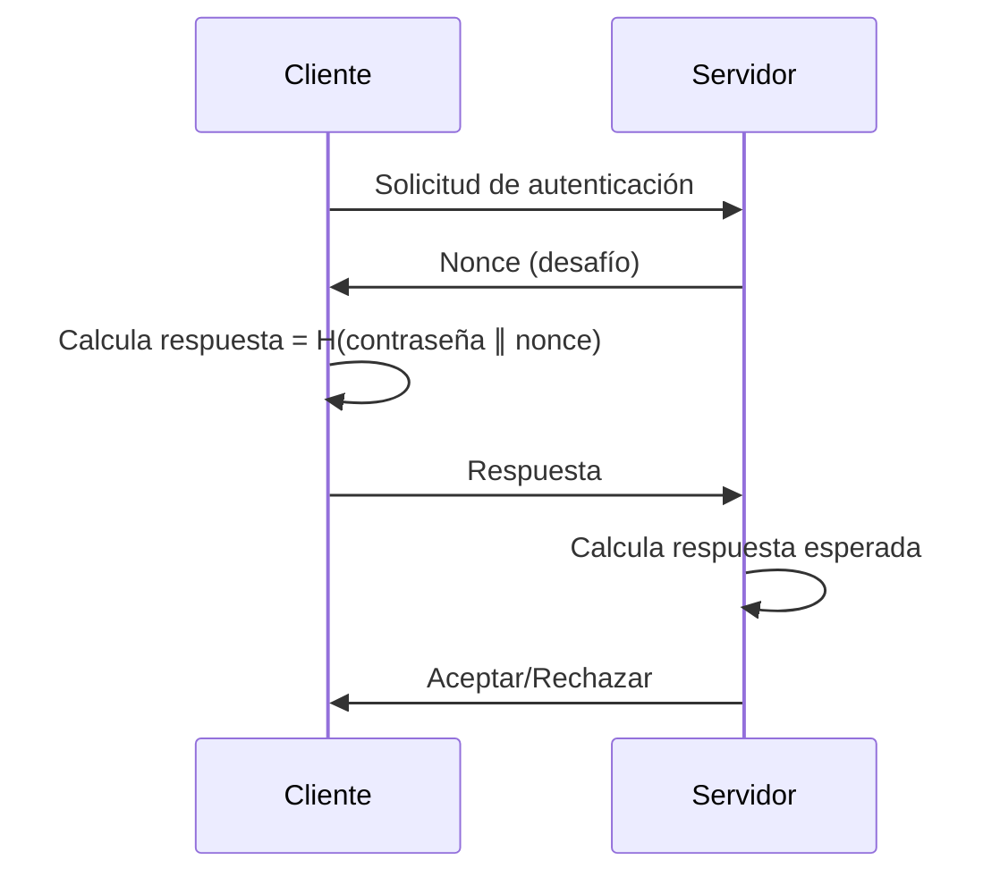

# Criptografía y Seguridad - Autentificación y firma digital

## 7.1 Principios fundamentales de autentificación, factores de autentificación.

---

La autenticación es el proceso de verificar la identidad de una entidad (usuario, sistema o dispositivo) que desea acceder a un recurso. Es un pilar fundamental de la seguridad informática y precede típicamente a la autorización.

### 2. Definiciones Clave

#### 2.1. Autenticación

Proceso mediante el cual se verifica la identidad declarada por una entidad. Según Stallings (2010), "la autenticación es el medio por el cual una parte demuestra a otra que es quien dice ser".

#### 2.2. Entidad Autenticada

Sujeto cuya identidad debe ser verificada. Puede ser:

- **Reclamante (Claimant)**: Entidad que solicita autenticación
- **Verificador (Verifier)**: Sistema que verifica la identidad
- **Autoridad de autenticación**: Sistema de confianza que media o valida

### 3. Modelo General de Autenticación



### 4. Factores de Autenticación

#### 4.1. Definición

Un factor de autenticación es una categoría de credencial utilizada para verificar la identidad. La autenticación fuerte requiere múltiples factores.

#### 4.2. Tipos de Factores

##### Factor 1: Algo que sabes (Knowledge Factors)

- Contraseñas, PINs, respuestas secretas
- **Ejemplo**: Contraseña de 8 caracteres: `P@ssw0rd!`

**Fortaleza teórica**: Dada una contraseña de longitud $n$ con $c$ caracteres posibles, el espacio de claves es:

$$S = c^n$$

Para una contraseña de 8 caracteres usando 94 caracteres imprimibles:

$$S = 94^8 \approx 6.1 \times 10^{15} \text{ combinaciones}$$

##### Factor 2: Algo que tienes (Possession Factors)

- Tokens hardware, tarjetas inteligentes, dispositivos móviles
- **Ejemplo**: Token RSA SecurID que genera OTPs

**Fórmula para OTPs basados en tiempo (TOTP)**:

$$OTP = H(K \parallel T) \mod 10^d$$

Donde:

- $H$: Función hash (ej. SHA-1)
- $K$: Clave secreta
- $T$: Período de tiempo actual
- $d$: Número de dígitos del OTP

##### Factor 3: Algo que eres (Inherence Factors)

- Biometría: huellas dactilares, reconocimiento facial, iris
- **Ejemplo**: Tasa de Falsos Aceptados (FAR) y Falsos Rechazados (FRR)

**Medidas de rendimiento biométrico**:

$$FAR = \frac{\text{Número de falsas aceptaciones}}{\text{Número de intentos de impostores}} \times 100\%$$

$$FRR = \frac{\text{Número de falsos rechazos}}{\text{Número de intentos legítimos}} \times 100\%$$

#### 4.3. Factor 4: Algo que haces (Behavioral Factors)

- Patrones de tecleo, firma manuscrita, voz
- **Ejemplo**: Análisis de dinámica de tecleo con medidas como:
  - Tiempo entre pulsaciones (digraph latency)
  - Duración de la pulsación (hold time)

### 5. Métodos de Autenticación

#### 5.1. Autenticación Basada en Contraseñas

**Algoritmo de almacenamiento seguro** (ejemplo simplificado):

```python
import hashlib
import os
import hashlib

def almacenar_contraseña(contraseña):
    # Generar salt aleatorio
    salt = os.urandom(32)

    # Derivar clave usando PBKDF2
    clave_derivada = hashlib.pbkdf2_hmac(
        'sha256',
        contraseña.encode('utf-8'),
        salt,
        100000  # Número de iteraciones
    )

    return salt + clave_derivada

def verificar_contraseña(contraseña, hash_almacenado):
    # Extraer salt
    salt = hash_almacenado[:32]
    hash_original = hash_almacenado[32:]

    # Calcular hash de la contraseña proporcionada
    hash_calculado = hashlib.pbkdf2_hmac(
        'sha256',
        contraseña.encode('utf-8'),
        salt,
        100000
    )

    return hash_calculado == hash_original

# Ejemplo de uso
hash_seguro = almacenar_contraseña("MiContraseñaSecreta")
print(f"Verificación: {verificar_contraseña('MiContraseñaSecreta', hash_seguro)}")
```

#### 5.2. Autenticación Multifactor (MFA)

Combinación de dos o más factores independientes. Según NIST SP 800-63B:

- **MFA de dos factores (2FA)**: Ej. Contraseña + token
- **MFA de tres factores (3FA)**: Ej. Contraseña + token + huella

### 6. Protocolos de Autenticación

#### 6.1. Protocolo de Desafío-Respuesta



**Fórmula**: $Respuesta = H(K \parallel Nonce)$
Donde $H$ es una función hash criptográfica.

#### 6.2. Protocolo de Kerberos (simplificado)

1. Cliente solicita TGT: $C \rightarrow AS: ID_C \parallel ID_{TGS} \parallel Tiempo$
2. AS responde: $AS \rightarrow C: E(K_C, [K_{C,TGS} \parallel ID_{TGS} \parallel Tiempo \parallel Ticket_{TGS}])$
3. Ticket TGS: $Ticket_{TGS} = E(K_{TGS}, [K_{C,TGS} \parallel ID_C \parallel \text{Dirección}_C \parallel Tiempo])$

### 7. Ejercicios Propuestos

#### Ejercicio 1: Análisis de Fortaleza de Contraseñas

Calcule el espacio de claves para los siguientes esquemas:
a) Contraseña de 6 dígitos numéricos
b) Contraseña de 8 caracteres con mayúsculas, minúsculas y dígitos
c) Contraseña de 12 caracteres con 94 caracteres imprimibles

**Solución esperada**:
a) $10^6 = 1,000,000$ combinaciones
b) $62^8 \approx 2.18 \times 10^{14}$ combinaciones
c) $94^{12} \approx 4.76 \times 10^{23}$ combinaciones

#### Ejercicio 2: Diseño de Esquema MFA

Diseñe un esquema de autenticación multifactor para un sistema bancario en línea que incluya:

1. Factor de conocimiento
2. Factor de posesión
3. Factor de inherente

Describa el flujo de autenticación y los controles de seguridad necesarios.

#### Ejercicio 3: Análisis de Protocolo

Analice el siguiente protocolo de autenticación mutua:

$$ \begin{aligned} &1. A \rightarrow B: A \parallel Nonce_A \\\ &2. B \rightarrow A: E(K_{AB}, Nonce_A \parallel Nonce_B) \\\ &3. A \rightarrow B: E(K_{AB}, Nonce_B) \end{aligned} $$

Identifique:
a) Las debilidades de seguridad
b) Posibles ataques
c) Mejoras al protocolo

### 8. Consideraciones de Seguridad

#### 8.1. Ataques Comunes

- **Fuerza bruta**: $\text{Tiempo} \approx \frac{\text{Espacio de claves}}{\text{Velocidad de prueba}}$
- **Diccionario**: Uso de listas de contraseñas comunes
- **Phishing**: Suplantación de interfaces de autenticación
- **Hombre en el medio**: Interceptación de credenciales

#### 8.2. Mejores Prácticas

1. **Longitud mínima**: 12 caracteres para contraseñas
2. **Complejidad**: Múltiples conjuntos de caracteres
3. **Actualización periódica**: Rotación de credenciales
4. **Almacenamiento seguro**: Hash con salt
5. **Límite de intentos**: Bloqueo tras $n$ intentos fallidos

### 9. Referencias

#### Bibliografía Básica

1. **Stallings, W. (2010)**: Capítulo 15 - "User Authentication"
2. **Forouzan, B. A. (2008)**: Capítulo 10 - "User Authentication and Access Control"
3. **Pfleeger & Pfleeger (2006)**: Capítulo 2 - "Identification and Authentication"

#### Bibliografía Complementaria

1. **Stallings (2010)**: Capítulo 3 - "User Authentication"
2. **Ferguson et al. (2010)**: Capítulo 9 - "Generating Randomness"
3. **Menezes et al. (1996)**: Capítulo 10 - "Identification and Entity Authentication"
4. **Schneier (1996)**: Capítulo 3 - "Protocols, Algorithms, and Source Code"

#### Estándares y Normativas

- **NIST SP 800-63B**: Digital Identity Guidelines
- **ISO/IEC 27001**: Sistemas de Gestión de Seguridad de la Información
- **FIPS 140-3**: Security Requirements for Cryptographic Modules

### 10. Glosario de Términos

| Término           | Definición                                        |
| ----------------- | ------------------------------------------------- |
| **Autenticación** | Verificación de la identidad de una entidad       |
| **Autorización**  | Determinación de los privilegios de acceso        |
| **Nonce**         | Número usado una vez en protocolos criptográficos |
| **OTP**           | Contraseña de un solo uso (One-Time Password)     |
| **Salt**          | Valor aleatorio añadido al hash de contraseñas    |
| **FAR**           | Tasa de Falsos Aceptados (False Acceptance Rate)  |
| **FRR**           | Tasa de Falsos Rechazados (False Rejection Rate)  |

### 11. Recursos Adicionales

#### Herramientas Prácticas

1. **John the Ripper**: Probador de fortaleza de contraseñas
2. **Hashcat**: Herramienta de recuperación de contraseñas
3. **OWASP ZAP**: Herramienta de testing de seguridad

#### Laboratorios Virtuales

1. Diseño e implementación de sistema de autenticación
2. Análisis de vulnerabilidades en protocolos
3. Implementación de esquema MFA

**Nota para el estudiante**: Esta guía cubre los principios fundamentales. Se recomienda complementar con las lecturas de referencia y ejercicios prácticos de implementación. Para profundizar en aspectos específicos, consulte los capítulos indicados en la bibliografía.
