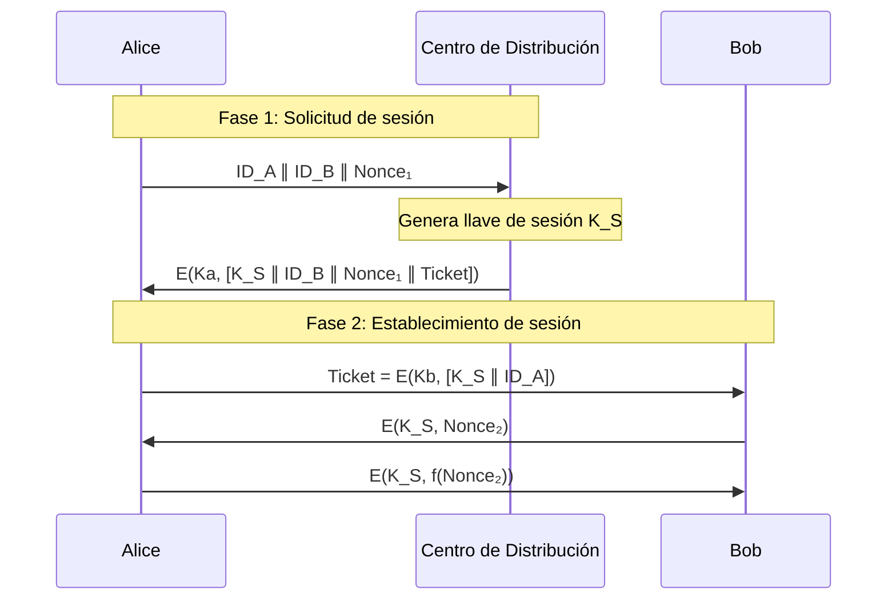
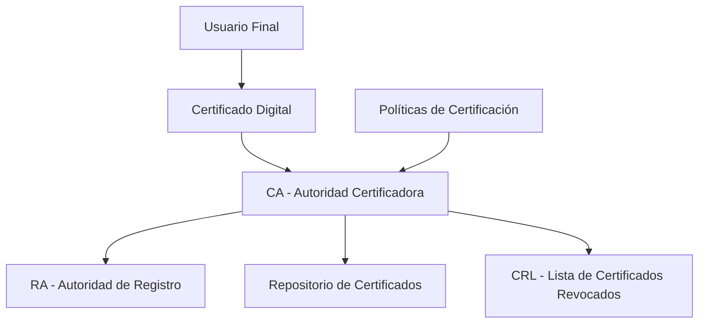
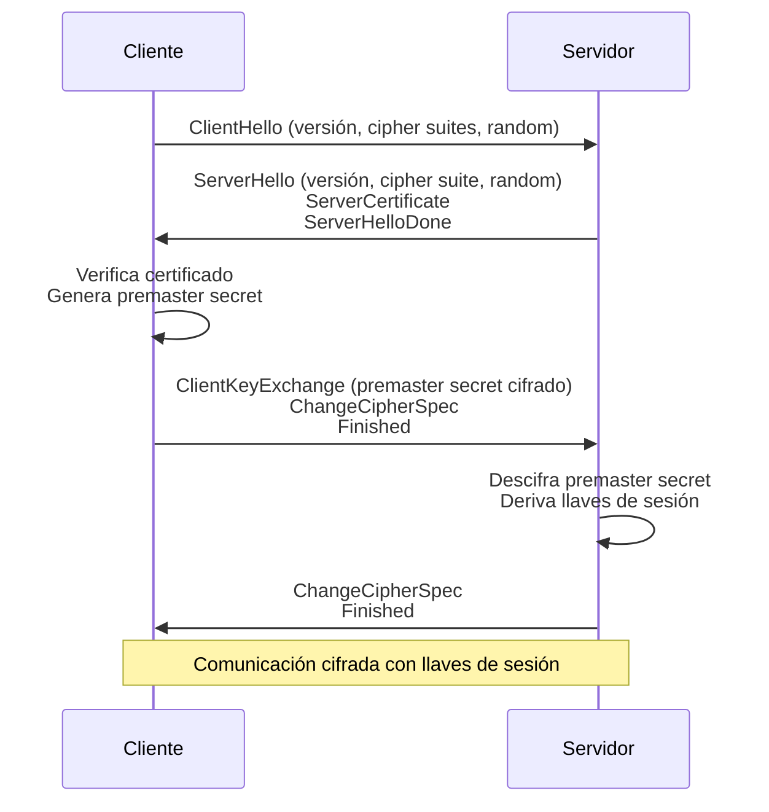

# Criptografía y Seguridad - Autentificación y firma digital

## 7.2 Distribución de llaves, certificados.

---

La distribución segura de llaves criptográficas es el problema fundamental de la criptografía simétrica. En sistemas asimétricos, el reto se transforma en la verificación auténtica de las llaves públicas. Los certificados digitales proporcionan la solución a este problema mediante una infraestructura de confianza.

### 1. Definiciones Fundamentales

#### 1.1. Distribución de Llaves

Proceso mediante el cual las llaves criptográficas son entregadas de manera segura a las entidades autorizadas para su uso en operaciones criptográficas.

**Según Stallings (2010)**: "El problema de la distribución de llaves consiste en cómo distribuir las llaves secretas a las partes que necesitan intercambiar datos de manera segura, sin permitir que los atacantes las obtengan".

#### 1.2. Certificado Digital

Estructura de datos que vincula una llave pública con la identidad de su propietario, firmada digitalmente por una Autoridad Certificadora (CA) de confianza.

**Estructura básica**:

$$ \text{Certificado} = \{ \text{Identidad}, \text{Llave Pública}, \text{Periodo de validez}, \text{Información de la CA} \}_{\text{firma de la CA}} $$

### 2. Problema de la Distribución de Llaves

#### 2.1. Para Criptografía Simétrica

En sistemas simétricos, si $n$ usuarios necesitan comunicarse entre sí:

**Número de llaves requeridas**:

$$
K = \frac{n(n-1)}{2}
$$

Para $n = 1000$ usuarios:

$$
K = \frac{1000 \times 999}{2} = 499,500 \text{ llaves}
$$

#### 2.2. Para Criptografía Asimétrica

Cada usuario necesita un par de llaves (pública y privada):

**Número de pares de llaves**:

$$
P = n
$$

Cada usuario debe conocer y verificar las $n-1$ llaves públicas de los demás usuarios.

### 3. Métodos de Distribución de Llaves

#### 3.1. Distribución Manual

- Intercambio físico de llaves
- Instalación por administrador
- **Limitación**: No escala para grandes organizaciones

#### 3.2. Distribución Centralizada (KDC - Key Distribution Center)



**Fórmula del Ticket** (Kerberos):

$$
\text{Ticket}_{B} = E(K_B, [K_S \parallel ID_A \parallel \text{Timestamp} \parallel \text{Dirección}_A])
$$

#### 3.3. Intercambio de Llaves Diffie-Hellman

**Protocolo básico**:

1. Parámetros públicos: primo $p$ y generador $g$
2. Alice: $a$ privado, calcula $A = g^a \mod p$
3. Bob: $b$ privado, calcula $B = g^b \mod p$
4. Intercambio: $A \leftrightarrow B$
5. Llave compartida: $K = B^a \mod p = A^b \mod p = g^{ab} \mod p$

```python
import random
from sympy import isprime, primitive_root

def diffie_hellman_key_exchange():
    # 1. Generar parámetros públicos (en la práctica son predefinidos)
    p = 323170060713110073001535134778251633  # primo grande
    g = 2  # generador módulo p

    # 2. Generar llaves privadas
    a_private = random.randint(2, p-2)  # Llave privada de Alice
    b_private = random.randint(2, p-2)  # Llave privada de Bob

    # 3. Calcular llaves públicas
    A_public = pow(g, a_private, p)  # g^a mod p
    B_public = pow(g, b_private, p)  # g^b mod p

    # 4. Calcular llave compartida
    K_alice = pow(B_public, a_private, p)  # B^a mod p
    K_bob = pow(A_public, b_private, p)    # A^b mod p

    return {
        'shared_key_alice': K_alice,
        'shared_key_bob': K_bob,
        'keys_match': K_alice == K_bob
    }

# Ejemplo de uso
result = diffie_hellman_key_exchange()
print(f"Llave compartida de Alice: {result['shared_key_alice']}")
print(f"Llave compartida de Bob: {result['shared_key_bob']}")
print(f"¿Las llaves coinciden? {result['keys_match']}")
```

### 4. Infraestructura de Llave Pública (PKI)

#### 4.1. Componentes Principales



#### 4.2. Estructura X.509 v3

**Campos principales de un certificado**:

```python
# Estructura simplificada de certificado X.509
certificate_structure = {
    'version': 'v3',
    'serial_number': '00:AA:BB:CC:DD:EE:FF',
    'signature_algorithm': 'sha256WithRSAEncryption',
    'issuer': {
        'country': 'US',
        'organization': 'Example CA',
        'common_name': 'Example Root CA'
    },
    'validity': {
        'not_before': '20240101000000Z',
        'not_after': '20251231235959Z'
    },
    'subject': {
        'country': 'MX',
        'organization': 'Universidad Ejemplo',
        'common_name': 'www.ejemplo.edu.mx'
    },
    'subject_public_key_info': {
        'algorithm': 'rsaEncryption',
        'public_key': '-----BEGIN PUBLIC KEY-----\n...\n-----END PUBLIC KEY-----'
    },
    'extensions': {
        'basic_constraints': 'CA:FALSE',
        'key_usage': 'Digital Signature, Key Encipherment',
        'subject_alt_name': 'DNS:www.ejemplo.edu.mx, DNS:ejemplo.edu.mx'
    },
    'signature': {
        'algorithm': 'sha256WithRSAEncryption',
        'value': '30:31:32:...'
    }
}
```

#### 4.3. Jerarquía de Confianza

**Cadena de certificación**:

$$
\text{Confianza}(Cert_U) = \text{Confianza}(CA_R) \times \prod_{i=1}^{n} \text{Confianza}(CA_i \rightarrow CA_{i+1})
$$

Donde:

- $Cert_U$: Certificado del usuario
- $CA_R$: CA raíz
- $CA_i$: CA intermedia $i$

### 5. Procesos de Gestión de Certificados

#### 5.1. Emisión de Certificados

**Algoritmo de firma** (RSA-PSS):

$$
S = (H(M))^d \mod n
$$

Donde:

- $H(M)$: Hash del mensaje (certificado)
- $d$: Llave privada de la CA
- $n$: Módulo RSA

#### 5.2. Validación de Certificados

**Proceso de verificación**:

1. Verificar firma digital
2. Comprobar periodo de validez
3. Consultar CRL/OCSP para revocación
4. Verificar ruta de certificación

```python
import datetime
from cryptography import x509
from cryptography.hazmat.backends import default_backend
from cryptography.hazmat.primitives import hashes
from cryptography.hazmat.primitives.asymmetric import padding

def validate_certificate(cert_pem, ca_cert_pem):
    """Valida un certificado contra una CA"""

    # Cargar certificados
    cert = x509.load_pem_x509_certificate(cert_pem, default_backend())
    ca_cert = x509.load_pem_x509_certificate(ca_cert_pem, default_backend())

    validation_result = {
        'valid': True,
        'errors': []
    }

    # 1. Verificar periodo de validez
    now = datetime.datetime.utcnow()
    if now < cert.not_valid_before_utc:
        validation_result['valid'] = False
        validation_result['errors'].append('Certificado aún no válido')
    if now > cert.not_valid_after_utc:
        validation_result['valid'] = False
        validation_result['errors'].append('Certificado expirado')

    # 2. Verificar firma
    try:
        public_key = ca_cert.public_key()
        public_key.verify(
            cert.signature,
            cert.tbs_certificate_bytes,
            padding.PKCS1v15(),
            cert.signature_hash_algorithm
        )
    except Exception as e:
        validation_result['valid'] = False
        validation_result['errors'].append(f'Firma inválida: {str(e)}')

    # 3. Verificar nombre del emisor
    if cert.issuer != ca_cert.subject:
        validation_result['valid'] = False
        validation_result['errors'].append('Emisor no coincide con CA')

    return validation_result
```

#### 5.3. Revocación de Certificados

**Métodos**:

1. **CRL (Certificate Revocation List)**: Lista periódica
2. **OCSP (Online Certificate Status Protocol)**: Consulta en tiempo real

**Tasa de revocación**:

$$
R = \frac{N_{\text{revocados}}}{N_{\text{emitidos}}} \times 100\%
$$

### 6. Protocolos de Distribución de Llaves

#### 6.1. SSL/TLS Handshake



**Derivación de llaves en TLS 1.2**:

$$
\text{master secret} = \text{PRF}(\text{premaster secret}, \text{"master secret"}, \text{ClientHello.random} \parallel \text{ServerHello.random})
$$

#### 6.2. IPsec/IKE (Internet Key Exchange)

**Fases**:

1. **Fase 1**: Autenticación mutua y establecimiento de SA (Security Association)
2. **Fase 2**: Establecimiento de SAs para datos

### 7. Ejercicios Propuestos

#### Ejercicio 1: Cálculo de Llaves en Red Simétrica

Una empresa tiene 150 empleados que necesitan comunicarse de forma segura en pares.

a) Calcule el número total de llaves simétricas necesarias.
b) Si se implementa un KDC, ¿cuántas llaves se deben almacenar en el KDC?
c) Compare la complejidad de ambos enfoques.

**Solución esperada**:
a) $K = \frac{150 \times 149}{2} = 11,175$ llaves
b) $150$ llaves (una por usuario con el KDC)
c) El KDC reduce la gestión de llaves de $O(n^2)$ a $O(n)$

#### Ejercicio 2: Análisis de Cadena de Certificados

Dada la siguiente jerarquía:

- CA Raíz: "Global Root CA"
- CA Intermedia: "Americas CA"
- Certificado de servidor: "www.ejemplo.com"

Diseñe el proceso completo de validación incluyendo:

1. Verificación de firmas
2. Comprobación de nombres
3. Validación temporal
4. Consulta de revocación

#### Ejercicio 3: Implementación de Diffie-Hellman

Implemente en Python el protocolo Diffie-Hellman con protección contra ataques de hombre en el medio usando autenticación digital. Incluya:

a) Generación de parámetros
b) Autenticación con certificados
c) Derivação de llave

### 8. Consideraciones de Seguridad

#### 8.1. Ataques Comunes

| Ataque                | Descripción                                 | Contramedida             |
| --------------------- | ------------------------------------------- | ------------------------ |
| **Man-in-the-Middle** | Intercepta y modifica intercambio de llaves | Autenticación mutua      |
| **Replay Attack**     | Reutiliza mensajes antiguos                 | Uso de nonces/timestamps |
| **Key Compromise**    | Robo de llave privada                       | Revocación inmediata     |
| **CA Compromise**     | Compromiso de autoridad certificadora       | CRL/OCSP, jerarquías     |

#### 8.2. Mejores Prácticas

1. **Longitud de llaves**: RSA ≥ 2048 bits, ECC ≥ 256 bits
2. **Periodos de validez**: Certificados ≤ 397 días (actual)
3. **Revocación proactiva**: Monitoreo constante
4. **Almacenamiento seguro**: HSMs para llaves privadas

### 9. Referencias

#### Bibliografía Básica

1. **Stallings, W. (2010)**:
   - Capítulo 14: "Key Management and Distribution"
   - Capítulo 16: "Transport-Level Security"

2. **Forouzan, B. A. (2008)**:
   - Capítulo 13: "Digital Signature"
   - Capítulo 15: "Key Management"

3. **Pfleeger & Pfleeger (2006)**:
   - Capítulo 7: "Protection in Operating Systems"
   - Capítulo 8: "Database Security"

#### Bibliografía Complementaria

1. **Stallings (2010)**:
   - Capítulo 4: "Key Distribution and User Authentication"

2. **Ferguson et al. (2010)**:
   - Capítulo 18: "Key Management"
   - Capítulo 22: "PKI Practicalities"

3. **Menezes et al. (1996)**:
   - Capítulo 12: "Key Establishment Protocols"
   - Capítulo 13: "Key Management Techniques"

4. **Schneier (1996)**:
   - Capítulo 3: "Key Management"
   - Capítulo 8: "Key Management"

#### Estándares y RFCs

- **X.509**: Estándar ITU-T para certificados
- **RFC 5280**: Internet X.509 Public Key Infrastructure
- **RFC 8446**: TLS 1.3
- **RFC 7296**: IKEv2 Protocol

### 10. Ejemplo Práctico Completo

#### Sistema de Correo Seguro con S/MIME

```python
from cryptography.hazmat.primitives import serialization, hashes
from cryptography.hazmat.primitives.asymmetric import rsa, padding
from cryptography import x509
from cryptography.x509.oid import NameOID
import datetime

class PKISystem:
    def __init__(self):
        self.ca_private_key = None
        self.ca_certificate = None

    def create_ca(self, ca_name):
        """Crea una Autoridad Certificadora raíz"""
        # Generar llave privada
        self.ca_private_key = rsa.generate_private_key(
            public_exponent=65537,
            key_size=2048
        )

        # Crear certificado auto-firmado
        subject = issuer = x509.Name([
            x509.NameAttribute(NameOID.COUNTRY_NAME, "MX"),
            x509.NameAttribute(NameOID.STATE_OR_PROVINCE_NAME, "CDMX"),
            x509.NameAttribute(NameOID.ORGANIZATION_NAME, ca_name),
            x509.NameAttribute(NameOID.COMMON_NAME, f"{ca_name} Root CA"),
        ])

        self.ca_certificate = x509.CertificateBuilder().subject_name(
            subject
        ).issuer_name(
            issuer
        ).public_key(
            self.ca_private_key.public_key()
        ).serial_number(
            x509.random_serial_number()
        ).not_valid_before(
            datetime.datetime.utcnow()
        ).not_valid_after(
            datetime.datetime.utcnow() + datetime.timedelta(days=3650)
        ).add_extension(
            x509.BasicConstraints(ca=True, path_length=None),
            critical=True
        ).sign(self.ca_private_key, hashes.SHA256())

        return self.ca_certificate

    def issue_certificate(self, subject_name, public_key):
        """Emite un certificado para un usuario"""
        if not self.ca_private_key:
            raise ValueError("CA no inicializada")

        subject = x509.Name([
            x509.NameAttribute(NameOID.COUNTRY_NAME, "MX"),
            x509.NameAttribute(NameOID.ORGANIZATION_NAME, "Empresa Ejemplo"),
            x509.NameAttribute(NameOID.COMMON_NAME, subject_name),
        ])

        certificate = x509.CertificateBuilder().subject_name(
            subject
        ).issuer_name(
            self.ca_certificate.subject
        ).public_key(
            public_key
        ).serial_number(
            x509.random_serial_number()
        ).not_valid_before(
            datetime.datetime.utcnow()
        ).not_valid_after(
            datetime.datetime.utcnow() + datetime.timedelta(days=365)
        ).add_extension(
            x509.BasicConstraints(ca=False, path_length=None),
            critical=True
        ).add_extension(
            x509.KeyUsage(
                digital_signature=True,
                key_encipherment=True,
                content_commitment=True,
                data_encipherment=False,
                key_agreement=False,
                key_cert_sign=False,
                crl_sign=False,
                encipher_only=False,
                decipher_only=False
            ),
            critical=True
        ).sign(self.ca_private_key, hashes.SHA256())

        return certificate

# Uso del sistema
pki = PKISystem()
ca_cert = pki.create_ca("MiCA")

# Usuario genera su par de llaves
user_private_key = rsa.generate_private_key(
    public_exponent=65537,
    key_size=2048
)

# Obtiene certificado
user_cert = pki.issue_certificate("alice@ejemplo.com", user_private_key.public_key())

print("Sistema PKI implementado exitosamente")
print(f"CA: {ca_cert.subject.rfc4514_string()}")
print(f"Certificado usuario: {user_cert.subject.rfc4514_string()}")
```

### 11. Tendencias Actuales

#### 11.1. Let's Encrypt y Automatización

- Certificados gratuitos
- Renovación automática (ACME protocol)
- **Efecto**: Reducción de certificados autofirmados

#### 11.2. Certificate Transparency

- Registros públicos de todos los certificados emitidos
- **Objetivo**: Detectar certificados maliciosos o fraudulentos

#### 11.3. Post-Quantum Cryptography

- Preparación para computación cuántica
- Algoritmos basados en retículos, códigos, multivariados

### 12. Evaluación

#### Preguntas de Revisión

1. ¿Por qué es crítico el problema de distribución de llaves en criptografía?
2. Describa la diferencia entre distribución simétrica y asimétrica de llaves.
3. ¿Qué papel juegan las Autoridades Certificadoras en la PKI?
4. Explique el proceso de validación de una cadena de certificados.
5. ¿Cómo protege Diffie-Hellman contra escuchas? ¿Y contra MITM?

#### Caso de Estudio

Analice el caso de DigiNotar (2011), donde el compromiso de una CA resultó en la emisión de certificados fraudulentos para Google, Yahoo y otros servicios. Discuta:

- Fallas en la implementación de seguridad
- Consecuencias del compromiso
- Lecciones aprendidas para diseño de PKI

**Nota**: Esta guía cubre los aspectos fundamentales de distribución de llaves y certificados. Para implementaciones reales, consulte siempre las últimas versiones de los estándares y mejores prácticas de seguridad actualizadas.
