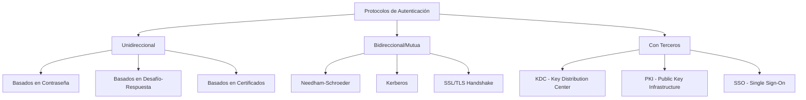
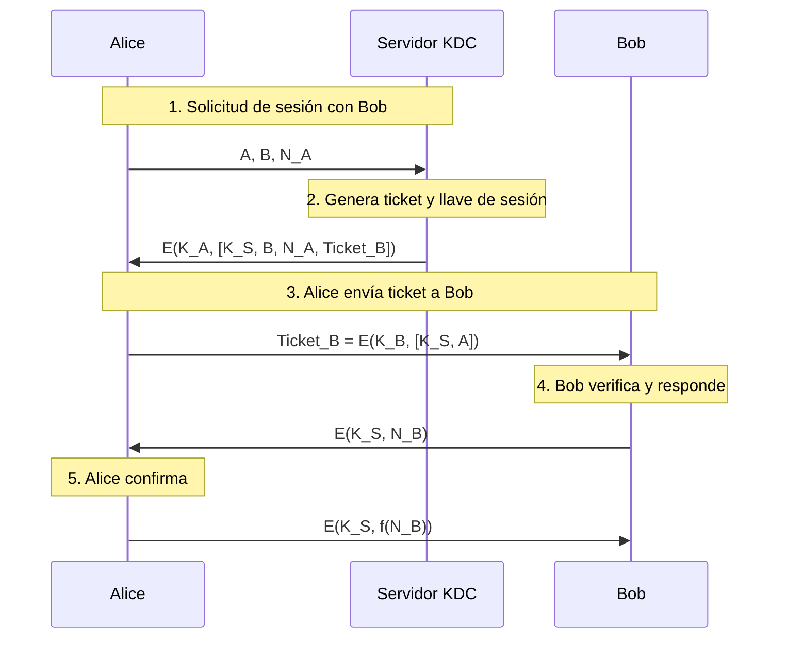
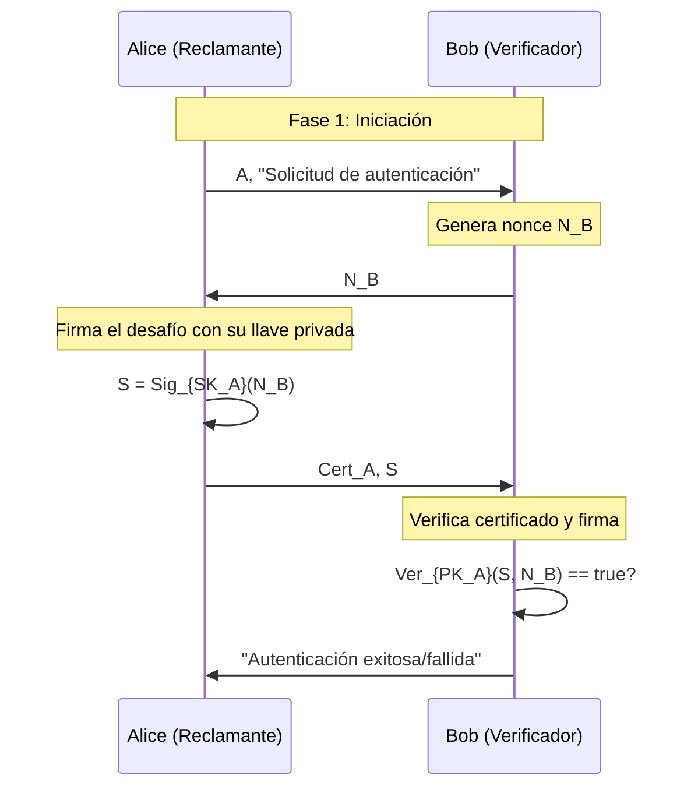
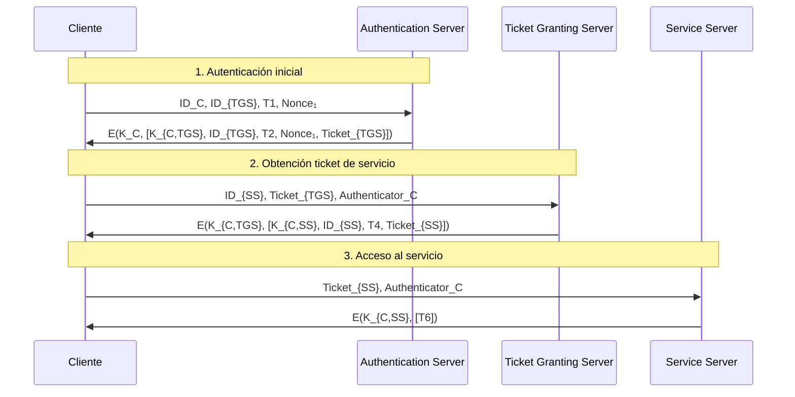
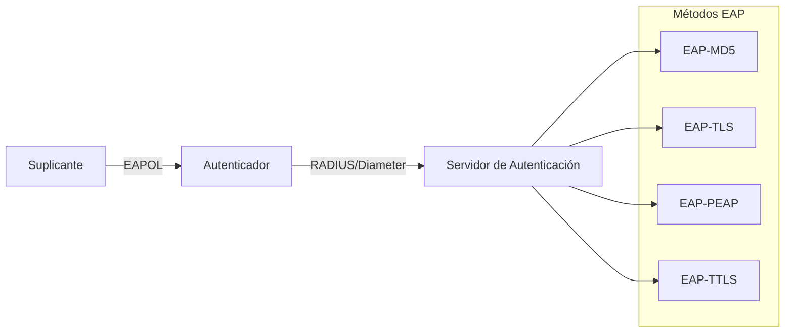
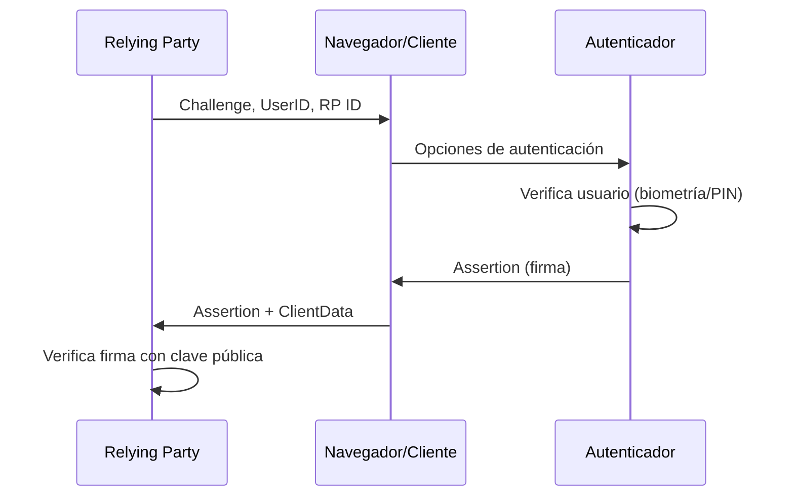

# Criptografía y Seguridad - Autentificación y firma digital

## 7.3 Protocolos de autentificación.

---

Los protocolos de autenticación son mecanismos estructurados que permiten a una entidad demostrar su identidad a otra a través de un intercambio de mensajes. Según Stallings (2010), "un protocolo de autenticación define la secuencia de mensajes y operaciones necesarias para verificar la identidad de un participante".

### 1. Fundamentos Teóricos

#### 1.1. Definiciones Formales

**Protocolo de Autenticación**: Conjunto ordenado de reglas que gobiernan el intercambio de mensajes entre dos o más entidades para establecer y verificar identidades.

**Objetivos de un protocolo de autenticación**:

1. **Identificación**: Establecer la identidad del reclamante
2. **Autenticación mutua**: Ambas partes verifican identidades mutuamente
3. **Freshness**: Garantizar que los mensajes son recientes
4. **No repudio**: Imposibilidad de negar participación

#### 1.2. Propiedades de Seguridad

**Modelo Dolev-Yao** (adversario activo):

- Puede interceptar, modificar, retransmitir o eliminar mensajes
- No puede romper primitivas criptográficas subyacentes

**Propiedades formales**:

$$ \begin{aligned} &\text{Autenticidad: } \forall m, \text{ si } B \text{ acepta } m \text{ de } A \text{ entonces } A \text{ envió } m \\\ &\text{Freshness: } \forall m, m \text{ no es una retransmisión antigua} \\\ &\text{Integridad: } \forall m, m \text{ no ha sido alterado en tránsito} \end{aligned} $$

### 2. Clasificación de Protocolos

#### 2.1. Por Tipo de Autenticación



#### 2.2. Por Mecanismo Criptográfico

| Tipo               | Mecanismo                     | Ventajas                          | Limitaciones                 |
| ------------------ | ----------------------------- | --------------------------------- | ---------------------------- |
| **Simétrico**      | Llaves compartidas            | Rápido, eficiente                 | Problema distribución llaves |
| **Asimétrico**     | Criptografía de llave pública | Escalable, sin secreto compartido | Computacionalmente costoso   |
| **Zero-Knowledge** | Pruebas de conocimiento       | No revela secreto                 | Complejidad implementación   |

### 3. Protocolos Basados en Contraseña

#### 3.1. Autenticación Básica HTTP

**Protocolo**:

```
Cliente → Servidor: GET /recurso HTTP/1.1
Servidor → Cliente: HTTP/1.1 401 Unauthorized
                  WWW-Authenticate: Basic realm="Acceso"
Cliente → Servidor: GET /recurso HTTP/1.1
                  Authorization: Basic base64(usuario:contraseña)
```

**Vulnerabilidad**: Credenciales en texto claro (base64 no es cifrado)

#### 3.2. Challenge-Handshake Authentication Protocol (CHAP)

**Algoritmo**:

$$
\text{Respuesta} = H(\text{ID} \parallel \text{Contraseña} \parallel \text{Desafío})
$$

```python
import hashlib
import os
import secrets

class CHAPProtocol:
    def __init__(self, stored_password_hash):
        self.stored_hash = stored_password_hash

    def generate_challenge(self):
        """Genera un nonce como desafío"""
        return secrets.token_bytes(16)

    def compute_response(self, username, password, challenge):
        """Calcula respuesta CHAP"""
        # En la práctica, usaría un KDF como PBKDF2
        data = username.encode() + b':' + password.encode() + challenge
        return hashlib.sha256(data).digest()

    def verify_response(self, username, received_response, challenge):
        """Verifica la respuesta"""
        # El servidor reconstruye la respuesta esperada
        expected_response = self.compute_response(
            username,
            self.stored_hash,  # En realidad compararía con hash almacenado
            challenge
        )
        return secrets.compare_digest(expected_response, received_response)

# Ejemplo de uso
chap = CHAPProtocol("hash_almacenado_del_usuario")
challenge = chap.generate_challenge()

# Simulación cliente
response = chap.compute_response("alice", "password123", challenge)

# Simulación servidor
is_valid = chap.verify_response("alice", response, challenge)
print(f"Autenticación {'exitosa' if is_valid else 'fallida'}")
```

### 4. Protocolos de Autenticación Mutua

#### 4.1. Protocolo Needham-Schroeder (1978)

**Versión original con criptografía simétrica**:



**Formalización**:

$$ \begin{aligned} &1. A \rightarrow S: A, B, N_A \\\  &2. S \rightarrow A: E(K_A, [K_S, B, N_A, E(K_B, [K_S, A])]) \\\  &3. A \rightarrow B: E(K_B, [K_S, A]) \\\  &4. B \rightarrow A: E(K_S, N_B) \\\  &5. A \rightarrow B: E(K_S, f(N_B)) \end{aligned} $$

**Vulnerabilidad descubierta por Denning y Sacco (1981)**: Ataque de replay si $K_S$ es comprometida.

#### 4.2. Needham-Schroeder Corregido (con timestamps)

**Versión mejorada**:

$$ \begin{aligned} &1. A \rightarrow S: A, B \\\ &2. S \rightarrow A: E(K_A, [K_S, B, T, E(K_B, [K_S, A, T])]) \\\ &3. A \rightarrow B: E(K_B, [K_S, A, T]) \\\ &4. B \rightarrow A: E(K_S, N_B) \\\ &5. A \rightarrow B: E(K_S, f(N_B)) \end{aligned} $$

Donde $T$ es un timestamp que garantiza freshness.

### 5. Protocolos Basados en Llave Pública

#### 5.1. Protocolo de Autenticación con Firma Digital

**Protocolo básico**:



**Fórmulas**:

- Firma: $S = \text{Sig}_{SK_A}(N_B)$
- Verificación: $\text{Ver}_{PK_A}(S, N_B) = \text{true/false}$

#### 5.2. Protocolo STS (Station-to-Station)

**Combinación Diffie-Hellman con autenticación**:

```python
from cryptography.hazmat.primitives import hashes, serialization
from cryptography.hazmat.primitives.asymmetric import dh, rsa, padding
from cryptography.hazmat.primitives.kdf.hkdf import HKDF
import os

class STSProtocol:
    def __init__(self):
        # Parámetros Diffie-Hellman
        self.parameters = dh.generate_parameters(generator=2, key_size=2048)

    def generate_key_pair(self):
        """Genera par de llaves DH"""
        private_key = self.parameters.generate_private_key()
        public_key = private_key.public_key()
        return private_key, public_key

    def authenticate_exchange(self, alice_private_key, bob_public_key,
                            identity_cert, peer_cert):
        """Ejecuta protocolo STS simplificado"""

        # 1. Intercambio DH
        shared_key = alice_private_key.exchange(bob_public_key)

        # 2. Deriva llave de sesión
        derived_key = HKDF(
            algorithm=hashes.SHA256(),
            length=32,
            salt=None,
            info=b'sts-key-derivation'
        ).derive(shared_key)

        # 3. Firma de los mensajes DH (simplificado)
        # En realidad se firma g^a y g^b concatenados

        return derived_key

# Ejemplo de uso
sts = STSProtocol()

# Alice y Bob generan sus pares de llaves DH
alice_priv, alice_pub = sts.generate_key_pair()
bob_priv, bob_pub = sts.generate_key_pair()

# Simulación del protocolo (desde perspectiva de Alice)
session_key = sts.authenticate_exchange(
    alice_priv,
    bob_pub,
    identity_cert=None,  # Certificado de Alice
    peer_cert=None       # Certificado de Bob
)

print(f"Llave de sesión derivada: {session_key.hex()[:16]}...")
```

### 6. Protocolos de Terceros de Confianza

#### 6.1. Kerberos V5

**Arquitectura de tres partes**:

1. **AS** (Authentication Server): Autentica usuario inicial
2. **TGS** (Ticket Granting Server): Proporciona tickets de servicio
3. **SS** (Service Server): Servicio final

**Flujo detallado**:



**Estructuras de datos**:

- **Ticket**: $Ticket_{TGS} = E(K_{TGS}, [K_{C,TGS}, ID_C, AD_C, T2, T3])$
- **Authenticator**: $Auth_C = E(K_{C,TGS}, [ID_C, AD_C, TS])$

#### 6.2. Protocolo Otway-Rees

**Protocolo simplificado para redes no confiables**:

$$ \begin{aligned} &1. A \rightarrow B: M, A, B, E(K_A, [N_A, M, A, B]) \\\ &2. B \rightarrow S: M, A, B, E(K_A, [N_A, M, A, B]), E(K_B, [N_B, M, A, B]) \\\ &3. S \rightarrow B: M, E(K_A, [N_A, K_S]), E(K_B, [N_B, K_S]) \\\ &4. B \rightarrow A: M, E(K_A, [N_A, K_S]) \end{aligned} $$

### 7. Protocolos de Autenticación para Entornos Específicos

#### 7.1. IEEE 802.1X (Autenticación en Redes)

**Arquitectura EAP (Extensible Authentication Protocol)**:



#### 7.2. OAuth 2.0 y OpenID Connect

**Flujo Authorization Code**:

```
Cliente → Servidor Auth: /auth?response_type=code&client_id=...
Usuario → Servidor Auth: Autenticación (credenciales)
Servidor Auth → Cliente: Código de autorización
Cliente → Servidor Auth: /token (code + client_secret)
Servidor Auth → Cliente: Access Token, ID Token
Cliente → Servidor Recursos: /api (con Access Token)
```

### 8. Análisis Formal de Protocolos

#### 8.1. Lógica de BAN (Burrows-Abadi-Needham)

**Creencias y reglas**:

$$ \begin{aligned} &P \text{ cree } X: P \models X \\\ &P \text{ ve } X: P \triangleleft X \\\ &P \text{ dijo } X: P \mid\sim X \\\ &P \text{ controla } X: P \Rightarrow X \\\ &\text{Clave compartida: } P \stackrel{K}{\longleftrightarrow} Q \end{aligned} $$

**Reglas de inferencia**:

1. **Message meaning**: $\frac{P \models P \stackrel{K}{\longleftrightarrow} Q, P \triangleleft \{X\}_K}{P \models Q \mid\sim X}$
2. **Nonce verification**: $\frac{P \models \sharp(X), P \models Q \mid\sim X}{P \models Q \models X}$
3. **Jurisdiction**: $\frac{P \models Q \Rightarrow X, P \models Q \models X}{P \models X}$

#### 8.2. Análisis del Protocolo Needham-Schroeder

**Objetivos de creencia**:

1. $A \models A \stackrel{K_S}{\longleftrightarrow} B$
2. $B \models A \stackrel{K_S}{\longleftrightarrow} B$
3. $A \models B \models A \stackrel{K_S}{\longleftrightarrow} B$

**Derivación formal usando lógica BAN** (simplificada):

```
1. A ve E(K_A, [K_S, B, N_A, Ticket_B])
2. A cree S dijo (K_S, B, N_A, Ticket_B)  [Regla de significado]
3. A cree fresh(N_A) → A cree fresh(K_S)  [Freshness propagation]
4. A cree S controla K_S → A cree K_S      [Jurisdicción]
```

### 9. Ejercicios Propuestos

#### Ejercicio 1: Análisis de Vulnerabilidades

Analice el siguiente protocolo simplificado:

$$ \begin{aligned} &1. A \rightarrow B: A \\\ &2. B \rightarrow A: N_B \\\ &3. A \rightarrow B: E(K_{AB}, N_B) \end{aligned} $$

Identifique:
a) ¿Qué tipo de autenticación provee (unidireccional/mutua)?
b) ¿Es vulnerable a ataques de replay? ¿Por qué?
c) Proponga una mejora para autenticación mutua.

**Solución esperada**:
a) Autenticación de A hacia B (unidireccional)
b) Sí, si un atacante captura el mensaje 3, puede reenviarlo más tarde
c) Agregar: $4. B \rightarrow A: E(K_{AB}, f(N_B))$ para autenticación mutua

#### Ejercicio 2: Diseño de Protocolo

Diseñe un protocolo de autenticación mutua para un sistema IoT con las siguientes restricciones:

- Dispositivos con recursos limitados
- Comunicación inalámbrica
- Soporte para actualización de credenciales
- Resistente a ataques de replay y MITM

Incluya:

1. Diagrama de secuencia
2. Especificación formal de mensajes
3. Análisis de seguridad usando lógica BAN

#### Ejercicio 3: Implementación de Kerberos Simplificado

Implemente en Python un sistema de autenticación tipo Kerberos simplificado que incluya:

```python
class SimplifiedKerberos:
    def __init__(self):
        self.kdc_database = {}  # Almacena secretos de usuarios
        self.ticket_cache = {}  # Cache de tickets

    def register_user(self, username, secret):
        """Registra un usuario en el KDC"""
        pass

    def request_tgt(self, username, secret):
        """Solicita Ticket Granting Ticket"""
        pass

    def request_service_ticket(self, tgt, service_name):
        """Solicita ticket de servicio"""
        pass

    def authenticate_to_service(self, service_ticket, authenticator):
        """Autentica con servicio"""
        pass
```

Complete la implementación con:
a) Generación y verificación de tickets
b) Uso de timestamps para freshness
c) Manejo de nonces

### 10. Ataques y Contramedidas

#### 10.1. Ataques Comunes a Protocolos

| Ataque                | Descripción                         | Ejemplo                                          | Contramedida              |
| --------------------- | ----------------------------------- | ------------------------------------------------ | ------------------------- |
| **Replay**            | Retransmisión de mensajes legítimos | Needham-Schroeder original                       | Nonces/timestamps         |
| **Reflection**        | Devuelve mensajes al emisor         | Protocolos con mismos mensajes en ambos sentidos | Asimetría en mensajes     |
| **Man-in-the-Middle** | Intercepta y modifica comunicación  | Diffie-Hellman sin autenticación                 | Certificados digitales    |
| **Type Attack**       | Sustituye tipo de mensaje           | Cambiar "request" por "response"                 | Campos de tipo protegidos |
| **Session Hijack**    | Secuestra sesión establecida        | Robo de cookies/cookies                          | Tokens de sesión robustos |

#### 10.2. Principios de Diseño Seguro (Abadi y Needham)

1. **Ser explícito**: Indicar claramente nombres y tipos
2. **Freshness garantizado**: Usar nonces o timestamps
3. **Aplicar lo que se expresa**: Si se firma, incluir toda información relevante
4. **Minimizar supuestos**: Especificar claramente los requisitos

### 11. Protocolos Modernos

#### 11.1. WebAuthn (Web Authentication API)

**Protocolo FIDO2 para autenticación sin contraseña**:



**Estructura de datos**:

- **Assertion**: $\text{Sig}_{PrivKey}(\text{RP ID} \parallel \text{Challenge} \parallel \text{flags})$

#### 11.2. Zero-Knowledge Proofs en Autenticación

**Protocolo Schnorr de identificación**:

$$ \begin{aligned} &\text{Setup: } y = g^x \mod p \quad (x \text{ secreto}) \\\ &1. P \rightarrow V: t = g^r \mod p \quad (r \text{ aleatorio}) \\\ &2. V \rightarrow P: c \quad (\text{desafío aleatorio}) \\\ &3. P \rightarrow V: s = r + c \cdot x \mod q \\\ &4. V \text{ verifica: } g^s \stackrel{?}{=} t \cdot y^c \mod p \end{aligned} $$

### 12. Referencias

#### Bibliografía Básica

1. **Stallings, W. (2010)**:
   - Capítulo 15: "User Authentication"
   - Capítulo 14: "Key Management and Distribution"

2. **Forouzan, B. A. (2008)**:
   - Capítulo 11: "Message Authentication and Hash Functions"
   - Capítulo 15: "Key Management"

3. **Pfleeger & Pfleeger (2006)**:
   - Capítulo 2: "Identification and Authentication"
   - Capítulo 3: "Program Security"

#### Bibliografía Complementaria

1. **Stallings (2010)**:
   - Capítulo 4: "Key Distribution and User Authentication"

2. **Ferguson et al. (2010)**:
   - Capítulo 9: "Generating Randomness"
   - Capítulo 11: "Key Establishment"

3. **Menezes et al. (1996)**:
   - Capítulo 10: "Identification and Entity Authentication"
   - Capítulo 12: "Key Establishment Protocols"

4. **Schneier (1996)**:
   - Capítulo 3: "Protocols"
   - Capítulo 5: "Advanced Protocols"

#### RFCs y Estándares Clave

- **RFC 4226**: HOTP - HMAC-Based One-Time Password
- **RFC 6238**: TOTP - Time-Based One-Time Password
- **RFC 5280**: Internet X.509 PKI
- **RFC 8446**: TLS 1.3
- **RFC 6749**: OAuth 2.0
- **RFC 8252**: OAuth 2.0 for Native Apps

### 13. Laboratorio Práctico

#### Implementación de Protocolo de Desafío-Respuesta

```python
import hashlib
import hmac
import secrets
import json
from datetime import datetime, timedelta
from cryptography.hazmat.primitives import serialization
from cryptography.hazmat.primitives.asymmetric import rsa
from cryptography.hazmat.primitives import hashes
from cryptography.hazmat.primitives.asymmetric import padding
from base64 import b64encode, b64decode

class AuthenticationProtocol:
    """Implementación de protocolo de autenticación mutua"""

    def __init__(self):
        self.sessions = {}

    def generate_nonce(self, length=16):
        """Genera un nonce criptográficamente seguro"""
        return secrets.token_bytes(length)

    def create_challenge(self, username):
        """Crea un desafío para el usuario"""
        challenge = {
            'nonce': self.generate_nonce(),
            'timestamp': datetime.utcnow().isoformat(),
            'username': username
        }
        # Almacenar desafío pendiente
        self.sessions[username] = {
            'challenge': challenge,
            'created': datetime.utcnow(),
            'status': 'pending'
        }
        return challenge

    def create_hmac_response(self, secret_key, challenge):
        """Crea respuesta HMAC para un desafío"""
        # Convertir desafío a string consistente
        challenge_str = json.dumps(challenge, sort_keys=True).encode()

        # Crear HMAC
        signature = hmac.new(
            secret_key.encode(),
            challenge_str,
            hashlib.sha256
        ).digest()

        return {
            'username': challenge['username'],
            'nonce': challenge['nonce'],
            'response': b64encode(signature).decode(),
            'timestamp': datetime.utcnow().isoformat()
        }

    def verify_hmac_response(self, secret_key, response, stored_challenge):
        """Verifica una respuesta HMAC"""
        # Reconstruir firma esperada
        expected_signature = hmac.new(
            secret_key.encode(),
            json.dumps(stored_challenge, sort_keys=True).encode(),
            hashlib.sha256
        ).digest()

        # Comparar
        received_signature = b64decode(response['response'])

        # Verificar nonce coincide
        nonce_match = response['nonce'] == stored_challenge['nonce']

        # Verificar HMAC
        hmac_match = hmac.compare_digest(
            expected_signature,
            received_signature
        )

        # Verificar freshness (dentro de 5 minutos)
        response_time = datetime.fromisoformat(response['timestamp'])
        time_diff = datetime.utcnow() - response_time
        fresh = time_diff < timedelta(minutes=5)

        return nonce_match and hmac_match and fresh

# Ejemplo completo de uso
def demo_authentication_protocol():
    protocol = AuthenticationProtocol()

    # Credenciales del usuario (en realidad estarían en base de datos)
    user_credentials = {
        'alice': 'SecretPassword123!',
        'bob': 'AnotherSecret456@'
    }

    print("=== Demo Protocolo de Autenticación ===")

    # 1. Cliente solicita autenticación
    username = 'alice'
    print(f"\n1. {username} solicita autenticación")

    # 2. Servidor genera desafío
    challenge = protocol.create_challenge(username)
    print(f"2. Servidor envía desafío: nonce={challenge['nonce'][:8].hex()}...")

    # 3. Cliente calcula respuesta
    secret_key = user_credentials[username]
    response = protocol.create_hmac_response(secret_key, challenge)
    print(f"3. Cliente envía respuesta: {response['response'][:20]}...")

    # 4. Servidor verifica
    stored_challenge = protocol.sessions[username]['challenge']
    is_valid = protocol.verify_hmac_response(
        secret_key,
        response,
        stored_challenge
    )

    print(f"\n4. Servidor verifica: {'ÉXITO' if is_valid else 'FALLO'}")

    # 5. Prueba con credencial incorrecta
    print("\n5. Prueba con credencial incorrecta:")
    wrong_response = protocol.create_hmac_response('WrongPassword', challenge)
    is_valid_wrong = protocol.verify_hmac_response(
        secret_key,
        wrong_response,
        stored_challenge
    )
    print(f"   Resultado: {'ÉXITO (inesperado)' if is_valid_wrong else 'FALLO (esperado)'}")

if __name__ == "__main__":
    demo_authentication_protocol()
```

### 14. Evaluación y Casos de Estudio

#### Preguntas de Revisión

1. Compare autenticación unidireccional vs. mutua en términos de seguridad y complejidad.
2. ¿Por qué los nonces son esenciales en protocolos de autenticación?
3. Describa el ataque de reflection y cómo prevenirlo.
4. ¿Qué ventajas ofrece Kerberos sobre protocolos más simples?
5. Explique cómo WebAuthn elimina la necesidad de contraseñas.

#### Caso de Estudio: Vulnerabilidad en Implementación de Kerberos

Analice la vulnerabilidad CVE-2020-17049 (Kerberos Key Distribution Center):

- Fallo en la validación de PAC (Privilege Attribute Certificate)
- Posible elevación de privilegios
- Impacto en sistemas Windows Enterprise
- Parches y mitigaciones aplicadas

**Nota para el estudiante**: Esta guía proporciona los fundamentos teóricos y prácticos de protocolos de autenticación. Para profundizar, se recomienda implementar los protocolos estudiados en entornos controlados y analizar su seguridad usando herramientas formales como ProVerif o Scyther.
