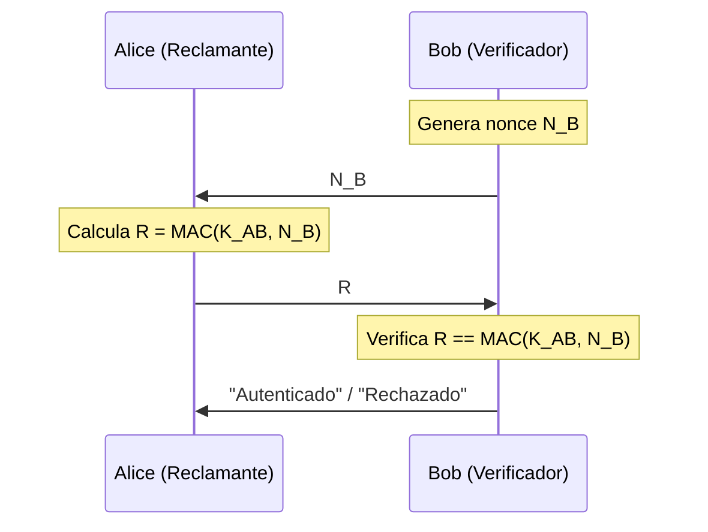
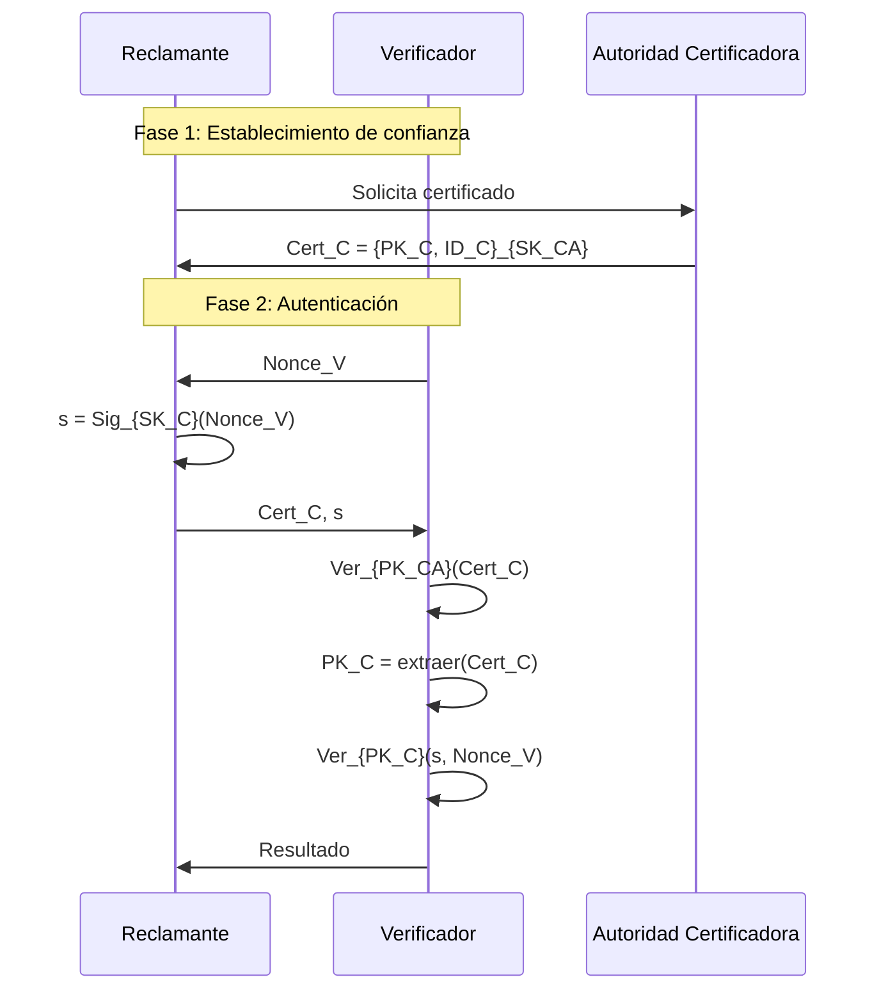
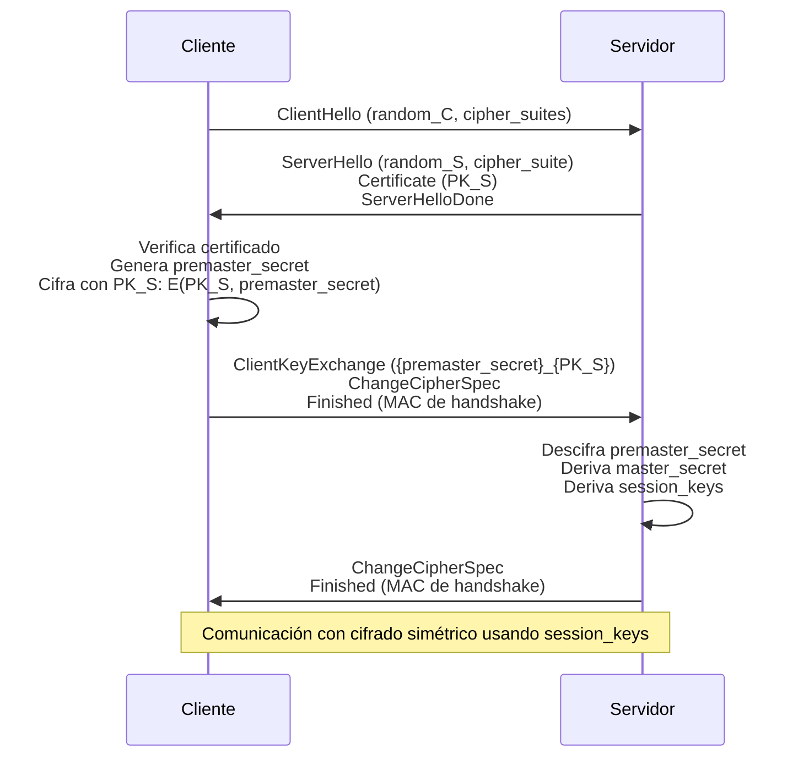

# Criptografía y Seguridad - Autentificación y firma digital

## 7.4 Autentificación basada en sistemas simétricos y de llave pública.

---

### Introducción

La autenticación es el proceso de verificar la identidad de una entidad. Según Stallings (2010), "los mecanismos de autenticación pueden clasificarse en dos categorías principales: aquellos basados en criptografía simétrica y aquellos basados en criptografía de llave pública". Esta guía explora ambos enfoques, sus fundamentos matemáticos, protocolos y aplicaciones prácticas.

### 1. Fundamentos Teóricos

#### 1.1. Definiciones Formales

**Autenticación Simétrica**: Proceso que utiliza una llave secreta compartida $K_{AB}$ entre dos partes para verificar mutuamente sus identidades.

**Autenticación Asimétrica**: Proceso que utiliza pares de llaves ( pública $PK$, privada $SK$ ) donde una parte demuestra conocimiento de la llave privada sin revelarla.

**Modelo Matemático**:

- Simétrica: $Auth = f(K_{shared}, challenge)$
- Asimétrica: $Auth = Sig_{SK}(challenge)$ donde $Ver_{PK}(Auth, challenge) = true$

### 2. Autenticación Simétrica

#### 2.1. Fundamentos Criptográficos

**Base matemática**: Operaciones con llaves compartidas

$$
\text{MAC}(K, M) = H(K \parallel M) \quad \text{o} \quad \text{MAC}(K, M) = E_K(H(M))
$$

**Propiedades requeridas**:

1. **Computacionalmente eficiente**
2. **Resistente a colisiones**: Dificultad de encontrar $M' \neq M$ tal que $MAC(K, M) = MAC(K, M')$
3. **Uniformidad**: Salida distribuida uniformemente

#### 2.2. MAC (Message Authentication Code)

**HMAC (Hash-based MAC) definición formal**:

$$
HMAC(K, m) = H\left((K \oplus opad) \parallel H\left((K \oplus ipad) \parallel m\right)\right)
$$

```python
import hashlib
import hmac
import os

class SymmetricAuthentication:
    """Sistema de autenticación simétrica"""

    def __init__(self):
        self.shared_secrets = {}

    def establish_shared_secret(self, user1, user2, key_length=32):
        """Establece secreto compartido entre dos usuarios"""
        # En la práctica, esto se haría mediante un protocolo de intercambio
        shared_key = os.urandom(key_length)
        self.shared_secrets[(user1, user2)] = shared_key
        self.shared_secrets[(user2, user1)] = shared_key
        return shared_key

    def generate_hmac(self, user_from, user_to, message):
        """Genera HMAC para autenticación"""
        key = self.shared_secrets.get((user_from, user_to))
        if not key:
            raise ValueError("No hay secreto compartido establecido")

        h = hmac.new(key, message.encode(), hashlib.sha256)
        return h.digest()

    def verify_hmac(self, user_from, user_to, message, received_hmac):
        """Verifica HMAC recibido"""
        expected_hmac = self.generate_hmac(user_from, user_to, message)
        return hmac.compare_digest(expected_hmac, received_hmac)

    def challenge_response_protocol(self, claimant, verifier):
        """Protocolo de desafío-respuesta simétrico"""
        # 1. Verificador genera desafío
        challenge = os.urandom(16)
        print(f"{verifier} genera desafío: {challenge.hex()}")

        # 2. Reclamante calcula respuesta (MAC del desafío)
        response = self.generate_hmac(claimant, verifier, challenge.hex())

        # 3. Verificador valida
        is_valid = self.verify_hmac(claimant, verifier, challenge.hex(), response)

        return {
            'challenge': challenge,
            'response': response,
            'valid': is_valid
        }

# Ejemplo de uso
auth_system = SymmetricAuthentication()

# Establecer secreto compartido entre Alice y Bob
key = auth_system.establish_shared_secret("Alice", "Bob")
print(f"Secreto compartido establecido: {key.hex()[:16]}...")

# Ejecutar protocolo de autenticación
result = auth_system.challenge_response_protocol("Alice", "Bob")
print(f"Autenticación {'exitosa' if result['valid'] else 'fallida'}")
```

#### 2.3. Protocolos Simétricos Clásicos

**Protocolo de Desafío-Respuesta con Nonce**:



**Formalización**:

$$ \begin{aligned} &1. B \rightarrow A: N_B \\\ &2. A \rightarrow B: MAC(K_{AB}, N_B) \\\ &3. B \text{ verifica: } MAC(K_{AB}, N_B) \stackrel{?}{=} recibido \end{aligned} $$

#### 2.4. Autenticación Mutua Simétrica

**Protocolo Needham-Schroeder simplificado**:

$$ \begin{aligned} &1. A \rightarrow B: A, N_A \\\ &2. B \rightarrow A: E(K_{AB}, N_A, N_B) \\\ &3. A \rightarrow B: E(K_{AB}, N_B) \end{aligned} $$

**Análisis de seguridad**:

- **Fortaleza**: Resistente a replay si los nonces son únicos
- **Debilidad**: Requiere distribución previa de $K_{AB}$
- **Complejidad**: $O(1)$ por par de usuarios

### 3. Autenticación con Llave Pública

#### 3.1. Fundamentos Matemáticos

**Base teórica**: Problemas computacionalmente difíciles

1. **Factorización**: RSA - Dado $n = pq$, hallar $p$ y $q$
2. **Logaritmo discreto**: DSA, ElGamal - Dado $g^x \mod p$, hallar $x$
3. **Curvas elípticas**: ECDSA - Dado $kP$, hallar $k$

**Firma digital RSA**:

$$ \begin{aligned} &\text{Firma: } s = m^d \mod n \\\ &\text{Verificación: } m \stackrel{?}{=} s^e \mod n \end{aligned} $$

donde $(n, e)$ es la llave pública y $d$ es la llave privada.

#### 3.2. Protocolos de Firma Digital

```python
from cryptography.hazmat.primitives import hashes
from cryptography.hazmat.primitives.asymmetric import rsa, padding, ec
from cryptography.hazmat.primitives import serialization
from cryptography.hazmat.primitives.asymmetric import utils
import os

class PublicKeyAuthentication:
    """Sistema de autenticación con llave pública"""

    def __init__(self):
        self.key_pairs = {}
        self.public_keys = {}

    def generate_rsa_keypair(self, user, key_size=2048):
        """Genera par de llaves RSA para un usuario"""
        private_key = rsa.generate_private_key(
            public_exponent=65537,
            key_size=key_size
        )

        public_key = private_key.public_key()

        self.key_pairs[user] = private_key
        self.public_keys[user] = public_key

        return private_key, public_key

    def generate_ecc_keypair(self, user):
        """Genera par de llaves ECC para un usuario"""
        private_key = ec.generate_private_key(ec.SECP256R1())
        public_key = private_key.public_key()

        self.key_pairs[user] = private_key
        self.public_keys[user] = public_key

        return private_key, public_key

    def sign_message(self, user, message):
        """Firma un mensaje con la llave privada del usuario"""
        private_key = self.key_pairs.get(user)
        if not private_key:
            raise ValueError(f"Usuario {user} no tiene llave privada")

        # Hash del mensaje primero (mejor práctica)
        message_hash = hashes.Hash(hashes.SHA256())
        message_hash.update(message.encode())
        digest = message_hash.finalize()

        # Firma dependiendo del tipo de llave
        if isinstance(private_key, rsa.RSAPrivateKey):
            signature = private_key.sign(
                digest,
                padding.PSS(
                    mgf=padding.MGF1(hashes.SHA256()),
                    salt_length=padding.PSS.MAX_LENGTH
                ),
                hashes.SHA256()
            )
        else:  # ECC
            signature = private_key.sign(
                digest,
                ec.ECDSA(hashes.SHA256())
            )

        return signature

    def verify_signature(self, user, message, signature):
        """Verifica una firma con la llave pública del usuario"""
        public_key = self.public_keys.get(user)
        if not public_key:
            raise ValueError(f"Usuario {user} no tiene llave pública registrada")

        # Calcular hash del mensaje
        message_hash = hashes.Hash(hashes.SHA256())
        message_hash.update(message.encode())
        digest = message_hash.finalize()

        try:
            if isinstance(public_key, rsa.RSAPublicKey):
                public_key.verify(
                    signature,
                    digest,
                    padding.PSS(
                        mgf=padding.MGF1(hashes.SHA256()),
                        salt_length=padding.PSS.MAX_LENGTH
                    ),
                    hashes.SHA256()
                )
            else:  # ECC
                public_key.verify(
                    signature,
                    digest,
                    ec.ECDSA(hashes.SHA256())
                )
            return True
        except Exception:
            return False

    def public_key_challenge_protocol(self, claimant, verifier):
        """Protocolo de autenticación con llave pública"""
        # 1. Verificador genera desafío
        challenge = os.urandom(32).hex()
        print(f"{verifier} genera desafío: {challenge[:16]}...")

        # 2. Reclamante firma el desafío
        signature = self.sign_message(claimant, challenge)

        # 3. Verificador valida la firma
        is_valid = self.verify_signature(claimant, challenge, signature)

        return {
            'challenge': challenge,
            'signature': signature,
            'valid': is_valid
        }

# Ejemplo comparativo
print("=== COMPARACIÓN SISTEMAS SIMÉTRICOS vs. LLAVE PÚBLICA ===")

# Sistema simétrico
print("\n1. Sistema Simétrico:")
sym_auth = SymmetricAuthentication()
sym_auth.establish_shared_secret("Alice", "Bob")
sym_result = sym_auth.challenge_response_protocol("Alice", "Bob")
print(f"   Resultado: {sym_result['valid']}")
print(f"   Longitud respuesta: {len(sym_result['response'])} bytes")

# Sistema llave pública
print("\n2. Sistema Llave Pública:")
pk_auth = PublicKeyAuthentication()
pk_auth.generate_rsa_keypair("Alice")
pk_auth.generate_rsa_keypair("Bob")

# Registrar llaves públicas (en la práctica sería con certificados)
pk_auth.public_keys["Bob"] = pk_auth.public_keys["Alice"]  # Simplificación

pk_result = pk_auth.public_key_challenge_protocol("Alice", "Bob")
print(f"   Resultado: {pk_result['valid']}")
print(f"   Longitud firma RSA: {len(pk_result['signature'])} bytes")

# Comparación ECC
print("\n3. Sistema Llave Pública ECC:")
pk_auth.generate_ecc_keypair("Charlie")
ecc_result = pk_auth.public_key_challenge_protocol("Charlie", "Bob")
print(f"   Resultado: {ecc_result['valid']}")
print(f"   Longitud firma ECC: {len(ecc_result['signature'])} bytes")
```

#### 3.3. Protocolos Asimétricos Avanzados

**Protocolo de Firma Digital con Desafío**:



**Análisis matemático**:

- **Complejidad computacional**: $O(k^3)$ para RSA, $O(k^2)$ para ECC
- **Longitud de firma**: 256 bytes (RSA-2048) vs 64 bytes (ECC-256)
- **Seguridad**: Basada en problemas matemáticos vs. secreto compartido

### 4. Comparación Sistemática

#### 4.1. Tabla Comparativa

| Característica          | Autenticación Simétrica              | Autenticación Llave Pública |
| ----------------------- | ------------------------------------ | --------------------------- |
| **Llaves necesarias**   | $\frac{n(n-1)}{2}$ para $n$ usuarios | $n$ pares de llaves         |
| **Distribución llaves** | Problema difícil                     | Fácil (certificados)        |
| **Velocidad**           | Muy rápida                           | Más lenta (10-100x)         |
| **Escalabilidad**       | Limitada                             | Excelente                   |
| **No repudio**          | No proporciona                       | Sí proporciona              |
| **Ejemplos**            | Kerberos, MACs                       | RSA, DSA, ECDSA             |

#### 4.2. Análisis Matemático de Escalabilidad

**Para $n$ usuarios**:

- **Sistema simétrico**:

  $$K_{\text{sym}} = \binom{n}{2} = \frac{n(n-1)}{2}$$

  $$\text{Crecimiento: } O(n^2)$$

- **Sistema asimétrico**:

  $$K_{\text{asym}} = n \text{ pares}$$

  $$\text{Crecimiento: } O(n)$$

**Ejemplo numérico para $n = 1000$**:

$$ \begin{aligned} &K_{\text{sym}} = \frac{1000 \times 999}{2} = 499,500 \text{ llaves} \\\ &K_{\text{asym}} = 1000 \text{ pares} = 2000 \text{ llaves} \end{aligned} $$

#### 4.3. Análisis de Rendimiento

**Operaciones criptográficas comparadas**:

| Operación        | RSA-2048  | AES-128  | ECC-256  | HMAC-SHA256 |
| ---------------- | --------- | -------- | -------- | ----------- |
| **Firma/Enc**    | ~0.5 ms   | ~0.01 ms | ~1 ms    | ~0.005 ms   |
| **Verif/Dec**    | ~0.02 ms  | ~0.01 ms | ~2 ms    | ~0.005 ms   |
| **Tamaño firma** | 256 bytes | N/A      | 64 bytes | 32 bytes    |

### 5. Protocolos Híbridos

#### 5.1. SSL/TLS Handshake



**Derivación de llaves en TLS**:

$$ \begin{aligned} &\text{master\_secret} = \text{PRF}(\text{premaster\_secret}, \text{"master secret"}, \\\ &\quad \text{ClientHello.random} \parallel \text{ServerHello.random}) \\\ &\text{key\_block} = \text{PRF}(\text{master\_secret}, \text{"key expansion"}, \\\ &\quad \text{ServerHello.random} \parallel \text{ClientHello.random}) \end{aligned} $$

#### 5.2. Protocolo de Estación a Estación (STS)

**Combinación Diffie-Hellman con autenticación**:

$$ \begin{aligned} &1. A \rightarrow B: g^x \\\ &2. B \rightarrow A: g^y, E_{K}(Sig_B(g^x, g^y)) \\\ &3. A \rightarrow B: E_{K}(Sig_A(g^x, g^y)) \end{aligned} $$
donde $K = g^{xy} \mod p$

### 6. Implementación Práctica: Sistema Híbrido

```python
from cryptography.hazmat.primitives.ciphers import Cipher, algorithms, modes
from cryptography.hazmat.primitives import padding as sym_padding
from cryptography.hazmat.backends import default_backend
import json

class HybridAuthenticationSystem:
    """Sistema híbrido que combina simétrico y asimétrico"""

    def __init__(self):
        self.pk_auth = PublicKeyAuthentication()
        self.session_keys = {}

    def establish_secure_session(self, client, server):
        """Establece sesión segura usando handshake híbrido"""

        print(f"\n=== Estableciendo sesión entre {client} y {server} ===")

        # 1. Generar llaves asimétricas si no existen
        if client not in self.pk_auth.key_pairs:
            self.pk_auth.generate_rsa_keypair(client)
        if server not in self.pk_auth.key_pairs:
            self.pk_auth.generate_rsa_keypair(server)

        # 2. Cliente genera premaster secret
        premaster_secret = os.urandom(48)
        print(f"1. {client} genera premaster secret: {premaster_secret.hex()[:16]}...")

        # 3. Cliente cifra premaster secret con llave pública del servidor
        server_pub_key = self.pk_auth.public_keys[server]

        # Simulación de cifrado RSA (en TLS real es RSA o ECDH)
        encrypted_premaster = server_pub_key.encrypt(
            premaster_secret,
            padding.OAEP(
                mgf=padding.MGF1(algorithm=hashes.SHA256()),
                algorithm=hashes.SHA256(),
                label=None
            )
        )
        print(f"2. {client} cifra premaster secret: {len(encrypted_premaster)} bytes")

        # 4. Simulación de derivación de llaves (simplificada)
        # En TLS real: master_secret = PRF(premaster_secret, "master secret", random)
        master_secret = hashlib.sha256(
            premaster_secret + b"master_secret"
        ).digest()

        # 5. Derivar llaves de sesión
        key_material = hashlib.sha256(
            master_secret + b"key_expansion"
        ).digest()

        # Extraer llaves para cifrado y MAC
        client_write_key = key_material[:16]
        server_write_key = key_material[16:32]
        client_mac_key = key_material[32:48]
        server_mac_key = key_material[48:64]

        # 6. Almacenar llaves de sesión
        session_id = f"{client}-{server}-{os.urandom(4).hex()}"
        self.session_keys[session_id] = {
            'client': client,
            'server': server,
            'client_write_key': client_write_key,
            'server_write_key': server_write_key,
            'client_mac_key': client_mac_key,
            'server_mac_key': server_mac_key
        }

        print(f"3. Sesión establecida: {session_id}")
        print(f"   Llaves derivadas: {len(key_material)} bytes total")

        return session_id

    def send_authenticated_message(self, session_id, sender, message):
        """Envía mensaje autenticado usando llaves de sesión"""
        session = self.session_keys.get(session_id)
        if not session:
            raise ValueError("Sesión no encontrada")

        # Determinar llaves a usar
        if sender == session['client']:
            enc_key = session['client_write_key']
            mac_key = session['client_mac_key']
        else:
            enc_key = session['server_write_key']
            mac_key = session['server_mac_key']

        # 1. Calcular MAC
        mac = hmac.new(mac_key, message.encode(), hashlib.sha256).digest()[:16]

        # 2. Cifrar mensaje + MAC
        padder = sym_padding.PKCS7(128).padder()
        padded_data = padder.update(message.encode() + mac) + padder.finalize()

        # Cifrado simétrico (AES)
        iv = os.urandom(16)
        cipher = Cipher(
            algorithms.AES(enc_key),
            modes.CBC(iv),
            backend=default_backend()
        )
        encryptor = cipher.encryptor()
        ciphertext = encryptor.update(padded_data) + encryptor.finalize()

        return {
            'iv': iv,
            'ciphertext': ciphertext,
            'sender': sender
        }

    def receive_authenticated_message(self, session_id, encrypted_message):
        """Recibe y verifica mensaje autenticado"""
        session = self.session_keys.get(session_id)
        if not session:
            raise ValueError("Sesión no encontrada")

        # Determinar llaves a usar
        if encrypted_message['sender'] == session['client']:
            enc_key = session['server_write_key']  # El receptor usa su llave
            mac_key = session['client_mac_key']    # MAC fue hecho por el emisor
        else:
            enc_key = session['client_write_key']
            mac_key = session['server_mac_key']

        # 1. Descifrar
        cipher = Cipher(
            algorithms.AES(enc_key),
            modes.CBC(encrypted_message['iv']),
            backend=default_backend()
        )
        decryptor = cipher.decryptor()
        padded_data = decryptor.update(encrypted_message['ciphertext']) + decryptor.finalize()

        # 2. Remover padding
        unpadder = sym_padding.PKCS7(128).unpadder()
        data = unpadder.update(padded_data) + unpadder.finalize()

        # 3. Separar mensaje y MAC
        message_data = data[:-16]
        received_mac = data[-16:]

        # 4. Verificar MAC
        expected_mac = hmac.new(mac_key, message_data, hashlib.sha256).digest()[:16]

        if not hmac.compare_digest(expected_mac, received_mac):
            raise ValueError("Autenticación fallida: MAC no coincide")

        return message_data.decode()

# Ejemplo de sistema híbrido
print("\n=== SISTEMA HÍBRIDO DE AUTENTICACIÓN ===")
hybrid_system = HybridAuthenticationSystem()

# Establecer sesión
session_id = hybrid_system.establish_secure_session("Alice", "Bob")

# Enviar mensaje autenticado
message = "Mensaje secreto importante"
encrypted = hybrid_system.send_authenticated_message(session_id, "Alice", message)
print(f"\n4. Mensaje cifrado enviado: {len(encrypted['ciphertext'])} bytes")

# Recibir y verificar
try:
    decrypted = hybrid_system.receive_authenticated_message(session_id, encrypted)
    print(f"5. Mensaje recibido y autenticado: {decrypted}")
except ValueError as e:
    print(f"5. Error de autenticación: {e}")
```

### 7. Ejercicios Propuestos

#### Ejercicio 1: Análisis de Protocolos Híbridos

Analice el siguiente protocolo híbrido:

$$ \begin{aligned} &1. A \rightarrow B: A, Cert_A \\\ &2. B \rightarrow A: N_B \\\ &3. A \rightarrow B: E(PK_B, K_S), Sig_{SK_A}(N_B, K_S) \\\ &4. B \rightarrow A: E(K_S, N_B + 1) \end{aligned} $$

Donde $K_S$ es una llave de sesión simétrica.

**Responda**:
a) ¿Qué tipo de autenticación proporciona (unidireccional/mutua)?
b) ¿Cómo se garantiza la frescura (freshness)?
c) Identifique posibles vulnerabilidades.
d) Calcule el número de operaciones criptográficas por parte.

#### Ejercicio 2: Implementación Comparativa

Implemente en Python un sistema que compare el rendimiento de:

```python
def benchmark_authentication_systems():
    """Compara rendimiento de sistemas de autenticación"""
    results = {
        'symmetric': {'time': 0, 'throughput': 0},
        'rsa': {'time': 0, 'throughput': 0},
        'ecc': {'time': 0, 'throughput': 0}
    }

    # Su implementación aquí
    # 1. Medir tiempo para 1000 autenticaciones simétricas
    # 2. Medir tiempo para 1000 autenticaciones RSA
    # 3. Medir tiempo para 1000 autenticaciones ECC
    # 4. Calcular throughput (operaciones/segundo)

    return results
```

**Requisitos**:

- Use HMAC-SHA256 para simétrico
- Use RSA-2048 y ECC-P256 para asimétrico
- Incluya generación de desafíos aleatorios
- Presente resultados en tabla comparativa

#### Ejercicio 3: Diseño de Sistema Híbrido

Diseñe un sistema de autenticación para una aplicación bancaria móvil con:

- 1 millón de usuarios
- Latencia máxima de 200ms
- Resistencia a ataques MITM
- Renovación periódica de credenciales

**Entregables**:

1. Diagrama de arquitectura
2. Protocolo detallado con fórmulas matemáticas
3. Análisis de seguridad formal
4. Estimación de costos computacionales

### 8. Consideraciones de Seguridad Avanzadas

#### 8.1. Ataques Específicos por Tipo

| Tipo Sistema   | Ataque Común     | Mecanismo              | Contramedida           |
| -------------- | ---------------- | ---------------------- | ---------------------- |
| **Simétrico**  | Replay Attack    | Reutilización de MACs  | Nonces/timestamps      |
| **Simétrico**  | Key Exhaustion   | Desgaste de llave      | Rotación periódica     |
| **Asimétrico** | Padding Oracle   | RSA PKCS#1 v1.5        | Usar OAEP padding      |
| **Asimétrico** | Side-Channel     | Análisis de tiempo     | Operaciones constantes |
| **Híbrido**    | Downgrade Attack | TLS cipher negotiation | Cipher suite estrictos |

#### 8.2. Análisis Matemático de Fortaleza

**Para sistemas simétricos (MAC)**:

- **Longitud de llave**: $k$ bits
- **Esfuerzo para falsificación**: $O(2^{k/2})$ para birthday attack
- **Ejemplo HMAC-SHA256**: $k=256$, esfuerzo $\approx 2^{128}$

**Para sistemas asimétricos (RSA)**:

- **Tamaño de módulo**: $n$ bits
- **Esfuerzo para factorización**:

  $$L_n\left[\frac{1}{3}, \left(\frac{64}{9}\right)^{1/3}\right] = e^{1.923(\ln n)^{1/3}(\ln \ln n)^{2/3}}$$

- **RSA-2048**: $\approx 2^{112}$ operaciones

**Para ECC**:

- **Tamaño de curva**: $n$ bits
- **Esfuerzo para ECDLP**: $O(2^{n/2})$
- **ECC-256**: $\approx 2^{128}$ operaciones

### 9. Estándares y Mejores Prácticas

#### 9.1. Recomendaciones NIST

**Para autenticación simétrica**:

- **HMAC**: Usar SHA-256 o SHA-384
- **Longitud de llave**: ≥ 128 bits
- **Renovación**: Cada $2^{40}$ mensajes o 1 año

**Para autenticación asimétrica**:

- **RSA**: ≥ 2048 bits (hasta 2030)
- **ECC**: ≥ 256 bits (curvas P-256, P-384)
- **Firmas**: RSA-PSS o ECDSA con nonces determinísticos

#### 9.2. Protocolos Industriales

| Aplicación | Protocolo | Tipo       | Fortaleza               |
| ---------- | --------- | ---------- | ----------------------- |
| **Web**    | TLS 1.3   | Híbrido    | Perfect Forward Secrecy |
| **Email**  | S/MIME    | Asimétrico | No repudio              |
| **Redes**  | IPsec/IKE | Híbrido    | Autenticación mutua     |
| **IoT**    | DTLS      | Híbrido    | Recursos limitados      |
| **Banca**  | 3D Secure | Híbrido    | Multi-factor            |

### 10. Referencias

#### Bibliografía Básica

1. **Stallings, W. (2010)**:
   - Capítulo 12: "Message Authentication Codes"
   - Capítulo 13: "Digital Signatures"
   - Capítulo 14: "Key Management and Distribution"

2. **Forouzan, B. A. (2008)**:
   - Capítulo 11: "Message Authentication and Hash Functions"
   - Capítulo 13: "Digital Signature"
   - Capítulo 15: "Key Management"

3. **Pfleeger & Pfleeger (2006)**:
   - Capítulo 2: "Identification and Authentication"
   - Capítulo 7: "Protection in Operating Systems"

#### Bibliografía Complementaria

1. **Stallings (2010)**:
   - Capítulo 3: "User Authentication"
   - Capítulo 4: "Transport-Level Security"

2. **Ferguson et al. (2010)**:
   - Capítulo 6: "Message Authentication Codes"
   - Capítulo 7: "Authenticated Encryption"
   - Capítulo 11: "Key Establishment"

3. **Menezes et al. (1996)**:
   - Capítulo 9: "Hash Functions and Data Integrity"
   - Capítulo 11: "Digital Signatures"
   - Capítulo 12: "Key Establishment Protocols"

4. **Schneier (1996)**:
   - Capítulo 2: "Protocol Building Blocks"
   - Capítulo 3: "Basic Protocols"
   - Capítulo 5: "Advanced Protocols"

#### RFCs y Estándares Clave

- **RFC 2104**: HMAC: Keyed-Hashing for Message Authentication
- **RFC 3447**: PKCS #1: RSA Cryptography Specifications
- **RFC 8017**: PKCS #1 v2.2
- **RFC 5289**: TLS Elliptic Curve Cipher Suites
- **SP 800-57**: NIST Recommendation for Key Management
- **FIPS 186-5**: Digital Signature Standard (DSS)

### 11. Glosario de Términos

| Término                     | Definición                            | Fórmula/Ejemplo                                             |
| --------------------------- | ------------------------------------- | ----------------------------------------------------------- |
| **MAC**                     | Código de Autenticación de Mensaje    | $MAC(K, M) = H(K \oplus opad \| H(K \oplus ipad \| M))$     |
| **HMAC**                    | MAC basado en Hash                    | $HMAC(K,m) = H((K \oplus opad) \| H((K \oplus ipad) \| m))$ |
| **Firma Digital**           | Transformación criptográfica de datos | $s = Sig_{SK}(m)$, $Ver_{PK}(s,m) = true$                   |
| **Nonce**                   | Número usado una vez                  | $N \in_R \{0,1\}^{128}$                                     |
| **Challenge-Response**      | Protocolo de autenticación            | $B \rightarrow A: N_B$, $A \rightarrow B: MAC(K_{AB}, N_B)$ |
| **Perfect Forward Secrecy** | Secreto hacia adelante                | $K_{session} = g^{ab} \mod p$                               |

**Nota para el estudiante**: Esta guía presenta los fundamentos teóricos y prácticos de ambos sistemas de autenticación. Para aplicaciones reales, siempre consulte los estándares más recientes y considere el contexto específico de uso (rendimiento, seguridad, costo). La implementación de referencias debe usarse solo con fines educativos; para producción, utilice bibliotecas criptográficas ampliamente auditadas.
