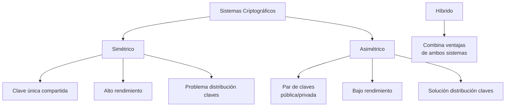
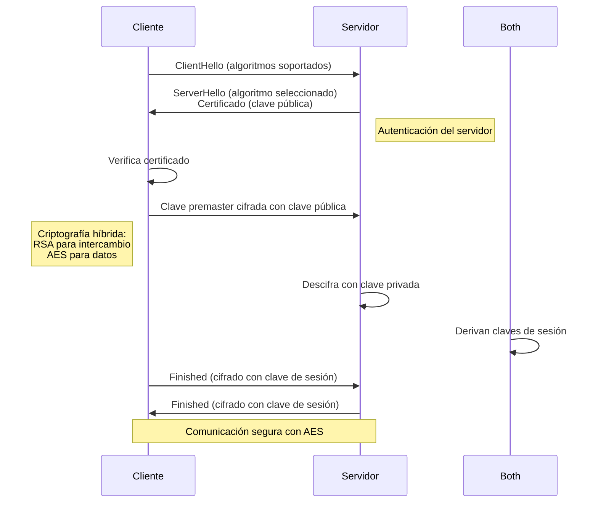
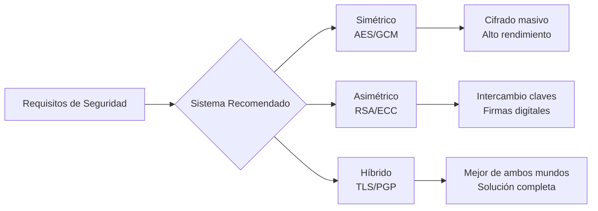

# Criptografía y Seguridad - Protocolos de seguridad en Internet

## 8.1 Análisis comparativo de sistemas simétricos y de llave pública.

---

### 1. Introducción

Los protocolos de seguridad en Internet implementan mecanismos criptográficos para garantizar confidencialidad, integridad, autenticación y no repudio. Dos familias fundamentales son: criptografía simétrica (o de clave secreta) y criptografía asimétrica (o de clave pública).

### 2. Definiciones Fundamentales

#### 2.1 Criptografía Simétrica

Sistema donde el mismo secreto (clave) se usa para cifrar y descifrar.

- **Función de cifrado:** $C = E(K, P)$ donde $C$ es el texto cifrado, $E$ la función de cifrado, $K$ la clave secreta y $P$ el texto plano.
- **Función de descifrado:** $P = D(K, C)$

#### 2.2 Criptografía Asimétrica

Sistema que utiliza un par de claves matemáticamente relacionadas: clave pública $(K_{pub})$ y clave privada $(K_{priv})$.

- **Cifrado con clave pública:** $C = E(K_{pub}, P)$
- **Descifrado con clave privada:** $P = D(K_{priv}, C)$
- **Firma digital (ejemplo con RSA):** $S = M^d \mod n$ donde $d$ es la clave privada
- **Verificación de firma:** $M = S^e \mod n$ donde $e$ es la clave pública

### 3. Características Comparativas

#### 3.1 Tabla de Comparación



#### 3.2 Comparación Detallada

| **Característica**        | **Criptografía Simétrica**    | **Criptografía Asimétrica**                  |
| ------------------------- | ----------------------------- | -------------------------------------------- |
| **Número de claves**      | 1 clave compartida            | Par de claves (pública/privada)              |
| **Velocidad**             | Alta (optimizado en hardware) | Lenta (100-1000 veces más lenta)             |
| **Longitud clave típica** | 128-256 bits                  | 2048-4096 bits (equivalente seguridad)       |
| **Uso principal**         | Cifrado de datos masivos      | Distribución de claves, firmas digitales     |
| **Problema clave**        | Distribución segura de claves | Confianza en autenticidad de claves públicas |
| **Ejemplos**              | AES, DES, 3DES, ChaCha20      | RSA, ECC, DSA, ElGamal                       |

### 4. Funciones y Fórmulas Matemáticas

#### 4.1 Medida de Seguridad: Entropía

La entropía de una clave mide su impredecibilidad:

$$H(K) = -\sum_{i=1}^{n} p_i \log_2 p_i$$

donde $p_i$ es la probabilidad de cada símbolo en la clave.

#### 4.2 Seguridad en RSA

Basado en la dificultad de factorización de números grandes:

- Clave pública: $(n, e)$ donde $n = p \times q$
- Clave privada: $(n, d)$
- Relación: $e \cdot d \equiv 1 \mod \phi(n)$ donde $\phi(n) = (p-1)(q-1)$

#### 4.3 DSA (Algoritmo de Firma Digital)

Para firma digital:

- **Generación de firma:**

  $$r = (g^k \mod p) \mod q$$

  $$s = (k^{-1}(H(m) + x \cdot r)) \mod q$$

- **Verificación:**

  $$w = s^{-1} \mod q$$

  $$u_1 = (H(m) \cdot w) \mod q$$

  $$u_2 = (r \cdot w) \mod q$$

  $$v = ((g^{u_1} \cdot y^{u_2}) \mod p) \mod q$$

### 5. Ejemplos Prácticos

#### 5.1 Cifrado Simétrico con AES (Python)

```python
from Crypto.Cipher import AES
from Crypto.Random import get_random_bytes
import base64

# Generación de clave
key = get_random_bytes(16)  # AES-128
cipher = AES.new(key, AES.MODE_GCM)

# Datos a cifrar
plaintext = b"Datos confidenciales del protocolo"

# Cifrado
ciphertext, tag = cipher.encrypt_and_digest(plaintext)

# Resultados
print(f"Clave: {base64.b64encode(key).decode()}")
print(f"Texto cifrado: {base64.b64encode(ciphertext).decode()}")
print(f"Tag de autenticación: {base64.b64encode(tag).decode()}")
```

#### 5.2 Cifrado Asimétrico con RSA

```python
from Crypto.PublicKey import RSA
from Crypto.Cipher import PKCS1_OAEP

# Generación de par de claves
key = RSA.generate(2048)
private_key = key.export_key()
public_key = key.publickey().export_key()

# Cifrado con clave pública
cipher_rsa = PKCS1_OAEP.new(RSA.import_key(public_key))
message = b"Mensaje secreto"
encrypted = cipher_rsa.encrypt(message)

# Descifrado con clave privada
cipher_rsa = PKCS1_OAEP.new(RSA.import_key(private_key))
decrypted = cipher_rsa.decrypt(encrypted)

print(f"Mensaje original: {message}")
print(f"Mensaje descifrado: {decrypted}")
```

### 6. Protocolos Híbridos

#### 6.1 SSL/TLS Handshake



#### 6.2 PGP (Pretty Good Privacy)

Combina:

1. Generación de clave de sesión aleatoria
2. Cifrado del mensaje con clave de sesión (AES/IDEA)
3. Cifrado de la clave de sesión con clave pública del destinatario
4. Firma digital con clave privada del remitente

### 7. Ejercicios Propuestos

#### Ejercicio 1: Análisis de Rendimiento

Calcule la diferencia de rendimiento entre sistemas simétricos y asimétricos:

- AES-128 procesa 1 GB en 2 segundos
- RSA-2048 cifra 256 bytes en 50 ms
- Calcule: ¿Cuántas veces es más rápido AES que RSA para cifrar 1 GB?

**Solución:**

$$
\text{Operaciones RSA necesarias} = \frac{1\, \text{GB}}{256\, \text{bytes}} = 4,194,304\, \text{operaciones}
$$

$$
\text{Tiempo RSA} = 4,194,304 \times 0.05\, \text{s} = 209,715.2\, \text{s}
$$

$$
\text{Ratio} = \frac{209,715.2\, \text{s}}{2\, \text{s}} = 104,857.6
$$

#### Ejercicio 2: Diseño de Protocolo Híbrido

Diseñe un protocolo que:

1. Use ECDH para intercambio de claves
2. Derive una clave AES-256-GCM
3. Implemente autenticación mutua
4. Incluya no repudio con firmas ECDSA

#### Ejercicio 3: Análisis de Seguridad

Compare la seguridad equivalente:

- AES-128 bits
- RSA-3072 bits
- ECC-256 bits
  Investigue: ¿Por qué estas longitudes se consideran equivalentes en seguridad?

### 8. Consideraciones Prácticas

#### 8.1 Ventajas Combinadas



#### 8.2 Recomendaciones de Implementación

1. **Para datos en tránsito (TLS/SSL):** Sistemas híbridos
2. **Para datos en reposo:** AES-256 con gestión adecuada de claves
3. **Para autenticación:** Certificados X.509 con RSA/ECC
4. **Para IoT/Dispositivos limitados:** ECC por menor consumo

### 9. Aplicaciones en Protocolos Internet

| **Protocolo** | **Sistema Simétrico** | **Sistema Asimétrico** | **Propósito**                   |
| ------------- | --------------------- | ---------------------- | ------------------------------- |
| **IPSec**     | AES, 3DES             | RSA, ECDH              | Seguridad a nivel de red        |
| **SSL/TLS**   | AES, ChaCha20         | RSA, ECDHE             | Seguridad a nivel de transporte |
| **SSH**       | AES, Blowfish         | RSA, DSA               | Acceso remoto seguro            |
| **S/MIME**    | AES, RC2              | RSA, ECC               | Correo seguro                   |

### 10. Referencias Bibliográficas

#### Básicas

1. **Stallings, W.** (2010). _Cryptography and Network Security: Principles and Practice_ (5a ed.). Prentice Hall.
   - Capítulo 2: Criptografía simétrica
   - Capítulo 9: Criptografía de clave pública
   - Capítulo 16: Seguridad en transporte

2. **Forouzan, B. A.** (2008). _Cryptography and Network Security_. McGraw Hill.
   - Capítulo 10: Criptografía simétrica
   - Capítulo 14: Criptografía asimétrica

3. **Pfleeger, C. P. y Pfleeger, S. L.** (2006). _Security in Computing_ (4a ed.). Prentice Hall.
   - Capítulo 3: Protección de programas
   - Capítulo 11: Criptografía en la práctica

#### Complementarias

4. **Stallings, W.** (2010). _Network Security Essentials: Applications and Standards_ (4a ed.). Prentice Hall.

5. **Ferguson, N., Schneier, B., y Kohno, T.** (2010). _Cryptography Engineering: Design Principles and Practical Applications_. Wiley.

6. **Menezes, A., van Oorschot, P., y Vanstone, S.** (1996). _Handbook of Applied Cryptography_. CRC Press.

7. **Schneier, B.** (1996). _Applied Cryptography: Protocols, Algorithms, and Source Code in C_ (2a ed.). Wiley.

### 11. Evaluación del Aprendizaje

#### Preguntas de Revisión

1. Explique por qué los sistemas simétricos son más rápidos que los asimétricos.
2. Describa el problema de distribución de claves y cómo lo resuelve la criptografía asimétrica.
3. ¿Por qué la mayoría de protocolos modernos usan sistemas híbridos?
4. Compare RSA y ECC en términos de longitud de clave y eficiencia computacional.
5. Explique cómo SSL/TLS utiliza ambos sistemas criptográficos.

#### Proyecto Final

Diseñe e implemente un sistema de mensajería segura que:

1. Use ECDH para establecer claves de sesión
2. Implemente cifrado con AES-256-GCM
3. Incluya firmas digitales para autenticación
4. Proporcione forward secrecy
5. Sea resistente a ataques MITM

### 12. Glosario

- **Confidencialidad:** Propiedad que asegura que la información solo es accesible a autorizados.
- **Integridad:** Garantía de que la información no ha sido alterada.
- **No repudio:** Imposibilidad de negar la autoría de una acción.
- **Forward Secrecy:** Propiedad que asegura que el compromiso de claves a largo plazo no compromete comunicaciones pasadas.
- **MITM (Man-in-the-Middle):** Ataque donde el atacante intercepta y posiblemente altera la comunicación.

_Esta guía proporciona una base comprehensiva para el análisis comparativo de sistemas simétricos y de llave pública en protocolos de seguridad en Internet. Se recomienda complementar con las prácticas de laboratorio y estudio de casos reales de implementación._
