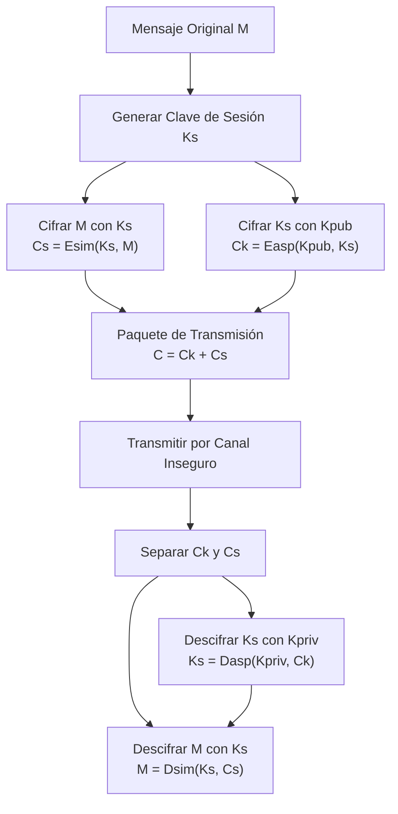
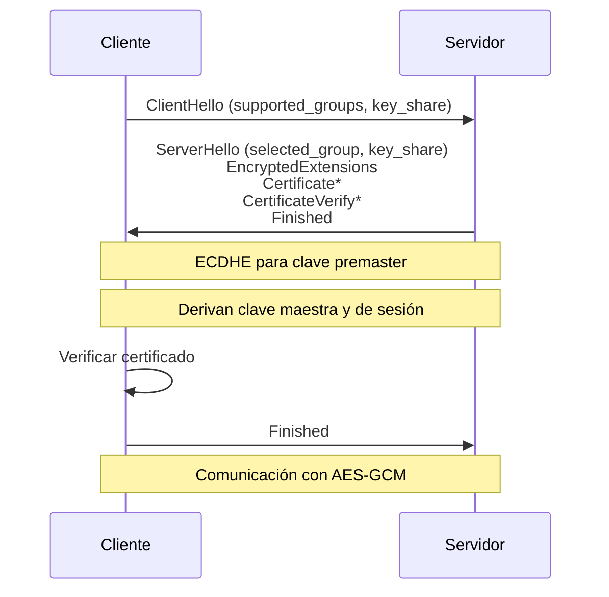
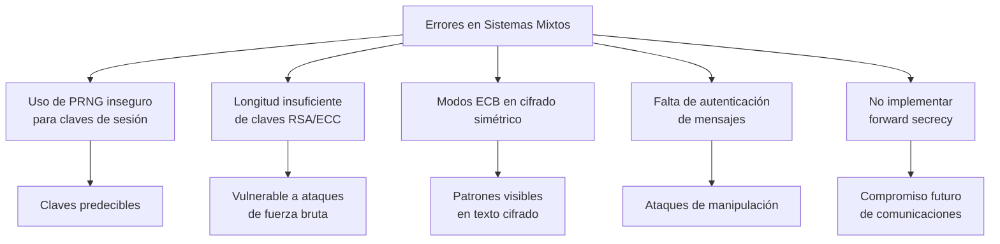

# Criptografía y Seguridad - Protocolos de seguridad en Internet

## 8.2 Sistemas criptográficos mixtos.

---

### 1. Introducción a los Sistemas Mixtos

Los sistemas criptográficos mixtos combinan las ventajas de la criptografía simétrica (eficiencia) y asimétrica (distribución segura de claves) para crear esquemas de seguridad robustos y eficientes.

**Definición:** Un sistema criptográfico mixto utiliza criptografía asimétrica para el intercambio seguro de claves y criptografía simétrica para el cifrado de datos masivos.

### 2. Fundamentos Teóricos

#### 2.1 Justificación Matemática

La necesidad de sistemas mixtos surge de las diferencias de rendimiento:

- **Velocidad simétrica:** $V_s \approx 1000 \times V_a$ donde $V_s$ es velocidad simétrica y $V_a$ velocidad asimétrica
- **Longitud de mensaje óptima:** Para un mensaje de tamaño $M$, el costo computacional total es:

$$
C_{total} = C_{asim}(K) + C_{sim}(M)
$$

donde:

- $C_{asim}(K)$: Costo de cifrar clave simétrica con criptografía asimétrica
- $C_{sim}(M)$: Costo de cifrar mensaje con criptografía simétrica

#### 2.2 Modelo General de Sistema Mixto



### 3. Estructura Básica de un Sistema Mixto

#### 3.1 Componentes Fundamentales

1. **Módulo de intercambio de claves:** Utiliza algoritmos asimétricos
2. **Módulo de cifrado de datos:** Utiliza algoritmos simétricos
3. **Gestor de claves de sesión:** Genera y maneja claves temporales

#### 3.2 Algoritmo Genérico

```
Entrada: Mensaje M, Clave pública del receptor Kpub
Salida: Mensaje cifrado C

1. Generar clave de sesión aleatoria Ks
2. Cifrar mensaje: Cs = AES-256-GCM(Ks, M)
3. Cifrar clave de sesión: Ck = RSA-OAEP(Kpub, Ks)
4. Formar paquete: C = Ck || Cs || Tag_autenticación
5. Retornar C
```

### 4. Implementación Práctica

#### 4.1 Ejemplo en Python usando RSA y AES

```python
from Crypto.PublicKey import RSA
from Crypto.Cipher import AES, PKCS1_OAEP
from Crypto.Random import get_random_bytes
import base64
import json

class SistemaMixto:
    def __init__(self, rsa_key_size=2048):
        """Inicializar sistema con par de claves RSA"""
        self.key = RSA.generate(rsa_key_size)
        self.private_key = self.key.export_key()
        self.public_key = self.key.publickey().export_key()

    def cifrar(self, mensaje, public_key_receptor=None):
        """
        Cifrar mensaje usando sistema mixto
        Args:
            mensaje: bytes a cifrar
            public_key_receptor: clave pública RSA del receptor
        Returns:
            Diccionario con componentes cifrados
        """
        # 1. Generar clave de sesión AES (256 bits)
        clave_sesion = get_random_bytes(32)  # AES-256

        # 2. Cifrar mensaje con AES-GCM
        cipher_aes = AES.new(clave_sesion, AES.MODE_GCM)
        ciphertext, tag = cipher_aes.encrypt_and_digest(mensaje)
        nonce = cipher_aes.nonce

        # 3. Cifrar clave de sesión con RSA
        if public_key_receptor is None:
            public_key_receptor = self.public_key

        rsa_key = RSA.import_key(public_key_receptor)
        cipher_rsa = PKCS1_OAEP.new(rsa_key)
        clave_sesion_cifrada = cipher_rsa.encrypt(clave_sesion)

        # 4. Empaquetar todo
        paquete = {
            'version': '1.0',
            'algoritmo_simetrico': 'AES-256-GCM',
            'algoritmo_asimetrico': 'RSA-OAEP',
            'clave_sesion_cifrada': base64.b64encode(clave_sesion_cifrada).decode(),
            'nonce': base64.b64encode(nonce).decode(),
            'ciphertext': base64.b64encode(ciphertext).decode(),
            'tag': base64.b64encode(tag).decode()
        }

        return json.dumps(paquete)

    def descifrar(self, paquete_cifrado):
        """
        Descifrar mensaje usando clave privada
        Args:
            paquete_cifrado: JSON con componentes cifrados
        Returns:
            Mensaje original
        """
        paquete = json.loads(paquete_cifrado)

        # 1. Descifrar clave de sesión con RSA
        clave_sesion_cifrada = base64.b64decode(paquete['clave_sesion_cifrada'])
        cipher_rsa = PKCS1_OAEP.new(self.key)
        clave_sesion = cipher_rsa.decrypt(clave_sesion_cifrada)

        # 2. Descifrar mensaje con AES-GCM
        nonce = base64.b64decode(paquete['nonce'])
        ciphertext = base64.b64decode(paquete['ciphertext'])
        tag = base64.b64decode(paquete['tag'])

        cipher_aes = AES.new(clave_sesion, AES.MODE_GCM, nonce=nonce)
        mensaje = cipher_aes.decrypt_and_verify(ciphertext, tag)

        return mensaje

# Ejemplo de uso
if __name__ == "__main__":
    # Crear instancias para Alice (remitente) y Bob (receptor)
    sistema_alice = SistemaMixto()
    sistema_bob = SistemaMixto()

    mensaje = b"Mensaje confidencial para Bob"
    print(f"Mensaje original: {mensaje.decode()}")

    # Alice cifra para Bob usando su clave pública
    paquete_cifrado = sistema_alice.cifrar(
        mensaje,
        sistema_bob.public_key
    )
    print(f"\nPaquete cifrado (primeros 200 chars):")
    print(paquete_cifrado[:200] + "...")

    # Bob descifra con su clave privada
    mensaje_descifrado = sistema_bob.descifrar(paquete_cifrado)
    print(f"\nMensaje descifrado: {mensaje_descifrado.decode()}")
```

#### 4.2 Ejemplo con ECC (Curvas Elípticas)

```python
from cryptography.hazmat.primitives.asymmetric import ec
from cryptography.hazmat.primitives import serialization
from cryptography.hazmat.primitives.kdf.hkdf import HKDF
from cryptography.hazmat.primitives import hashes
from cryptography.hazmat.primitives.ciphers.aead import AESGCM
import os

class SistemaMixtoECC:
    def __init__(self):
        self.private_key = ec.generate_private_key(ec.SECP384R1())
        self.public_key = self.private_key.public_key()

    def derivar_clave_aes(self, shared_secret, salt):
        """Derivar clave AES de 256 bits usando HKDF"""
        hkdf = HKDF(
            algorithm=hashes.SHA256(),
            length=32,  # 256 bits
            salt=salt,
            info=b'sistema-mixto-ecc'
        )
        return hkdf.derive(shared_secret)

    def cifrar_con_clave_publica(self, mensaje, public_key_receptor):
        # ECDH para derivar secreto compartido
        shared_secret = self.private_key.exchange(
            ec.ECDH(),
            public_key_receptor
        )

        # Derivar clave AES
        salt = os.urandom(16)
        clave_aes = self.derivar_clave_aes(shared_secret, salt)

        # Cifrar con AES-GCM
        nonce = os.urandom(12)
        aesgcm = AESGCM(clave_aes)
        ciphertext = aesgcm.encrypt(nonce, mensaje, None)

        return {
            'salt': salt.hex(),
            'nonce': nonce.hex(),
            'ciphertext': ciphertext.hex(),
            'public_key_emisor': self.public_key.public_bytes(
                encoding=serialization.Encoding.PEM,
                format=serialization.PublicFormat.SubjectPublicKeyInfo
            ).decode()
        }
```

### 5. Análisis de Seguridad

#### 5.1 Ventajas de Seguridad

1. **Forward Secrecy:** Si se implementa con ECDHE
2. **Confidencialidad:** Doble capa de cifrado
3. **Autenticación:** Posible mediante certificados digitales
4. **Integridad:** Mediante modos autenticados como GCM

#### 5.2 Consideraciones de Seguridad

- **Longitud de claves:**
  $$K_{segura} = \max(K_{sim}, K_{asim})$$
  donde la seguridad total depende del eslabón más débil

- **Ataques de canal lateral:** Ambos componentes son vulnerables
- **Gestión de claves:** Complejidad aumentada

### 6. Protocolos que Utilizan Sistemas Mixtos

#### 6.1 TLS 1.3 Handshake (Simplificado)



#### 6.2 PGP (Pretty Good Privacy)

Estructura de mensaje PGP:

```
+-------------------+-------------------+-------------------+
| Session Key Packet| Signature Packet | Encrypted Data    |
| (RSA/ElGamal)     | (Optional)       | Packet (AES/3DES) |
+-------------------+-------------------+-------------------+
```

### 7. Análisis de Rendimiento

#### 7.1 Modelo Matemático de Rendimiento

El tiempo total de cifrado/descifrado en sistema mixto:

$$
T_{total} = T_{genKs} + T_{cifKs}(L_K) + T_{cifM}(L_M)
$$

donde:

- $T_{genKs}$: Tiempo generar clave de sesión
- $T_{cifKs}(L_K)$: Tiempo cifrar clave de longitud $L_K$
- $T_{cifM}(L_M)$: Tiempo cifrar mensaje de longitud $L_M$

#### 7.2 Comparación Eficiencia

```python
import time
import matplotlib.pyplot as plt
import numpy as np

def simular_rendimiento(tamanos_mensaje):
    """Simular rendimiento de diferentes enfoques"""
    resultados = {
        'solo_rsa': [],
        'solo_aes': [],
        'mixto': []
    }

    # Tiempos base (ms)
    t_rsa_por_byte = 0.1  # ms por byte (muy ineficiente para grandes)
    t_aes_por_byte = 0.001  # ms por byte
    t_cifrar_clave_rsa = 5  # ms para cifrar clave AES

    for tamaño in tamanos_mensaje:
        # Solo RSA (impráctico, solo teórico)
        resultados['solo_rsa'].append(tamaño * t_rsa_por_byte)

        # Solo AES (sin intercambio seguro)
        resultados['solo_aes'].append(tamaño * t_aes_por_byte)

        # Sistema mixto
        resultados['mixto'].append(t_cifrar_clave_rsa + tamaño * t_aes_por_byte)

    return resultados

# Generar gráfico
tamanos = np.logspace(3, 7, 50)  # 1KB a 10MB
resultados = simular_rendimiento(tamanos)

plt.figure(figsize=(10, 6))
for metodo, tiempos in resultados.items():
    plt.plot(tamanos, tiempos, label=metodo, linewidth=2)

plt.xscale('log')
plt.yscale('log')
plt.xlabel('Tamaño del Mensaje (bytes)')
plt.ylabel('Tiempo de Cifrado (ms)')
plt.title('Comparación de Rendimiento: Sistemas Criptográficos')
plt.legend()
plt.grid(True, alpha=0.3)
plt.show()
```

### 8. Ejercicios Propuestos

#### Ejercicio 1: Análisis de Costo Computacional

Un sistema mixto utiliza RSA-2048 para intercambiar claves AES-256. Calcule:

1. Si RSA-2048 puede cifrar 245 bytes y tarda 10ms
2. Si AES-256 cifra a 100 MB/s
3. ¿Cuál es el tamaño mínimo de mensaje para que el sistema mixto sea más eficiente que usar solo RSA?

**Solución:**

$$
T_{RSA}(M) = \frac{M}{245} \times 10 \text{ ms}
$$

$$
T_{mixto}(M) = 10 \text{ ms} + \frac{M}{100 \times 10^6} \times 1000 \text{ ms}
$$

Igualando: $\frac{M}{245} \times 10 = 10 + \frac{M}{10^5}$

#### Ejercicio 2: Diseño de Protocolo

Diseñe un protocolo mixto que:

1. Use ECDH P-384 para intercambio de claves
2. Implemente AES-256-GCM para cifrado
3. Incluya autenticación con EdDSA
4. Proporcione forward secrecy
5. Sea resistente a ataques de replays

#### Ejercicio 3: Implementación Práctica

Implemente en Python un sistema mixto que:

- Use Curve25519 para ECDH
- ChaCha20-Poly1305 para cifrado simétrico
- Formato de paquete con versionado
- Gestión de errores robusta

### 9. Consideraciones de Implementación

#### 9.1 Mejores Prácticas

1. **Elección de algoritmos:**
   - Asimétrico: RSA-2048+ o ECC P-256+
   - Simétrico: AES-256-GCM o ChaCha20-Poly1305
   - Hash: SHA-256 o SHA-3

2. **Gestión de claves:**
   - Rotación regular de claves de sesión
   - Almacenamiento seguro de claves privadas
   - Revocación de certificados

3. **Consideraciones de rendimiento:**
   - Usar hardware acceleration (AES-NI)
   - Connection pooling para reducir handshakes
   - Caching de claves de sesión

#### 9.2 Errores Comunes a Evitar



### 10. Casos de Estudio

#### 10.1 Signal Protocol

- Combina X3DH (Extended Triple Diffie-Hellman) y Double Ratchet
- Forward secrecy y future secrecy
- Mensajería extremo a extremo

#### 10.2 WebRTC SRTP

- DTLS para handshake (mixto)
- SRTP para medios (simétrico)
- Claves derivadas de DTLS

### 11. Referencias Bibliográficas

#### Bibliografía Básica

1. **Stallings, William** (2010). _Cryptography and Network Security: Principles and Practice_, 5a Ed., Prentice Hall.
   - Capítulo 10: "Key Management and Distribution"
   - Capítulo 16: "Transport-Level Security"
   - Sección 9.1: "Principles of Public-Key Cryptosystems"

2. **Forouzan, Behrouz A.** (2008). _Cryptography and Network Security_, McGraw Hill.
   - Capítulo 10: "Symmetric-Key Cryptography"
   - Capítulo 31: "Transport-Layer Security: SSL and TLS"
   - Sección 15.2: "Hybrid Cryptosystems"

3. **Pfleeger, Charles P. y Shari L. Pfleeger** (2006). _Security in Computing_, 4a Ed., Prentice Hall.
   - Capítulo 2: "Toolbox: Authentication, Access Control, and Cryptography"
   - Capítulo 11: "Cryptography in Practice"

#### Bibliografía Complementaria

4. **Stallings, William** (2010). _Network Security Essentials: Applications and Standards_, 4a Ed., Prentice Hall.
   - Capítulo 4: "Key Distribution and User Authentication"
   - Capítulo 5: "Transport-Level Security"

5. **Ferguson, Niels, Bruce Schneier y Tadayoshi Kohno** (2010). _Cryptography Engineering: Design Principles and Practical Applications_, Wiley.
   - Capítulo 11: "Key Management"
   - Capítulo 14: "Implementation Issues"

6. **Menezes, Alfred, Paul van Oorschot y Scott Vanstone** (1996). _Handbook of Applied Cryptography_, CRC Press.
   - Capítulo 12: "Key Establishment Protocols"
   - Capítulo 13: "Key Management Techniques"

7. **Schneier, Bruce** (1996). _Applied Cryptography: Protocols, Algorithms, and Source Code in C_, 2a Ed., Wiley.
   - Capítulo 3: "Basic Protocols"
   - Capítulo 8: "Key Management"

### 12. Evaluación del Aprendizaje

#### Preguntas de Revisión

1. ¿Por qué los sistemas mixtos son el estándar en protocolos modernos?
2. Explique cómo TLS 1.3 implementa un sistema mixto.
3. Compare PGP y S/MIME en su uso de criptografía mixta.
4. ¿Qué ventajas ofrece ECDH sobre RSA en sistemas mixtos?
5. Describa cómo se logra forward secrecy en sistemas mixtos.

#### Proyecto Final

Implemente un sistema de transferencia segura de archivos que:

1. Use TLS-like handshake con sistema mixto
2. Implemente resumption sessions
3. Incluya autenticación mutua con certificados
4. Soporte archivos grandes (streaming cifrado)
5. Registre auditoría de operaciones

### 13. Glosario de Términos

- **Clave de sesión:** Clave simétrica temporal para una comunicación específica
- **Forward Secrecy:** Propiedad que protege sesiones pasadas si la clave privada es comprometida
- **ECDH:** Elliptic Curve Diffie-Hellman, algoritmo para acuerdo de claves
- **Nonce:** Número usado una vez, crucial en modos de cifrado como GCM
- **HKDF:** HMAC-based Key Derivation Function, para derivar claves criptográficas

_Esta guía proporciona una visión completa de los sistemas criptográficos mixtos, combinando fundamentos teóricos, implementación práctica y consideraciones de seguridad relevantes para protocolos de Internet modernos._
