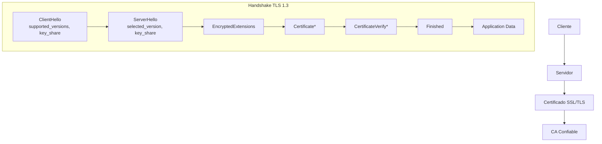
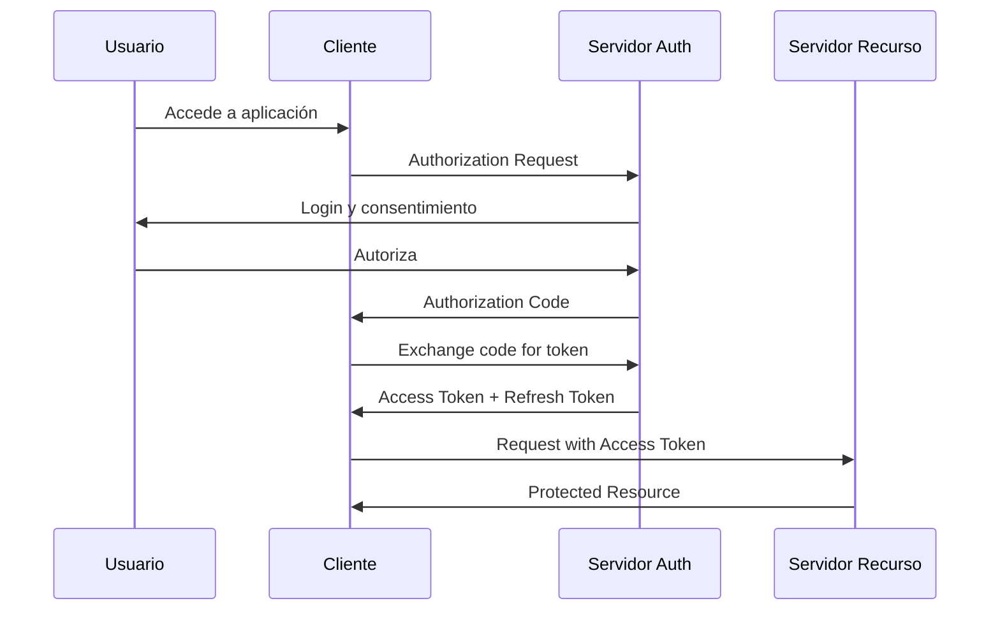
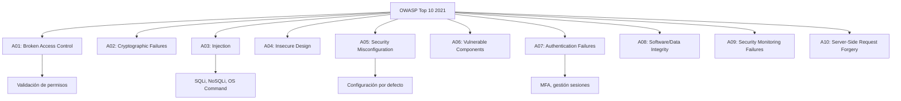

# Criptografía y Seguridad - Protocolos de seguridad en Internet

## 8.3 Seguridad en la web.

---

### 1. Introducción a la Seguridad Web

La seguridad en la web protege las comunicaciones, datos y usuarios en aplicaciones y servicios basados en HTTP/HTTPS. Involucra múltiples capas de protección desde el transporte hasta la aplicación.

### 2. Protocolos Fundamentales

#### 2.1 HTTPS (HTTP Secure)

HTTPS = HTTP + TLS/SSL, proporciona:

- **Confidencialidad:** Cifrado de datos en tránsito
- **Integridad:** Detección de modificación de datos
- **Autenticación:** Verificación de identidad del servidor

**Fórmula de Handshake TLS:**

$$ \text{Clave\_maestra} = \text{PRF}(\text{pre\_master\_secreto}, \text{"master secret"}, \text{ClientHello.random} + \text{ServerHello.random}) $$

#### 2.2 Arquitectura TLS 1.3



### 3. Certificados Digitales y PKI

#### 3.1 Estructura X.509

Certificado digital = {información sujeto + clave pública + firma CA}

**Firma del certificado:**

$$ \text{Firma} = E_{K_{priv-CA}}(H(\text{Datos\_certificado})) $$

**Verificación:**

$$ H(\text{Datos\_certificado}) \stackrel{?}{=} D_{ K_{ pub-CA } }( \text{Firma} ) $$

#### 3.2 Cadena de Confianza

```python
import ssl
import socket
from cryptography import x509
from cryptography.hazmat.backends import default_backend

def verificar_cadena_confianza(hostname, port=443):
    """Verificar cadena de certificados completa"""
    context = ssl.create_default_context()

    with socket.create_connection((hostname, port)) as sock:
        with context.wrap_socket(sock, server_hostname=hostname) as ssock:
            cert_bin = ssock.getpeercert(binary_form=True)
            cert = x509.load_der_x509_certificate(cert_bin, default_backend())

            # Verificar validez temporal
            from datetime import datetime
            ahora = datetime.utcnow()
            if ahora < cert.not_valid_before or ahora > cert.not_valid_after:
                raise ssl.CertificateError("Certificado expirado")

            # Obtener cadena completa
            cert_chain = ssock.getpeercertchain()
            print(f"Certificado sujeto: {cert.subject}")
            print(f"Certificado emisor: {cert.issuer}")
            print(f"Número de certificados en cadena: {len(cert_chain)}")

            return {
                'version': cert.version,
                'serial_number': cert.serial_number,
                'subject': dict(cert.subject),
                'issuer': dict(cert.issuer),
                'not_valid_before': cert.not_valid_before,
                'not_valid_after': cert.not_valid_after,
                'signature_algorithm': cert.signature_algorithm_oid._name
            }

# Ejemplo de uso
try:
    cert_info = verificar_cadena_confianza("www.google.com")
    print("Información del certificado:", cert_info)
except Exception as e:
    print(f"Error de verificación: {e}")
```

### 4. Mecanismos de Seguridad Web

#### 4.1 CORS (Cross-Origin Resource Sharing)

Política de seguridad del navegador que controla el acceso entre dominios.

**Política Same-Origin:**

$$ \text{Origen} = \text{protocolo} + \text{dominio} + \text{puerto} $$

**Encabezados CORS:**

```http
Access-Control-Allow-Origin: https://dominio-permitido.com
Access-Control-Allow-Methods: GET, POST, PUT
Access-Control-Allow-Headers: Content-Type, Authorization
Access-Control-Allow-Credentials: true
```

#### 4.2 CSP (Content Security Policy)

Protección contra XSS mediante listas blancas de recursos.

```http
Content-Security-Policy:
  default-src 'self';
  script-src 'self' https://apis.google.com;
  style-src 'self' 'unsafe-inline';
  img-src *;
  font-src 'self' https://fonts.gstatic.com;
  connect-src 'self' https://api.midominio.com;
  frame-ancestors 'none';
  report-uri /csp-violation-report-endpoint/
```

#### 4.3 Headers de Seguridad Esenciales

```python
from flask import Flask, Response

app = Flask(__name__)

@app.after_request
def agregar_headers_seguridad(response):
    """Agregar headers de seguridad HTTP"""
    headers_seguridad = {
        'Strict-Transport-Security': 'max-age=31536000; includeSubDomains',
        'X-Content-Type-Options': 'nosniff',
        'X-Frame-Options': 'DENY',
        'X-XSS-Protection': '1; mode=block',
        'Referrer-Policy': 'strict-origin-when-cross-origin',
        'Permissions-Policy': 'geolocation=(), microphone=(), camera=()',
        'Content-Security-Policy': "default-src 'self'; script-src 'self'"
    }

    for header, valor in headers_seguridad.items():
        response.headers[header] = valor

    return response

@app.route('/api/datos')
def obtener_datos():
    return {'mensaje': 'Datos seguros'}

if __name__ == '__main__':
    app.run(ssl_context='adhoc')
```

### 5. Autenticación y Autorización Web

#### 5.1 OAuth 2.0 Flow



#### 5.2 JWT (JSON Web Tokens)

Estructura: Header.Payload.Signature

**Firma JWT (HMAC SHA256):**

$$ \text{Signature} = \text{HMAC}_{SHA256}(\text{base64UrlEncode(header)} + "." + \text{base64UrlEncode(payload)}, \text{secret}) $$

**Verificación:**

```python
import jwt
import datetime
from cryptography.hazmat.primitives import serialization
from cryptography.hazmat.primitives.asymmetric import rsa

class JWTHandler:
    def __init__(self):
        self.secret_key = "clave-secreta-super-segura"
        self.algorithm = "HS256"

    def generar_token(self, user_id, roles, expires_hours=24):
        """Generar JWT token"""
        payload = {
            'sub': user_id,
            'roles': roles,
            'iat': datetime.datetime.utcnow(),
            'exp': datetime.datetime.utcnow() + datetime.timedelta(hours=expires_hours),
            'iss': 'mi-aplicacion-segura'
        }

        token = jwt.encode(payload, self.secret_key, algorithm=self.algorithm)
        return token

    def verificar_token(self, token):
        """Verificar y decodificar JWT"""
        try:
            payload = jwt.decode(
                token,
                self.secret_key,
                algorithms=[self.algorithm],
                options={'verify_exp': True}
            )
            return payload
        except jwt.ExpiredSignatureError:
            raise Exception("Token expirado")
        except jwt.InvalidTokenError:
            raise Exception("Token inválido")

# Ejemplo RSA para JWT
def generar_par_claves_rsa():
    """Generar par de claves RSA para JWT asimétrico"""
    private_key = rsa.generate_private_key(
        public_exponent=65537,
        key_size=2048
    )
    public_key = private_key.public_key()

    # Serializar
    private_pem = private_key.private_bytes(
        encoding=serialization.Encoding.PEM,
        format=serialization.PrivateFormat.PKCS8,
        encryption_algorithm=serialization.NoEncryption()
    )

    public_pem = public_key.public_bytes(
        encoding=serialization.Encoding.PEM,
        format=serialization.PublicFormat.SubjectPublicKeyInfo
    )

    return private_pem, public_pem
```

### 6. Protección contra Ataques Web Comunes

#### 6.1 SQL Injection Prevention

```python
import sqlite3
from typing import List, Tuple

class DatabaseManager:
    def __init__(self, db_path):
        self.conn = sqlite3.connect(db_path)
        self.conn.execute("PRAGMA foreign_keys = ON")

    def consulta_segura(self, usuario: str) -> List[Tuple]:
        """Consulta segura usando parámetros"""
        query = "SELECT * FROM usuarios WHERE username = ?"
        cursor = self.conn.execute(query, (usuario,))
        return cursor.fetchall()

    def consulta_vulnerable(self, usuario: str) -> List[Tuple]:
        """Consulta VULNERABLE a SQL Injection"""
        query = f"SELECT * FROM usuarios WHERE username = '{usuario}'"
        cursor = self.conn.execute(query)  # ¡PELIGRO!
        return cursor.fetchall()

    def stored_procedure_segura(self, user_id: int, datos: dict):
        """Usar procedimientos almacenados"""
        cursor = self.conn.cursor()
        cursor.execute(
            "EXEC sp_actualizar_usuario @user_id=?, @nombre=?",
            (user_id, datos['nombre'])
        )
        self.conn.commit()
```

#### 6.2 XSS (Cross-Site Scripting) Protection

```python
import html
import bleach
from markdown import markdown

class XSSProtector:
    @staticmethod
    def sanitizar_html(input_html: str) -> str:
        """Sanitizar HTML usando whitelist"""
        # Lista blanca de tags y atributos permitidos
        allowed_tags = ['p', 'b', 'i', 'em', 'strong', 'a', 'br']
        allowed_attrs = {
            'a': ['href', 'title', 'rel']
        }

        # Limpiar HTML
        cleaned = bleach.clean(
            input_html,
            tags=allowed_tags,
            attributes=allowed_attrs,
            strip=True
        )

        # Escapar contenido no permitido
        return bleach.linkify(cleaned)

    @staticmethod
    def procesar_markdown_seguro(markdown_text: str) -> str:
        """Procesar markdown de forma segura"""
        # Convertir markdown a HTML
        html_output = markdown(markdown_text)

        # Sanitizar
        return XSSProtector.sanitizar_html(html_output)

    @staticmethod
    def validar_y_escapar(input_text: str, max_length: int = 1000) -> str:
        """Validar y escapar entrada de usuario"""
        if len(input_text) > max_length:
            raise ValueError(f"Input excede {max_length} caracteres")

        # Escapar caracteres HTML
        return html.escape(input_text)

# Ejemplo de uso
protector = XSSProtector()
entrada_usuario = '<script>alert("XSS")</script><p>Texto seguro</p>'
seguro = protector.sanitizar_html(entrada_usuario)
print(f"Entrada original: {entrada_usuario}")
print(f"Entrada segura: {seguro}")
```

#### 6.3 CSRF Protection

```python
from flask import Flask, request, session, render_template_string
import secrets
import hashlib
import time

app = Flask(__name__)
app.secret_key = secrets.token_hex(32)

class CSRFTokenManager:
    @staticmethod
    def generar_token() -> str:
        """Generar token CSRF único"""
        token = secrets.token_hex(32)
        timestamp = str(int(time.time()))

        # Crear token con timestamp
        token_data = f"{token}:{timestamp}"
        return token_data

    @staticmethod
    def validar_token(token_cliente: str, token_servidor: str) -> bool:
        """Validar token CSRF"""
        if not token_cliente or not token_servidor:
            return False

        # Separar token y timestamp
        try:
            cliente_token, cliente_time = token_cliente.split(":")
            servidor_token, servidor_time = token_servidor.split(":")
        except ValueError:
            return False

        # Verificar tokens
        if cliente_token != servidor_token:
            return False

        # Verificar expiración (10 minutos)
        tiempo_actual = int(time.time())
        tiempo_token = int(cliente_time)

        if tiempo_actual - tiempo_token > 600:  # 10 minutos
            return False

        return True

@app.route('/formulario')
def mostrar_formulario():
    """Mostrar formulario con token CSRF"""
    csrf_token = CSRFTokenManager.generar_token()
    session['csrf_token'] = csrf_token

    form_html = """
    <form action="/procesar" method="POST">
        <input type="hidden" name="csrf_token" value="{{ csrf_token }}">
        <input type="text" name="dato" placeholder="Ingrese dato">
        <button type="submit">Enviar</button>
    </form>
    """

    return render_template_string(form_html, csrf_token=csrf_token)

@app.route('/procesar', methods=['POST'])
def procesar_formulario():
    """Procesar formulario con validación CSRF"""
    csrf_cliente = request.form.get('csrf_token')
    csrf_servidor = session.get('csrf_token')

    if not CSRFTokenManager.validar_token(csrf_cliente, csrf_servidor):
        return "Error CSRF: Token inválido o expirado", 403

    # Procesar datos seguramente
    dato = request.form.get('dato')
    return f"Datos procesados: {dato}"
```

### 7. Modelo de Amenazas Web

#### 7.1 OWASP Top 10 2021



### 8. Auditoría y Monitoreo de Seguridad

#### 8.1 Logs de Seguridad

```python
import logging
import json
from datetime import datetime
from typing import Dict, Any

class SecurityLogger:
    def __init__(self):
        # Configurar logger
        self.logger = logging.getLogger('security')
        self.logger.setLevel(logging.INFO)

        # Handler para archivo
        file_handler = logging.FileHandler('security_audit.log')
        file_handler.setFormatter(
            logging.Formatter('%(asctime)s - %(levelname)s - %(message)s')
        )
        self.logger.addHandler(file_handler)

    def log_event(self, event_type: str, details: Dict[str, Any], user_id: str = None):
        """Registrar evento de seguridad"""
        log_entry = {
            'timestamp': datetime.utcnow().isoformat(),
            'event_type': event_type,
            'user_id': user_id,
            'ip_address': self._get_client_ip(),
            'user_agent': request.headers.get('User-Agent'),
            'details': details,
            'severity': self._determine_severity(event_type)
        }

        self.logger.info(json.dumps(log_entry))

        # Alertar para eventos críticos
        if log_entry['severity'] == 'CRITICAL':
            self._send_alert(log_entry)

    def _determine_severity(self, event_type: str) -> str:
        """Determinar severidad del evento"""
        critical_events = {'failed_login_attempts', 'sql_injection_attempt', 'csrf_attack'}
        high_events = {'access_denied', 'xss_attempt', 'file_upload_attempt'}

        if event_type in critical_events:
            return 'CRITICAL'
        elif event_type in high_events:
            return 'HIGH'
        else:
            return 'MEDIUM'

    def _get_client_ip(self):
        """Obtener IP del cliente"""
        if request.headers.get('X-Forwarded-For'):
            return request.headers.get('X-Forwarded-For').split(',')[0]
        return request.remote_addr

    def _send_alert(self, log_entry: Dict):
        """Enviar alerta de seguridad"""
        # Implementar notificación (email, Slack, etc.)
        print(f"ALERTA DE SEGURIDAD: {log_entry}")
```

### 9. Ejercicios Propuestos

#### Ejercicio 1: Análisis de Certificado TLS

1. Conecte a `https://www.ejemplo.com`
2. Extraiga el certificado SSL/TLS
3. Analice:
   - Algoritmo de firma
   - Validez temporal
   - Cadena de confianza
   - Extensiones (SAN, Key Usage)
4. Verifique si cumple con las mejores prácticas

#### Ejercicio 2: Implementación de CSP

Diseñe e implemente una política CSP para una aplicación que:

- Carga scripts desde CDN de jQuery y Bootstrap
- Incluye iframes de YouTube
- Usa Google Fonts
- Tiene un endpoint de API propio
- Debe prevenir XSS y clickjacking

#### Ejercicio 3: Auditoría de Seguridad

Realice una auditoría básica de una aplicación web:

1. Escanee headers de seguridad
2. Pruebe vulnerabilidades comunes (usando herramientas como `sqlmap` o `nikto` en ambiente controlado)
3. Analice cookies (HttpOnly, Secure, SameSite)
4. Verifique configuración TLS

**Ejemplo de cálculo de puntuación de seguridad:**

$$
\text{Puntuación} = \frac{\sum_{i=1}^{n} w_i \cdot s_i}{\sum_{i=1}^{n} w_i}
$$

donde $w_i$ es el peso de cada control y $s_i$ su puntuación (0-1).

### 10. Herramientas de Seguridad Web

#### 10.1 Herramientas de Análisis

```python
import subprocess
import requests
from bs4 import BeautifulSoup
import ssl
import socket

class SecurityScanner:
    @staticmethod
    def verificar_headers(url: str):
        """Verificar headers de seguridad"""
        try:
            response = requests.get(url, timeout=10)
            headers = response.headers

            checks = {
                'Strict-Transport-Security': 'HSTS configurado',
                'X-Content-Type-Options': 'nosniff presente',
                'X-Frame-Options': 'Protección clickjacking',
                'Content-Security-Policy': 'CSP implementado',
                'X-XSS-Protection': 'Protección XSS'
            }

            resultados = {}
            for header, descripcion in checks.items():
                if header in headers:
                    resultados[header] = {'presente': True, 'valor': headers[header]}
                else:
                    resultados[header] = {'presente': False, 'valor': None}

            return resultados
        except Exception as e:
            return {'error': str(e)}

    @staticmethod
    def analizar_tls(hostname: str, port: int = 443):
        """Analizar configuración TLS"""
        context = ssl.create_default_context()

        with socket.create_connection((hostname, port)) as sock:
            with context.wrap_socket(sock, server_hostname=hostname) as ssock:
                cipher = ssock.cipher()
                cert = ssock.getpeercert()
                tls_version = ssock.version()

                return {
                    'tls_version': tls_version,
                    'cipher_suite': cipher[0],
                    'cipher_bits': cipher[2],
                    'certificate_issuer': dict(cert['issuer']),
                    'certificate_subject': dict(cert['subject']),
                    'certificate_expiry': cert['notAfter']
                }

    @staticmethod
    def escanear_xss(url: str):
        """Escaneo básico de XSS"""
        response = requests.get(url)
        soup = BeautifulSoup(response.text, 'html.parser')

        vulnerabilidades = []

        # Buscar formularios sin tokens CSRF
        forms = soup.find_all('form')
        for form in forms:
            inputs = form.find_all('input', {'type': 'hidden', 'name': 'csrf_token'})
            if not inputs:
                vulnerabilidades.append({
                    'tipo': 'CSRF',
                    'elemento': str(form)[:100],
                    'gravedad': 'Alta'
                })

        # Buscar scripts inline
        scripts = soup.find_all('script')
        for script in scripts:
            if not script.get('src'):
                vulnerabilidades.append({
                    'tipo': 'Script Inline',
                    'elemento': str(script)[:100],
                    'gravedad': 'Media'
                })

        return vulnerabilidades
```

### 11. Referencias Bibliográficas

#### Bibliografía Básica

1. **Stallings, William** (2010). _Cryptography and Network Security: Principles and Practice_, 5a Ed., Prentice Hall.
   - Capítulo 16: "Transport-Level Security" (SSL/TLS)
   - Capítulo 17: "Wireless Network Security"
   - Apéndice L: "Web Security"

2. **Forouzan, Behrouz A.** (2008). _Cryptography and Network Security_, McGraw Hill.
   - Capítulo 31: "Transport-Layer Security: SSL and TLS"
   - Capítulo 32: "Application-Layer Security: PGP and S/MIME"
   - Sección 15.4: "Web Security"

3. **Pfleeger, Charles P. y Shari L. Pfleeger** (2006). _Security in Computing_, 4a Ed., Prentice Hall.
   - Capítulo 6: "Security in Networks"
   - Capítulo 7: "Security in the Internet"

#### Bibliografía Complementaria

4. **Stallings, William** (2010). _Network Security Essentials: Applications and Standards_, 4a Ed., Prentice Hall.
   - Capítulo 5: "Transport-Level Security"
   - Capítulo 6: "Wireless Network Security"
   - Capítulo 7: "Electronic Mail Security"

5. **Ferguson, Niels, Bruce Schneier y Tadayoshi Kohno** (2010). _Cryptography Engineering: Design Principles and Practical Applications_, Wiley.
   - Capítulo 21: "SSL/TLS"
   - Capítulo 22: "SSH"

6. **OWASP Foundation** (2021). _OWASP Top 10 2021_
   - Disponible en: https://owasp.org/www-project-top-ten/

7. **Mozilla Developer Network** (2023). _Web Security Guidelines_
   - Disponible en: https://developer.mozilla.org/en-US/docs/Web/Security

### 12. Evaluación del Aprendizaje

#### Preguntas de Revisión

1. Explique el proceso completo de handshake TLS 1.3
2. Describa la diferencia entre autenticación y autorización en contexto web
3. ¿Cómo previene CSP los ataques XSS?
4. Explique el flujo de OAuth 2.0 Authorization Code Grant
5. Liste 5 headers de seguridad HTTP y su propósito

#### Proyecto Final

Implemente una aplicación web segura que incluya:

1. HTTPS con certificado válido
2. Autenticación con JWT y refresh tokens
3. Protección contra OWASP Top 10
4. Headers de seguridad configurados
5. Sistema de logging de seguridad
6. Auditoría automática de vulnerabilidades

### 13. Glosario de Términos

- **TLS/SSL:** Protocolos de seguridad para comunicaciones en red
- **CSP:** Content Security Policy, política de seguridad para recursos web
- **JWT:** JSON Web Token, estándar para tokens de acceso
- **CORS:** Cross-Origin Resource Sharing, mecanismo de control de acceso
- **PKI:** Public Key Infrastructure, infraestructura de clave pública
- **XSS:** Cross-Site Scripting, vulnerabilidad de inyección de scripts
- **CSRF:** Cross-Site Request Forgery, falsificación de petición en sitios cruzados
- **HSTS:** HTTP Strict Transport Security, política de seguridad para forzar HTTPS
- **SRI:** Subresource Integrity, verificación de integridad de recursos externos
