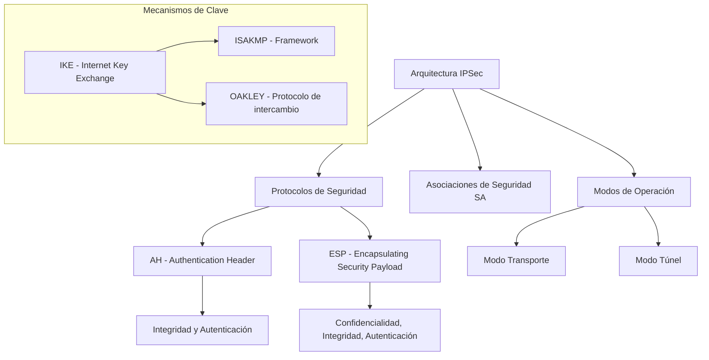
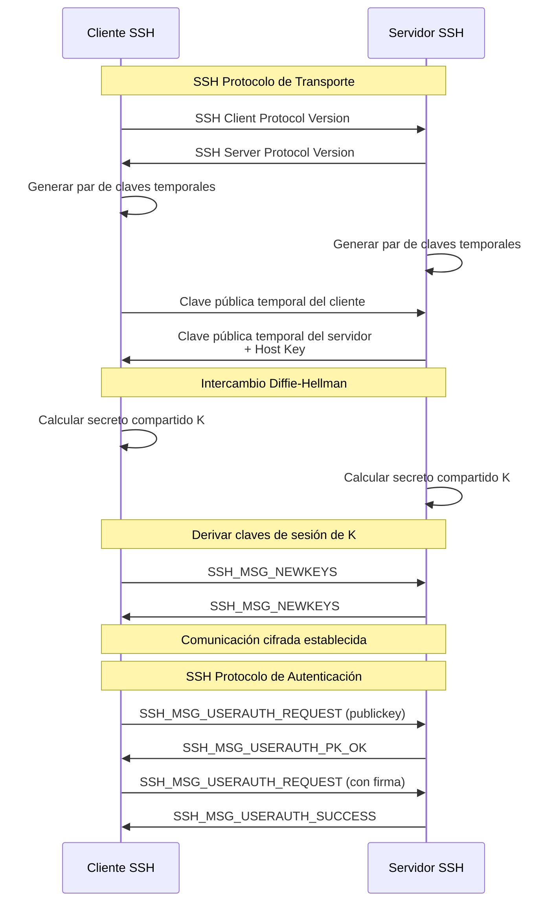
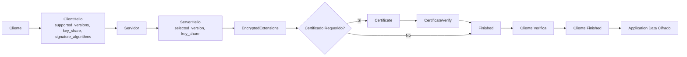
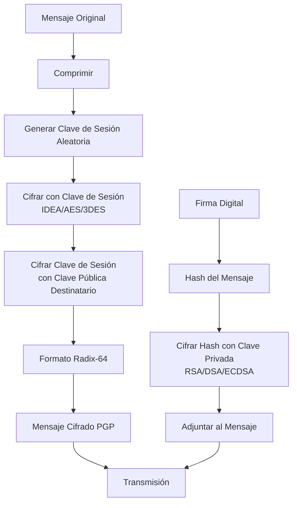
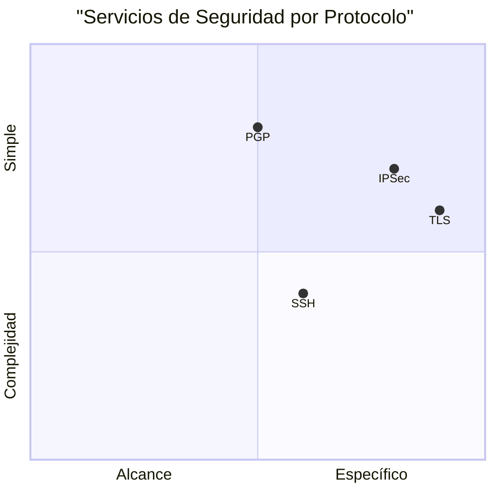

# Criptografía y Seguridad - Protocolos de seguridad en Internet

## 8.4 Protocolos de seguridad: IPSec, secure shell, TLS, PGP.

---

### 1. Introducción a los Protocolos de Seguridad

Los protocolos de seguridad implementan mecanismos criptográficos para proteger diferentes capas de la pila de red OSI, ofreciendo servicios como confidencialidad, integridad, autenticación y no repudio.

**Clasificación por capa OSI:**

- **Capa de Red:** IPSec
- **Capa de Transporte:** TLS
- **Capa de Aplicación:** SSH, PGP

### 2. IPSec (Internet Protocol Security)

#### 2.1 Arquitectura IPSec

IPSec opera en la capa de red y proporciona seguridad extremo a extremo.



#### 2.2 Estructura de Paquetes IPSec

**Formato ESP (Encapsulating Security Payload):**

```
 0                   1                   2                   3
 0 1 2 3 4 5 6 7 8 9 0 1 2 3 4 5 6 7 8 9 0 1 2 3 4 5 6 7 8 9 0 1
+-+-+-+-+-+-+-+-+-+-+-+-+-+-+-+-+-+-+-+-+-+-+-+-+-+-+-+-+-+-+-+-+
|               Security Parameters Index (SPI)                 |
+-+-+-+-+-+-+-+-+-+-+-+-+-+-+-+-+-+-+-+-+-+-+-+-+-+-+-+-+-+-+-+-+
|                      Sequence Number                          |
+-+-+-+-+-+-+-+-+-+-+-+-+-+-+-+-+-+-+-+-+-+-+-+-+-+-+-+-+-+-+-+-+
|                    Payload Data (variable)                    |
~                                                               ~
+-+-+-+-+-+-+-+-+-+-+-+-+-+-+-+-+-+-+-+-+-+-+-+-+-+-+-+-+-+-+-+-+
|         Padding (0-255 bytes)         |  Pad Len  | Next Hdr |
+-+-+-+-+-+-+-+-+-+-+-+-+-+-+-+-+-+-+-+-+-+-+-+-+-+-+-+-+-+-+-+-+
|                Authentication Data (variable)                 |
+-+-+-+-+-+-+-+-+-+-+-+-+-+-+-+-+-+-+-+-+-+-+-+-+-+-+-+-+-+-+-+-+
```

**Cálculo de ICV (Integrity Check Value) en AH:**

$$ ICV = HMAC(K, \text{datos\\\_inmutables}) $$

#### 2.3 IKE (Internet Key Exchange) - Fase 1

Intercambio Diffie-Hellman para establecer SA:

1. **Main Mode (6 mensajes):**

   $$ g^X \mod p \rightarrow \text{Intercambio de claves} $$

   $$ K = (g^{XY} \mod p) $$

2. **Quick Mode (Fase 2):** Establece SAs para datos

```python
# Ejemplo simplificado de cálculo Diffie-Hellman para IKE
import random
from cryptography.hazmat.primitives import hashes
from cryptography.hazmat.primitives.asymmetric import dh
from cryptography.hazmat.primitives.kdf.hkdf import HKDF

def ike_phase1_dh():
    """Simulación IKE Fase 1 con Diffie-Hellman"""
    # Parámetros Diffie-Hellman (grupo 14 - 2048 bits)
    parameters = dh.generate_parameters(generator=2, key_size=2048)

    # Generar claves para iniciador y respondedor
    private_key_initiator = parameters.generate_private_key()
    public_key_initiator = private_key_initiator.public_key()

    private_key_responder = parameters.generate_private_key()
    public_key_responder = private_key_responder.public_key()

    # Calcular secreto compartido
    shared_secret_initiator = private_key_initiator.exchange(public_key_responder)
    shared_secret_responder = private_key_responder.exchange(public_key_initiator)

    # Verificar que coinciden
    assert shared_secret_initiator == shared_secret_responder

    # Derivar claves usando HKDF
    derived_key = HKDF(
        algorithm=hashes.SHA256(),
        length=32,
        salt=None,
        info=b'ike-key-derivation'
    ).derive(shared_secret_initiator)

    return {
        'shared_secret': shared_secret_initiator.hex()[:50] + "...",
        'derived_key': derived_key.hex(),
        'key_length': len(derived_key) * 8
    }

# Ejecutar ejemplo
ike_result = ike_phase1_dh()
print("Resultado IKE Fase 1:", ike_result)
```

### 3. SSH (Secure Shell)

#### 3.1 Arquitectura SSH

SSH tiene tres componentes principales:

1. **Protocolo de Transporte:** Autenticación del servidor, cifrado, compresión
2. **Protocolo de Autenticación de Usuario:** Autenticación del cliente
3. **Protocolo de Conexión:** Gestión de canales multiplexados



#### 3.2 Algoritmo de Intercambio de Claves SSH

El secreto compartido se calcula como:

$$ K = f(\text{hash}(V_C || V_S || I_C || I_S || K_S || e || n || K)) $$

Donde:

- $V_C, V_S$: Strings de identificación
- $I_C, I_S$: Paquetes iniciales de intercambio
- $K_S$: Clave pública del servidor
- $e, n$: Parámetros Diffie-Hellman
- $K$: Secreto compartido Diffie-Hellman

#### 3.3 Ejemplo de Conexión SSH con Paramiko

```python
import paramiko
import getpass
from cryptography.hazmat.primitives import serialization
from cryptography.hazmat.primitives.asymmetric import rsa
import base64

class SSHManager:
    def __init__(self):
        self.client = paramiko.SSHClient()
        self.client.set_missing_host_key_policy(paramiko.AutoAddPolicy())

    def generar_claves_ssh(self, bits=2048):
        """Generar par de claves RSA para SSH"""
        private_key = rsa.generate_private_key(
            public_exponent=65537,
            key_size=bits
        )

        # Exportar clave privada en formato OpenSSH
        private_pem = private_key.private_bytes(
            encoding=serialization.Encoding.PEM,
            format=serialization.PrivateFormat.PKCS8,
            encryption_algorithm=serialization.NoEncryption()
        )

        # Exportar clave pública en formato OpenSSH
        public_key = private_key.public_key()
        public_openssh = public_key.public_bytes(
            encoding=serialization.Encoding.OpenSSH,
            format=serialization.PublicFormat.OpenSSH
        )

        # Generar fingerprint
        fingerprint = hashlib.md5(public_openssh).hexdigest()
        fingerprint_formatted = ':'.join(
            fingerprint[i:i+2] for i in range(0, len(fingerprint), 2)
        )

        return {
            'private_key': private_pem.decode(),
            'public_key': public_openssh.decode(),
            'fingerprint': fingerprint_formatted
        }

    def conectar_con_password(self, hostname, username, port=22):
        """Conexión SSH con autenticación por password"""
        password = getpass.getpass(f"Password para {username}@{hostname}: ")

        try:
            self.client.connect(
                hostname=hostname,
                username=username,
                password=password,
                port=port,
                timeout=10
            )

            # Obtener información de la conexión
            transport = self.client.get_transport()
            if transport:
                print(f"Conexión establecida a {hostname}")
                print(f"Algoritmo de cifrado: {transport.get_cipher()}")
                print(f"Algoritmo MAC: {transport.get_mac()}")
                print(f"Algoritmo de compresión: {transport.get_compression()}")

            return True
        except Exception as e:
            print(f"Error de conexión: {e}")
            return False

    def ejecutar_comando(self, comando):
        """Ejecutar comando remoto"""
        stdin, stdout, stderr = self.client.exec_command(comando)
        salida = stdout.read().decode()
        error = stderr.read().decode()

        return {
            'salida': salida,
            'error': error,
            'codigo_salida': stdout.channel.recv_exit_status()
        }

    def cerrar(self):
        """Cerrar conexión SSH"""
        self.client.close()

# Ejemplo de uso
if __name__ == "__main__":
    ssh = SSHManager()

    # Generar claves
    claves = ssh.generar_claves_ssh()
    print("Clave pública generada:")
    print(claves['public_key'])
    print(f"Fingerprint: {claves['fingerprint']}")

    # Conectar (ejemplo - requiere servidor real)
    # if ssh.conectar_con_password("ejemplo.com", "usuario"):
    #     resultado = ssh.ejecutar_comando("ls -la")
    #     print("Resultado del comando:", resultado['salida'])
    #     ssh.cerrar()
```

### 4. TLS (Transport Layer Security)

#### 4.1 Evolución y Versiones

$$ \text{SSL 1.0} \rightarrow \text{SSL 2.0} \rightarrow \text{SSL 3.0} \rightarrow \text{TLS 1.0} \rightarrow \text{TLS 1.1} \rightarrow \text{TLS 1.2} \rightarrow \text{TLS 1.3} $$

#### 4.2 Handshake TLS 1.3 Simplificado



#### 4.3 Cálculo de Claves en TLS 1.3

El secreto maestro se calcula como:

$$ \text{Master Secret} = \text{HKDF-Extract}(\text{salt}, \text{Shared Secret}) $$

Derivación de claves:

$$ \text{client\\\_key} = \text{HKDF-Expand-Label}(\text{Master Secret}, \text{"client key"}, "", \text{length}) $$

$$ \text{server\\\_key} = \text{HKDF-Expand-Label}(\text{Master Secret}, \text{"server key"}, "", \text{length}) $$

#### 4.4 Implementación de Cliente TLS en Python

```python
import ssl
import socket
import hashlib
from cryptography import x509
from cryptography.hazmat.backends import default_backend
from cryptography.hazmat.primitives import hashes
from cryptography.hazmat.primitives.asymmetric import padding, rsa

class TLSClient:
    def __init__(self, hostname, port=443):
        self.hostname = hostname
        self.port = port
        self.context = ssl.create_default_context()
        self.context.check_hostname = True
        self.context.verify_mode = ssl.CERT_REQUIRED

    def establecer_conexion(self):
        """Establecer conexión TLS y analizar parámetros"""
        with socket.create_connection((self.hostname, self.port)) as sock:
            with self.context.wrap_socket(sock, server_hostname=self.hostname) as ssock:
                # Obtener información de la conexión
                tls_version = ssock.version()
                cipher = ssock.cipher()

                # Obtener certificado
                cert_bin = ssock.getpeercert(binary_form=True)
                cert = x509.load_der_x509_certificate(cert_bin, default_backend())

                # Calcular fingerprint
                fingerprint = hashlib.sha256(cert_bin).hexdigest()

                # Verificar validez
                from datetime import datetime
                ahora = datetime.utcnow()
                valido = cert.not_valid_before <= ahora <= cert.not_valid_after

                return {
                    'tls_version': tls_version,
                    'cipher_suite': cipher[0],
                    'cipher_bits': cipher[2],
                    'certificate': {
                        'subject': dict(cert.subject),
                        'issuer': dict(cert.issuer),
                        'serial_number': cert.serial_number,
                        'valid_from': cert.not_valid_before,
                        'valid_to': cert.not_valid_after,
                        'signature_algorithm': cert.signature_algorithm_oid._name,
                        'fingerprint_sha256': fingerprint,
                        'is_valid': valido
                    }
                }

    def verificar_cadena_certificados(self):
        """Verificar cadena completa de certificados"""
        self.context = ssl.create_default_context()
        self.context.check_hostname = False
        self.context.verify_mode = ssl.CERT_REQUIRED

        certs_info = []

        def verify_callback(conn, cert, errno, depth, return_code):
            cert_info = {
                'depth': depth,
                'subject': cert['subject'],
                'issuer': cert['issuer'],
                'version': cert['version'],
                'serial_number': cert['serialNumber'],
                'not_before': cert['notBefore'],
                'not_after': cert['notAfter']
            }
            certs_info.append(cert_info)
            return True

        self.context.set_verify_callback(verify_callback)

        with socket.create_connection((self.hostname, self.port)) as sock:
            with self.context.wrap_socket(sock, server_hostname=self.hostname) as ssock:
                pass  # La verificación ocurre en el callback

        return certs_info

# Ejemplo de uso
if __name__ == "__main__":
    client = TLSClient("www.google.com")

    try:
        info = client.establecer_conexion()
        print("=== Información TLS ===")
        print(f"Versión: {info['tls_version']}")
        print(f"Cipher Suite: {info['cipher_suite']}")
        print(f"Fortaleza: {info['cipher_bits']} bits")

        print("\n=== Información Certificado ===")
        cert = info['certificate']
        print(f"Sujeto: {cert['subject']}")
        print(f"Emisor: {cert['issuer']}")
        print(f"Válido: {cert['valid_from']} - {cert['valid_to']}")
        print(f"Fingerprint SHA256: {cert['fingerprint_sha256']}")
        print(f"Válido ahora: {cert['is_valid']}")

        # Verificar cadena
        print("\n=== Cadena de Certificados ===")
        cadena = client.verificar_cadena_certificados()
        for i, cert in enumerate(cadena):
            print(f"\nCertificado {i} (profundidad {cert['depth']}):")
            print(f"  Sujeto: {cert['subject']}")
            print(f"  Emisor: {cert['issuer']}")

    except Exception as e:
        print(f"Error: {e}")
```

### 5. PGP (Pretty Good Privacy)

#### 5.1 Arquitectura PGP

PGP usa criptografía híbrida para correo electrónico seguro.



#### 5.2 Formato de Mensaje PGP

```
+----------------+----------------+----------------+----------------+
| Tag (1 byte)   | Length (var)   | Content (var)  | Next Packet    |
+----------------+----------------+----------------+----------------+

Tipos de Paquetes:
- Tag 1: Public-Key Encrypted Session Key Packet
- Tag 2: Signature Packet
- Tag 8: Compressed Data Packet
- Tag 9: Symmetrically Encrypted Data Packet
- Tag 11: Literal Data Packet
```

#### 5.3 Cálculos en PGP

**Generación de firma:**

$$ S = \text{Encrypt}_{K_{priv-emisor}}(H(M)) $$

**Verificación:**

$$ H(M) \stackrel{?}{=} \text{Decrypt}_{K_{pub-emisor}}(S) $$

#### 5.4 Ejemplo Simulado de PGP en Python

```python
import gnupg
import tempfile
import os
from datetime import datetime

class PGPSimulator:
    def __init__(self):
        # Configurar directorio temporal para GPG
        self.gnupghome = tempfile.mkdtemp()
        os.environ['GNUPGHOME'] = self.gnupghome
        self.gpg = gnupg.GPG(gnupghome=self.gnupghome)

    def generar_par_claves(self, nombre, email, passphrase):
        """Generar par de claves PGP"""
        input_data = self.gpg.gen_key_input(
            key_type="RSA",
            key_length=2048,
            name_real=nombre,
            name_email=email,
            passphrase=passphrase,
            expire_date='365d'
        )

        key = self.gpg.gen_key(input_data)
        return key

    def cifrar_mensaje(self, mensaje, destinatarios):
        """Cifrar mensaje para uno o más destinatarios"""
        cifrado = self.gpg.encrypt(
            mensaje,
            destinatarios,
            always_trust=True,
            armor=True
        )

        return str(cifrado)

    def descifrar_mensaje(self, mensaje_cifrado, passphrase):
        """Descifrar mensaje PGP"""
        descifrado = self.gpg.decrypt(
            mensaje_cifrado,
            passphrase=passphrase
        )

        return str(descifrado)

    def firmar_mensaje(self, mensaje, clave_firma, passphrase):
        """Firmar mensaje digitalmente"""
        firma = self.gpg.sign(
            mensaje,
            keyid=clave_firma,
            passphrase=passphrase,
            detach=True,
            armor=True
        )

        return str(firma)

    def verificar_firma(self, mensaje, firma, clave_verificacion):
        """Verificar firma digital"""
        verificacion = self.gpg.verify(
            firma,
            mensaje
        )

        return {
            'valido': verificacion.valid,
            'firmante': verificacion.username,
            'fecha': verificacion.timestamp,
            'trust_level': verificacion.trust_level,
            'status': verificacion.status
        }

    def exportar_clave_publica(self, keyid):
        """Exportar clave pública en formato ASCII"""
        clave_publica = self.gpg.export_keys(keyid)
        return clave_publica

    def importar_clave_publica(self, clave_publica):
        """Importar clave pública de otro usuario"""
        resultado = self.gpg.import_keys(clave_publica)
        return resultado

    def listar_claves(self):
        """Listar todas las claves en el keyring"""
        claves_publicas = self.gpg.list_keys()
        claves_privadas = self.gpg.list_keys(secret=True)

        return {
            'publicas': claves_publicas,
            'privadas': claves_privadas
        }

# Ejemplo de uso
if __name__ == "__main__":
    pgp = PGPSimulator()

    # Generar claves para Alice
    print("=== Generando claves para Alice ===")
    clave_alice = pgp.generar_par_claves(
        "Alice Smith",
        "alice@example.com",
        "password123"
    )
    print(f"ID Clave Alice: {clave_alice}")

    # Generar claves para Bob
    print("\n=== Generando claves para Bob ===")
    clave_bob = pgp.generar_par_claves(
        "Bob Johnson",
        "bob@example.com",
        "password456"
    )
    print(f"ID Clave Bob: {clave_bob}")

    # Exportar e importar claves públicas
    print("\n=== Intercambiando claves públicas ===")
    pub_alice = pgp.exportar_clave_publica(clave_alice.fingerprint)
    pub_bob = pgp.exportar_clave_publica(clave_bob.fingerprint)

    # En un escenario real, se enviarían por un canal seguro

    # Alice envía mensaje cifrado a Bob
    print("\n=== Alice cifra mensaje para Bob ===")
    mensaje = "Mensaje confidencial para Bob"

    mensaje_cifrado = pgp.cifrar_mensaje(
        mensaje,
        [clave_bob.fingerprint]
    )

    print(f"Mensaje cifrado (primeras 200 chars):")
    print(mensaje_cifrado[:200] + "...")

    # Bob descifra el mensaje
    print("\n=== Bob descifra el mensaje ===")
    mensaje_descifrado = pgp.descifrar_mensaje(
        mensaje_cifrado,
        "password456"
    )

    print(f"Mensaje descifrado: {mensaje_descifrado}")

    # Firma digital
    print("\n=== Bob firma un mensaje ===")
    mensaje_a_firmar = "Este es un mensaje importante"
    firma = pgp.firmar_mensaje(
        mensaje_a_firmar,
        clave_bob.fingerprint,
        "password456"
    )

    print(f"Firma generada (primeras 200 chars):")
    print(firma[:200] + "...")

    # Verificar firma
    print("\n=== Alice verifica la firma de Bob ===")
    verificacion = pgp.verificar_firma(
        mensaje_a_firmar,
        firma,
        clave_bob.fingerprint
    )

    print(f"Firma válida: {verificacion['valido']}")
    print(f"Firmado por: {verificacion['firmante']}")

    # Limpiar
    import shutil
    shutil.rmtree(pgp.gnupghome)
```

### 6. Comparativa de Protocolos

#### 6.1 Tabla Comparativa

| **Característica** | **IPSec**          | **SSH**                               | **TLS**            | **PGP**           |
| ------------------ | ------------------ | ------------------------------------- | ------------------ | ----------------- |
| **Capa OSI**       | Red (3)            | Aplicación (7)                        | Transporte (4)     | Aplicación (7)    |
| **Uso Principal**  | VPNs, túnel seguro | Acceso remoto, transferencia archivos | Web, email, VoIP   | Email, archivos   |
| **Autenticación**  | Certificados, PSK  | Claves públicas, passwords            | Certificados X.509 | Web of Trust      |
| **Cifrado**        | ESP (AES, 3DES)    | AES, ChaCha20                         | AES, ChaCha20      | AES, CAST5, IDEA  |
| **Integridad**     | AH, ESP            | HMAC-SHA                              | HMAC-SHA           | MD5, SHA          |
| **Modos**          | Transporte, Túnel  | Cliente-Servidor                      | Cliente-Servidor   | Peer-to-Peer      |
| **Gestión Claves** | IKE, manual        | Intercambio DH                        | Certificados, PSK  | Anillos de claves |

#### 6.2 Matriz de Servicios de Seguridad



### 7. Ejercicios Propuestos

#### Ejercicio 1: Análisis de Handshake TLS

Capture y analice un handshake TLS 1.3 usando Wireshark:

1. Identifique los mensajes ClientHello y ServerHello
2. Extraiga los parámetros de cifrado negociados
3. Verifique el certificado del servidor
4. Calcule el tiempo total del handshake

#### Ejercicio 2: Implementación de Túnel SSH

Implemente un túnel SSH que:

1. Cifre tráfico HTTP entre cliente y servidor
2. Use autenticación por clave pública
3. Implemente compresión opcional
4. Registre logs de conexión

#### Ejercicio 3: VPN con IPSec

Configure una VPN IPSec usando strongSwan o similar:

1. Establezca túnel en modo transporte
2. Implemente autenticación mutua con certificados
3. Configure políticas de seguridad
4. Mida el overhead de cifrado

#### Ejercicio 4: Sistema de Correo Seguro con PGP

Diseñe un sistema de correo seguro que:

1. Use PGP para cifrado extremo a extremo
2. Implemente firma digital para no repudio
3. Gestione anillo de claves públicas
4. Valide certificados mediante Web of Trust

**Cálculo de overhead PGP:**
Para un mensaje de $M$ bytes:

$$ \text{Overhead} = \text{Encabezados} + \text{Clave de sesión cifrada} + \text{Firma} $$

$$ \text{Tamaño final} = M + E(K_{pub}, K_s) + E(K_{priv}, H(M)) + \text{metadata} $$

### 8. Consideraciones de Seguridad

#### 8.1 Vulnerabilidades Conocidas

1. **IPSec:** IKE agresivo expone información, implementaciones con PSK débiles
2. **SSH:** Versiones antiguas vulnerables, configuración por defecto insegura
3. **TLS:** BEAST, CRIME, POODLE, Heartbleed (en versiones antiguas)
4. **PGP:** Vulnerabilidades en implementaciones, problemas con Web of Trust

#### 8.2 Mejores Prácticas

- **IPSec:** Usar IKEv2, evitar PSK, usar certificados
- **SSH:** Deshabilitar autenticación por password, usar claves ed25519
- **TLS:** Implementar TLS 1.3, HSTS, cifrados modernos
- **PGP:** Rotar claves regularmente, verificar fingerprints manualmente

### 9. Referencias Bibliográficas

#### Bibliografía Básica

1. **Stallings, William** (2010). _Cryptography and Network Security: Principles and Practice_, 5a Ed., Prentice Hall.
   - Capítulo 16: "Transport-Level Security" (TLS)
   - Capítulo 19: "IP Security" (IPSec)
   - Capítulo 15: "Electronic Mail Security" (PGP)

2. **Forouzan, Behrouz A.** (2008). _Cryptography and Network Security_, McGraw Hill.
   - Capítulo 31: "Transport-Layer Security: SSL and TLS"
   - Capítulo 32: "IP Security: IPSec"
   - Capítulo 33: "System Security: SSH and PGP"

3. **Pfleeger, Charles P. y Shari L. Pfleeger** (2006). _Security in Computing_, 4a Ed., Prentice Hall.
   - Capítulo 6: "Security in Networks"
   - Capítulo 7: "Security in the Internet"

#### Bibliografía Complementaria

4. **Stallings, William** (2010). _Network Security Essentials: Applications and Standards_, 4a Ed., Prentice Hall.
   - Capítulo 4: "IP Security"
   - Capítulo 5: "Web Security"
   - Capítulo 6: "Network Management Security"

5. **Ferguson, Niels, Bruce Schneier y Tadayoshi Kohno** (2010). _Cryptography Engineering: Design Principles and Practical Applications_, Wiley.
   - Capítulo 21: "SSL/TLS"
   - Capítulo 22: "SSH"

6. **RFC 4301:** Security Architecture for the Internet Protocol (IPSec)
7. **RFC 4251:** The Secure Shell (SSH) Protocol Architecture
8. **RFC 8446:** The Transport Layer Security (TLS) Protocol Version 1.3
9. **RFC 4880:** OpenPGP Message Format

### 10. Evaluación del Aprendizaje

#### Preguntas de Revisión

1. Compare los modos transporte y túnel en IPSec
2. Explique el proceso de autenticación en SSH usando claves públicas
3. Describa las mejoras de TLS 1.3 sobre TLS 1.2
4. ¿Cómo funciona la Web of Trust en PGP?
5. Analice ventajas y desventajas de cada protocolo para diferentes casos de uso

#### Proyecto Final

Implemente un sistema de comunicación seguro que combine múltiples protocolos:

1. Use IPSec para túnel entre redes
2. Implemente SSH para administración remota
3. Proteja API web con TLS 1.3
4. Use PGP para correo interno cifrado
5. Implemente un sistema de monitoreo de seguridad

### 11. Glosario de Términos

- **SA (Security Association):** Acuerdo de parámetros de seguridad entre dos entidades IPSec
- **IKE (Internet Key Exchange):** Protocolo para establecer SAs en IPSec
- **Forward Secrecy:** Propiedad que protege sesiones pasadas si la clave privada es comprometida
- **Web of Trust:** Modelo de autenticación descentralizado usado en PGP
- **Cipher Suite:** Conjunto de algoritmos criptográficos en TLS
- **HMAC:** Hash-based Message Authentication Code
- **PKI:** Public Key Infrastructure
- **X.509:** Estándar para certificados digitales
- **GnuPG:** Implementación libre de OpenPGP
