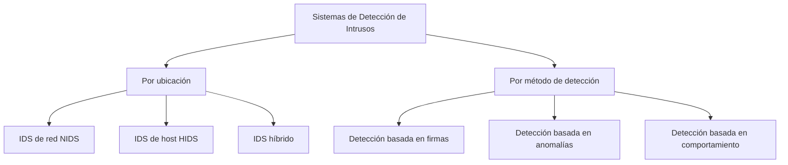
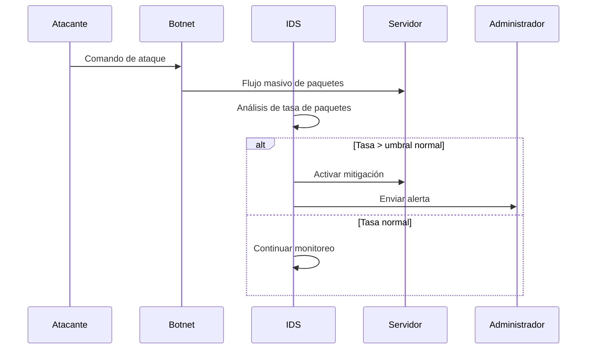

# Criptografía y Seguridad - Seguridad en redes, cortafuegos y políticas

## 9.1 Intrusión, detección de intrusos.

---

La detección de intrusos es un componente crítico de la seguridad en redes que permite identificar actividades maliciosas o violaciones de políticas de seguridad. Un sistema de detección de intrusos (IDS) monitorea el tráfico de red o la actividad del sistema para detectar patrones sospechosos.

### Definiciones Fundamentales

#### Intrusión

Una intrusión es cualquier conjunto de acciones que intenta comprometer la integridad, confidencialidad o disponibilidad de un recurso informático (Stallings, 2010).

#### Sistema de Detección de Intrusos (IDS)

Un IDS es un dispositivo o aplicación software que monitorea sistemas o redes en busca de actividades maliciosas o violaciones de políticas.

#### Sistema de Prevención de Intrusos (IPS)

Un IPS es un sistema que no solo detecta intrusiones, sino que también toma medidas para bloquear o prevenir dichas actividades.

### Clasificación de los IDS



### Métodos de Detección

#### 1. Detección Basada en Firmas (Misuse Detection)

Compara la actividad observada con patrones conocidos de ataques.

**Ventajas:**

- Baja tasa de falsos positivos para ataques conocidos
- Eficiente en términos de recursos

**Limitaciones:**

- No detecta ataques nuevos o variantes
- Requiere actualizaciones constantes de firmas

#### 2. Detección Basada en Anomalías

Establece un perfil de comportamiento normal y detecta desviaciones.

**Enfoques estadísticos comunes:**

- **Media móvil:**
  $$ \bar{x}\_t = \frac{ 1 }{ n }\sum_{i = t - n + 1 } ^ { t } x_i $$

- **Desviación estándar:**
  $$\sigma = \sqrt{\frac{1}{n}\sum_{i=1}^{n}(x_i - \bar{x})^2}$$

- **Límites de confianza:**
  $$\text{Alarma si } |x - \bar{x}| > k\sigma$$

#### 3. Detección Basada en Comportamiento

Similar a la detección por anomalías pero con enfoque en patrones de comportamiento específicos.

### Arquitectura de un IDS

#### Componentes principales:

1. **Sensor/Agente:** Recopila datos de la red o sistema
2. **Motor de análisis:** Procesa los datos en busca de intrusiones
3. **Consola de gestión:** Interfaz para administración y visualización
4. **Base de datos:** Almacena firmas, políticas y eventos

### Ejemplo: Algoritmo Básico de Detección

```python
class SimpleAnomalyDetector:
    def __init__(self, window_size=100, threshold=3):
        """
        Inicializa el detector de anomalías

        Parameters:
        window_size: tamaño de la ventana para estadísticas
        threshold: umbral en desviaciones estándar
        """
        self.window_size = window_size
        self.threshold = threshold
        self.data_window = []

    def update(self, new_value):
        """
        Actualiza el modelo con un nuevo valor

        Returns:
        bool: True si es anomalía, False en caso contrario
        """
        if len(self.data_window) >= self.window_size:
            self.data_window.pop(0)
        self.data_window.append(new_value)

        if len(self.data_window) < 10:
            return False  # No hay suficientes datos

        return self._is_anomaly(new_value)

    def _is_anomaly(self, value):
        """Detecta si un valor es anómalo"""
        mean = sum(self.data_window) / len(self.data_window)
        variance = sum((x - mean) ** 2 for x in self.data_window) / len(self.data_window)
        std_dev = variance ** 0.5

        # Evitar división por cero
        if std_dev == 0:
            return abs(value - mean) > 0.1

        z_score = abs((value - mean) / std_dev)
        return z_score > self.threshold

# Ejemplo de uso
detector = SimpleAnomalyDetector(window_size=50, threshold=2.5)

# Simulación de tráfico de red (paquetes por segundo)
traffic = [100, 105, 98, 110, 102, 500, 95, 99, 101, 450, 103]

print("Detección de anomalías en tráfico de red:")
for i, packets in enumerate(traffic):
    if detector.update(packets):
        print(f"Alerta! Anomalía detectada en medición {i+1}: {packets} paquetes/seg")
```

### Métricas de Evalución de IDS

#### Tasa de Verdaderos Positivos (Recall)

$$TPR = \frac{TP}{TP + FN}$$

#### Tasa de Falsos Positivos

$$FPR = \frac{FP}{FP + TN}$$

#### Precisión

$$Precision = \frac{TP}{TP + FP}$$

#### F1-Score

$$F_1 = 2 \times \frac{Precision \times Recall}{Precision + Recall}$$

Donde:

- TP: Verdaderos positivos
- FP: Falsos positivos
- TN: Verdaderos negativos
- FN: Falsos negativos

### Ejercicios Propuestos

#### Ejercicio 1: Análisis de Tasa de Falsos Positivos

Un IDS monitorea una red durante 24 horas y reporta:

- 150 alertas de intrusión
- Tras investigación, 30 son ataques reales
- Se estima que ocurrieron 50 ataques en total

**Calcule:**

1. Verdaderos positivos (TP)
2. Falsos positivos (FP)
3. Falsos negativos (FN)
4. Tasa de verdaderos positivos (TPR)
5. Tasa de falsos positivos (FPR)

#### Ejercicio 2: Implementación de Detector Estadístico

Implemente una clase en Python que:

1. Calcule la media móvil exponencial:

   $$EMA_t = \alpha \times x_t + (1-\alpha) \times EMA_{t-1}$$

2. Detecte anomalías cuando el valor actual se desvíe más de 3 desviaciones estándar de la EMA
3. Pruebe con datos sintéticos de consumo de CPU

#### Ejercicio 3: Análisis de Firmas

Diseñe una firma para detectar un ataque de escaneo de puertos que:

1. Realiza más de 10 conexiones por segundo
2. A puertos no estándar
3. Desde una misma dirección IP

### Caso de Estudio: Detección de Ataques DDoS



### Consideraciones de Implementación

#### Desafíos Técnicos:

1. **Rendimiento:** Los IDS deben procesar grandes volúmenes de datos en tiempo real
2. **Evitación:** Los atacantes pueden intentar evadir la detección
3. **Configuración:** Balance entre detección y falsos positivos

#### Mejores Prácticas:

1. **Defensa en profundidad:** Combinar IDS con otras medidas de seguridad
2. **Actualización regular:** Mantener firmas y algoritmos actualizados
3. **Segmentación:** Ubicar sensores estratégicamente en la red

### Comparativa IDS vs IPS

| Característica         | IDS            | IPS                 |
| ---------------------- | -------------- | ------------------- |
| Modo de operación      | Pasivo         | Activo              |
| Acción ante detección  | Alertar        | Bloquear/Prevenir   |
| Ubicación en red       | Fuera de línea | En línea            |
| Impacto en rendimiento | Bajo           | Potencialmente alto |

### Referencias

#### Bibliografía Básica:

1. **Stallings, William** (2010). _Cryptography and Network Security: Principles and Practice_, 5a Ed., Prentice Hall.
   - Capítulo 8: "Intrusion Detection"

2. **Forouzan, Behrouz A.** (2008). _Cryptography and Network Security_, McGraw Hill.
   - Capítulo 31: "Intrusion Detection Systems"

3. **Pfleeger, Charles P. y Shari L. Pfleeger** (2006). _Security in Computing_, 4a Ed., Prentice Hall.
   - Capítulo 6: "Protecting Programs and Data"

#### Bibliografía Complementaria:

1. **Stallings, William** (2010). _Network Security Essentials: Applications and Standards_, 4a Ed., Prentice Hall.
2. **Ferguson, Niels; Schneier, Bruce; Kohno, Tadayoshi** (2010). _Cryptography Engineering: Design Principles and Practical Applications_, Wiley.
3. **Menezes, Alfred; van Oorschot, Paul; Vanstone, Scott** (1996). _Handbook of Applied Cryptography_, CRC Press.
4. **Schneier, Bruce** (1996). _Applied Cryptography: Protocols, Algorithms, and Source Code in C_, 2a Ed., Wiley.

### Glosario de Términos

- **Alerta:** Notificación generada por un IDS cuando detecta actividad sospechosa
- **Falso positivo:** Alerta generada por actividad legítima
- **Falso negativo:** Ataque no detectado por el IDS
- **Firma:** Patrón que identifica un ataque conocido
- **Umbral:** Valor límite que determina cuándo se genera una alerta
- **Zero-day:** Ataque que explota una vulnerabilidad previamente desconocida

### Evaluación de Conocimientos

#### Preguntas de Revisión:

1. Explique la diferencia entre detección basada en firmas y basada en anomalías
2. Describa las ventajas y desventajas de un NIDS vs un HIDS
3. ¿Cómo afecta la tasa de falsos positivos la utilidad práctica de un IDS?
4. Explique el concepto de "defensa en profundidad" en el contexto de detección de intrusos
5. Describa tres técnicas que podrían usar los atacantes para evadir la detección

#### Proyecto Sugerido:

Diseñe e implemente un IDS básico que pueda:

1. Analizar archivos de log de un servidor web
2. Detectar patrones de ataques comunes (SQL injection, XSS)
3. Generar reportes de actividad sospechosa
4. Calcular métricas de desempeño del sistema
