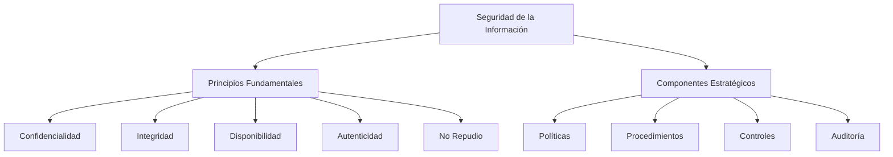
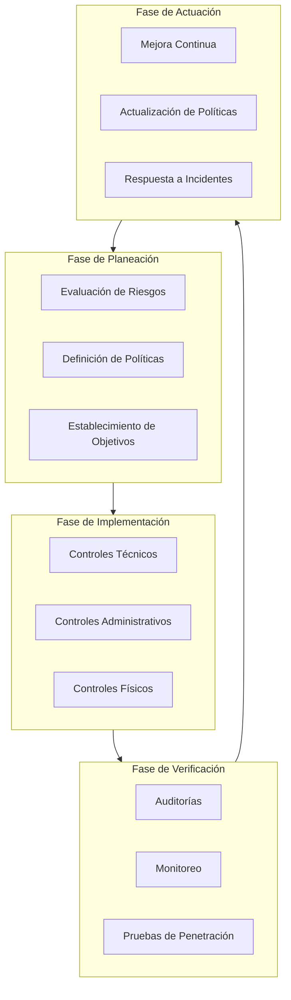
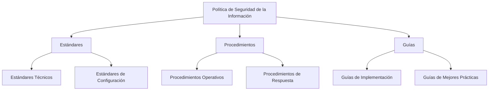
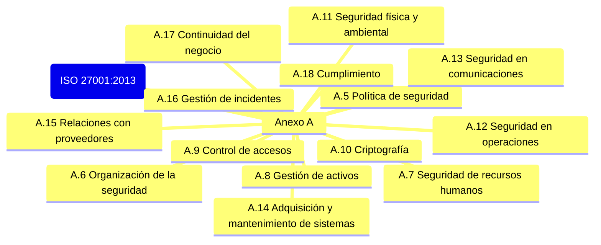
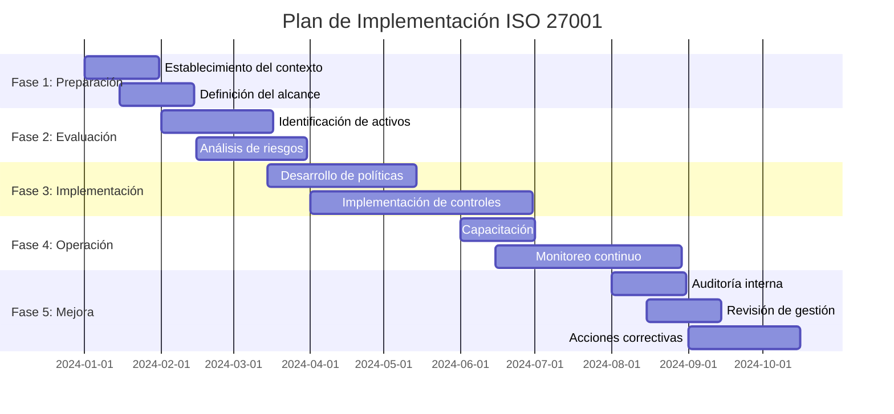

# Criptografía y Seguridad - Seguridad en redes, cortafuegos y políticas

## 9.3 Planeación de la seguridad, políticas de seguridad.

---

La planeación de seguridad y las políticas de seguridad constituyen los cimientos de una estrategia integral de seguridad informática. Estas establecen el marco estratégico, los procedimientos operativos y los controles técnicos necesarios para proteger los activos de información.

### Marco Conceptual de la Seguridad de la Información



### Ciclo de Vida de la Seguridad de la Información

#### Modelo PDCA (Plan-Do-Check-Act)



### Evaluación de Riesgos

#### Metodología Cuantitativa

**Valor Esperado de Pérdida Anual (ALE):**

$$ALE = ARO \times SLE$$

Donde:

- **ALE** (Annual Loss Expectancy): Pérdida anual esperada
- **ARO** (Annual Rate of Occurrence): Frecuencia anual de ocurrencia
- **SLE** (Single Loss Expectancy): Pérdida esperada por incidente

**Cálculo de SLE:**

$$SLE = AV \times EF$$

Donde:

- **AV** (Asset Value): Valor del activo
- **EF** (Exposure Factor): Factor de exposición (0-1)

#### Metodología Cualitativa

**Matriz de Riesgo:**

| Probabilidad/Impacto | Bajo          | Medio        | Alto           |
| -------------------- | ------------- | ------------ | -------------- |
| **Alta**             | Riesgo Medio  | Riesgo Alto  | Riesgo Crítico |
| **Media**            | Riesgo Bajo   | Riesgo Medio | Riesgo Alto    |
| **Baja**             | Riesgo Mínimo | Riesgo Bajo  | Riesgo Medio   |

### Políticas de Seguridad

#### Jerarquía de Documentación



#### Componentes de una Política de Seguridad

```python
class SecurityPolicy:
    """
    Clase que representa los componentes de una política de seguridad
    """

    def __init__(self, organization_name):
        self.organization = organization_name
        self.sections = {
            "introduccion": {
                "proposito": "",
                "alcance": "",
                "responsabilidades": {}
            },
            "politicas_especificas": [],
            "cumplimiento": {
                "auditoria": "",
                "sanciones": ""
            }
        }

    def calculate_risk_score(self, threat_likelihood, threat_impact):
        """
        Calcula el score de riesgo usando una matriz cualitativa

        Args:
            threat_likelihood: Probabilidad (1-5)
            threat_impact: Impacto (1-5)

        Returns:
            risk_score: Puntuación de riesgo
        """
        # Matriz de riesgo simple
        risk_matrix = [
            [1, 2, 3, 4, 5],
            [2, 4, 6, 8, 10],
            [3, 6, 9, 12, 15],
            [4, 8, 12, 16, 20],
            [5, 10, 15, 20, 25]
        ]

        return risk_matrix[threat_likelihood-1][threat_impact-1]

    def generate_ale_report(self, assets):
        """
        Genera reporte ALE para múltiples activos

        Args:
            assets: Lista de diccionarios con información de activos

        Returns:
            DataFrame con análisis ALE
        """
        import pandas as pd

        report_data = []
        total_ale = 0

        for asset in assets:
            sle = asset['value'] * asset['exposure_factor']
            ale = sle * asset['annual_occurrence']
            total_ale += ale

            report_data.append({
                'Activo': asset['name'],
                'Valor (AV)': f"${asset['value']:,.2f}",
                'Factor Exposición (EF)': f"{asset['exposure_factor']*100:.1f}%",
                'SLE': f"${sle:,.2f}",
                'ARO': asset['annual_occurrence'],
                'ALE': f"${ale:,.2f}",
                'ROSI': self.calculate_rosi(ale, asset['control_cost'])
            })

        df = pd.DataFrame(report_data)
        df.loc['TOTAL'] = [''] * 5 + [f"${total_ale:,.2f}", '']

        return df

    def calculate_rosi(self, ale, control_cost, control_effectiveness=0.8):
        """
        Calcula Return on Security Investment (ROSI)

        Args:
            ale: Annual Loss Expectancy
            control_cost: Costo del control de seguridad
            control_effectiveness: Efectividad del control (0-1)

        Returns:
            rosi: Return on Security Investment
        """
        risk_reduction = ale * control_effectiveness
        rosi = (risk_reduction - control_cost) / control_cost * 100

        return f"{rosi:.1f}%"
```

### Estándares y Marcos de Referencia

#### ISO/IEC 27001:2013

**Estructura de Dominios de Control:**



#### NIST Cybersecurity Framework

**Cinco Funciones Principales:**

1. **Identify** - Desarrollar comprensión organizacional
2. **Protect** - Implementar salvaguardas apropiadas
3. **Detect** - Implementar actividades de detección
4. **Respond** - Tomar acción ante incidentes detectados
5. **Recover** - Mantener planes de resiliencia

### Desarrollo de Políticas de Seguridad

#### Plantilla de Política de Seguridad

```python
def create_security_policy_template():
    """
    Genera una plantilla estructurada para políticas de seguridad
    """
    template = {
        "metadata": {
            "nombre_organizacion": "",
            "version_politica": "1.0",
            "fecha_efectiva": "",
            "fecha_revision": "",
            "aprobado_por": "",
            "distribucion": ["Empleados", "Contratistas", "Terceros"]
        },
        "secciones": [
            {
                "titulo": "1. Introducción y Propósito",
                "contenido": {
                    "1.1": "Declaración de propósito",
                    "1.2": "Alcance",
                    "1.3": "Audiencia objetivo",
                    "1.4": "Definiciones y términos"
                }
            },
            {
                "titulo": "2. Roles y Responsabilidades",
                "contenido": {
                    "2.1": "Comité de seguridad",
                    "2.2": "Oficial de seguridad (CISO)",
                    "2.3": "Administradores de sistemas",
                    "2.4": "Usuarios finales",
                    "2.5": "Auditores"
                }
            },
            {
                "titulo": "3. Políticas Específicas",
                "subsecciones": [
                    {
                        "titulo": "3.1 Control de Accesos",
                        "politicas": [
                            "Política de contraseñas",
                            "Control de acceso basado en roles (RBAC)",
                            "Principio de menor privilegio"
                        ]
                    },
                    {
                        "titulo": "3.2 Seguridad de Redes",
                        "politicas": [
                            "Configuración de firewalls",
                            "Segmentación de red",
                            "Uso de VPN"
                        ]
                    },
                    {
                        "titulo": "3.3 Gestión de Incidentes",
                        "politicas": [
                            "Procedimiento de reporte",
                            "Escalamiento de incidentes",
                            "Análisis post-incidente"
                        ]
                    }
                ]
            },
            {
                "titulo": "4. Cumplimiento y Auditoría",
                "contenido": {
                    "4.1": "Auditorías regulares",
                    "4.2": "Pruebas de penetración",
                    "4.3": "Revisiones de cumplimiento",
                    "4.4": "Sanciones por incumplimiento"
                }
            }
        ],
        "apendices": [
            "A. Matriz de clasificación de datos",
            "B. Procedimiento de respuesta a incidentes",
            "C. Plantilla de evaluación de riesgos"
        ]
    }

    return template

# Ejemplo de uso
policy_template = create_security_policy_template()
print(f"Plantilla para: {policy_template['metadata']['nombre_organizacion']}")
print(f"Versión: {policy_template['metadata']['version_politica']}")
```

### Gestión de Riesgos Cuantitativa

#### Análisis Costo-Beneficio

**Return on Security Investment (ROSI):**

$$ROSI = \frac{(ALE_{antes} - ALE_{despues}) - Costo_{control}}{Costo_{control}} \times 100\%$$

**Período de Recuperación (Payback Period):**

$$Payback\ Period = \frac{Costo_{control}}{ALE_{antes} - ALE_{despues}}$$

#### Ejemplo Práctico: Cálculo de ALE y ROSI

```python
def quantitative_risk_analysis_example():
    """
    Ejemplo completo de análisis cuantitativo de riesgos
    """
    # Datos del activo
    asset_value = 1000000  # $1,000,000
    exposure_factor = 0.3  # 30% de exposición
    annual_occurrence = 0.1  # Una vez cada 10 años

    # Cálculo de SLE y ALE
    sle = asset_value * exposure_factor
    ale_before = sle * annual_occurrence

    print("=== ANÁLISIS DE RIESGO CUANTITATIVO ===")
    print(f"Valor del activo: ${asset_value:,.2f}")
    print(f"Factor de exposición: {exposure_factor*100:.1f}%")
    print(f"SLE (Single Loss Expectancy): ${sle:,.2f}")
    print(f"ARO (Annual Rate of Occurrence): {annual_occurrence}")
    print(f"ALE (Annual Loss Expectancy): ${ale_before:,.2f}")
    print("\n" + "="*50)

    # Evaluación de control de seguridad
    control_cost = 20000  # $20,000 anuales
    control_effectiveness = 0.8  # 80% efectivo

    # Nuevo ALE después del control
    risk_reduction = ale_before * control_effectiveness
    ale_after = ale_before - risk_reduction

    print("\n=== EVALUACIÓN DE CONTROL DE SEGURIDAD ===")
    print(f"Costo del control: ${control_cost:,.2f}/año")
    print(f"Efectividad del control: {control_effectiveness*100:.0f}%")
    print(f"ALE después del control: ${ale_after:,.2f}")
    print(f"Reducción de riesgo: ${risk_reduction:,.2f}")

    # Cálculo de ROSI
    rosi = ((ale_before - ale_after) - control_cost) / control_cost * 100

    print(f"\nROSI (Return on Security Investment): {rosi:.1f}%")

    # Payback period
    annual_savings = ale_before - ale_after
    if annual_savings > 0:
        payback_period = control_cost / annual_savings
        print(f"Período de recuperación: {payback_period:.1f} años")

    # Toma de decisión
    print("\n=== RECOMENDACIÓN ===")
    if rosi > 0:
        print("✓ IMPLEMENTAR CONTROL: ROI positivo")
        print(f"  Beneficio neto anual: ${(annual_savings - control_cost):,.2f}")
    else:
        print("✗ NO IMPLEMENTAR: ROI negativo")
        print("  Considerar controles alternativos")

# Ejecutar ejemplo
quantitative_risk_analysis_example()
```

### Ejercicios Propuestos

#### Ejercicio 1: Análisis de Riesgo para Sistema de Pagos

Una empresa de comercio electrónico tiene un sistema de pagos con las siguientes características:

- Valor del sistema: $500,000
- Probabilidad de ataque DDoS: 20% anual
- Factor de exposición durante ataque: 60%
- Costo de mitigación propuesto: $15,000 anuales
- Efectividad esperada: 90%

**Calcule:**

1. SLE, ALE antes y después del control
2. ROSI de la solución de mitigación
3. Período de recuperación de la inversión
4. Recomendación basada en el análisis

#### Ejercicio 2: Desarrollo de Política de Contraseñas

Diseñe una política de contraseñas que incluya:

1. Requisitos de complejidad (longitud, caracteres)
2. Caducidad y reutilización
3. Almacenamiento seguro (hash con salt)
4. Recuperación de contraseñas
5. Auditoría y monitoreo

**Implemente una función que valide contraseñas según la política:**

```python
def validate_password(password, min_length=12, require_special=True):
    """
    Valida una contraseña según política de seguridad
    """
    # Implementar validaciones
    pass
```

#### Ejercicio 3: Matriz de Responsabilidad RACI

Para un proyecto de implementación de firewall, desarrolle una matriz RACI:

- **R**esponsible (Ejecuta)
- **A**ccountable (Aprueba)
- **C**onsulted (Consulta)
- **I**nformed (Informado)

**Roles a considerar:** CISO, Administrador de red, Usuario final, Auditor, Proveedor.

### Implementación de Controles

#### Modelo de Capas de Defensa


#### Controles de Seguridad por Categoría

| Tipo de Control   | Ejemplos                          | Implementación                           |
| ----------------- | --------------------------------- | ---------------------------------------- |
| **Preventivos**   | Firewalls, Cifrado, RBAC          | Bloquean amenazas antes de que ocurran   |
| **Detectivos**    | IDS/IPS, SIEM, Logging            | Identifican actividades sospechosas      |
| **Correctivos**   | Backups, Patches, DRP             | Restauran sistemas después de incidentes |
| **Disuasivos**    | Señalización, Sanciones, CCTV     | Desalientan actividades maliciosas       |
| **Recuperativos** | Planes de contingencia, Hot sites | Facilitan la recuperación                |

### Caso de Estudio: Implementación de ISO 27001

#### Fases del Proyecto:



### Monitoreo y Mejora Continua

#### Métricas de Desempeño de Seguridad

**Índice de Madurez de Seguridad:**

$$SMI = \frac{\sum_{i=1}^{n} w_i \times m_i}{\sum_{i=1}^{n} w_i}$$

Donde:

- $w_i$: Peso del dominio $i$
- $m_i$: Nivel de madurez del dominio $i$ (0-5)

**Tasa de Cumplimiento de Políticas:**

$$Compliance\ Rate = \frac{Controles\ Implementados}{Controles\ Requeridos} \times 100\%$$

### Referencias Bibliográficas

#### Bibliografía Básica:

1. **Stallings, William** (2010). _Cryptography and Network Security: Principles and Practice_, 5a Ed.
   - Capítulo 1: "Introduction"
   - Capítulo 20: "Network Security Management"

2. **Forouzan, Behrouz A.** (2008). _Cryptography and Network Security_
   - Capítulo 1: "Introduction to Cryptography and Network Security"
   - Capítulo 32: "Security Policies"

3. **Pfleeger, C.P. & Pfleeger, S.L.** (2006). _Security in Computing_, 4a Ed.
   - Capítulo 1: "Is There a Security Problem?"
   - Capítulo 8: "Management of Security"

#### Bibliografía Complementaria:

1. **Stallings, William** (2010). _Network Security Essentials_
   - Capítulo 1: "Introduction"

2. **ISO/IEC 27001:2013** - Information security management systems
3. **NIST SP 800-53** - Security and Privacy Controls for Information Systems
4. **COBIT 5** - Framework for Governance and Management of Enterprise IT

### Herramientas y Recursos

#### Plantillas Disponibles:

1. Matriz de evaluación de riesgos
2. Plantilla de política de seguridad
3. Checklist de implementación de controles
4. Formato de reporte de incidentes
5. Plan de respuesta a emergencias

#### Software de Gestión:

- GRC (Governance, Risk, Compliance) platforms
- SIEM (Security Information and Event Management)
- VM (Vulnerability Management) systems
- Policy management software

### Evaluación de Conocimientos

#### Preguntas Teóricas:

1. Explique la diferencia entre política, estándar y procedimiento
2. Describa el modelo PDCA en el contexto de seguridad
3. Compare análisis cuantitativo vs cualitativo de riesgos
4. Explique el concepto de "defensa en profundidad"
5. Describa los componentes clave de una política de seguridad efectiva

#### Problemas Prácticos:

1. Calcule el ALE para un sistema con valor de $750,000, EF del 40% y ARO de 0.25
2. Diseñe una política de clasificación de datos con tres niveles
3. Desarrolle un procedimiento de respuesta a incidentes para ransomware
4. Cree una matriz RACI para un proyecto de implementación de firewall

#### Proyecto Final:

Desarrollar un programa completo de seguridad de la información que incluya:

1. Política maestra de seguridad
2. Proceso de gestión de riesgos
3. Plan de implementación de controles
4. Programa de concientización
5. Sistema de monitoreo y mejora continua

**Nota:** La planeación de seguridad es un proceso continuo y dinámico que debe adaptarse a los cambios en el panorama de amenazas, la tecnología y los objetivos del negocio. Una política de seguridad efectiva equilibra la protección con la practicidad operativa.
