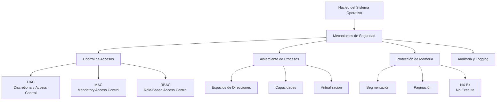
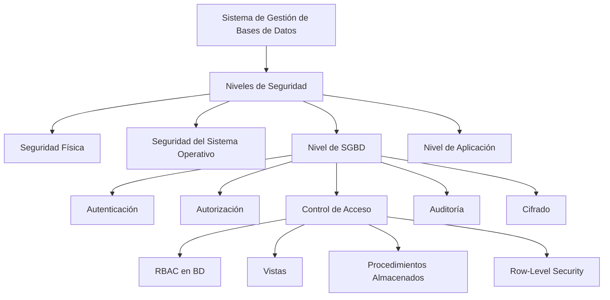
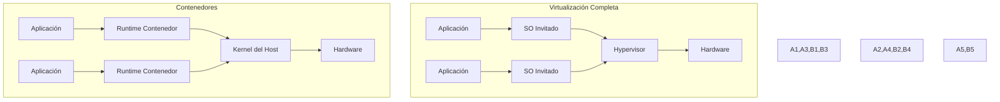

# Criptografía y Seguridad - Seguridad en redes, cortafuegos y políticas

## 9.4 Aspectos de seguridad en el diseño de sistemas operativos y de manejadores de bases de datos.

---

La seguridad en sistemas operativos y bases de datos constituye la base fundamental para la protección de sistemas informáticos. Esta guía explora los mecanismos de seguridad integrados en estos componentes críticos del sistema.

### Arquitectura de Seguridad en Sistemas Operativos



### Modelos de Control de Acceso

#### 1. DAC - Control de Acceso Discrecional

El propietario del objeto decide quién puede acceder.

**Matriz de Acceso:**
$$ M = \begin{bmatrix} a_{11} & a_{12} & \cdots & a_{1n} \\\ a_{21} & a_{22} & \cdots & a_{2n} \\\ \vdots & \vdots & \ddots & \vdots \\\ a_{m1} & a_{m2} & \cdots & a_{mn} \end{bmatrix} $$

Donde $a_{ij}$ representa los permisos del sujeto $i$ sobre el objeto $j$.

#### 2. MAC - Control de Acceso Obligatorio

Basado en etiquetas de seguridad y políticas del sistema.

*_Propiedad *-Security:*_

$$
\forall s \in S, o \in O: \text{read}(s, o) \Rightarrow \text{label}(s) \geq \text{label}(o)
$$

#### 3. RBAC - Control de Acceso Basado en Roles

```python
class RBACSystem:
    """
    Implementación simplificada de RBAC
    """
    def __init__(self):
        self.users = {}
        self.roles = {}
        self.permissions = {}
        self.user_roles = {}
        self.role_permissions = {}

    def add_user(self, user_id, clearance_level=0):
        """Añade un usuario al sistema"""
        self.users[user_id] = {
            'id': user_id,
            'clearance': clearance_level,
            'sessions': []
        }

    def define_role(self, role_id, description=""):
        """Define un nuevo rol"""
        self.roles[role_id] = {
            'id': role_id,
            'description': description
        }

    def assign_role(self, user_id, role_id):
        """Asigna un rol a un usuario"""
        if user_id not in self.user_roles:
            self.user_roles[user_id] = []
        self.user_roles[user_id].append(role_id)

    def define_permission(self, perm_id, resource, action):
        """Define un permiso"""
        self.permissions[perm_id] = {
            'resource': resource,
            'action': action,
            'constraints': []
        }

    def grant_permission(self, role_id, perm_id, constraints=None):
        """Concede un permiso a un rol"""
        if role_id not in self.role_permissions:
            self.role_permissions[role_id] = []

        permission = self.permissions[perm_id].copy()
        if constraints:
            permission['constraints'] = constraints

        self.role_permissions[role_id].append(permission)

    def check_access(self, user_id, resource, action):
        """Verifica si un usuario tiene acceso a un recurso"""
        if user_id not in self.user_roles:
            return False

        user_roles = self.user_roles[user_id]

        for role in user_roles:
            if role in self.role_permissions:
                for perm in self.role_permissions[role]:
                    if (perm['resource'] == resource and
                        perm['action'] == action):
                        return True
        return False

    def get_effective_permissions(self, user_id):
        """Obtiene todos los permisos efectivos de un usuario"""
        effective_perms = []

        if user_id in self.user_roles:
            for role in self.user_roles[user_id]:
                if role in self.role_permissions:
                    effective_perms.extend(self.role_permissions[role])

        return effective_perms

# Ejemplo de uso
rbac = RBACSystem()

# Definir roles
rbac.define_role("admin", "Administrador del sistema")
rbac.define_role("user", "Usuario regular")
rbac.define_role("auditor", "Auditor de seguridad")

# Definir permisos
rbac.define_permission("read_log", "/var/log", "read")
rbac.define_permission("write_config", "/etc/config", "write")
rbac.define_permission("execute_backup", "/usr/bin/backup", "execute")

# Asignar permisos a roles
rbac.grant_permission("admin", "read_log")
rbac.grant_permission("admin", "write_config")
rbac.grant_permission("user", "execute_backup")
rbac.grant_permission("auditor", "read_log")

# Crear usuarios y asignar roles
rbac.add_user("alice", clearance_level=3)
rbac.add_user("bob", clearance_level=1)
rbac.add_user("charlie", clearance_level=2)

rbac.assign_role("alice", "admin")
rbac.assign_role("bob", "user")
rbac.assign_role("charlie", "auditor")

# Verificar acceso
print("Alice puede escribir config?:",
      rbac.check_access("alice", "/etc/config", "write"))  # True
print("Bob puede leer logs?:",
      rbac.check_access("bob", "/var/log", "read"))  # False
```

### Protección de Memoria

#### Modelo de Segmentación

**Verificación de límites:**

$$
\text{if } \text{base} \leq \text{dirección} < \text{base} + \text{límite} \text{ then permitir acceso}
$$

#### Paginación con Protección

**Tabla de Páginas con bits de protección:**

```python
class MemoryProtectionUnit:
    """
    Simulación de unidad de protección de memoria
    """
    def __init__(self, page_size=4096):
        self.page_size = page_size
        self.page_table = {}
        self.bit_masks = {
            'READ': 0b001,
            'WRITE': 0b010,
            'EXECUTE': 0b100,
            'USER': 0b1000,  # Modo usuario
            'KERNEL': 0b0000  # Modo kernel
        }

    def map_page(self, virtual_addr, physical_addr, permissions):
        """Mapea una página virtual a física con permisos"""
        page_num = virtual_addr // self.page_size
        offset = virtual_addr % self.page_size

        self.page_table[page_num] = {
            'physical_base': physical_addr,
            'permissions': permissions,
            'accessed': False,
            'dirty': False
        }

        return page_num

    def check_access(self, virtual_addr, access_type, mode='USER'):
        """Verifica si el acceso es permitido"""
        page_num = virtual_addr // self.page_size
        offset = virtual_addr % self.page_size

        if page_num not in self.page_table:
            raise MemoryError("Page fault: página no mapeada")

        page_entry = self.page_table[page_num]

        # Verificar modo
        if mode == 'USER' and not (page_entry['permissions'] & self.bit_masks['USER']):
            raise PermissionError("Acceso denegado: modo kernel requerido")

        # Verificar permisos específicos
        required_perm = self.bit_masks.get(access_type.upper(), 0)
        if not (page_entry['permissions'] & required_perm):
            raise PermissionError(f"Acceso {access_type} denegado")

        # Actualizar bits de estado
        page_entry['accessed'] = True
        if access_type == 'WRITE':
            page_entry['dirty'] = True

        # Calcular dirección física
        physical_addr = page_entry['physical_base'] + offset

        return physical_addr

    def get_memory_protection_summary(self):
        """Genera un resumen de la protección de memoria"""
        summary = {
            'total_pages': len(self.page_table),
            'user_pages': 0,
            'kernel_pages': 0,
            'readonly_pages': 0,
            'executable_pages': 0
        }

        for page_entry in self.page_table.values():
            perms = page_entry['permissions']

            if perms & self.bit_masks['USER']:
                summary['user_pages'] += 1
            else:
                summary['kernel_pages'] += 1

            if not (perms & self.bit_masks['WRITE']):
                summary['readonly_pages'] += 1

            if perms & self.bit_masks['EXECUTE']:
                summary['executable_pages'] += 1

        return summary

# Ejemplo de uso
mpu = MemoryProtectionUnit()

# Mapear páginas con diferentes permisos
mpu.map_page(0x0000, 0x1000,
             mpu.bit_masks['READ'] | mpu.bit_masks['EXECUTE'] | mpu.bit_masks['USER'])

mpu.map_page(0x1000, 0x2000,
             mpu.bit_masks['READ'] | mpu.bit_masks['WRITE'] | mpu.bit_masks['USER'])

mpu.map_page(0x8000, 0x3000,
             mpu.bit_masks['READ'] | mpu.bit_masks['WRITE'] | mpu.bit_masks['EXECUTE'])

try:
    # Intentar acceso válido
    addr = mpu.check_access(0x1050, 'READ', 'USER')
    print(f"Acceso READ permitido a dirección física: {hex(addr)}")

    # Intentar acceso no permitido
    addr = mpu.check_access(0x0050, 'WRITE', 'USER')
except PermissionError as e:
    print(f"Error de permisos: {e}")
except MemoryError as e:
    print(f"Error de memoria: {e}")

print("\nResumen de protección:")
summary = mpu.get_memory_protection_summary()
for key, value in summary.items():
    print(f"{key}: {value}")
```

### Seguridad en Bases de Datos

#### Arquitectura de Seguridad en SGBD



#### Modelo de Seguridad SQL

##### 1. Autenticación y Autorización

**SQL GRANT Statement:**

```sql
-- Sintaxis básica GRANT
GRANT privilege_list
ON object_type object_name
TO user_or_role_list
[WITH GRANT OPTION]
[WITH ADMIN OPTION];
```

##### 2. Control de Acceso Granular

```python
class DatabaseSecurityManager:
    """
    Gestor de seguridad para bases de datos relacionales
    """

    def __init__(self, db_connection):
        self.conn = db_connection
        self.privilege_matrix = {}
        self.audit_log = []

    def grant_privilege(self, user, table, privilege, grant_option=False):
        """
        Concede un privilegio sobre una tabla
        """
        if table not in self.privilege_matrix:
            self.privilege_matrix[table] = {}

        if user not in self.privilege_matrix[table]:
            self.privilege_matrix[table][user] = set()

        self.privilege_matrix[table][user].add(privilege)

        if grant_option:
            self.privilege_matrix[table][user].add(f'GRANT_{privilege}')

        # Registrar en log de auditoría
        self.audit_log.append({
            'timestamp': datetime.now(),
            'action': 'GRANT',
            'user': 'SYSTEM',
            'target_user': user,
            'object': table,
            'privilege': privilege,
            'grant_option': grant_option
        })

    def revoke_privilege(self, user, table, privilege):
        """
        Revoca un privilegio
        """
        if (table in self.privilege_matrix and
            user in self.privilege_matrix[table]):
            if privilege in self.privilege_matrix[table][user]:
                self.privilege_matrix[table][user].remove(privilege)

                # Registrar en log
                self.audit_log.append({
                    'timestamp': datetime.now(),
                    'action': 'REVOKE',
                    'user': 'SYSTEM',
                    'target_user': user,
                    'object': table,
                    'privilege': privilege
                })

    def check_access(self, user, table, action):
        """
        Verifica si un usuario tiene acceso a una tabla
        """
        required_privilege = self._action_to_privilege(action)

        if table not in self.privilege_matrix:
            return False

        if user not in self.privilege_matrix[table]:
            return False

        user_privileges = self.privilege_matrix[table][user]

        # Verificar privilegio directo
        if required_privilege in user_privileges:
            return True

        # Verificar si tiene ALL PRIVILEGES
        if 'ALL' in user_privileges:
            return True

        return False

    def _action_to_privilege(self, action):
        """
        Mapea acciones SQL a privilegios
        """
        mapping = {
            'SELECT': 'SELECT',
            'INSERT': 'INSERT',
            'UPDATE': 'UPDATE',
            'DELETE': 'DELETE',
            'CREATE': 'CREATE',
            'DROP': 'DROP',
            'ALTER': 'ALTER',
            'REFERENCES': 'REFERENCES',
            'INDEX': 'INDEX'
        }
        return mapping.get(action.upper(), action.upper())

    def create_view_with_security(self, view_name, base_table,
                                  user_condition, columns=None):
        """
        Crea una vista con control de acceso a nivel de fila
        """
        if columns is None:
            columns = "*"
        else:
            columns = ", ".join(columns)

        view_sql = f"""
        CREATE VIEW {view_name} AS
        SELECT {columns}
        FROM {base_table}
        WHERE {user_condition}
        WITH CHECK OPTION;
        """

        # Ejecutar SQL (en implementación real)
        # self.conn.execute(view_sql)

        return view_sql

    def get_audit_report(self, start_date=None, end_date=None):
        """
        Genera reporte de auditoría
        """
        report = []

        for entry in self.audit_log:
            if start_date and entry['timestamp'] < start_date:
                continue
            if end_date and entry['timestamp'] > end_date:
                continue

            report.append({
                'timestamp': entry['timestamp'].isoformat(),
                'action': entry['action'],
                'performed_by': entry['user'],
                'affected_user': entry['target_user'],
                'object': entry['object'],
                'details': f"{entry['action']} {entry['privilege']} ON {entry['object']}"
            })

        return report

from datetime import datetime

# Ejemplo de uso
db_sec = DatabaseSecurityManager(None)

# Conceder privilegios
db_sec.grant_privilege('alice', 'employees', 'SELECT')
db_sec.grant_privilege('alice', 'employees', 'INSERT', grant_option=True)
db_sec.grant_privilege('bob', 'salaries', 'SELECT')
db_sec.grant_privilege('admin', 'employees', 'ALL')

# Verificar acceso
print("Alice puede SELECT en employees?:",
      db_sec.check_access('alice', 'employees', 'SELECT'))  # True
print("Bob puede INSERT en employees?:",
      db_sec.check_access('bob', 'employees', 'INSERT'))  # False

# Crear vista con seguridad
view_sql = db_sec.create_view_with_security(
    'employee_view',
    'employees',
    "department = CURRENT_USER_DEPARTMENT() AND salary <= 50000",
    ['employee_id', 'name', 'department', 'position']
)

print("\nVista creada:")
print(view_sql)

# Reporte de auditoría
print("\nReporte de auditoría:")
for entry in db_sec.get_audit_report()[:3]:
    print(f"{entry['timestamp']}: {entry['details']}")
```

#### Cifrado en Bases de Datos

##### 1. Cifrado a Nivel de Columna

**Modelo de Cifrado Determinista:**
$$C = E(K, P)$$
Mismo texto plano produce mismo texto cifrado (permite búsquedas).

**Modelo de Cifrado Aleatorio:**
$$C = E(K, P, IV)$$
Usa Initialization Vector para mayor seguridad.

```python
from cryptography.hazmat.primitives.ciphers import Cipher, algorithms, modes
from cryptography.hazmat.primitives import hashes
from cryptography.hazmat.primitives.kdf.pbkdf2 import PBKDF2
import os
import base64

class DatabaseEncryption:
    """
    Sistema de cifrado para datos en bases de datos
    """

    def __init__(self, master_key=None):
        self.master_key = master_key or os.urandom(32)
        self.key_cache = {}

    def derive_column_key(self, table_name, column_name, salt=None):
        """
        Deriva una clave específica para una columna
        """
        if salt is None:
            salt = f"{table_name}:{column_name}".encode()

        # Usar HKDF para derivar clave
        kdf = PBKDF2(
            algorithm=hashes.SHA256(),
            length=32,
            salt=salt,
            iterations=100000
        )

        column_key = kdf.derive(self.master_key)
        return column_key

    def encrypt_cell(self, table_name, column_name, plaintext,
                     method='deterministic'):
        """
        Cifra un valor individual
        """
        if plaintext is None:
            return None

        column_key = self.derive_column_key(table_name, column_name)

        if method == 'deterministic':
            # Cifrado determinista (para búsquedas)
            cipher = Cipher(
                algorithms.AES(column_key),
                modes.ECB()  # ECB para determinismo
            )
            encryptor = cipher.encryptor()

            # Padding para AES
            data = plaintext.encode()
            pad_len = 16 - (len(data) % 16)
            data += bytes([pad_len] * pad_len)

            ciphertext = encryptor.update(data) + encryptor.finalize()

        elif method == 'randomized':
            # Cifrado aleatorio (más seguro)
            iv = os.urandom(16)
            cipher = Cipher(
                algorithms.AES(column_key),
                modes.GCM(iv)
            )
            encryptor = cipher.encryptor()

            ciphertext = encryptor.update(plaintext.encode()) + encryptor.finalize()
            tag = encryptor.tag

            # Combinar IV, ciphertext y tag
            return base64.b64encode(iv + tag + ciphertext).decode()

        return base64.b64encode(ciphertext).decode()

    def decrypt_cell(self, table_name, column_name, ciphertext,
                     method='deterministic'):
        """
        Descifra un valor
        """
        if ciphertext is None:
            return None

        column_key = self.derive_column_key(table_name, column_name)
        data = base64.b64decode(ciphertext)

        if method == 'deterministic':
            cipher = Cipher(
                algorithms.AES(column_key),
                modes.ECB()
            )
            decryptor = cipher.decryptor()

            plaintext = decryptor.update(data) + decryptor.finalize()

            # Remover padding
            pad_len = plaintext[-1]
            plaintext = plaintext[:-pad_len]

            return plaintext.decode()

        elif method == 'randomized':
            # Separar IV, tag y ciphertext
            iv = data[:16]
            tag = data[16:32]
            ciphertext = data[32:]

            cipher = Cipher(
                algorithms.AES(column_key),
                modes.GCM(iv, tag)
            )
            decryptor = cipher.decryptor()

            plaintext = decryptor.update(ciphertext) + decryptor.finalize()
            return plaintext.decode()

    def create_encrypted_column_sql(self, table_name, column_name,
                                    data_type="VARCHAR", method='deterministic'):
        """
        Genera SQL para crear columna cifrada
        """
        if method == 'deterministic':
            # Para búsquedas exactas
            sql = f"""
            CREATE FUNCTION encrypt_{table_name}_{column_name}(value {data_type})
            RETURNS TEXT AS $$
            BEGIN
                RETURN encrypt_deterministic(value, '{table_name}', '{column_name}');
            END;
            $$ LANGUAGE plpgsql SECURITY DEFINER;

            CREATE FUNCTION decrypt_{table_name}_{column_name}(ciphertext TEXT)
            RETURNS {data_type} AS $$
            BEGIN
                RETURN decrypt_deterministic(ciphertext, '{table_name}', '{column_name}');
            END;
            $$ LANGUAGE plpgsql SECURITY DEFINER;
            """
        else:
            sql = f"""
            CREATE FUNCTION encrypt_{table_name}_{column_name}_rand(value {data_type})
            RETURNS TEXT AS $$
            BEGIN
                RETURN encrypt_randomized(value, '{table_name}', '{column_name}');
            END;
            $$ LANGUAGE plpgsql SECURITY DEFINER;
            """

        return sql

# Ejemplo de uso
db_enc = DatabaseEncryption()

# Cifrar datos
plaintext = "Información confidencial"
ciphertext_det = db_enc.encrypt_cell("clientes", "tarjeta_credito", plaintext, "deterministic")
ciphertext_rand = db_enc.encrypt_cell("clientes", "ssn", plaintext, "randomized")

print("Texto plano:", plaintext)
print("Cifrado determinista:", ciphertext_det[:50] + "...")
print("Cifrado aleatorio:", ciphertext_rand[:50] + "...")

# Descifrar
decrypted_det = db_enc.decrypt_cell("clientes", "tarjeta_credito", ciphertext_det, "deterministic")
decrypted_rand = db_enc.decrypt_cell("clientes", "ssn", ciphertext_rand, "randomized")

print("\nDescifrado determinista:", decrypted_det)
print("Descifrado aleatorio:", decrypted_rand)
```

### Ejercicios Propuestos

#### Ejercicio 1: Implementación de SELinux-like MAC

Implemente un sistema MAC simplificado que:

1. Use etiquetas de seguridad (nivel, categoría)
2. Implemente la propiedad Bell-LaPadula
3. Permita read-up y write-down controlados
4. Incluya logging de violaciones

**Modelo Bell-LaPadula:**

- **Simple Security Property:** No read-up
- ***-Property:** No write-down (con excepciones)

#### Ejercicio 2: Sistema de Auditoría de Bases de Datos

Diseñe un sistema de auditoría que:

1. Capture todas las operaciones DML (SELECT, INSERT, UPDATE, DELETE)
2. Almacene contexto completo (usuario, timestamp, IP, query)
3. Genere alertas por patrones sospechosos
4. Produzca reportes de cumplimiento

#### Ejercicio 3: Análisis de Vulnerabilidades Comunes

Analice y proponga mitigaciones para:

1. **SQL Injection:** Validación de entrada y prepared statements
2. **Buffer Overflow:** ASLR, DEP/XN bit, canarios
3. **Privilege Escalation:** Principle of Least Privilege, sandboxing
4. **Information Leakage:** Proper error handling, access controls

### Seguridad en Sistemas de Archivos

#### Modelo de Permisos POSIX

**Cálculo de máscara efectiva:**

$$
\text{Permiso Efectivo} = \text{Permiso del Archivo} \cap \text{Máscara de Proceso}
$$

**Representación octal:**

```python
def parse_posix_permissions(perm_string):
    """
    Convierte representación simbólica a numérica
    """
    perm_map = {
        'r': 4, 'w': 2, 'x': 1,
        '-': 0
    }

    # Ejemplo: "rwxr-xr--"
    if len(perm_string) == 9:
        octal = 0
        for i, char in enumerate(perm_string):
            if char in perm_map:
                value = perm_map[char]
                position = 8 - i
                octal += value << (position // 3 * 3)

        return oct(octal)

    return None

# Ejemplo
print("Permisos rwxr-xr-- en octal:", parse_posix_permissions("rwxr-xr--"))
```

### Mecanismos de Aislamiento

#### Contenedores vs Virtualización



### Referencias Bibliográficas

#### Bibliografía Básica:

1. **Stallings, William** (2010). _Cryptography and Network Security: Principles and Practice_, 5a Ed.
   - Capítulo 4: "Access Control"
   - Capítulo 15: "Database Security"

2. **Forouzan, Behrouz A.** (2008). _Cryptography and Network Security_
   - Capítulo 16: "Operating System Security"
   - Capítulo 32: "Security Policies"

3. **Pfleeger, C.P. & Pfleeger, S.L.** (2006). _Security in Computing_, 4a Ed.
   - Capítulo 4: "Protection in General-Purpose Operating Systems"
   - Capítulo 5: "Database Security"

#### Bibliografía Complementaria:

1. **Stallings, William** (2010). _Network Security Essentials_
   - Capítulo 4: "Access Control"

2. **Saltzer, J.H. & Schroeder, M.D.** (1975). "The Protection of Information in Computer Systems"

3. **ISO/IEC 27001:2013** - Information security management systems

4. **NIST SP 800-53** - Security and Privacy Controls for Information Systems

### Casos de Estudio

#### Caso 1: Implementación de RBAC en Hospital

**Requisitos:**

- Médicos: Acceso a historiales de sus pacientes
- Enfermeras: Actualización de signos vitales
- Administrativos: Datos demográficos únicamente
- Auditores: Solo lectura, todos los registros

**Implementar:**

1. Esquema de roles y permisos
2. Control de acceso a nivel de fila
3. Sistema de auditoría de accesos
4. Procedimientos de emergencia

#### Caso 2: Sistema Bancario Seguro

**Características:**

- Cifrado de datos sensibles
- Doble autenticación para transacciones
- Segregación de ambientes (desarrollo, testing, producción)
- Monitoreo en tiempo real de actividades sospechosas

### Herramientas de Seguridad

#### Para Sistemas Operativos:

1. **SELinux** (Security-Enhanced Linux)
2. **AppArmor** (Application Armor)
3. **Windows Defender Application Control**
4. **Auditd** (Linux Audit Framework)

#### Para Bases de Datos:

1. **Oracle Database Vault**
2. **Microsoft SQL Server Always Encrypted**
3. **PostgreSQL pgaudit**
4. **MySQL Enterprise Audit**

### Evaluación de Conocimientos

#### Preguntas Teóricas:

1. Explique la diferencia entre DAC, MAC y RBAC
2. Describa los mecanismos de protección de memoria
3. Compare cifrado determinista vs aleatorio en bases de datos
4. Explique el principio de mínimo privilegio
5. Describa las vulnerabilidades comunes en SGBD

#### Problemas Prácticos:

1. Diseñe un esquema RBAC para una universidad
2. Implemente control de acceso a nivel de fila en SQL
3. Calcule permisos efectivos en POSIX
4. Diseñe un sistema de auditoría para transacciones bancarias

#### Proyecto Final:

Desarrollar un sistema integrado de seguridad que incluya:

1. Control de acceso multi-nivel
2. Cifrado transparente de datos
3. Sistema de auditoría completo
4. Detección de anomalías en tiempo real
5. Reportes de cumplimiento normativo

**Nota:** La seguridad en sistemas operativos y bases de datos requiere un enfoque en capas que combine controles técnicos, procesos administrativos y conciencia del usuario. La implementación efectiva debe balancear seguridad, usabilidad y desempeño.
