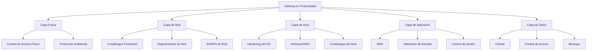
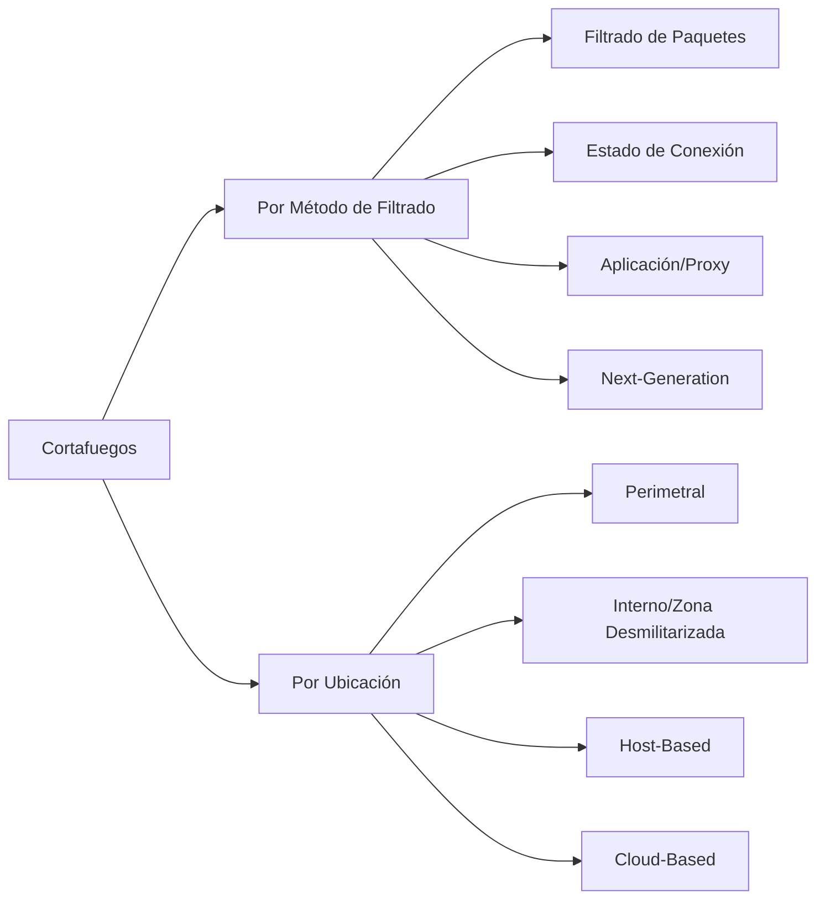
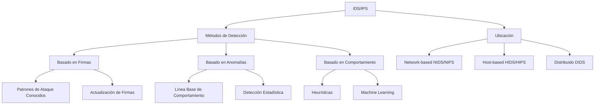
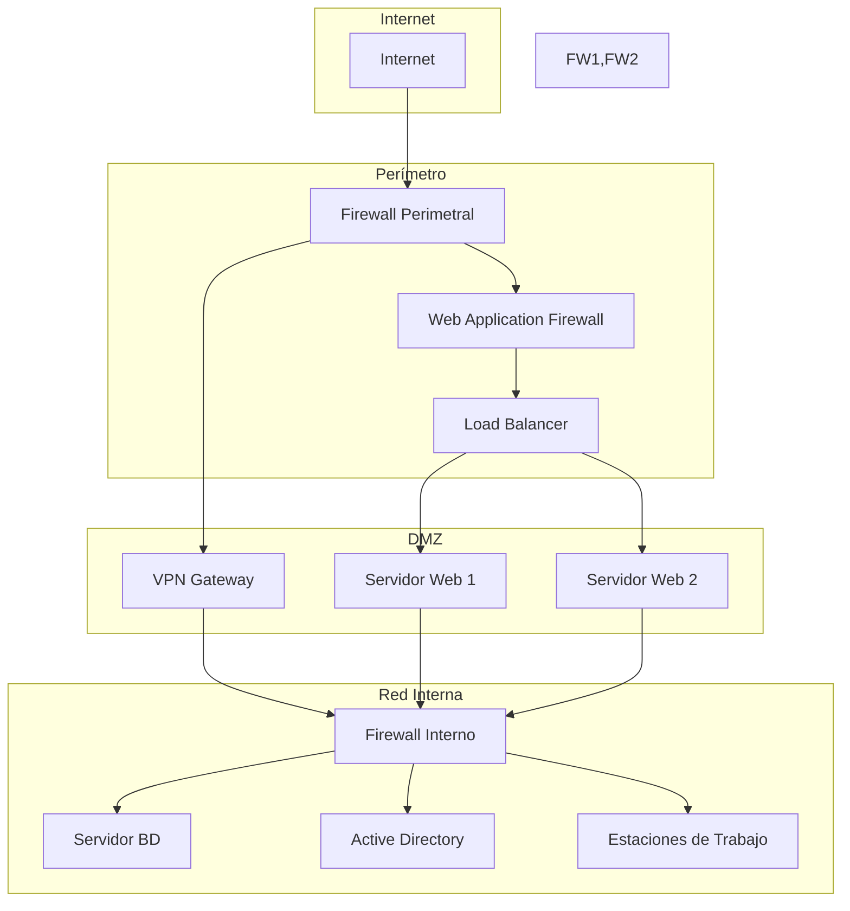

# Criptografía y Seguridad - Seguridad en redes, cortafuegos y políticas

## 9.5 Mecanismos de defensa contra intrusión, configuración del sistema, cortafuegos.

---

La defensa contra intrusiones involucra múltiples capas de protección, desde la configuración segura de sistemas hasta la implementación de cortafuegos (firewalls) y sistemas de detección/prevención de intrusiones. Esta guía explora los mecanismos fundamentales para proteger redes y sistemas.

### Arquitectura de Defensa en Profundidad



### Cortafuegos (Firewalls)

#### Tipos de Cortafuegos



#### 1. Filtrado de Paquetes (Stateless)

**Regla básica de filtrado:**

$$
\text{Permitir/Denegar} = f(\text{src\\\_ip}, \text{dst\\\_ip}, \text{src\\\_port}, \text{dst\\\_port}, \text{protocolo})
$$

```python
class PacketFilterFirewall:
    """
    Implementación básica de firewall con filtrado de paquetes
    """

    def __init__(self):
        self.rules = []
        self.log = []

    def add_rule(self, direction, protocol, src_ip, src_port,
                 dst_ip, dst_port, action, description=""):
        """
        Agrega una regla al firewall
        """
        rule = {
            'id': len(self.rules) + 1,
            'direction': direction,  # 'inbound' o 'outbound'
            'protocol': protocol.upper(),
            'src_ip': src_ip,
            'src_port': src_port,
            'dst_ip': dst_ip,
            'dst_port': dst_port,
            'action': action,  # 'ALLOW' o 'DENY'
            'description': description,
            'hit_count': 0
        }
        self.rules.append(rule)
        return rule['id']

    def match_ip(self, packet_ip, rule_ip):
        """
        Compara direcciones IP con soporte para CIDR
        """
        if rule_ip == 'any':
            return True

        if '/' in rule_ip:
            # Manejar notación CIDR
            import ipaddress
            packet_net = ipaddress.ip_network(packet_ip, strict=False)
            rule_net = ipaddress.ip_network(rule_ip, strict=False)
            return packet_net.subnet_of(rule_net)

        return packet_ip == rule_ip

    def match_port(self, packet_port, rule_port):
        """
        Compara puertos
        """
        if rule_port == 'any':
            return True

        if isinstance(rule_port, str) and '-' in rule_port:
            # Rango de puertos
            start, end = map(int, rule_port.split('-'))
            return start <= packet_port <= end

        return int(packet_port) == int(rule_port)

    def process_packet(self, packet):
        """
        Procesa un paquete según las reglas
        """
        for rule in self.rules:
            # Verificar dirección
            if packet['direction'] != rule['direction']:
                continue

            # Verificar protocolo
            if rule['protocol'] != 'ANY' and packet['protocol'] != rule['protocol']:
                continue

            # Verificar IP origen
            if not self.match_ip(packet['src_ip'], rule['src_ip']):
                continue

            # Verificar puerto origen
            if not self.match_port(packet['src_port'], rule['src_port']):
                continue

            # Verificar IP destino
            if not self.match_ip(packet['dst_ip'], rule['dst_ip']):
                continue

            # Verificar puerto destino
            if not self.match_port(packet['dst_port'], rule['dst_port']):
                continue

            # Regla coincide
            rule['hit_count'] += 1

            # Registrar en log
            log_entry = {
                'timestamp': datetime.now(),
                'rule_id': rule['id'],
                'packet_info': packet,
                'action': rule['action'],
                'rule_desc': rule['description']
            }
            self.log.append(log_entry)

            return rule['action']

        # Política por defecto: DENY ALL
        default_action = 'DENY'
        self.log.append({
            'timestamp': datetime.now(),
            'rule_id': 0,
            'packet_info': packet,
            'action': default_action,
            'rule_desc': 'Default deny rule'
        })

        return default_action

    def generate_statistics(self):
        """
        Genera estadísticas de uso del firewall
        """
        total_packets = len(self.log)
        allowed_packets = sum(1 for entry in self.log if entry['action'] == 'ALLOW')
        denied_packets = total_packets - allowed_packets

        # Top reglas más usadas
        rule_hits = {}
        for rule in self.rules:
            rule_hits[rule['id']] = rule['hit_count']

        top_rules = sorted(rule_hits.items(), key=lambda x: x[1], reverse=True)[:5]

        return {
            'total_packets': total_packets,
            'allowed_packets': allowed_packets,
            'denied_packets': denied_packets,
            'deny_rate': (denied_packets / total_packets * 100) if total_packets > 0 else 0,
            'top_rules': top_rules
        }

    def export_rules_iptables(self):
        """
        Exporta reglas en formato iptables
        """
        iptables_rules = []

        for rule in self.rules:
            # Construir comando iptables básico
            cmd = f"iptables -A {'INPUT' if rule['direction'] == 'inbound' else 'OUTPUT'}"

            # Protocolo
            if rule['protocol'] != 'ANY':
                cmd += f" -p {rule['protocol'].lower()}"

            # IP origen
            if rule['src_ip'] != 'any':
                cmd += f" -s {rule['src_ip']}"

            # Puerto origen
            if rule['src_port'] != 'any':
                cmd += f" --sport {rule['src_port']}"

            # IP destino
            if rule['dst_ip'] != 'any':
                cmd += f" -d {rule['dst_ip']}"

            # Puerto destino
            if rule['dst_port'] != 'any':
                cmd += f" --dport {rule['dst_port']}"

            # Acción
            cmd += f" -j {rule['action'].upper()}"

            # Comentario
            if rule['description']:
                cmd += f" -m comment --comment \"{rule['description']}\""

            iptables_rules.append(cmd)

        return iptables_rules

from datetime import datetime

# Ejemplo de uso
firewall = PacketFilterFirewall()

# Reglas de ejemplo
firewall.add_rule('inbound', 'TCP', 'any', 'any', '192.168.1.100', '22', 'ALLOW', 'SSH al servidor')
firewall.add_rule('inbound', 'TCP', 'any', 'any', '192.168.1.100', '80', 'ALLOW', 'HTTP al servidor web')
firewall.add_rule('inbound', 'TCP', 'any', 'any', '192.168.1.0/24', '1-1024', 'DENY', 'Bloquear puertos bajos')
firewall.add_rule('inbound', 'ANY', '10.0.0.0/8', 'any', 'any', 'any', 'DENY', 'Bloquear red interna desde externo')

# Procesar paquetes de prueba
test_packets = [
    {'direction': 'inbound', 'protocol': 'TCP', 'src_ip': '203.0.113.5',
     'src_port': 54321, 'dst_ip': '192.168.1.100', 'dst_port': 22},
    {'direction': 'inbound', 'protocol': 'TCP', 'src_ip': '10.1.1.1',
     'src_port': 12345, 'dst_ip': '192.168.1.50', 'dst_port': 80},
    {'direction': 'outbound', 'protocol': 'TCP', 'src_ip': '192.168.1.100',
     'src_port': 54321, 'dst_ip': '8.8.8.8', 'dst_port': 53}
]

print("Procesando paquetes:")
for i, packet in enumerate(test_packets):
    action = firewall.process_packet(packet)
    print(f"Paquete {i+1}: {action} - {packet}")

# Estadísticas
print("\nEstadísticas del firewall:")
stats = firewall.generate_statistics()
for key, value in stats.items():
    if key != 'top_rules':
        print(f"{key}: {value}")

# Reglas iptables
print("\nReglas en formato iptables:")
for rule in firewall.export_rules_iptables()[:3]:
    print(rule)
```

#### 2. Firewalls Stateful

**Tabla de estado de conexiones:**

```python
class StatefulFirewall(PacketFilterFirewall):
    """
    Firewall stateful que mantiene estado de conexiones
    """

    def __init__(self):
        super().__init__()
        self.connection_table = {}
        self.timeout = 300  # segundos
        self.max_connections = 1000

    def _get_connection_key(self, packet, direction):
        """
        Genera clave única para conexión
        """
        if direction == 'inbound':
            return (packet['src_ip'], packet['src_port'],
                   packet['dst_ip'], packet['dst_port'],
                   packet['protocol'])
        else:
            return (packet['dst_ip'], packet['dst_port'],
                   packet['src_ip'], packet['src_port'],
                   packet['protocol'])

    def update_connection_table(self, packet, action):
        """
        Actualiza tabla de estado de conexiones
        """
        import time

        # Limpiar conexiones expiradas
        current_time = time.time()
        expired = [k for k, v in self.connection_table.items()
                  if current_time - v['last_seen'] > self.timeout]

        for key in expired:
            del self.connection_table[key]

        # Si es ALLOW y protocolo con estado (TCP/UDP)
        if action == 'ALLOW' and packet['protocol'] in ['TCP', 'UDP']:
            key = self._get_connection_key(packet, packet['direction'])

            if key not in self.connection_table and len(self.connection_table) < self.max_connections:
                self.connection_table[key] = {
                    'state': 'ESTABLISHED' if packet['direction'] == 'inbound' else 'NEW',
                    'last_seen': current_time,
                    'packet_count': 1,
                    'bytes_transferred': len(str(packet))  # Simplificado
                }
            elif key in self.connection_table:
                self.connection_table[key]['last_seen'] = current_time
                self.connection_table[key]['packet_count'] += 1

    def check_established_connection(self, packet):
        """
        Verifica si el paquete pertenece a conexión establecida
        """
        # Para tráfico de retorno (outbound response)
        if packet['direction'] == 'outbound':
            key = self._get_connection_key(packet, 'inbound')
            if key in self.connection_table:
                return True

        return False

    def process_packet(self, packet):
        """
        Procesa paquete con estado
        """
        # Primero verificar si es tráfico de conexión establecida
        if self.check_established_connection(packet):
            self.update_connection_table(packet, 'ALLOW')

            log_entry = {
                'timestamp': datetime.now(),
                'rule_id': -1,  # Regla especial para estado
                'packet_info': packet,
                'action': 'ALLOW',
                'rule_desc': 'Established connection'
            }
            self.log.append(log_entry)

            return 'ALLOW'

        # Si no, procesar con reglas normales
        action = super().process_packet(packet)

        # Actualizar tabla de estado si se permite
        self.update_connection_table(packet, action)

        return action

    def get_connection_stats(self):
        """
        Obtiene estadísticas de conexiones
        """
        tcp_connections = sum(1 for k in self.connection_table.keys() if k[4] == 'TCP')
        udp_connections = sum(1 for k in self.connection_table.keys() if k[4] == 'UDP')

        return {
            'total_connections': len(self.connection_table),
            'tcp_connections': tcp_connections,
            'udp_connections': udp_connections,
            'connection_table_size': len(self.connection_table)
        }

# Ejemplo de firewall stateful
stateful_fw = StatefulFirewall()

# Agregar reglas
stateful_fw.add_rule('inbound', 'TCP', 'any', 'any', '192.168.1.100',
                     '22', 'ALLOW', 'SSH inbound')
stateful_fw.add_rule('inbound', 'TCP', 'any', 'any', '192.168.1.100',
                     '80', 'ALLOW', 'HTTP inbound')

# Simular conexión SSH
ssh_syn = {'direction': 'inbound', 'protocol': 'TCP',
           'src_ip': '203.0.113.10', 'src_port': 54321,
           'dst_ip': '192.168.1.100', 'dst_port': 22}

ssh_syn_ack = {'direction': 'outbound', 'protocol': 'TCP',
               'src_ip': '192.168.1.100', 'src_port': 22,
               'dst_ip': '203.0.113.10', 'dst_port': 54321}

print("Procesando conexión SSH:")
print("SYN (inbound):", stateful_fw.process_packet(ssh_syn))
print("SYN-ACK (outbound):", stateful_fw.process_packet(ssh_syn_ack))

print("\nEstadísticas de conexiones:")
conn_stats = stateful_fw.get_connection_stats()
for key, value in conn_stats.items():
    print(f"{key}: {value}")
```

#### 3. Firewalls de Aplicación (Proxy)

**Modelo de proxy inverso:**

```python
class ApplicationFirewall:
    """
    Firewall a nivel de aplicación (WAF básico)
    """

    def __init__(self):
        self.rules = {
            'sql_injection': [
                (r"([';]+\s*(?:--|#|/\*))", "SQL injection attempt"),
                (r"\b(union|select|insert|update|delete|drop|exec)\b.*\b(from|into|table|database)\b", "SQL keywords")
            ],
            'xss': [
                (r"<script.*?>.*?</script>", "XSS script tag"),
                (r"javascript:", "XSS javascript protocol"),
                (r"on\w+\s*=", "XSS event handler")
            ],
            'path_traversal': [
                (r"\.\./", "Path traversal attempt"),
                (r"/etc/passwd", "Sensitive file access")
            ]
        }
        self.rate_limits = {}  # Para protección DDoS
        self.blocked_ips = set()

    def inspect_http_request(self, request):
        """
        Inspecciona petición HTTP
        """
        import re
        import time

        client_ip = request.get('client_ip', '')
        method = request.get('method', '')
        path = request.get('path', '')
        headers = request.get('headers', {})
        body = request.get('body', '')

        # Verificar IP bloqueada
        if client_ip in self.blocked_ips:
            return {'action': 'BLOCK', 'reason': 'IP bloqueada'}

        # Aplicar rate limiting
        current_time = time.time()
        if client_ip in self.rate_limits:
            window_start, request_count = self.rate_limits[client_ip]
            if current_time - window_start < 60:  # Ventana de 60 segundos
                if request_count > 100:  # Límite de 100 peticiones/minuto
                    self.blocked_ips.add(client_ip)
                    return {'action': 'BLOCK', 'reason': 'Rate limit excedido'}
                self.rate_limits[client_ip] = (window_start, request_count + 1)
            else:
                self.rate_limits[client_ip] = (current_time, 1)
        else:
            self.rate_limits[client_ip] = (current_time, 1)

        # Concatenar todo para inspección
        request_string = f"{method} {path}\n{headers}\n{body}"

        # Aplicar reglas de seguridad
        for category, patterns in self.rules.items():
            for pattern, description in patterns:
                if re.search(pattern, request_string, re.IGNORECASE):
                    return {
                        'action': 'BLOCK',
                        'reason': f'{description} detectado',
                        'category': category,
                        'pattern': pattern
                    }

        # Verificar métodos HTTP peligrosos
        dangerous_methods = ['PUT', 'DELETE', 'TRACE', 'CONNECT']
        if method in dangerous_methods and path.startswith('/admin/'):
            return {'action': 'BLOCK', 'reason': 'Método peligroso en área admin'}

        # Verificar user-agent sospechoso
        user_agent = headers.get('User-Agent', '')
        suspicious_agents = ['sqlmap', 'nikto', 'wget', 'curl']
        if any(agent in user_agent.lower() for agent in suspicious_agents):
            return {'action': 'WARN', 'reason': 'User-Agent sospechoso'}

        return {'action': 'ALLOW'}

    def generate_security_report(self, time_period=3600):
        """
        Genera reporte de seguridad
        """
        import time
        current_time = time.time()

        attacks_by_category = {}
        blocked_ips = list(self.blocked_ips)

        return {
            'total_blocked_ips': len(blocked_ips),
            'current_rate_limits': len(self.rate_limits),
            'blocked_ips_sample': blocked_ips[:10],
            'attack_categories': attacks_by_category
        }

# Ejemplo de uso
waf = ApplicationFirewall()

# Peticiones de prueba
test_requests = [
    {
        'client_ip': '203.0.113.25',
        'method': 'GET',
        'path': '/index.php?id=1',
        'headers': {'User-Agent': 'Mozilla/5.0'},
        'body': ''
    },
    {
        'client_ip': '203.0.113.25',
        'method': 'GET',
        'path': '/index.php?id=1\' OR \'1\'=\'1',
        'headers': {'User-Agent': 'sqlmap'},
        'body': ''
    },
    {
        'client_ip': '203.0.113.26',
        'method': 'GET',
        'path': '/../../../etc/passwd',
        'headers': {'User-Agent': 'Mozilla/5.0'},
        'body': ''
    }
]

print("Inspección de peticiones HTTP:")
for i, req in enumerate(test_requests):
    result = waf.inspect_http_request(req)
    print(f"Petición {i+1}: {result['action']} - {result.get('reason', '')}")

print("\nReporte de seguridad:")
report = waf.generate_security_report()
for key, value in report.items():
    print(f"{key}: {value}")
```

### Hardening del Sistema (Configuración Segura)

#### Checklist de Hardening

```python
class SystemHardeningChecker:
    """
    Verificador de configuración segura del sistema
    """

    def __init__(self):
        self.checks = {
            'accounts': [
                self.check_empty_passwords,
                self.check_password_policy,
                self.check_unnecessary_users
            ],
            'network': [
                self.check_unnecessary_services,
                self.check_firewall_status,
                self.check_ssh_config
            ],
            'filesystem': [
                self.check_file_permissions,
                self.check_suid_files,
                self.check_world_writable
            ],
            'auditing': [
                self.check_auditd_status,
                self.check_log_rotation
            ]
        }
        self.results = {}

    def check_empty_passwords(self):
        """Verifica cuentas sin contraseña"""
        # Simulación - en realidad leería /etc/shadow
        users_without_passwords = []
        return {
            'name': 'Cuentas sin contraseña',
            'status': 'PASS' if not users_without_passwords else 'FAIL',
            'details': users_without_passwords,
            'remediation': 'Establecer contraseñas para todas las cuentas'
        }

    def check_password_policy(self):
        """Verifica política de contraseñas"""
        import re

        policy_checks = {
            'min_length': 8,
            'complexity': True,
            'max_age': 90,
            'min_age': 1,
            'history': 5
        }

        # Simulación de verificación
        issues = []

        # En implementación real, verificaría /etc/login.defs y PAM
        return {
            'name': 'Política de contraseñas',
            'status': 'PASS' if not issues else 'FAIL',
            'details': issues,
            'remediation': 'Configurar política en /etc/login.defs y PAM'
        }

    def check_unnecessary_services(self):
        """Verifica servicios innecesarios"""
        unnecessary_services = [
            'telnet', 'rlogin', 'rsh', 'ftp',
            'rexec', 'tftp', 'ypbind', 'chargen'
        ]

        running_services = []  # Simulación
        found_services = [s for s in unnecessary_services if s in running_services]

        return {
            'name': 'Servicios innecesarios',
            'status': 'PASS' if not found_services else 'FAIL',
            'details': found_services,
            'remediation': 'Deshabilitar servicios no requeridos: systemctl disable <servicio>'
        }

    def check_ssh_config(self):
        """Verifica configuración segura de SSH"""
        ssh_config_checks = {
            'Protocol': '2',
            'PermitRootLogin': 'no',
            'PasswordAuthentication': 'no',
            'X11Forwarding': 'no',
            'MaxAuthTries': '3'
        }

        # Simulación de verificación
        issues = []
        current_config = {'Protocol': '2', 'PermitRootLogin': 'yes'}  # Simulación

        for key, expected in ssh_config_checks.items():
            if key in current_config and current_config[key] != expected:
                issues.append(f"{key}: {current_config[key]} (debería ser {expected})")

        return {
            'name': 'Configuración SSH',
            'status': 'PASS' if not issues else 'FAIL',
            'details': issues,
            'remediation': 'Editar /etc/ssh/sshd_config y reiniciar servicio'
        }

    def check_file_permissions(self, critical_files=None):
        """Verifica permisos de archivos críticos"""
        if critical_files is None:
            critical_files = {
                '/etc/passwd': '644',
                '/etc/shadow': '640',
                '/etc/group': '644',
                '/etc/sudoers': '440'
            }

        issues = []
        # Simulación - en realidad usaría os.stat()
        for file, expected_perm in critical_files.items():
            pass  # Verificar permisos reales

        return {
            'name': 'Permisos de archivos críticos',
            'status': 'PASS' if not issues else 'FAIL',
            'details': issues,
            'remediation': 'Ajustar permisos con chmod'
        }

    def run_all_checks(self):
        """Ejecuta todos los checks de hardening"""
        all_results = {}

        for category, checks in self.checks.items():
            category_results = []
            for check_func in checks:
                result = check_func()
                category_results.append(result)

            all_results[category] = category_results

        self.results = all_results
        return all_results

    def generate_hardening_report(self):
        """Genera reporte completo de hardening"""
        if not self.results:
            self.run_all_checks()

        total_checks = 0
        passed_checks = 0
        failed_checks = 0

        report_lines = ["=== REPORTE DE HARDENING DEL SISTEMA ===\n"]

        for category, results in self.results.items():
            report_lines.append(f"\n{category.upper()}:")

            for result in results:
                total_checks += 1
                status_icon = "✓" if result['status'] == 'PASS' else "✗"

                if result['status'] == 'PASS':
                    passed_checks += 1
                else:
                    failed_checks += 1

                report_lines.append(f"  {status_icon} {result['name']}")

                if result['details']:
                    for detail in result['details']:
                        report_lines.append(f"    - {detail}")

                report_lines.append(f"    Remedio: {result['remediation']}")

        # Resumen
        compliance_rate = (passed_checks / total_checks * 100) if total_checks > 0 else 0

        report_lines.append(f"\n=== RESUMEN ===")
        report_lines.append(f"Checks totales: {total_checks}")
        report_lines.append(f"Checks aprobados: {passed_checks}")
        report_lines.append(f"Checks fallados: {failed_checks}")
        report_lines.append(f"Tasa de cumplimiento: {compliance_rate:.1f}%")

        if compliance_rate >= 90:
            report_lines.append("Estado: SEGURO")
        elif compliance_rate >= 70:
            report_lines.append("Estado: MODERADO")
        else:
            report_lines.append("Estado: VULNERABLE")

        return "\n".join(report_lines)

# Ejemplo de uso
hardening_checker = SystemHardeningChecker()
print("Ejecutando checks de hardening...\n")

report = hardening_checker.generate_hardening_report()
print(report)
```

### Sistemas de Detección/Prevención de Intrusiones (IDS/IPS)

#### Arquitectura de IDS/IPS



```python
class HybridIPS:
    """
    Sistema de Prevención de Intrusiones híbrido
    """

    def __init__(self):
        self.signature_detector = SignatureBasedDetector()
        self.anomaly_detector = AnomalyBasedDetector()
        self.behavior_analyzer = BehaviorAnalyzer()
        self.decision_engine = DecisionEngine()
        self.blocked_ips = set()

    class SignatureBasedDetector:
        def __init__(self):
            self.signatures = self.load_signatures()

        def load_signatures(self):
            """Carga firmas de ataques conocidos"""
            return {
                'sql_injection': [
                    (r"'.*--", "SQL comment"),
                    (r"union.*select", "Union select"),
                    (r"1['\"]?=['\"]?1", "SQL tautology")
                ],
                'xss': [
                    (r"<script>", "Script tag"),
                    (r"javascript:", "JS protocol")
                ],
                'port_scan': [
                    (r"SYN.*to multiple ports", "Port scan SYN"),
                    (r"NULL packet", "Null scan")
                ]
            }

        def detect(self, packet):
            """Detección basada en firmas"""
            import re

            alerts = []
            packet_str = str(packet)

            for category, patterns in self.signatures.items():
                for pattern, description in patterns:
                    if re.search(pattern, packet_str, re.IGNORECASE):
                        alerts.append({
                            'type': 'SIGNATURE',
                            'category': category,
                            'description': description,
                            'confidence': 0.9,
                            'packet_info': packet
                        })

            return alerts

    class AnomalyBasedDetector:
        def __init__(self):
            self.baseline = self.establish_baseline()
            self.thresholds = {
                'packet_rate': 1000,  # paquetes/segundo
                'connection_rate': 100,  # conexiones/segundo
                'error_rate': 0.1  # 10% de errores
            }

        def establish_baseline(self, training_period=3600):
            """Establece línea base de comportamiento normal"""
            return {
                'avg_packet_rate': 500,
                'avg_connection_rate': 50,
                'common_ports': [80, 443, 22, 53],
                'protocol_distribution': {'TCP': 0.7, 'UDP': 0.25, 'ICMP': 0.05}
            }

        def calculate_entropy(self, data):
            """Calcula entropía de una distribución"""
            from collections import Counter
            import math

            counter = Counter(data)
            total = len(data)
            entropy = 0

            for count in counter.values():
                probability = count / total
                entropy -= probability * math.log2(probability)

            return entropy

        def detect(self, traffic_stats):
            """Detección basada en anomalías"""
            alerts = []

            # Verificar tasa de paquetes
            if traffic_stats['packet_rate'] > self.thresholds['packet_rate']:
                deviation = (traffic_stats['packet_rate'] - self.baseline['avg_packet_rate']) / self.baseline['avg_packet_rate']
                alerts.append({
                    'type': 'ANOMALY',
                    'category': 'HIGH_TRAFFIC',
                    'description': f'Alta tasa de paquetes: {traffic_stats["packet_rate"]} pps',
                    'confidence': min(0.5 + deviation, 0.9),
                    'stats': traffic_stats
                })

            # Verificar entropía de puertos
            port_entropy = self.calculate_entropy(traffic_stats['destination_ports'])
            if port_entropy > 4.0:  # Entropía alta indica scanning
                alerts.append({
                    'type': 'ANOMALY',
                    'category': 'PORT_SCAN',
                    'description': f'Entropía de puertos alta: {port_entropy:.2f}',
                    'confidence': 0.7,
                    'stats': traffic_stats
                })

            return alerts

    class BehaviorAnalyzer:
        def __init__(self):
            self.behavior_profiles = {}
            self.suspicious_patterns = [
                'rapid_failures',  # Muchos intentos fallidos
                'privilege_escalation',  # Cambio de privilegios
                'data_exfiltration'  # Transferencia grande de datos
            ]

        def analyze_user_behavior(self, user_actions):
            """Analiza comportamiento del usuario"""
            alerts = []

            # Detectar intentos fallidos rápidos
            failed_logins = [a for a in user_actions if a['action'] == 'login_failed']
            if len(failed_logins) > 5:  # Más de 5 intentos fallidos
                time_window = user_actions[-1]['timestamp'] - user_actions[0]['timestamp']
                if time_window.total_seconds() < 300:  # En menos de 5 minutos
                    alerts.append({
                        'type': 'BEHAVIOR',
                        'category': 'BRUTE_FORCE',
                        'description': f'{len(failed_logins)} intentos fallidos en {time_window.total_seconds()}s',
                        'confidence': 0.8,
                        'user': user_actions[0]['user']
                    })

            return alerts

    class DecisionEngine:
        def __init__(self):
            self.policies = {
                'HIGH_CONFIDENCE_BLOCK': 0.8,
                'MEDIUM_CONFIDENCE_ALERT': 0.5,
                'LOW_CONFIDENCE_LOG': 0.3
            }

            self.response_actions = {
                'BLOCK_IP': self.block_ip,
                'THROTTLE': self.throttle_connection,
                'ALERT_ADMIN': self.send_alert,
                'LOG_ONLY': self.log_event
            }

        def evaluate_alerts(self, alerts):
            """Evalúa alertas y decide acción"""
            decisions = []

            for alert in alerts:
                confidence = alert.get('confidence', 0)

                if confidence >= self.policies['HIGH_CONFIDENCE_BLOCK']:
                    action = 'BLOCK_IP'
                elif confidence >= self.policies['MEDIUM_CONFIDENCE_ALERT']:
                    action = 'ALERT_ADMIN'
                else:
                    action = 'LOG_ONLY'

                decisions.append({
                    'alert': alert,
                    'action': action,
                    'confidence': confidence
                })

            return decisions

        def block_ip(self, ip_address):
            """Bloquea dirección IP"""
            return f"BLOCK {ip_address}"

        def throttle_connection(self, connection_info):
            """Limita conexión"""
            return f"THROTTLE {connection_info}"

        def send_alert(self, alert_info):
            """Envía alerta a administrador"""
            return f"ALERT: {alert_info}"

        def log_event(self, event_info):
            """Registra evento en log"""
            return f"LOG: {event_info}"

    def process_traffic(self, packets, traffic_stats, user_actions):
        """Procesa tráfico y toma decisiones"""
        all_alerts = []

        # Detección por firmas
        for packet in packets[:10]:  # Limitar para ejemplo
            alerts = self.signature_detector.detect(packet)
            all_alerts.extend(alerts)

        # Detección por anomalías
        anomaly_alerts = self.anomaly_detector.detect(traffic_stats)
        all_alerts.extend(anomaly_alerts)

        # Análisis de comportamiento
        behavior_alerts = self.behavior_analyzer.analyze_user_behavior(user_actions)
        all_alerts.extend(behavior_alerts)

        # Tomar decisiones
        decisions = self.decision_engine.evaluate_alerts(all_alerts)

        # Aplicar acciones
        actions_taken = []
        for decision in decisions:
            if decision['action'] == 'BLOCK_IP' and 'packet_info' in decision['alert']:
                ip = decision['alert']['packet_info'].get('src_ip')
                if ip:
                    self.blocked_ips.add(ip)
                    actions_taken.append(f"Bloqueado IP: {ip}")

        return {
            'total_alerts': len(all_alerts),
            'decisions': decisions,
            'actions_taken': actions_taken,
            'blocked_ips_count': len(self.blocked_ips)
        }

# Ejemplo de uso
ips = HybridIPS()

# Datos de prueba
test_packets = [
    {'src_ip': '203.0.113.1', 'data': "GET /index.php?id=1' UNION SELECT"},
    {'src_ip': '203.0.113.2', 'data': '<script>alert(1)</script>'},
    {'src_ip': '203.0.113.3', 'data': 'Normal traffic'}
]

traffic_stats = {
    'packet_rate': 1500,  # Alto para prueba
    'connection_rate': 80,
    'destination_ports': [80, 443, 22, 8080, 21, 23, 25, 110] * 10  # Puertos variados
}

user_actions = [
    {'user': 'attacker', 'action': 'login_failed', 'timestamp': datetime.now()},
    {'user': 'attacker', 'action': 'login_failed', 'timestamp': datetime.now()},
    {'user': 'attacker', 'action': 'login_failed', 'timestamp': datetime.now()}
]

print("Procesando tráfico con IPS híbrido...")
result = ips.process_traffic(test_packets, traffic_stats, user_actions)

print(f"\nAlertas generadas: {result['total_alerts']}")
print(f"IPs bloqueadas: {result['blocked_ips_count']}")
print("\nAcciones tomadas:")
for action in result['actions_taken']:
    print(f"  - {action}")
```

### Ejercicios Propuestos

#### Ejercicio 1: Diseño de Arquitectura de Firewalls

Diseñe una arquitectura de cortafuegos para una empresa con:

1. Servidores web públicos (DMZ)
2. Servidores de base de datos internos
3. Usuarios de oficina
4. Trabajadores remotos (VPN)

**Requisitos:**

- Diagrama de red con zonas de seguridad
- Reglas de firewall para cada interfaz
- Política de NAT
- Configuración de VPN

#### Ejercicio 2: Implementación de Rate Limiting

Implemente un sistema de rate limiting que:

1. Detecte ataques DDoS basados en tasa de paquetes
2. Use token bucket algorithm
3. Implemente IP reputation scoring
4. Genere alertas automáticas

**Fórmula Token Bucket:**

$$
\text{tokens} = \min(\text{capacidad}, \text{tokens} + \text{tasa} \times \Delta t)
$$

#### Ejercicio 3: Hardening Automatizado

Desarrolle un script que:

1. Escanee configuración del sistema
2. Compare con benchmarks CIS
3. Genere reporte de cumplimiento
4. Sugiera comandos de remediación

### Configuración Segura de Servicios

#### Configuración de SSH Seguro

```python
def generate_secure_ssh_config():
    """Genera configuración segura para SSH"""

    secure_config = """
# Configuración segura de SSH
Port 2222  # Cambiar puerto predeterminado
Protocol 2
PermitRootLogin no
PasswordAuthentication no
PubkeyAuthentication yes
X11Forwarding no
MaxAuthTries 3
MaxSessions 10
ClientAliveInterval 300
ClientAliveCountMax 2
AllowUsers admin usuario1 usuario2
DenyUsers root test
AllowGroups ssh-users
LoginGraceTime 60
Banner /etc/issue.net

# Criptografía fuerte
Ciphers aes256-gcm@openssh.com,aes128-gcm@openssh.com
MACs hmac-sha2-512-etm@openssh.com,hmac-sha2-256-etm@openssh.com
KexAlgorithms ecdh-sha2-nistp521,ecdh-sha2-nistp384

# Logging detallado
LogLevel VERBOSE
SyslogFacility AUTH
"""

    return secure_config

# Comandos de hardening SSH
hardening_commands = [
    "sudo cp /etc/ssh/sshd_config /etc/ssh/sshd_config.backup",
    "sudo systemctl restart sshd",
    "sudo sshd -t",  # Verificar sintaxis
    "sudo fail2ban-client status sshd"  # Verificar protección
]

print("Configuración SSH segura generada:")
print(generate_secure_ssh_config())
```

### Referencias Bibliográficas

#### Bibliografía Básica:

1. **Stallings, William** (2010). _Cryptography and Network Security: Principles and Practice_, 5a Ed.
   - Capítulo 9: "Firewalls"
   - Capítulo 20: "Network Security Management"

2. **Forouzan, Behrouz A.** (2008). _Cryptography and Network Security_
   - Capítulo 31: "Intrusion Detection Systems"
   - Capítulo 32: "Firewalls"

3. **Pfleeger, C.P. & Pfleeger, S.L.** (2006). _Security in Computing_, 4a Ed.
   - Capítulo 6: "Protecting Programs and Data"
   - Capítulo 8: "Management of Security"

#### Bibliografía Complementaria:

1. **Stallings, William** (2010). _Network Security Essentials_
   - Capítulo 9: "Intrusion Detection"

2. **CIS Benchmarks** - Center for Internet Security
3. **NIST SP 800-41** - Guidelines on Firewalls and Firewall Policy
4. **NIST SP 800-123** - Guide to General Server Security

### Caso de Estudio: Implementación en Empresa

#### Escenario:

Empresa con 500 empleados, servidores web, base de datos y acceso remoto.

**Solución propuesta:**



### Herramientas Recomendadas

#### Firewalls:

1. **pfSense/OPNsense** - Firewalls open source
2. **iptables/nftables** - Firewall de Linux
3. **Windows Firewall** - Con configuración avanzada

#### Hardening:

1. **Lynis** - Auditoría de seguridad
2. **OpenSCAP** - Evaluación de cumplimiento
3. **Bastille** - Hardening automatizado

#### IDS/IPS:

1. **Snort/Suricata** - IDS/IPS de red
2. **OSSEC** - HIDS
3. **Fail2ban** - Protección contra fuerza bruta

### Evaluación de Conocimientos

#### Preguntas Teóricas:

1. Compare firewall stateless vs stateful
2. Explique el concepto de "defensa en profundidad"
3. Describa los métodos de detección de IDS
4. ¿Qué es hardening y por qué es importante?
5. Explique la diferencia entre IDS e IPS

#### Problemas Prácticos:

1. Diseñe reglas de firewall para servidor web
2. Implemente detector de port scanning
3. Genere checklist de hardening para Linux
4. Calcule umbrales para detección de anomalías

#### Proyecto Final:

Implementar sistema de defensa completo que incluya:

1. Firewall con filtrado stateful
2. WAF básico
3. Sistema de detección de anomalías
4. Herramienta de hardening automatizado
5. Panel de monitoreo y alertas

**Nota:** La seguridad efectiva requiere múltiples capas de defensa, monitoreo continuo y actualización constante. La configuración segura debe balancear protección y funcionalidad, siguiendo el principio de mínimo privilegio y defensa en profundidad.
