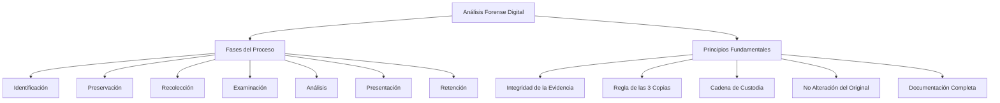
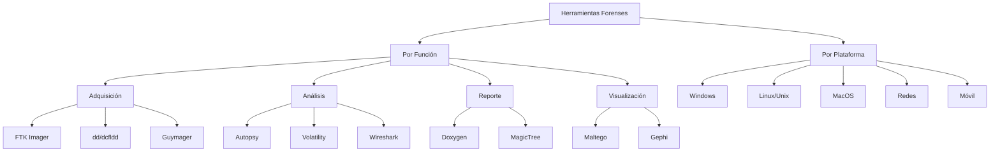
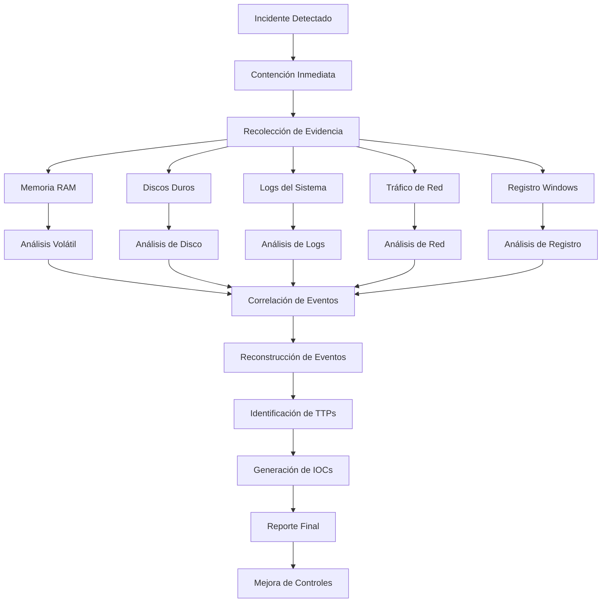
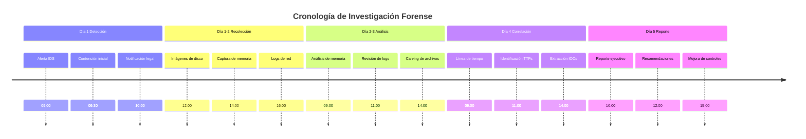

# Criptografía y Seguridad - Seguridad en redes, cortafuegos y políticas

## 9.6 Herramientas de análisis de intrusión, análisis forense.

---

El análisis de intrusiones y la informática forense son disciplinas críticas para la investigación de incidentes de seguridad. Estas herramientas y técnicas permiten identificar, analizar y responder a brechas de seguridad, así como recolectar evidencia para procesos legales.

### Marco del Análisis Forense Digital



### Cadena de Custodia y Principios Forenses

#### Modelo Matemático de Integridad de Evidencia

**Función hash forense:**

$$
H_{\text{forense}}(E) = \text{SHA256}(E) \parallel \text{timestamp} \parallel \text{investigador}
$$

**Cadena de custodia verificable:**

$$
\text{CoC} = \lbrace H(E_i), \text{stamp}_i, \text{custodio}_i, \text{firma}_i \rbrace\_{i=1}^{n}
$$

```python
class ForensicIntegrity:
    """
    Sistema de gestión de integridad forense
    """

    def __init__(self):
        import hashlib
        import time
        from datetime import datetime

        self.hash_algorithms = ['sha256', 'sha512', 'md5']
        self.chain_of_custody = []
        self.evidence_log = []

    def calculate_hashes(self, data):
        """Calcula múltiples hashes para integridad"""
        import hashlib

        hashes = {}
        for algo in self.hash_algorithms:
            if algo == 'sha256':
                hashes[algo] = hashlib.sha256(data).hexdigest()
            elif algo == 'sha512':
                hashes[algo] = hashlib.sha512(data).hexdigest()
            elif algo == 'md5':
                hashes[algo] = hashlib.md5(data).hexdigest()

        return hashes

    def create_evidence_bag(self, evidence_id, description, data, collector):
        """Crea un paquete de evidencia con metadatos completos"""
        import time
        import json
        from datetime import datetime

        # Calcular hashes
        hashes = self.calculate_hashes(data)

        # Crear metadatos
        metadata = {
            'evidence_id': evidence_id,
            'description': description,
            'timestamp': datetime.utcnow().isoformat() + 'Z',
            'collector': collector,
            'hashes': hashes,
            'size_bytes': len(data),
            'acquisition_method': 'digital',
            'device_info': {},
            'integrity_checks': []
        }

        # Crear paquete de evidencia
        evidence_package = {
            'metadata': metadata,
            'data': data.hex() if isinstance(data, bytes) else str(data),
            'signature': self._sign_metadata(metadata, collector)
        }

        # Registrar en cadena de custodia
        custody_record = {
            'action': 'COLLECTION',
            'evidence_id': evidence_id,
            'timestamp': metadata['timestamp'],
            'custodian': collector,
            'location': 'INVESTIGATION_LAB',
            'hash_chain': hashes['sha256'],
            'previous_hash': self._get_last_hash()
        }

        self.chain_of_custody.append(custody_record)
        self.evidence_log.append(evidence_package)

        return evidence_package

    def _sign_metadata(self, metadata, signer):
        """Firma digital de metadatos (simplificado)"""
        import hashlib
        import json

        metadata_str = json.dumps(metadata, sort_keys=True)
        signature_hash = hashlib.sha256(
            f"{metadata_str}{signer}".encode()
        ).hexdigest()

        return {
            'signer': signer,
            'signature': signature_hash,
            'algorithm': 'SHA256'
        }

    def _get_last_hash(self):
        """Obtiene el último hash de la cadena"""
        if self.chain_of_custody:
            return self.chain_of_custody[-1]['hash_chain']
        return '0' * 64  # Hash inicial

    def transfer_custody(self, evidence_id, from_custodian, to_custodian, reason):
        """Registra transferencia de custodia"""
        import datetime

        transfer_record = {
            'action': 'TRANSFER',
            'evidence_id': evidence_id,
            'timestamp': datetime.datetime.utcnow().isoformat() + 'Z',
            'from_custodian': from_custodian,
            'to_custodian': to_custodian,
            'reason': reason,
            'previous_hash': self._get_last_hash(),
            'hash_chain': self._calculate_transfer_hash(evidence_id, from_custodian, to_custodian)
        }

        self.chain_of_custody.append(transfer_record)
        return transfer_record

    def _calculate_transfer_hash(self, evidence_id, from_cust, to_cust):
        """Calcula hash para transferencia"""
        import hashlib

        data = f"{evidence_id}{from_cust}{to_cust}{self._get_last_hash()}"
        return hashlib.sha256(data.encode()).hexdigest()

    def verify_integrity(self, evidence_id):
        """Verifica integridad de la evidencia"""
        # Buscar evidencia
        evidence = None
        for e in self.evidence_log:
            if e['metadata']['evidence_id'] == evidence_id:
                evidence = e
                break

        if not evidence:
            return {'status': 'NOT_FOUND', 'evidence_id': evidence_id}

        # Verificar hashes
        current_data = bytes.fromhex(evidence['data']) if 'data' in evidence else ''
        recalculated_hashes = self.calculate_hashes(current_data)

        integrity_check = {
            'evidence_id': evidence_id,
            'original_hashes': evidence['metadata']['hashes'],
            'recalculated_hashes': recalculated_hashes,
            'hash_matches': {},
            'overall_integrity': True
        }

        # Comparar hashes
        for algo in self.hash_algorithms:
            original = evidence['metadata']['hashes'].get(algo, '')
            recalculated = recalculated_hashes.get(algo, '')
            matches = original == recalculated
            integrity_check['hash_matches'][algo] = matches

            if not matches:
                integrity_check['overall_integrity'] = False

        # Verificar cadena de custodia
        custody_chain = [r for r in self.chain_of_custody
                        if r['evidence_id'] == evidence_id]
        integrity_check['custody_chain_valid'] = self._validate_custody_chain(custody_chain)

        return integrity_check

    def _validate_custody_chain(self, custody_records):
        """Valida la cadena de custodia"""
        if not custody_records:
            return False

        for i in range(1, len(custody_records)):
            current = custody_records[i]
            previous = custody_records[i-1]

            if current['previous_hash'] != previous['hash_chain']:
                return False

        return True

    def generate_forensic_report(self, evidence_id):
        """Genera reporte forense completo"""
        integrity = self.verify_integrity(evidence_id)

        # Buscar evidencia
        evidence = None
        for e in self.evidence_log:
            if e['metadata']['evidence_id'] == evidence_id:
                evidence = e
                break

        report = {
            'report_id': f"FR-{evidence_id}-{datetime.datetime.now().strftime('%Y%m%d')}",
            'generation_date': datetime.datetime.utcnow().isoformat() + 'Z',
            'evidence_id': evidence_id,
            'integrity_verification': integrity,
            'metadata': evidence['metadata'] if evidence else {},
            'custody_chain': [r for r in self.chain_of_custody
                            if r['evidence_id'] == evidence_id],
            'analysis_summary': {},
            'recommendations': []
        }

        return report

# Ejemplo de uso
import datetime

forensic = ForensicIntegrity()

# Crear evidencia de ejemplo
sample_data = b"Evidencia de archivo comprometido: malware.exe"
evidence = forensic.create_evidence_bag(
    evidence_id="EVD-2024-001",
    description="Archivo ejecutable sospechoso",
    data=sample_data,
    collector="investigador1"
)

print("Evidencia creada:")
print(f"ID: {evidence['metadata']['evidence_id']}")
print(f"Hashes: {evidence['metadata']['hashes']}")

# Transferir custodia
transfer = forensic.transfer_custody(
    evidence_id="EVD-2024-001",
    from_custodian="investigador1",
    to_custodian="analista_forense",
    reason="Análisis técnico"
)

print(f"\nCustodia transferida a: {transfer['to_custodian']}")

# Verificar integridad
print("\nVerificación de integridad:")
integrity = forensic.verify_integrity("EVD-2024-001")
print(f"Integridad general: {integrity['overall_integrity']}")
for algo, match in integrity['hash_matches'].items():
    print(f"{algo}: {'✓' if match else '✗'}")
```

### Herramientas de Análisis de Intrusión

#### Taxonomía de Herramientas Forenses



#### 1. Análisis de Memoria RAM con Volatility

**Estructura de memoria:**

```python
class MemoryForensicAnalyzer:
    """
    Analizador de memoria RAM para forensia
    """

    def __init__(self, memory_dump):
        self.memory_dump = memory_dump
        self.profile = self.detect_profile()
        self.processes = []
        self.network_connections = []
        self.malware_indicators = []

    def detect_profile(self):
        """Detecta el perfil del sistema operativo"""
        # En implementación real usaría Volatility Framework
        profiles = {
            'Win7SP1x64': 'Windows 7 SP1 x64',
            'Win10x64': 'Windows 10 x64',
            'LinuxUbuntu': 'Ubuntu Linux'
        }

        # Simulación de detección
        return 'Win10x64'

    def extract_processes(self):
        """Extrae lista de procesos de memoria"""
        import struct

        # Estructura simulada de proceso
        process_template = {
            'pid': 0,
            'name': '',
            'ppid': 0,
            'start_time': '',
            'suspicious': False
        }

        # Simulación de extracción
        simulated_processes = [
            {'pid': 100, 'name': 'system', 'ppid': 0, 'suspicious': False},
            {'pid': 456, 'name': 'explorer.exe', 'ppid': 100, 'suspicious': False},
            {'pid': 1234, 'name': 'malware.exe', 'ppid': 456, 'suspicious': True},
            {'pid': 567, 'name': 'chrome.exe', 'ppid': 456, 'suspicious': False},
            {'pid': 890, 'name': 'powershell.exe', 'ppid': 456, 'suspicious': True}
        ]

        self.processes = simulated_processes
        return self.processes

    def analyze_process_tree(self):
        """Analiza el árbol de procesos"""
        process_tree = {}

        for proc in self.processes:
            pid = proc['pid']
            ppid = proc['ppid']

            if ppid not in process_tree:
                process_tree[ppid] = []
            process_tree[ppid].append(proc)

        # Identificar procesos huérfanos
        orphan_processes = []
        for proc in self.processes:
            if proc['ppid'] != 0 and proc['ppid'] not in [p['pid'] for p in self.processes]:
                orphan_processes.append(proc)

        return {
            'process_tree': process_tree,
            'orphan_processes': orphan_processes,
            'total_processes': len(self.processes),
            'suspicious_count': sum(1 for p in self.processes if p['suspicious'])
        }

    def scan_for_malware_indicators(self):
        """Escanea memoria en busca de indicadores de malware"""
        indicators = {
            'process_hollowing': [
                b'\x4D\x5A',  # MZ header in memory
                b'\x50\x45\x00\x00'  # PE header
            ],
            'code_injection': [
                b'\xE8\x00\x00\x00\x00',  # CALL instruction
                b'\x68\x00\x00\x00\x00'   # PUSH instruction
            ],
            'shellcode_patterns': [
                b'\x90\x90\x90',  # NOP sled
                b'\xCC',          # INT3 (breakpoint)
                b'\xEB\xFE'       # JMP -2 (infinite loop)
            ]
        }

        findings = []

        # Simulación de escaneo
        for category, patterns in indicators.items():
            for pattern in patterns:
                # En implementación real buscaría en memory_dump
                if pattern in b'simulated_memory_with_malware_patterns':
                    findings.append({
                        'category': category,
                        'pattern': pattern.hex(),
                        'description': self._describe_indicator(category)
                    })

        self.malware_indicators = findings
        return findings

    def _describe_indicator(self, category):
        """Describe indicadores de malware"""
        descriptions = {
            'process_hollowing': 'Técnica donde malware reemplaza código legítimo',
            'code_injection': 'Inyección de código malicioso en proceso legítimo',
            'shellcode_patterns': 'Secuencias típicas de shellcode'
        }
        return descriptions.get(category, 'Indicador desconocido')

    def extract_network_connections(self):
        """Extrae conexiones de red de memoria"""
        # Simulación de conexiones de red
        connections = [
            {'local_addr': '192.168.1.100:54321', 'remote_addr': '45.33.32.156:443',
             'state': 'ESTABLISHED', 'process': 'chrome.exe', 'suspicious': False},
            {'local_addr': '192.168.1.100:12345', 'remote_addr': '185.239.242.133:8080',
             'state': 'ESTABLISHED', 'process': 'malware.exe', 'suspicious': True},
            {'local_addr': '192.168.1.100:54322', 'remote_addr': '8.8.8.8:53',
             'state': 'ESTABLISHED', 'process': 'svchost.exe', 'suspicious': False}
        ]

        self.network_connections = connections
        return connections

    def generate_memory_analysis_report(self):
        """Genera reporte completo de análisis de memoria"""
        self.extract_processes()
        self.scan_for_malware_indicators()
        self.extract_network_connections()

        process_analysis = self.analyze_process_tree()

        report = {
            'metadata': {
                'analysis_date': datetime.datetime.now().isoformat(),
                'memory_dump_size': len(self.memory_dump) if self.memory_dump else 0,
                'os_profile': self.profile,
                'analyzer_version': '1.0'
            },
            'process_analysis': process_analysis,
            'malware_indicators': {
                'total_found': len(self.malware_indicators),
                'indicators': self.malware_indicators
            },
            'network_analysis': {
                'total_connections': len(self.network_connections),
                'suspicious_connections': [c for c in self.network_connections if c['suspicious']],
                'all_connections': self.network_connections
            },
            'findings_summary': {
                'risk_level': self._calculate_risk_level(),
                'recommended_actions': self._generate_recommendations()
            }
        }

        return report

    def _calculate_risk_level(self):
        """Calcula nivel de riesgo basado en hallazgos"""
        risk_score = 0

        # Procesos sospechosos
        risk_score += sum(1 for p in self.processes if p['suspicious']) * 10

        # Indicadores de malware
        risk_score += len(self.malware_indicators) * 20

        # Conexiones sospechosas
        risk_score += sum(1 for c in self.network_connections if c['suspicious']) * 15

        if risk_score > 50:
            return 'CRITICAL'
        elif risk_score > 25:
            return 'HIGH'
        elif risk_score > 10:
            return 'MEDIUM'
        else:
            return 'LOW'

    def _generate_recommendations(self):
        """Genera recomendaciones basadas en hallazgos"""
        recommendations = []

        if any(p['suspicious'] for p in self.processes):
            recommendations.append("Aislar sistema de la red inmediatamente")
            recommendations.append("Realizar análisis completo de disco")

        if self.malware_indicators:
            recommendations.append("Extraer y analizar muestras de malware")
            recommendations.append("Actualizar firmas de antivirus")

        suspicious_connections = [c for c in self.network_connections if c['suspicious']]
        if suspicious_connections:
            recommendations.append("Bloquear IPs maliciosas en firewall")
            recommendations.append("Notificar al equipo de respuesta a incidentes")

        if not recommendations:
            recommendations.append("Monitorear sistema por actividad inusual")

        return recommendations

# Ejemplo de uso
memory_analyzer = MemoryForensicAnalyzer(b"simulated_memory_dump_data")

print("Analizando volcado de memoria...")
report = memory_analyzer.generate_memory_analysis_report()

print(f"\nPerfil detectado: {report['metadata']['os_profile']}")
print(f"Procesos encontrados: {report['process_analysis']['total_processes']}")
print(f"Procesos sospechosos: {report['process_analysis']['suspicious_count']}")
print(f"Indicadores de malware: {report['malware_indicators']['total_found']}")
print(f"Nivel de riesgo: {report['findings_summary']['risk_level']}")

print("\nRecomendaciones:")
for i, rec in enumerate(report['findings_summary']['recommended_actions'], 1):
    print(f"{i}. {rec}")
```

#### 2. Análisis de Tráfico de Red con Wireshark/TShark

**Modelo de detección de anomalías:**

```python
class NetworkTrafficAnalyzer:
    """
    Analizador forense de tráfico de red
    """

    def __init__(self, pcap_file=None):
        self.pcap_file = pcap_file
        self.packets = []
        self.conversations = []
        self.anomalies = []

    def load_pcap(self, pcap_file):
        """Carga archivo PCAP para análisis"""
        # En implementación real usaría pyshark o scapy
        print(f"Cargando {pcap_file}...")
        self.pcap_file = pcap_file
        return True

    def analyze_traffic_patterns(self):
        """Analiza patrones de tráfico"""
        # Simulación de datos de tráfico
        traffic_stats = {
            'total_packets': 10000,
            'total_bytes': 52428800,  # 50 MB
            'time_range': '2024-01-15 10:00:00 to 2024-01-15 11:00:00',
            'protocol_distribution': {
                'TCP': 65,
                'UDP': 25,
                'ICMP': 5,
                'HTTP': 30,
                'HTTPS': 20,
                'DNS': 15,
                'Other': 5
            },
            'top_talkers': [
                {'ip': '192.168.1.100', 'bytes_sent': 10485760, 'bytes_received': 5242880},
                {'ip': '192.168.1.50', 'bytes_sent': 5242880, 'bytes_received': 1048576},
                {'ip': '8.8.8.8', 'bytes_sent': 102400, 'bytes_received': 51200}
            ]
        }

        return traffic_stats

    def detect_port_scans(self):
        """Detecta escaneos de puertos"""
        # Algoritmo de detección de port scanning
        scan_threshold = 20  # Número de puertos distintos
        time_window = 60     # Segundos

        # Simulación de detección
        detected_scans = [
            {
                'scanner_ip': '203.0.113.45',
                'target_ip': '192.168.1.100',
                'ports_scanned': 45,
                'scan_type': 'SYN Scan',
                'timestamp': '2024-01-15 10:15:30',
                'duration_seconds': 45
            }
        ]

        return detected_scans

    def detect_dos_attacks(self):
        """Detecta ataques de Denegación de Servicio"""
        # Parámetros para detección
        packet_rate_threshold = 1000  # paquetes/segundo
        syn_flood_threshold = 500     # SYN/segundo

        # Cálculo de tasa de paquetes
        traffic_stats = self.analyze_traffic_patterns()

        detected_attacks = []

        # Simulación de detección
        if traffic_stats['total_packets'] > 50000:  # Umbral alto
            detected_attacks.append({
                'attack_type': 'Volumetric DDoS',
                'target_ip': '192.168.1.100',
                'packet_rate': 1500,
                'duration': 300,
                'source_ips': ['203.0.113.{}'.format(i) for i in range(1, 101)]
            })

        return detected_attacks

    def analyze_dns_queries(self):
        """Analiza consultas DNS en busca de malware"""
        suspicious_domains = [
            'malware-c2.com',
            'exfiltration-server.net',
            'dynamic-dns-provider.org'
        ]

        dns_queries = [
            {'query': 'google.com', 'response': '142.250.185.14', 'suspicious': False},
            {'query': 'malware-c2.com', 'response': '185.239.242.133', 'suspicious': True},
            {'query': 'microsoft.com', 'response': '20.76.201.171', 'suspicious': False},
            {'query': 'exfiltration-server.net', 'response': '45.33.32.156', 'suspicious': True}
        ]

        return dns_queries

    def extract_files_from_traffic(self):
        """Extrae archivos transferidos en tráfico de red"""
        # Simulación de extracción de archivos
        extracted_files = [
            {
                'filename': 'malware.exe',
                'source_ip': '185.239.242.133',
                'destination_ip': '192.168.1.100',
                'protocol': 'HTTP',
                'size_bytes': 102400,
                'md5': 'd41d8cd98f00b204e9800998ecf8427e',
                'suspicious': True
            },
            {
                'filename': 'document.pdf',
                'source_ip': '192.168.1.100',
                'destination_ip': '203.0.113.45',
                'protocol': 'HTTPS',
                'size_bytes': 512000,
                'md5': '5d41402abc4b2a76b9719d911017c592',
                'suspicious': False
            }
        ]

        return extracted_files

    def generate_network_forensic_report(self):
        """Genera reporte forense de red"""
        traffic_stats = self.analyze_traffic_patterns()
        port_scans = self.detect_port_scans()
        dos_attacks = self.detect_dos_attacks()
        dns_analysis = self.analyze_dns_queries()
        extracted_files = self.extract_files_from_traffic()

        # Calcular métricas de seguridad
        security_score = 100

        # Penalizar por hallazgos
        if port_scans:
            security_score -= len(port_scans) * 10

        if dos_attacks:
            security_score -= len(dos_attacks) * 30

        suspicious_dns = sum(1 for dns in dns_analysis if dns['suspicious'])
        if suspicious_dns:
            security_score -= suspicious_dns * 15

        suspicious_files = sum(1 for f in extracted_files if f['suspicious'])
        if suspicious_files:
            security_score -= suspicious_files * 25

        security_score = max(0, security_score)

        report = {
            'executive_summary': {
                'analysis_period': traffic_stats['time_range'],
                'total_traffic_gb': traffic_stats['total_bytes'] / 1e9,
                'security_score': security_score,
                'critical_findings': len(dos_attacks) + suspicious_files
            },
            'traffic_analysis': traffic_stats,
            'threat_detection': {
                'port_scans': {
                    'count': len(port_scans),
                    'details': port_scans
                },
                'dos_attacks': {
                    'count': len(dos_attacks),
                    'details': dos_attacks
                }
            },
            'dns_analysis': {
                'total_queries': len(dns_analysis),
                'suspicious_queries': suspicious_dns,
                'suspicious_domains': [d['query'] for d in dns_analysis if d['suspicious']]
            },
            'file_extraction': {
                'total_files': len(extracted_files),
                'suspicious_files': suspicious_files,
                'files': extracted_files
            },
            'timeline_analysis': self.generate_timeline(),
            'recommendations': self.generate_network_recommendations(
                port_scans, dos_attacks, suspicious_dns, suspicious_files
            )
        }

        return report

    def generate_timeline(self):
        """Genera línea de tiempo de eventos"""
        timeline = [
            {'timestamp': '2024-01-15 10:00:00', 'event': 'Inicio de captura'},
            {'timestamp': '2024-01-15 10:15:30', 'event': 'Port scan detectado'},
            {'timestamp': '2024-01-15 10:30:00', 'event': 'Descarga de malware.exe'},
            {'timestamp': '2024-01-15 10:45:00', 'event': 'Ataque DDoS iniciado'},
            {'timestamp': '2024-01-15 11:00:00', 'event': 'Fin de captura'}
        ]

        return timeline

    def generate_network_recommendations(self, port_scans, dos_attacks, suspicious_dns, suspicious_files):
        """Genera recomendaciones de seguridad"""
        recommendations = []

        if port_scans:
            recommendations.append("Implementar rate limiting en firewall")
            recommendations.append("Configurar IDS/IPS para detección de scans")

        if dos_attacks:
            recommendations.append("Implementar protección DDoS con proveedor de nube")
            recommendations.append("Configurar límites de conexión por IP")

        if suspicious_dns:
            recommendations.append("Bloquear dominios maliciosos en DNS")
            recommendations.append("Implementar DNS filtering")

        if suspicious_files:
            recommendations.append("Mejorar filtrado de archivos en gateway")
            recommendations.append("Implementar sandboxing para archivos sospechosos")

        # Recomendaciones generales
        recommendations.append("Implementar segmentación de red")
        recommendations.append("Actualizar firmas de IDS/IPS")
        recommendations.append("Monitorear tráfico de salida para exfiltración")

        return recommendations

# Ejemplo de uso
network_analyzer = NetworkTrafficAnalyzer()
network_analyzer.load_pcap("captura_incidente.pcap")

print("Analizando tráfico de red...")
report = network_analyzer.generate_network_forensic_report()

print(f"\n=== RESUMEN EJECUTIVO ===")
print(f"Período: {report['executive_summary']['analysis_period']}")
print(f"Tráfico total: {report['executive_summary']['total_traffic_gb']:.2f} GB")
print(f"Puntuación de seguridad: {report['executive_summary']['security_score']}/100")
print(f"Hallazgos críticos: {report['executive_summary']['critical_findings']}")

print(f"\n=== DETECCIÓN DE AMENAZAS ===")
print(f"Escaneos de puertos: {report['threat_detection']['port_scans']['count']}")
print(f"Ataques DDoS: {report['threat_detection']['dos_attacks']['count']}")
print(f"Consultas DNS sospechosas: {report['dns_analysis']['suspicious_queries']}")
print(f"Archivos sospechosos: {report['file_extraction']['suspicious_files']}")

print(f"\n=== RECOMENDACIONES ===")
for i, rec in enumerate(report['recommendations'][:5], 1):
    print(f"{i}. {rec}")
```

### Análisis Forense de Discos

#### Herramientas y Técnicas

```python
class DiskForensicAnalyzer:
    """
    Analizador forense de discos
    """

    def __init__(self, disk_image):
        self.disk_image = disk_image
        self.file_system = self.detect_filesystem()
        self.deleted_files = []
        self.timeline = []

    def detect_filesystem(self):
        """Detecta el sistema de archivos"""
        filesystems = {
            b'\xEB\x3C\x90': 'FAT32',
            b'\x33\xC0\x8E': 'NTFS',
            b'\x53\xEF': 'EXT4',
            b'\x28\x43\x29': 'HFS+'
        }

        # Simulación de detección
        return 'NTFS'

    def recover_deleted_files(self):
        """Recupera archivos eliminados"""
        # Técnicas de recuperación:
        # 1. Análisis de entradas FAT/MFT
        # 2. Carving de archivos por firmas
        # 3. Análisis de espacio no asignado

        file_signatures = {
            'PDF': b'\x25\x50\x44\x46',
            'JPG': b'\xFF\xD8\xFF',
            'PNG': b'\x89\x50\x4E\x47',
            'EXE': b'\x4D\x5A',
            'ZIP': b'\x50\x4B\x03\x04'
        }

        recovered_files = [
            {
                'filename': 'confidential.pdf',
                'original_path': '/Users/victim/Documents/',
                'size_bytes': 1048576,
                'deletion_time': '2024-01-15 10:30:00',
                'recovery_method': 'MFT Analysis',
                'content_preview': 'Contract details...',
                'sensitive': True
            },
            {
                'filename': 'malware.exe',
                'original_path': '/Downloads/',
                'size_bytes': 524288,
                'deletion_time': '2024-01-15 10:25:00',
                'recovery_method': 'File Carving',
                'content_preview': 'MZ...PE...',
                'sensitive': False
            }
        ]

        self.deleted_files = recovered_files
        return recovered_files

    def analyze_file_system_timeline(self):
        """Analiza línea de tiempo del sistema de archivos"""
        # MAC Times: Modified, Accessed, Changed
        timeline_events = []

        # Simulación de eventos
        events = [
            {'timestamp': '2024-01-15 09:00:00', 'event': 'System boot', 'type': 'System'},
            {'timestamp': '2024-01-15 09:15:00', 'event': 'User login', 'type': 'Authentication'},
            {'timestamp': '2024-01-15 09:30:00', 'event': 'File downloaded: malware.exe', 'type': 'File Activity'},
            {'timestamp': '2024-01-15 09:45:00', 'event': 'Registry modification', 'type': 'System'},
            {'timestamp': '2024-01-15 10:00:00', 'event': 'Network connection to C2', 'type': 'Network'},
            {'timestamp': '2024-01-15 10:15:00', 'event': 'File deleted: confidential.pdf', 'type': 'File Activity'}
        ]

        self.timeline = events
        return events

    def search_keywords(self, keywords):
        """Busca keywords en el disco"""
        import re

        findings = []

        for keyword in keywords:
            # Simulación de búsqueda
            if keyword.lower() in ['password', 'secret', 'confidential']:
                findings.append({
                    'keyword': keyword,
                    'locations': [
                        {'path': '/Users/victim/Documents/passwords.txt', 'context': 'admin:password123'},
                        {'path': '/Windows/System32/config/SAM', 'context': 'Hash storage'}
                    ],
                    'count': 2
                })

        return findings

    def extract_registry_artifacts(self):
        """Extrae artefactos del registro de Windows"""
        registry_artifacts = {
            'autorun_locations': [
                'HKLM\\Software\\Microsoft\\Windows\\CurrentVersion\\Run',
                'HKCU\\Software\\Microsoft\\Windows\\CurrentVersion\\Run'
            ],
            'recent_docs': 'HKCU\\Software\\Microsoft\\Windows\\CurrentVersion\\Explorer\\RecentDocs',
            'user_assist': 'HKCU\\Software\\Microsoft\\Windows\\CurrentVersion\\Explorer\\UserAssist',
            'browser_history': [
                'HKCU\\Software\\Microsoft\\Internet Explorer\\TypedURLs',
                'HKCU\\Software\\Microsoft\\Windows\\CurrentVersion\\Explorer\\RunMRU'
            ]
        }

        # Simulación de extracción
        extracted_data = [
            {
                'registry_key': 'HKLM\\Software\\Microsoft\\Windows\\CurrentVersion\\Run',
                'value_name': 'Malware',
                'value_data': 'C:\\Windows\\System32\\malware.exe',
                'last_modified': '2024-01-15 09:35:00'
            }
        ]

        return extracted_data

    def calculate_entropy(self, data):
        """Calcula entropía para detectar archivos encriptados"""
        import math
        from collections import Counter

        if not data:
            return 0

        counter = Counter(data)
        entropy = 0
        total = len(data)

        for count in counter.values():
            probability = count / total
            entropy -= probability * math.log2(probability)

        return entropy

    def detect_encrypted_files(self, entropy_threshold=7.0):
        """Detecta archivos encriptados por alta entropía"""
        high_entropy_files = []

        # Simulación de detección
        files_to_check = [
            {'path': '/Users/victim/Documents/encrypted.enc', 'entropy': 7.8},
            {'path': '/Users/victim/Pictures/normal.jpg', 'entropy': 5.2},
            {'path': '/tmp/ransomware_file', 'entropy': 7.9}
        ]

        for file_info in files_to_check:
            if file_info['entropy'] > entropy_threshold:
                high_entropy_files.append({
                    'path': file_info['path'],
                    'entropy': file_info['entropy'],
                    'suspicious': True,
                    'possible_encryption': True
                })

        return high_entropy_files

    def generate_disk_forensic_report(self):
        """Genera reporte forense de disco"""
        deleted_files = self.recover_deleted_files()
        timeline = self.analyze_file_system_timeline()
        registry_artifacts = self.extract_registry_artifacts()
        encrypted_files = self.detect_encrypted_files()

        # Análisis de keywords
        sensitive_keywords = ['password', 'secret', 'credit', 'card', 'ssn']
        keyword_findings = self.search_keywords(sensitive_keywords)

        report = {
            'disk_information': {
                'filesystem': self.file_system,
                'image_size_gb': len(self.disk_image) / 1e9 if self.disk_image else 0
            },
            'file_recovery': {
                'total_recovered': len(deleted_files),
                'sensitive_files': sum(1 for f in deleted_files if f['sensitive']),
                'files': deleted_files
            },
            'timeline_analysis': {
                'total_events': len(timeline),
                'critical_events': [e for e in timeline if e['type'] in ['File Activity', 'Network']],
                'timeline': timeline
            },
            'registry_analysis': {
                'artifacts_found': len(registry_artifacts),
                'malicious_entries': [a for a in registry_artifacts if 'Malware' in a['value_name']],
                'details': registry_artifacts
            },
            'encryption_analysis': {
                'high_entropy_files': len(encrypted_files),
                'files': encrypted_files
            },
            'keyword_analysis': {
                'keywords_searched': sensitive_keywords,
                'total_matches': sum(f['count'] for f in keyword_findings),
                'findings': keyword_findings
            },
            'forensic_conclusions': self.generate_conclusions(
                deleted_files, registry_artifacts, encrypted_files
            )
        }

        return report

    def generate_conclusions(self, deleted_files, registry_artifacts, encrypted_files):
        """Genera conclusiones forenses"""
        conclusions = []

        if any(f['sensitive'] for f in deleted_files):
            conclusions.append("EVIDENCIA DE DESTRUCCIÓN DE PRUEBAS: Archivos sensibles eliminados")

        if any('Malware' in a['value_name'] for a in registry_artifacts):
            conclusions.append("EVIDENCIA DE MALWARE: Entradas de auto-ejecución maliciosas")

        if encrypted_files:
            conclusions.append("POSIBLE RANSOMWARE: Archivos con alta entropía detectados")

        if not conclusions:
            conclusions.append("No se encontraron evidencias concluyentes de actividad maliciosa")

        return conclusions

# Ejemplo de uso
disk_analyzer = DiskForensicAnalyzer(b"disk_image_data")

print("Analizando imagen de disco...")
report = disk_analyzer.generate_disk_forensic_report()

print(f"\nSistema de archivos: {report['disk_information']['filesystem']}")
print(f"Archivos recuperados: {report['file_recovery']['total_recovered']}")
print(f"Archivos sensibles: {report['file_recovery']['sensitive_files']}")
print(f"Eventos en línea de tiempo: {report['timeline_analysis']['total_events']}")
print(f"Archivos encriptados sospechosos: {report['encryption_analysis']['high_entropy_files']}")

print(f"\n=== CONCLUSIONES FORENSES ===")
for conclusion in report['forensic_conclusions']:
    print(f"• {conclusion}")
```

### Ejercicios Propuestos

#### Ejercicio 1: Implementación de Carving de Archivos

Implemente un algoritmo de file carving que:

1. Detecte firmas de archivos comunes (PDF, JPG, DOCX)
2. Recupere archivos fragmentados
3. Valide integridad con hashes
4. Genere reporte de recuperación

**Fórmula de validación:**

$$
\text{Confianza} = \frac{\text{fragmentos\\\_encontrados}}{\text{fragmentos\\\_esperados}} \times \text{factor\\\_integridad}
$$

#### Ejercicio 2: Análisis de Logs de Sistema

Desarrolle un analizador de logs que:

1. Parse logs de Apache, Windows Event Log, y auth.log
2. Detecte patrones de ataques
3. Correlacione eventos entre sistemas
4. Genere línea de tiempo de ataque

#### Ejercicio 3: Herramienta de Análisis de Malware

Cree una herramienta que:

1. Realice análisis estático (strings, entropía, imports)
2. Ejecute en sandbox controlado
3. Extraiga indicadores de compromiso (IOCs)
4. Genere reporte YARA

### Metodología de Análisis Forense

#### Modelo de Investigación



### Herramientas Especializadas

#### Suite de Herramientas Forenses

```python
class ForensicToolkit:
    """
    Suite integrada de herramientas forenses
    """

    tools = {
        'memory_analysis': ['Volatility', 'Rekall', 'LiME'],
        'disk_analysis': ['FTK', 'EnCase', 'Autopsy', 'Sleuth Kit'],
        'network_analysis': ['Wireshark', 'NetworkMiner', 'Xplico'],
        'mobile_forensics': ['Cellebrite', 'Oxygen', 'Mobiledit'],
        'malware_analysis': ['IDA Pro', 'Ghidra', 'Cuckoo Sandbox'],
        'log_analysis': ['Splunk', 'ELK Stack', 'Graylog'],
        'password_recovery': ['John the Ripper', 'Hashcat', 'Ophcrack']
    }

    @staticmethod
    def recommend_tools(scenario):
        """Recomienda herramientas según escenario"""
        recommendations = {
            'data_breach': ['Wireshark', 'Splunk', 'Volatility', 'FTK'],
            'malware_infection': ['IDA Pro', 'Cuckoo Sandbox', 'Volatility', 'Autopsy'],
            'insider_threat': ['EnCase', 'Splunk', 'John the Ripper', 'NetworkMiner'],
            'ddos_attack': ['Wireshark', 'Splunk', 'NetworkMiner'],
            'ransomware': ['FTK', 'Volatility', 'Hashcat', 'IDA Pro']
        }

        return recommendations.get(scenario, ['Autopsy', 'Wireshark', 'Volatility'])

    @staticmethod
    def generate_analysis_workflow(incident_type):
        """Genera flujo de trabajo de análisis"""
        workflows = {
            'malware': [
                '1. Aislar sistema de red',
                '2. Capturar memoria RAM',
                '3. Crear imagen de disco',
                '4. Análisis estático de malware',
                '5. Análisis dinámico en sandbox',
                '6. Extraer IOCs',
                '7. Actualizar defensas'
            ],
            'data_exfiltration': [
                '1. Identificar vector de exfiltración',
                '2. Analizar logs de red',
                '3. Revisar proxies y firewalls',
                '4. Buscar archivos temporales',
                '5. Analizar registros de aplicaciones',
                '6. Determinar alcance',
                '7. Notificar partes afectadas'
            ]
        }

        return workflows.get(incident_type, [])
```

### Referencias Bibliográficas

#### Bibliografía Básica:

1. **Stallings, William** (2010). _Cryptography and Network Security: Principles and Practice_, 5a Ed.
   - Capítulo 8: "Intrusion Detection"
   - Capítulo 20: "Network Security Management"

2. **Forouzan, Behrouz A.** (2008). _Cryptography and Network Security_
   - Capítulo 31: "Intrusion Detection Systems"
   - Capítulo 33: "Computer Forensics"

3. **Pfleeger, C.P. & Pfleeger, S.L.** (2006). _Security in Computing_, 4a Ed.
   - Capítulo 7: "Database Security"
   - Capítulo 8: "Management of Security"

#### Bibliografía Complementaria:

1. **Stallings, William** (2010). _Network Security Essentials_
   - Capítulo 9: "Intrusion Detection"

2. **Carrier, B.** (2005). _File System Forensic Analysis_
3. **Casey, E.** (2011). _Digital Evidence and Computer Crime_
4. **NIST SP 800-86** - Guide to Integrating Forensic Techniques into Incident Response

### Marco Legal y Ético

#### Consideraciones Legales:

1. **Cadena de custodia** - Registro completo de manejo de evidencia
2. **Consentimiento** - Autorización para análisis
3. **Privacidad** - Respeto a datos personales
4. **Jurisdicción** - Leyes aplicables según ubicación

#### Principios Éticos:

```python
class ForensicEthics:
    """Marco ético para análisis forense"""

    principles = [
        "1. No causar daño adicional",
        "2. Preservar integridad de evidencia",
        "3. Documentar completamente",
        "4. Mantener confidencialidad",
        "5. Testificar honestamente",
        "6. Reconocer limitaciones",
        "7. Mantener competencia técnica",
        "8. Respetar privacidad"
    ]

    @staticmethod
    def check_legality(action, jurisdiction):
        """Verifica legalidad de acción forense"""
        legal_requirements = {
            'memory_capture': ['consent', 'warrant', 'company_policy'],
            'disk_imaging': ['consent', 'warrant', 'preservation_order'],
            'network_monitoring': ['consent', 'warrant', 'service_agreement']
        }

        return legal_requirements.get(action, [])
```

### Caso de Estudio Completo

#### Escenario: Brecha de Datos en Empresa

**Fases de Investigación:**



### Evaluación de Conocimientos

#### Preguntas Teóricas:

1. Explique la regla de las 3 copias en forensia digital
2. Describa la importancia de la cadena de custodia
3. Compare análisis estático vs dinámico de malware
4. ¿Qué son los IOCs y cómo se usan?
5. Explique diferencias entre forensia proactiva y reactiva

#### Problemas Prácticos:

1. Diseñe procedimiento para investigación de ransomware
2. Implemente verificador de integridad de evidencia
3. Analice PCAP en busca de exfiltración de datos
4. Recupere archivos eliminados de imagen de disco

#### Proyecto Final:

Desarrollar laboratorio forense virtual que incluya:

1. Herramientas de adquisición de evidencia
2. Análisis de memoria y disco
3. Sistema de correlación de eventos
4. Generador automático de reportes
5. Base de datos de IOCs

---

**Nota:** El análisis forense requiere rigor científico, ética profesional y conocimiento técnico profundo. Siempre seguir procedimientos documentados, mantener cadena de custodia y trabajar dentro del marco legal aplicable. La evidencia digital es frágil y debe manejarse con extremo cuidado para preservar su valor probatorio.
